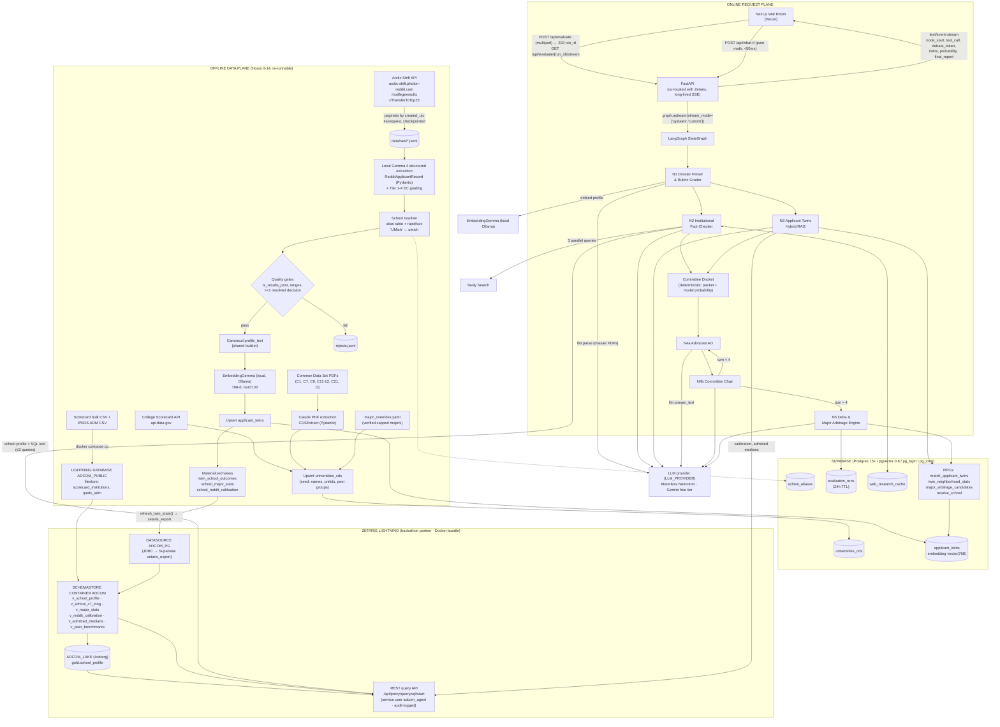
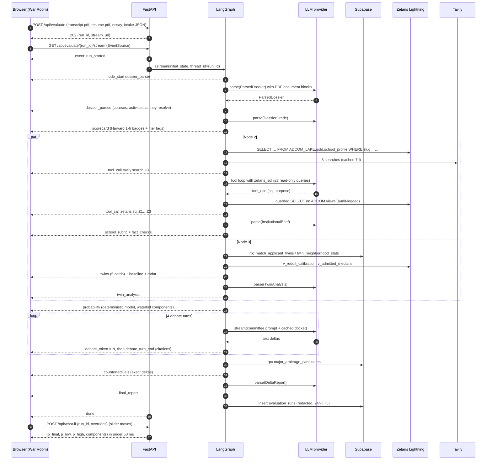
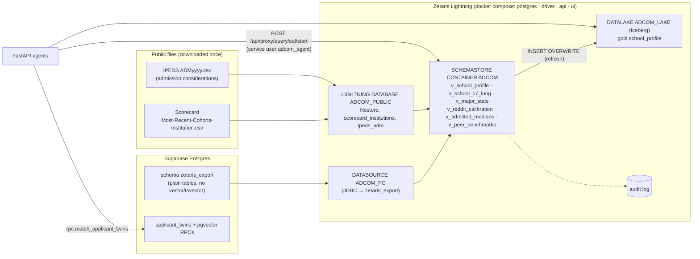
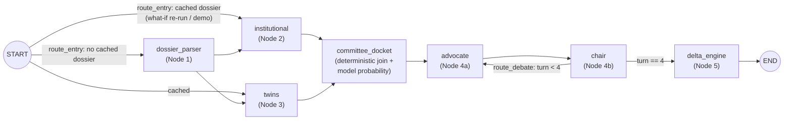

# AdCom — Autonomous Multi-Agent Admissions Committee Simulator

> Master implementation plan for a 36–48 hour hackathon build.
> **Part I:** Sections 1–3 (architecture, data, agents). **Part II:** Sections 4–7 (FastAPI streaming, War Room UI, 36-hour schedule, pitch).

---

## Table of Contents

- [0. Conventions, Assumptions & Repo Layout](#0-conventions-assumptions--repo-layout)
- [1. System Architecture & Tech Stack](#1-system-architecture--tech-stack)
- [2. Data Ingestion Pipeline & Database Schema](#2-data-ingestion-pipeline--database-schema)
- [3. Multi-Agent LangGraph Workflow & System Prompts](#3-multi-agent-langgraph-workflow--system-prompts)
- [4. FastAPI Backend & Streaming Specification](#4-fastapi-backend--streaming-specification)
- [5. Frontend UI/UX & Component Architecture](#5-frontend-uiux--component-architecture)
- [6. Hour-by-Hour Execution Schedule](#6-hour-by-hour-execution-schedule-36-hours-34-devs)
- [7. The 3-Minute Judging Pitch & Demo Script](#7-the-3-minute-judging-pitch--demo-script)

---

## 0. Conventions, Assumptions & Repo Layout

### 0.1 Design principles (these decide every judging Q&A)

1. **Math decides, LLMs judge and explain.** The admit probability comes from a deterministic, inspectable model: school base rate → C7-weighted rubric shifts → Bayesian update on applicant-twin outcomes. LLMs extract, grade, debate and advise, but **no LLM ever writes a probability number**. Every percentage on screen traces back to a formula and a SQL query.
2. **Every claim cites.** Debate messages carry inline citation tokens (`[[cds:c7.essay]]`, `[[twin:3]]`, `[[web:W2]]`). A validator checks them against the docket, and the UI renders them as clickable chips. If a citation can't be resolved, the UI shows it as unverified.
3. **Stream everything.** The first byte reaches the screen in under 2 s. Every node emits progress, tool-call and partial-result events, so the user never sees a bare spinner.
4. **Precompute the expensive parts, cache the rest.** Reddit extraction, embeddings and CDS parsing all happen offline. Prompt caching covers system prompts and the shared debate docket. Tavily results are cached for 7 days. Demo mode can replay a recorded event log if the venue Wi-Fi dies.
5. **One governed data plane: Zetaris Lightning** (hackathon partner). Every institutional fact and cross-source statistic the agents use is a federated SQL query through Zetaris (College Scorecard + IPEDS files read in place, Supabase over JDBC, an Iceberg gold layer). It runs as a least-privilege service user, every query is audit-logged, and each one surfaces in the debate as a `[[sql:Z#]]` citation that shows its exact SQL (§2.10).
6. **Privacy by construction.** We never store the raw PDF. PII is stripped before anything persists. Evaluation runs auto-expire after 24 h. Race/ethnicity is excluded from embeddings, from the probability model and from the context the LLM sees.

### 0.2 Model & provider choices

| Purpose | Provider / model | Notes |
|---|---|---|
| **Primary model provider for the live agents (hackathon partner)** | **Meterless Nightshift** (Meterless Runtime, OpenAI-compatible API at `METERLESS_BASE_URL`), model route `meterless/auto`, with at least one **NVIDIA Nemotron** lane | The default `LLM_PROVIDER`. NVIDIA's key lives only in Nightshift's Providers tab, never in our `.env`. Contract, switch and evidence: §1.7. |
| **Meterless Engine (hackathon partner)** | **World Model**: event-sourced shared state for the committee agents | Implemented as a TypeScript sidecar that passes the upstream conformance suite (§1.7.3). |
| **Free alternative for the live agents** (`LLM_PROVIDER=gemini`) | Google **Gemini API free tier** through its OpenAI-compatible endpoint: `GEMINI_MODEL` for medium/high effort and `GEMINI_FAST_MODEL` for low effort, both `gemini-3.5-flash-lite` by default (D-049) | $0: the key comes from Google AI Studio in a Cloud project with no billing account, so going over quota returns 429 instead of a charge. Google may use free-tier prompts to improve its products. When the main model is overloaded (503), calls move to the fast model (D-048). Shares `app/openai_compat.py` with Meterless (§1.7.2, D-046). |
| All reasoning nodes when `LLM_PROVIDER=anthropic` (kept, off by default) | Anthropic `claude-opus-5-5` | Paid, so it stays unused without explicit team consensus (AGENTS.md §4, D-046), and the API refuses it unless `ALLOW_PAID_PROVIDERS=true`. Effort is set per node (see §1.5). Thinking is always on for this model and is controlled only by `output_config.effort`. |
| Structured outputs (`anthropic` path; OpenAI-compatible path in §1.7.2) | `client.beta.messages.parse(..., output_format=PydanticModel)` | The result is validated into the Pydantic model and read from `.parsed_output`. |
| Refusal safety net (`anthropic` path) | `fallbacks="default"` + beta `server-side-fallback-2026-07-01` | If a safety classifier declines a request, it is re-run server-side on Anthropic's recommended fallback model. It's enabled in the shared `llm.py` wrapper and is a one-line removal if you don't want it. |
| Offline Reddit extraction | Local **Gemma 4 E2B** (`ETL_MODEL=gemma4:e2b`) served by Ollama on this machine | Free and offline. Structured output goes through Ollama's `format` JSON-schema constraint (`app/local_llm.py::chat_structured`). Quality tradeoff in §2.9.11. CDS PDF extraction (A10) uses the same local runtime through `CDS_MODEL` (default `gemma4:e2b`). |
| Embeddings (768-d) | Local **EmbeddingGemma 300M** (`EMBEDDING_MODEL=embeddinggemma`) via Ollama `/api/embed` | Free and offline; no embeddings API key. 768-d, so the schema uses `vector(768)`. Twins and live applicants are both embedded with the "sentence similarity" task prefix so they share one space. |
| Live web research | Tavily (`AsyncTavilyClient`) | Results are cached in Postgres. If Tavily is down, Node 2 degrades to DB-only. |
| **Data fabric (hackathon partner)** | **Zetaris Lightning 2.4.3** (local Docker bundle in `zetaris-platform/`) | The federated query engine, semantic views, Iceberg gold table, RBAC and audit log. Agents query it over its REST API (§2.10). pgvector stays in Supabase for sub-50 ms KNN. |

### 0.3 Environment variables (`.env`)

```bash
# LLM / embeddings / search
ANTHROPIC_API_KEY=sk-ant-...     # paid: leave unset unless the team agrees to use Claude (AGENTS.md §4, D-046)
TAVILY_API_KEY=tvly-...

# Supabase (backend uses the service-role key; never ship it to the browser)
SUPABASE_URL=https://<project>.supabase.co
SUPABASE_SERVICE_ROLE_KEY=eyJ...

# Public datasets
SCORECARD_API_KEY=...            # free key from api.data.gov (seeds names/unitids; the bulk CSV goes to Zetaris)

# Zetaris Lightning (hackathon partner platform, §2.10)
ZETARIS_URL=http://localhost:3000                # UI API proxy (same route verify.sh uses); http://ui:3000 inside compose
ZETARIS_AGENT_EMAIL=adcom-agent@adcom.local      # least-privilege service user created by zetaris/sql/04_security.sql
ZETARIS_AGENT_PASSWORD=...
ZETARIS_ADMIN_EMAIL=admin@zetaris.com            # setup scripts only
ZETARIS_ADMIN_PASSWORD=...                       # the password you changed it to after first sign-in
ZETARIS_PG_USER=zetaris_reader.<project-ref>     # Supabase session-pooler user for the JDBC datasource
ZETARIS_PG_PASSWORD=...
SUPABASE_POOLER_HOST=aws-0-<region>.pooler.supabase.com
ZETARIS_ENABLED=true                             # false → pure-Supabase fallback mode

# Meterless Nightshift (hackathon partner, §1.7). The values come from Nightshift's Console, top right.
# The NVIDIA API key does NOT go here: it is entered in Nightshift's Setup > Providers tab.
LLM_PROVIDER=meterless                          # meterless | gemini (free alternative) | anthropic (paid, off)
METERLESS_BASE_URL=http://127.0.0.1:8088/v1     # the Console's address; use the reachable URL if Nightshift is on another machine
METERLESS_RUNTIME_TOKEN=...                     # the Console's Runtime API key; never the NVIDIA key, never the placeholder rt-local
METERLESS_MODEL=meterless/auto                  # a routing mode, not an NVIDIA model id; pin a Nemotron lane for award evidence

# Gemini free tier (alternative provider, §1.7.2, D-046). Same OpenAI-compatible client as Meterless.
GEMINI_API_KEY=...                              # Google AI Studio, from a Cloud project with NO billing account (free tier only)
GEMINI_MODEL=gemini-3.5-flash-lite              # extraction, grading, briefs, delta (effort medium/high); see D-049
GEMINI_FAST_MODEL=gemini-3.5-flash-lite         # debate turns and the Zetaris SQL loop (effort low)
ALLOW_PAID_PROVIDERS=false                      # must be true before LLM_PROVIDER=anthropic will start
MAX_RUNS_PER_DAY=30                             # Flash Lite free tier: 500 requests/day ÷ 9–13 per evaluation, with headroom
MAX_CONCURRENT_RUNS=2                           # two evaluations stay near Flash Lite's 15 requests/minute

# World Model sidecar (§1.7.3): cd services/world-model && npm start. Empty → the docket comes from run state only.
WORLD_MODEL_URL=http://127.0.0.1:8790

# Tunables
REASONING_MODEL=claude-opus-5-5
ETL_MODEL=gemma4:e2b             # local Reddit extraction model (Ollama)
CDS_MODEL=gemma4:e2b             # local CDS PDF extraction (A10); try gemma4:e4b if C7 gets misread
EMBEDDING_MODEL=embeddinggemma   # local embedding model (Ollama), 768-d
OLLAMA_URL=http://localhost:11434
DEMO_MODE=false                  # true → replay recorded event logs (Part II, §4)
```

### 0.4 Monorepo layout

```
adcom/
├── apps/
│   └── web/                          # Next.js App Router (Part II, §5)
├── services/
│   ├── world-model/                  # Meterless World Model engine (TypeScript, passes the upstream conformance suite)
│   └── api/
│       ├── pyproject.toml
│       ├── app/
│       │   ├── main.py               # FastAPI app + SSE routes (Part II, §4)
│       │   ├── config.py             # pydantic-settings
│       │   ├── llm.py                # LLM doorway: parse / stream_text / chat_with_tools, dispatching on LLM_PROVIDER (Anthropic code here; Meterless and Gemini via openai_compat.py)
│       │   ├── openai_compat.py      # OpenAI-compatible client, Meterless and Gemini profiles: chat, structured output, streaming, tools (§1.7.2)
│       │   ├── world_model.py        # Python client for the World Model sidecar (§1.7.3)
│       │   ├── embeddings.py         # local EmbeddingGemma 768-d embeddings (Ollama)
│       │   ├── db.py                 # Supabase async client + RPC helpers
│       │   ├── web_research.py       # Tavily + Postgres cache
│       │   ├── zetaris.py            # Zetaris Lightning REST client (login, query)
│       │   ├── zetaris_repo.py       # typed reads from the ADCOM views + guarded agent SQL
│       │   ├── profile_text.py       # canonical profile string (shared by ETL + live applicant)
│       │   ├── schemas/
│       │   │   ├── common.py  dossier.py  institution.py  twins.py  debate.py  delta.py  inputs.py
│       │   ├── scoring/
│       │   │   ├── metrics.py        # GPA normalization, rigor, proxy ratings (deterministic)
│       │   │   ├── rubric.py         # C7 → pillar weights, hook effects, major multiplier
│       │   │   ├── probability.py    # logit model + Beta-binomial twin update
│       │   │   └── counterfactuals.py
│       │   └── agents/
│       │       ├── state.py          # AdComState TypedDict
│       │       ├── events.py         # custom stream events
│       │       ├── docket.py         # committee docket builder + citation validator
│       │       ├── graph.py          # StateGraph assembly
│       │       ├── zetaris_tool.py   # Node 2's bounded Zetaris SQL tool loop
│       │       ├── prompts/
│       │       │   ├── rubrics.py  dossier.py  institutional.py  twins.py  committee.py  delta.py
│       │       └── nodes/
│       │           ├── dossier_parser.py  institutional.py  twins.py  debate.py  delta_engine.py
│       ├── etl/
│       │   ├── common.py  reddit_archive.py  reddit_schema.py  prompts.py  school_resolver.py
│       │   ├── extract_reddit.py  load_twins.py  load_scorecard.py  load_cds.py
│       │   ├── refresh_stats.py  fit_coefficients.py  zetaris_setup.py  run_etl.py
│       └── scripts/
│           └── run_graph_cli.py      # run a full evaluation in the terminal
├── supabase/
│   └── migrations/
│       ├── 0001_extensions_types.sql
│       ├── 0002_universities.sql
│       ├── 0003_applicant_twins.sql
│       ├── 0004_stats_views.sql
│       ├── 0005_runtime_tables.sql
│       ├── 0006_rpc.sql
│       ├── 0007_rls_cron.sql
│       ├── 0008_radar.sql
│       └── 0009_zetaris_export.sql
├── zetaris/
│   └── sql/                          # Lightning SQL: 01_sources 02_views 03_gold 04_security (§2.10.4)
├── zetaris-platform/                 # the Zetaris Docker bundle (gitignored: holds .env secrets + JDBC jar)
└── data/
    ├── schools_seed.csv              # curated unitid → slug, peer group, aliases
    ├── school_aliases.yaml           # Reddit abbreviations ("CMU", "UMich", "Cal")
    ├── cds_sources.yaml              # slug → CDS PDF URL (collected by hand)
    ├── major_overrides.yaml          # verified capped/direct-admit majors
    ├── raw/                          # Arctic Shift JSONL (gitignored)
    ├── processed/                    # extracted twins JSONL (gitignored)
    ├── public/                       # Scorecard + IPEDS bulk CSVs copied into Zetaris (gitignored)
    └── demo_dossiers/                # 3 golden demo applicants
```

### 0.5 Python dependencies (`services/api/pyproject.toml`)

```toml
[project]
name = "adcom-api"
version = "0.1.0"
requires-python = ">=3.12"   # 3.11+ required for LangGraph's async get_stream_writer() context propagation
dependencies = [
  "fastapi",
  "uvicorn[standard]",
  "sse-starlette",
  "python-multipart",
  "langgraph>=1.0",
  "anthropic",               # pin exact version at Hour 0 with `uv lock`
  "supabase",
  "tavily-python",
  "pydantic>=2.7",
  "pydantic-settings",
  "httpx",
  "orjson",
  "rapidfuzz",
  "pypdf",
  "pyyaml",
  "numpy",
  "scipy",
  "statsmodels",             # offline coefficient fitting only
]
```

---

## 1. System Architecture & Tech Stack

### 1.1 End-to-end architecture



### 1.2 One evaluation, start to finish



### 1.3 Tech stack

| Layer | Choice | Why it wins a hackathon |
|---|---|---|
| **Frontend framework** | Next.js 15+ (App Router), TypeScript, React Server Components for the shell and client components for the War Room | One `pnpm create next-app`. Vercel deploys on `git push`. |
| **Styling / components** | Tailwind CSS v4 + shadcn/ui (Card, Badge, Tabs, Slider, Sheet, Tooltip, ScrollArea, Progress) | Polished, accessible defaults in minutes. You own the component code. |
| **Motion** | Framer Motion (`AnimatePresence`, `layout`, spring gauges) | Debate bubbles, twin-card flips and gauge sweeps make the demo memorable. |
| **Charts** | Recharts: `RadarChart` (6 axes), `RadialBarChart` (probability gauge), `BarChart` (waterfall) | Declarative and fast to theme. |
| **Client state** | Zustand store keyed by `run_id`, fed by an SSE reducer | No prop drilling. Event replay just re-feeds the reducer. |
| **SSE client** | Native `EventSource` on `GET /api/evaluate/{run_id}/stream` | `POST /api/evaluate` only *creates* the run (multipart upload → `202 {run_id}`). The stream is a plain GET, so the browser reconnects automatically with `Last-Event-ID` and never re-submits the application (§4.1). |
| **Upload** | `react-dropzone` | Drag-and-drop for PDFs. |
| **Backend** | Python 3.12, FastAPI, `sse-starlette` (`EventSourceResponse`), uvicorn | Async-native and Pydantic end to end. SSE is simpler than WebSockets for one-way streaming. |
| **Agent orchestration** | LangGraph ≥ 1.0 `StateGraph`: parallel fan-out/fan-in, a debate cycle, `get_stream_writer()` custom events, `InMemorySaver` checkpointer, per-node `RetryPolicy` | Real stateful graph semantics (cycles, joins, retries) with first-class streaming. |
| **LLM SDK** | No LangChain chat-model wrapper. Nodes call `app/llm.py`, which dispatches to `app/openai_compat.py` (httpx, OpenAI-compatible chat for Meterless and Gemini) or to the Anthropic Python SDK (kept, off by default) | One doorway that raises the same exceptions for every provider, with fewer abstraction layers to debug at 3 a.m. (§1.7.2, D-046). |
| **Database** | Supabase Postgres + `pgvector` (HNSW + exact filtered KNN), `pg_trgm` (fuzzy school names), `pg_cron` (TTL purge) | SQL filtering and vector ranking in one RPC call. Free tier is enough. |
| **Data fabric** (hackathon partner) | **Zetaris Lightning**: federated Spark SQL over Supabase (JDBC) + Scorecard/IPEDS files (filestore tables) + an Iceberg gold table; schema-store views as the semantic layer; RBAC + audit log; REST query API | Joins three public datasets with the Reddit corpus without copy-ETL, and gives the agents one governed, audited SQL surface (§2.10). |
| **Web research** | Tavily `AsyncTavilyClient.search(search_depth="advanced")` | One call returns clean snippets with URLs, which are needed for citations. |
| **Hosting** | Vercel (web); **one VM (16 GB, 4 vCPU) running the Zetaris compose stack + the FastAPI container on the same Docker network**; Supabase Cloud | The API must reach Zetaris's loopback-bound ports, so they're co-located (§4.10). Local laptop + tunnel works for judging too. |
| **Python tooling** | `uv` for env/lock, `ruff`, `pytest` | Fast installs on hackathon Wi-Fi. |

### 1.4 Why the system is shaped this way

- **Nodes 2 and 3 run in parallel.** Both depend only on Node 1 (dossier + embedding), so a LangGraph fan-out cuts about 10 s off the critical path. A list-source edge `add_edge(["institutional","twins"], "committee_docket")` is a true join: the docket waits for both.
- **The committee docket is a deterministic node.** It does three jobs. It joins the parallel branches. It computes the model probability *before* the debate, so both agents argue about the same number. And it builds one byte-stable context packet that all 4 debate turns share, which makes prompt-cache hits on turns 2–4.
- **The debate is a real graph cycle** (`chair → advocate` while `turn < 4`), not a single prompt pretending to be two people. Each turn sees the full transcript and its own role brief.
- **Node 5 never invents deltas.** It receives a menu of counterfactuals whose deltas were already computed by re-running the probability model with modified inputs (SAT → 75th percentile, add a Tier 2 activity, switch major, apply ED). It ranks and explains them, and the UI binds numbers by `counterfactual_id`.
- **Zetaris is the data plane, Supabase is the vector index.** Agents read institutional facts and cross-source statistics through Zetaris views (federated, cached, audit-logged), while the latency-critical KNN over twin embeddings stays in pgvector. Each source does what it's best at, and the boundary is a single `zetaris_repo` module with Supabase fallbacks (§2.10.10).
- **`/api/what-if` bypasses the graph.** Sliders call the same `compute_probability()` with overrides. It needs no LLM, so it responds in under 50 ms and the gauge animates live.

### 1.5 Latency, effort & cost budget (per evaluation)

| Node | LLM calls | Effort | Typical latency | What streams meanwhile |
|---|---|---|---|---|
| N1 Dossier Parser | 1 parse (PDF in) | `medium` | 12–20 s | parse progress, then `dossier_parsed` |
| N1 Rubric Grader | 1 parse | `high` | 8–15 s | `scorecard` badges animate in |
| N2 Institutional | 1 Zetaris profile read + ≤3 Zetaris SQL tool queries + 3 Tavily + 1 parse | `low` (tool loop) / `medium` (brief) | 10–16 s (parallel with N3) | `tool_call` chips (`zetaris.sql`, `tavily.search`), `school_rubric`, `fact_checks` |
| N3 Twins | 2 RPC + 2 Zetaris reads + 1 parse | `medium` | 4–8 s (parallel) | `twins` cards fly in **first**, because the RPC returns before the LLM finishes |
| Docket | 0 | — | under 50 ms | `probability` gauge sweeps |
| N4 Debate ×4 | 4 streams | `low` | 6–9 s per turn | `debate_token` typing |
| N5 Delta | 1 RPC + 1 parse | `high` | 10–15 s | `counterfactuals` first, then `final_report` |
| **Total** | **10–14 LLM calls** | | **~65–90 s cold, ~45 s with cached dossier** | Something visibly happens every ~1.5 s |

**Cost.** **$0 per evaluation** on the deployed stack (team rule, D-046). Nightshift routes to NVIDIA's free Nemotron credits, and the Gemini free tier bills nothing because its key comes from a Cloud project with no billing account. The real limit is quota: an evaluation makes 10–14 requests, all on `gemini-3.5-flash-lite` with the default settings (D-049). AI Studio shows its free tier at 15 requests a minute, 250K tokens a minute and 500 requests a day per project (2026-10-26; 3.8 and 3.6 Flash allow 5 a minute and 20 a day), so `.env.example` sets `MAX_RUNS_PER_DAY=30` and `MAX_CONCURRENT_RUNS=2` (D-050). A separate free project for the deployed host keeps team testing from using up the demo's quota. For comparison, the same run on Claude Opus 5.5 (roughly 70–90K input and 15–25K output tokens at $4 / $20 per MTok) would cost about $0.60–$1.00, which is why `anthropic` stays off. What-if calls are free.

### 1.6 Stream event taxonomy (wire format specified in Part II, §4)

| Event | Emitted by | Payload (abridged) |
|---|---|---|
| `run_started` | API | `run_id`, `school_slug` |
| `node_start` / `node_end` / `node_complete` | nodes / nodes / API (from LangGraph `updates`) | `node`, `label`, `elapsed_ms` |
| `progress` | any node | `node`, `message`, `pct?` |
| `tool_call` | N2, N3, N5 | `tool` (`zetaris.sql`, `zetaris.profile`, `tavily.search`, `rpc.match_applicant_twins`…), `args`, `status`, `result_count`; Zetaris calls add `id` (Z#), `purpose`, `sql` |
| `dossier_parsed` | N1 | redacted `ParsedDossier` |
| `scorecard` | N1 | `DossierGrade` + `ComputedMetrics` |
| `school_rubric` / `fact_checks` | N2 | `SchoolRubric`; `InstitutionalBrief`, web `snippets`, `zetaris_queries` (Z# id, purpose, sql, rows) |
| `twins` / `baseline` / `radar` / `twin_analysis` | N3 | `TwinCard[5]`, `EmpiricalBaseline`, 6-axis `RadarData` (§4.7), `TwinAnalysis` |
| `probability` | Docket | `ProbabilityBreakdown` |
| `debate_turn_start` / `debate_token` / `debate_reset` / `debate_turn_end` | N4 | `turn`, `speaker`, `delta`, `citations[]`, `recommendation?` |
| `counterfactuals` / `final_report` | N5 | `Counterfactual[]`, `DeltaReport` |
| `error` / `done` | any / API | `node`, `message`, `recoverable` |

### 1.7 Meterless (hackathon partner): Nightshift runtime and the World Model engine

Source: the Open Agent Hackathon 2026 Participant Setup Guide (21 Oct 2026) and meterless.ai. Everything in this section that the guide or the Meterless repo does not state is marked **(verify)** and gets confirmed the first time the step runs against a real Nightshift.

#### 1.7.1 What the event requires, and what we decided

| Rule from the guide | AdCom's answer |
|---|---|
| **Eligibility:** Zetaris and Meterless must be running on your machine. | Zetaris runs in Docker (§2.10). Nightshift must be running on the demo machine; it has **no Linux edition** (§1.7.5). |
| **Build rule:** implement at least one Meterless Engine in a *working feature*, with a conformance suite, evaluation or reproducible test as evidence. Mentioning an engine, copying a prompt or adding an unused dependency does not count. | **World Model** (human decision, D-011): the committee's shared case file, written in parallel by Nodes 1–3 and the debate agents, read through the engine's context builder (§1.7.3). |
| **Power rule:** the app must support Nightshift as a primary AI provider; keep other providers available. | `LLM_PROVIDER=meterless` is the default for the live agents; `gemini` (free tier) stays selectable, and `anthropic` is kept in code but off by default (§1.7.2, D-046). Offline ETL (Reddit and CDS extraction, embeddings) stays on local Ollama: it is a data pipeline, not the product answering at run time. |
| **NVIDIA Nemotron award:** a working feature visibly powered by a Nemotron model through Nightshift. | One Nightshift lane is pinned to a Nemotron model, and the committee debate runs on it in the demo (§1.7.4). |
| **Keys:** the NVIDIA key goes in Nightshift's Providers tab only. Your coding tool's model settings must not hold the Meterless token or the NVIDIA key. | `.env` holds only the Nightshift URL and Runtime token. Cursor, Claude Code and other coding tools never get either key. |

#### 1.7.2 Nightshift as the primary provider, Gemini as the free alternative (`app/openai_compat.py`, switch in `app/llm.py`)

Runtime contract (from the guide's Power prompt). The first four rows were confirmed against a real Nightshift 1.2.7 Runtime in S03 (D-043): `scripts.smoke_meterless` authorized, listed models and got a chat answer from `nvidia/nemotron-3.5-lightning-30b-a3b`, and a full live committee run then completed through it (D-054). Rows still marked **(verify)** were not exercised.

| Item | Value |
|---|---|
| Provider id / default base URL | `meterless` / `http://127.0.0.1:8088/v1` (Auto Detect in the upstream prompt scans loopback ports 8088, 8090, 8787, 11434) |
| Auth and headers | `Authorization: Bearer <METERLESS_RUNTIME_TOKEN>`, `meterless-app: adcom`, `meterless-scope: user` |
| Health and discovery | `GET /v1/models` decides health: 200 with a model list is healthy, 401/403 is "unauthorized". `/healthz` is not proof that a real model is connected. The API's startup check and `/api/health` use it with a 5 s timeout and no retry (B17c). |
| Chat | OpenAI-compatible `POST /v1/chat/completions`, `model: meterless/auto` (a routing mode, not an NVIDIA id; `meterless/<class>` and `meterless/<disposition>` routes come from `/v1/models`) |
| Timeouts | 180 s (model loads) **(verify)** |
| Placeholder | The token `rt-local` is rejected. The token is the Console's real Runtime key. **(verify)** |

How the switch works (B01 owns `llm.py`; steps B17a–B17c add this, D-046):
- One OpenAI-compatible client, `app/openai_compat.py` (httpx, no new dependency), with two profiles. **meterless**: `METERLESS_BASE_URL`, the Runtime token and the headers above. **gemini**: `https://generativelanguage.googleapis.com/v1beta/openai/` with `Authorization: Bearer <GEMINI_API_KEY>`.
- `Settings` gains `llm_provider: Literal["meterless", "gemini", "anthropic"] = "meterless"`, `meterless_base_url`, `meterless_runtime_token`, `meterless_model`, `meterless_app = "adcom"`, `gemini_api_key`, `gemini_model = "gemini-3.5-flash-lite"`, `gemini_fast_model = "gemini-3.5-flash-lite"` and `allow_paid_providers = False`. With `anthropic` selected and `allow_paid_providers` false, the API refuses to start: Claude is paid and stays unused without team consensus (AGENTS.md §4).
- `llm.parse(...)` and `llm.stream_text(...)` keep their signatures and dispatch on `settings.llm_provider`. The `anthropic` branch is the existing code, untouched. A new `llm.chat_with_tools(...)` runs one tool-calling round in a provider-neutral shape, so Node 2's Zetaris SQL loop (§2.10.7) works on every provider (B17b).
- OpenAI-compatible `parse`: `POST /chat/completions` with `response_format` set to a strict JSON schema built from the Pydantic model Gemini's compatibility layer accepts the plan's schemas, `$defs` and nullable fields included (verified 2026-10-26: `ParsedDossier` and `DossierGrade` on `gemini-3.6-flash` and `gemini-3.5-flash-lite`, D-048); **(verify for Nightshift lanes)**. If the provider rejects the schema or the reply fails validation, put the schema in the system prompt, parse the reply, and retry once on `ValidationError`. `finish_reason == "length"` raises `LLMTruncated`; `content_filter` or a refusal raises `LLMRefusal`, so callers see the same exceptions as with Claude.
- Messages are converted from the Anthropic shape: text blocks are joined and `cache_control` is dropped (Gemini caches implicitly). Node 1's PDF document blocks become text extracted locally with `pypdf`, because Google's compatibility layer does not document PDF input and Nemotron lanes are text-only. A PDF with no text layer adds an extraction warning.
- `effort` maps to `reasoning_effort` (low / medium / high); if a model rejects the level, the request is retried once without it. Gemini accepted every level we sent (low, medium and high on `gemini-3.5-flash-lite`, medium on `gemini-3.6-flash`; D-048), as it did `max_tokens`. On Gemini, `effort="low"` calls (the four debate turns and the SQL loop) use `GEMINI_FAST_MODEL` and the rest use `GEMINI_MODEL`. Both default to `gemini-3.5-flash-lite` (D-049), because the bigger Flash models stalled or returned 503 on the free tier; the split matters again when `GEMINI_MODEL` is set to one of them, which then handles about 5 requests per evaluation. Gemini counts thinking tokens in the output budget, so the nodes' `max_tokens` values stay as they are. Gemini's free tier answers 503 "high demand" on the bigger Flash models when they are busy (all day on 2026-10-26 for `gemini-3.8-flash`), so a call that still gets 503 after its retries moves once to `GEMINI_FAST_MODEL` (D-048). A stream moves only if no token has reached the browser yet.
- Errors are provider-neutral: `LLMUnavailable` (connection, 5xx, timeout), `LLMRateLimited` (per-minute 429, retried after `Retry-After`), `LLMQuotaExhausted` (daily 429, not retried), `LLMAuthError` (401/403), `LLMBadRequest` (any other 4xx) and `LLMInvalidOutput` (still invalid after the retry). `llm.PROVIDER_ERRORS` replaces bare `anthropic.APIError` in the nodes, and the graph's `LLM_RETRY` also retries `LLMUnavailable` and `LLMRateLimited`.
- `stream_text`: `stream: true` server-sent events, concatenating `delta.content`. There are no fallback blocks, so `on_reset` is never called.
- Anthropic-only features (prompt caching, server-side fallbacks, adaptive thinking) are ignored on this path. Node prompts are unchanged; numbers still come only from `app/scoring/` (§0.1).
- A startup check calls `GET /v1/models` on Meterless in the background (only when `LLM_PROVIDER=meterless` and not `FAKE_LLM`) and logs whether `METERLESS_MODEL` is listed; it never blocks startup. `/api/health` replaces `anthropic_key` with `llm_provider` and `llm_key`, and reports `"meterless": true|false` next to `"zetaris"` (B17c). If the Runtime is unreachable at demo time, set `LLM_PROVIDER=gemini` (a rung of the fallback ladder in §6.3). If Gemini's daily quota is also used up, serve the recorded replay.

#### 1.7.3 World Model engine: the committee's shared case file (steps B18a–B18b)

What the engine is (upstream `engines/world-model/AGENTS.md`): an append-only, event-sourced shared state. Snapshots, events and observations are appended and canonical views are recomputed from the log; one running job per aggregate with a FIFO backlog; stable content-derived entity ids (`type:system:externalId`, or `ent_` + SHA-256 prefix); and a *read surface* (a context builder that takes an intent and returns a structured, budget-truncated payload). Its done-line is a green conformance scorecard: `WORLD_MODEL_IMPL=/abs/path/to/index.ts npx tsx conformance/runner.ts`, run from a clone of github.com/Meterless/Meterless.

How AdCom uses it:
- **Aggregate** = one evaluation run (`run:<id>`).
- **Writers** (append observations, in parallel; B18b writes each node's docket sections, D-053): Node 1 dossier facts and metrics, Node 2 institutional facts (each tagged with its Zetaris query id), Node 3 twin findings and baseline, the debate agents' claims, the delta engine's counterfactuals. Nodes 2 and 3 already run in parallel (§1.4); the engine is what keeps their shared state consistent instead of last-write-wins.
- **Reader**: the docket node reads the run's `docket.section` observations back through the sidecar's `/context` read surface (§3.8.1) and builds the docket from them, taking any section the engine lacks (Node 1 skipped on a cached dossier) from the run state, so the text is byte-identical either way and the debate's prompt cache and citation index are unchanged. Citation tokens keep their current keys; resolving them to World Model entity ids is not built (D-053). Debate turns are appended as `debate.turn` observations and stay out of the docket.
- **Process boundary**: the conformance suite loads a TypeScript module, so the engine is a small Node sidecar, `services/world-model/` (`src/index.ts` implementing the upstream interface, plus a minimal HTTP wrapper), and the Python graph talks to it through `app/world_model.py`. The upstream repository is cloned outside our repo (for example `~/meterless`) to run the suite and is not vendored.
- **Upstream interface** (confirmed in B18a against `conformance/runner.ts` at upstream `1742dec`, D-052): the module exports `normalizeName(name)`, `entityIdFromName(type, name)`, `decide(similarity)` (`"auto-merge"` at ≥ 0.85, `"review"` at ≥ 0.82, else `"new"`) and a `WorldModel` class built with `{ storage: "memory", namespace, clock? }` that has `upsertEntity`, `ingest(observations) → { changed }`, `relate({ from, type, to, validFrom, source })`, `view("graph").neighborsOf(id, { via, at? })`, `stateShapeCanonical()` and `audit()`. Eight checks: stable ids (2), merge bands, provenance, idempotency (2), bitemporal edges and audit order. Ours (`services/world-model/src/index.ts`) passes 8/8 with zero dependencies; the sidecar runs with Node 24's built-in TypeScript support (`node src/server.ts`, default `127.0.0.1:8790`), one in-memory `WorldModel` per `run:<id>` namespace, under `/v1/<namespace>/…` (`entities`, `ingest`, `relate`, `state`, `audit`, `observations?since=`, `neighbors`, and `DELETE`).
- **Degradation**: if the sidecar is down, `docket.py` falls back to the in-state docket and the run still completes (the feature is lost, the demo is not).
- **Evidence** (what the guide asks for): the conformance scorecard saved to `docs/meterless-evidence/world-model-conformance.txt`; an integration test where Nodes 2 and 3 append concurrently and the docket contains both without loss; and a live demo moment where the debate shows a claim citing an entity written by a parallel node.

#### 1.7.4 Nightshift setup and Nemotron lanes (human steps; `docs/meterless-setup.md`)

1. Install the Nightshift edition for your machine from meterless.ai (Windows, Mac, or DGX Spark) and keep it running. The free browser edition does not expose the local Runtime our app needs.
2. In Nightshift: **Setup > Providers > NVIDIA**, paste your NVIDIA API key (from build.nvidia.com/models). Confirm NVIDIA shows as connected.
3. **NIGHT > LANES**: Lane 1 (fast worker) a small Nemotron model, Lane 2 (deep worker) a larger one, optionally a judge lane. The guide's examples are `nvidia/nemotron-3.5-lightning-30b-a3b` and `nvidia/nemotron-3.5-super-vl-120b-a12b`; they are not guaranteed entitlements, so pick the exact names from your catalog.
4. **Console** (top right): copy the Nightshift URL and Runtime API key into `.env` as `METERLESS_BASE_URL` and `METERLESS_RUNTIME_TOKEN`.
5. Verify with `uv run python -m scripts.smoke_meterless` (checks discovery, auth, and one chat request), then run one real committee turn and confirm in Nightshift's run details which model answered. `meterless/auto` may route to a non-NVIDIA model, so pin the Nemotron lane for award evidence.

#### 1.7.5 Open risks specific to Meterless

- **No Linux edition.** meterless.ai lists Windows, Mac (M1+, M5+ preorder) and a DGX Spark AppImage whose download link is not live yet. A Linux x86 dev machine cannot run Nightshift. The demo machine must be a teammate's Windows or Mac laptop (or a DGX), which also satisfies "running on your machine" for that person; ask the organizers in the HackOS Help desk if our team's eligibility needs the submitting machine to run it.
- **Engine language mismatch.** The conformance suite is TypeScript; our backend is Python (§1.7.3 sidecar).
- **Provider contract partly verified.** Discovery, auth and chat are confirmed (D-043), and a full committee run completed through Nightshift (D-054). Whether Nightshift lanes take the strict `json_schema` path or the prompt fallback, and the 180 s model-load timeout, are still marked **(verify)**.
- **Pre-built code.** The guide says to check the event rules on how much project code may be prepared before kickoff. We have prepared a lot; confirm with the organizers.

---

## 2. Data Ingestion Pipeline & Database Schema

### 2.1 Data source inventory

| Source | What we take | Access | Target volume | Lands in |
|---|---|---|---|---|
| **Arctic Shift** `arctic-shift.photon-reddit.com/api/posts/search` | r/collegeresults (first-year) and r/TransferToTop25 (transfer) results posts, about 2019 to now | Free, no key. Public JSON, `limit≤100`, paginate with `before=<epoch>`; dynamic rate limit, 429 carries `X-RateLimit-Reset` | 12–18K raw posts → **10K+ clean twins** | `applicant_twins` |
| **US College Scorecard API** `api.data.gov/ed/collegescorecard/v1/schools` | `id` (IPEDS unitid), name, city/state, ownership: seeds the curated school list | Free API key | ~265 schools with admit rate ≤ 60% (D-025) | `universities_cds` (seed) |
| **US College Scorecard bulk CSV** ("Most Recent Institution-Level Data" from collegescorecard.ed.gov/data) | `UNITID, INSTNM, CITY, STABBR, CONTROL, ADM_RATE, SATVR25/75, SATMT25/75, ACTCM25/75, UGDS, ADMCON7` for every institution | Download once → copied into Zetaris | ~6,500 institutions | **Zetaris** filestore table `ADCOM_PUBLIC.scorecard_institutions` (read in place) |
| **Common Data Set PDFs** | C1 (apps/admits/enrolled), **C7 factor weights**, C9 test percentiles, C11–C12 GPA, C21 ED/EA, **Section D transfers** | PDF links collected by hand from each school's Institutional Research page → Claude PDF extraction | 40–60 schools (all demo schools + top targets) | `universities_cds.c7_weights`, etc. |
| **IPEDS** (via Scorecard IDs) | unitid as the canonical school key | Implicit (Scorecard `id` = IPEDS unitid) | — | `universities_cds.unitid` |
| **IPEDS ADM complete data file** (`ADMyyyy.csv`, IPEDS Data Center) | Admission considerations `ADMCON*` (GPA, rank, record, recommendations, test scores), applicants/admits, SAT/ACT bands | Download once → copied into Zetaris | ~2,000 institutions | **Zetaris** filestore table `ADCOM_PUBLIC.ipeds_adm` → coarse C7 fallback for schools without a parsed CDS |
| **Zetaris Lightning** (hackathon partner) | Federation, semantic views, Iceberg gold, RBAC, audit log | Local Docker bundle (`zetaris-platform/`) | — | §2.10 |
| **Major overrides** | Verified capped / direct-admit majors (e.g., CS at UIUC, UW, UT Austin, CMU SCS) with source URLs | Hand-curated YAML (Track A, Hour 10) | 15–25 rows | `universities_cds.major_competitiveness` |
| **SFFA / Harberson rubrics** | Rating anchors | Encoded in prompts (§3.4) | — | prompt constants |

### 2.2 Migration `0001_extensions_types.sql`

```sql
-- Supabase installs extensions into the `extensions` schema; the default search_path includes it.
create extension if not exists vector   with schema extensions;   -- pgvector >= 0.8
create extension if not exists pg_trgm  with schema extensions;   -- fuzzy school-name matching
create extension if not exists pg_cron;                           -- TTL purge of evaluation runs

create type public.c7_level       as enum ('very_important', 'important', 'considered', 'not_considered');
create type public.test_policy    as enum ('required', 'optional', 'blind', 'flexible', 'unknown');
create type public.applicant_type as enum ('first_year', 'transfer');
create type public.school_control as enum ('public', 'private_nonprofit', 'private_forprofit');

-- Canonical C7 factor keys (CDS 2024-25 naming; racial/ethnic status was removed post-SFFA and is intentionally absent).
create or replace function public.c7_factor_keys()
returns text[]
language sql immutable parallel safe
as $$
  select array[
    'rigor', 'class_rank', 'academic_gpa', 'test_scores', 'essay', 'recommendations',
    'interview', 'extracurriculars', 'talent_ability', 'character', 'first_generation',
    'alumni_relation', 'geographic_residence', 'state_residency', 'religious_affiliation',
    'volunteer_work', 'work_experience', 'applicant_interest'
  ]::text[]
$$;

-- CHECK helper: every key is a known C7 factor and every value is a valid level.
create or replace function public.c7_is_valid(w jsonb)
returns boolean
language sql immutable parallel safe
as $$
  select jsonb_typeof(w) = 'object'
     and coalesce(bool_and(
           e.key = any (public.c7_factor_keys())
       and e.value #>> '{}' in ('very_important', 'important', 'considered', 'not_considered')
         ), true)
  from jsonb_each(w) as e
$$;

-- Canonical major buckets shared by ETL, grader and scoring (keep in sync with schemas/common.py::MajorCategory).
create or replace function public.major_category_keys()
returns text[]
language sql immutable parallel safe
as $$
  select array[
    'computer_science', 'computer_engineering', 'electrical_engineering', 'mechanical_aerospace',
    'other_engineering', 'math_stats', 'data_science', 'physics_astro', 'chemistry', 'biology',
    'neuroscience', 'pre_health', 'economics', 'business', 'political_science', 'psychology',
    'social_sciences_other', 'humanities', 'arts_design', 'architecture', 'undecided', 'other'
  ]::text[]
$$;
```

### 2.3 Migration `0002_universities.sql`: `universities_cds`

```sql
create table public.universities_cds (
  -- identity
  slug                  text primary key check (slug ~ '^[a-z0-9_]+$'),   -- 'mit', 'uiuc', 'ut_austin'
  unitid                integer unique,                                     -- IPEDS id (= Scorecard id)
  name                  text not null,
  short_name            text,
  city                  text,
  state                 char(2),
  control               public.school_control,
  peer_group            text not null default 'other'
                        check (peer_group in ('hyps','t20_private','public_ivy','uc','t50_private',
                                              'lac_elite','tech','other')),
  website               text,

  -- selectivity (CDS C1 / C21; Scorecard fallback)
  applicants            integer check (applicants >= 0),
  admits                integer check (admits >= 0),
  enrolled              integer check (enrolled >= 0),
  admit_rate            numeric(5,4) check (admit_rate between 0 and 1),
  ed_applicants         integer,
  ed_admits             integer,
  ed_admit_rate         numeric(5,4) check (ed_admit_rate between 0 and 1),
  ea_admit_rate         numeric(5,4) check (ea_admit_rate between 0 and 1),
  rd_admit_rate         numeric(5,4) check (rd_admit_rate between 0 and 1),
  yield_rate            numeric(5,4) check (yield_rate between 0 and 1),
  in_state_admit_rate   numeric(5,4) check (in_state_admit_rate between 0 and 1),     -- publics, when published
  out_state_admit_rate  numeric(5,4) check (out_state_admit_rate between 0 and 1),

  -- testing (CDS C9; Scorecard fallback)
  test_policy           public.test_policy not null default 'unknown',
  sat_composite_25      smallint check (sat_composite_25 between 400 and 1600),
  sat_composite_50      smallint check (sat_composite_50 between 400 and 1600),
  sat_composite_75      smallint check (sat_composite_75 between 400 and 1600),
  sat_ebrw_25           smallint check (sat_ebrw_25 between 200 and 800),
  sat_ebrw_75           smallint check (sat_ebrw_75 between 200 and 800),
  sat_math_25           smallint check (sat_math_25 between 200 and 800),
  sat_math_75           smallint check (sat_math_75 between 200 and 800),
  act_composite_25      smallint check (act_composite_25 between 1 and 36),
  act_composite_75      smallint check (act_composite_75 between 1 and 36),
  pct_submitting_sat    numeric(5,4),
  pct_submitting_act    numeric(5,4),

  -- high school record (CDS C10-C12)
  avg_hs_gpa            numeric(3,2),
  gpa_distribution      jsonb not null default '[]'::jsonb,   -- [{"bucket":"4.0","pct":0.63}, ...]
  pct_top10_class       numeric(5,4),

  -- CDS C7: {"rigor":"very_important","essay":"important","applicant_interest":"not_considered", ...}
  c7_weights            jsonb not null default '{}'::jsonb
                        constraint c7_weights_valid check (public.c7_is_valid(c7_weights)),

  -- CDS C21/C22: {"ed":true,"ed2":false,"ea":false,"rea":false}
  early_plans           jsonb not null default '{}'::jsonb,

  -- CDS Section D: {"accepts_transfers":true,"applicants":3120,"admits":180,"enrolled":120,"min_college_gpa":null}
  transfer_profile      jsonb not null default '{}'::jsonb,

  -- per-major competitiveness, keyed by major_category:
  -- {"computer_science":{"multiplier":0.38,"direct_admit":true,"college":"Grainger College of Engineering",
  --                      "source":"override","source_url":"https://...","n":212}}
  major_competitiveness jsonb not null default '{}'::jsonb,

  strategic_priorities  text[] not null default '{}',
  institutional_notes   text,
  cds_year              text,                                   -- '2024-2025'
  source_urls           jsonb not null default '{}'::jsonb,     -- {"cds":"...","scorecard":"..."}
  data_quality          jsonb not null default '{}'::jsonb,     -- {"imputed":["sat_composite_25"],"c7_source":"cds"}
  updated_at            timestamptz not null default now()
);

comment on table  public.universities_cds is 'One row per institution: Scorecard + Common Data Set facts, C7 weights, major multipliers.';
comment on column public.universities_cds.c7_weights is 'CDS C7 relative importance of 18 admission factors. Keys from c7_factor_keys().';

create index universities_cds_peer_idx on public.universities_cds (peer_group);
create index universities_cds_admit_idx on public.universities_cds (admit_rate);

-- Reddit names schools in hundreds of ways ("UMich", "Michigan", "UM Ann Arbor"); the resolver maps them here.
create table public.school_aliases (
  alias  text primary key check (alias = lower(alias)),
  slug   text not null references public.universities_cds (slug) on delete cascade
);
create index school_aliases_trgm_idx on public.school_aliases using gin (alias extensions.gin_trgm_ops);
create index school_aliases_slug_idx on public.school_aliases (slug);

create or replace function public.touch_updated_at()
returns trigger language plpgsql as $$
begin
  new.updated_at := now();
  return new;
end $$;

create trigger universities_cds_touch
before update on public.universities_cds
for each row execute function public.touch_updated_at();
```

### 2.4 Migration `0003_applicant_twins.sql`: `applicant_twins`

```sql
create table public.applicant_twins (
  id                     uuid primary key default gen_random_uuid(),

  -- provenance (no Reddit usernames are stored)
  reddit_id              text not null unique,                    -- e.g. 't3_1bx9k2' → stored as '1bx9k2'
  subreddit              text not null check (subreddit in ('collegeresults', 'TransferToTop25')),
  source_url             text not null,                           -- https://www.reddit.com/r/.../comments/<id>/
  post_created_at        timestamptz not null,
  cycle_year             smallint check (cycle_year between 2015 and 2035),   -- matriculation year
  applicant_type         public.applicant_type not null,

  -- academics
  gpa_uw                 numeric(3,2) check (gpa_uw between 0 and 4.00),
  gpa_w                  numeric(4,2) check (gpa_w between 0 and 6.00),
  gpa_w_scale            numeric(3,1),
  college_gpa            numeric(3,2) check (college_gpa between 0 and 4.00),   -- transfers
  class_rank_pct         numeric(5,4) check (class_rank_pct between 0 and 1),   -- 0.02 = top 2%
  sat_score              smallint check (sat_score between 400 and 1600),
  sat_math               smallint check (sat_math between 200 and 800),
  sat_ebrw               smallint check (sat_ebrw between 200 and 800),
  act_score              smallint check (act_score between 1 and 36),
  applied_test_optional  boolean,
  ap_count               smallint check (ap_count between 0 and 30),
  ib_diploma             boolean,
  honors_count           smallint,
  dual_enrollment_count  smallint,
  ap_scores              jsonb not null default '[]'::jsonb,   -- [{"subject":"Calc BC","score":5}]
  rigor_label            text check (rigor_label in ('most_demanding','very_demanding','demanding','average','below_average','unknown')),

  -- major
  intended_major         text,                                  -- raw text: "CS + Math double"
  major_category         text not null default 'undecided'
                         check (major_category = any (public.major_category_keys())),

  -- context (self-reported; race is kept ONLY for aggregate bias audits, never embedded or modeled)
  demographics           jsonb not null default '{}'::jsonb,
  -- {"gender":"F","race_ethnicity_raw":"...","residency_state":"CA","country":"US",
  --  "income_bracket":"80-150k","school_type":"public","first_gen":false}
  hooks                  text[] not null default '{}',
  -- subset of: first_gen, low_income, legacy, recruited_athlete, faculty_staff_child, rural, veteran, questbridge_finalist

  -- extracurriculars (tiers assigned in ETL with the same rubric Node 1 applies to live applicants)
  ec_tier_summary        jsonb not null default '{}'::jsonb,
  -- {"tier1":0,"tier2":2,"tier3":4,"tier4":3,"ec_score":6.25,"tier_derived_ec_rating":1.76}
  activities             jsonb not null default '[]'::jsonb,
  -- [{"description":"USACO Platinum; ...","role":"Founder","tier":2,"tier_rationale":"..."}]
  awards                 jsonb not null default '[]'::jsonb,   -- [{"name":"AIME qualifier","level":"national"}]
  spike_summary          text,
  essay_notes            text,
  lor_notes              text,
  headline               text,                                  -- "3.98 UW · 1560 SAT · 12 AP · CS · T1:0 T2:2"

  -- outcomes: canonical school slugs (FK-like; validated by the resolver, not by FK on arrays)
  accepted_schools       text[] not null default '{}',
  waitlisted_schools     text[] not null default '{}',
  rejected_schools       text[] not null default '{}',
  decisions_detail       jsonb not null default '[]'::jsonb,  -- [{"slug":"mit","outcome":"rejected","round":"EA","as_written":"MIT"}]
  applied_schools        text[] generated always as (accepted_schools || waitlisted_schools || rejected_schools) stored,
  committed_school       text,

  -- retrieval
  profile_text           text not null,                         -- deterministic canonical text (app/profile_text.py)
  embedding              extensions.vector(768),
  fts                    tsvector generated always as (to_tsvector('english', profile_text)) stored,

  -- extraction metadata
  extraction_confidence  text check (extraction_confidence in ('high','medium','low')),
  extraction_issues      text[] not null default '{}',
  extraction_model       text,
  created_at             timestamptz not null default now(),

  constraint outcome_arrays_disjoint check (
    not (accepted_schools && waitlisted_schools)
    and not (accepted_schools && rejected_schools)
    and not (waitlisted_schools && rejected_schools)
  ),
  constraint has_any_decision check (cardinality(accepted_schools || waitlisted_schools || rejected_schools) > 0)
);

comment on table public.applicant_twins is 'Self-reported Reddit applicant profiles with ground-truth outcomes; the retrieval corpus for Applicant Twins RAG.';

-- ANN index for unfiltered similarity (cohort explorer, cluster views)
create index applicant_twins_embedding_hnsw
  on public.applicant_twins using hnsw (embedding extensions.vector_cosine_ops)
  with (m = 16, ef_construction = 64);

-- Hybrid-search prefilter: "which twins applied to <school>" (array overlap/containment uses GIN)
create index applicant_twins_applied_gin  on public.applicant_twins using gin (applied_schools);
create index applicant_twins_accepted_gin on public.applicant_twins using gin (accepted_schools);
create index applicant_twins_hooks_gin    on public.applicant_twins using gin (hooks);
create index applicant_twins_fts_gin      on public.applicant_twins using gin (fts);
create index applicant_twins_major_idx    on public.applicant_twins (major_category, applicant_type);
create index applicant_twins_stats_idx    on public.applicant_twins (sat_score, gpa_uw);
create index applicant_twins_cycle_idx    on public.applicant_twins (cycle_year);
```

### 2.5 Migration `0004_stats_views.sql`: empirical outcome stats

These views power three things: major multipliers for Node 2, Reddit self-selection calibration for Node 3, and major arbitrage for Node 5.

```sql
-- One row per (twin, school decision)
create materialized view public.twin_school_outcomes as
select t.id as twin_id, t.applicant_type, t.major_category, t.cycle_year, d.slug, d.outcome
from public.applicant_twins t
cross join lateral (
  select unnest(t.accepted_schools)   as slug, 'accepted'::text   as outcome
  union all
  select unnest(t.waitlisted_schools),          'waitlisted'::text
  union all
  select unnest(t.rejected_schools),            'rejected'::text
) d;

create unique index twin_school_outcomes_pk on public.twin_school_outcomes (twin_id, slug);
create index twin_school_outcomes_slug_idx on public.twin_school_outcomes (slug, major_category);

-- Per (school, major) admit rate among Reddit applicants, with a Bayesian-smoothed multiplier
-- relative to that school's overall Reddit admit rate (prior strength = 20 pseudo-applicants).
create materialized view public.school_major_stats as
with school_tot as (
  select slug,
         count(*)::int                                     as n_all,
         avg((outcome = 'accepted')::int)::double precision as rate_all
  from public.twin_school_outcomes
  where applicant_type = 'first_year'
  group by slug
)
select o.slug,
       o.major_category,
       count(*)::int                                            as n,
       count(*) filter (where o.outcome = 'accepted')::int      as n_accepted,
       count(*) filter (where o.outcome = 'waitlisted')::int    as n_waitlisted,
       count(*) filter (where o.outcome = 'rejected')::int      as n_rejected,
       avg((o.outcome = 'accepted')::int)::double precision     as reddit_admit_rate,
       st.rate_all                                              as school_reddit_admit_rate,
       st.n_all                                                 as school_n,
       case when st.rate_all > 0 then
         ((count(*) filter (where o.outcome = 'accepted') + 20.0 * st.rate_all) / (count(*) + 20.0)) / st.rate_all
       else 1.0 end                                             as smoothed_multiplier
from public.twin_school_outcomes o
join school_tot st using (slug)
where o.applicant_type = 'first_year'
group by o.slug, o.major_category, st.rate_all, st.n_all;

create unique index school_major_stats_pk on public.school_major_stats (slug, major_category);

-- Self-selection calibration: how much higher is the Reddit admit rate than the official one?
-- odds_inflation = odds(reddit) / odds(official), clamped to [1, 8]. Node 3 divides twin odds by this.
create view public.school_reddit_calibration
with (security_invoker = true) as
select u.slug,
       u.admit_rate::double precision as official_admit_rate,
       st.n_all                       as reddit_n,
       st.rate_all                    as reddit_admit_rate,
       case
         when u.admit_rate > 0 and u.admit_rate < 1 and st.rate_all > 0 and st.rate_all < 1 then
           least(8.0, greatest(1.0,
             (st.rate_all / (1 - st.rate_all)) / (u.admit_rate::double precision / (1 - u.admit_rate::double precision))))
         else 1.0
       end                            as odds_inflation
from public.universities_cds u
join (
  select slug, count(*)::int as n_all, avg((outcome = 'accepted')::int)::double precision as rate_all
  from public.twin_school_outcomes
  where applicant_type = 'first_year'
  group by slug
) st using (slug);

-- Called by etl/refresh_stats.py after each load.
create or replace function public.refresh_twin_stats()
returns void
language plpgsql
security definer
set search_path = public
as $$
begin
  refresh materialized view concurrently public.twin_school_outcomes;
  refresh materialized view concurrently public.school_major_stats;
end $$;
```

### 2.6 Migration `0005_runtime_tables.sql`: runs & research cache

```sql
create table public.evaluation_runs (
  id                  uuid primary key default gen_random_uuid(),
  session_id          text not null,                       -- anonymous browser session id (no auth needed for the demo)
  created_at          timestamptz not null default now(),
  expires_at          timestamptz not null default now() + interval '24 hours',
  status              text not null default 'running' check (status in ('running','complete','failed')),
  school_slug         text references public.universities_cds (slug),
  intended_major      text,
  major_category      text,
  -- redacted artifacts only: the raw PDF and essay PII never reach this table
  intake              jsonb,     -- RawApplicantInputs minus file bytes
  dossier             jsonb,
  grade               jsonb,
  metrics             jsonb,
  school_rubric       jsonb,
  institutional_brief jsonb,
  twins               jsonb,
  baseline            jsonb,
  twin_analysis       jsonb,
  debate              jsonb,
  probability         jsonb,
  scoring_inputs      jsonb,     -- frozen ScoringInputs so /api/what-if can recompute without the graph
  counterfactuals     jsonb,
  delta_report        jsonb,
  profile_embedding   extensions.vector(768),
  event_log           jsonb not null default '[]'::jsonb   -- full SSE log → DEMO_MODE replay
);
create index evaluation_runs_session_idx on public.evaluation_runs (session_id, created_at desc);
create index evaluation_runs_expiry_idx  on public.evaluation_runs (expires_at);

create table public.web_research_cache (
  query_hash   text primary key,         -- sha256(slug|query)
  school_slug  text,
  query        text not null,
  results      jsonb not null,           -- Tavily results [{url,title,content,score,published_date}]
  fetched_at   timestamptz not null default now()
);
create index web_research_cache_slug_idx on public.web_research_cache (school_slug, fetched_at desc);
```

### 2.7 Migration `0006_rpc.sql`: hybrid search RPCs

#### 2.7.1 Why filtered *exact* KNN instead of filtered HNSW

If you add a `WHERE target school in applied_schools` filter to an HNSW scan, pgvector **post-filters**: HNSW returns `ef_search` (default 40) nearest rows across all schools, and the filter then throws most of them away. A query for a niche school can come back with 0–2 rows. pgvector 0.8 added iterative scans (`hnsw.iterative_scan`), which help. But our filtered candidate set is small: even MIT has only about 1–3K applicants in the corpus. So we **prefilter with the GIN index on `applied_schools`** inside a `MATERIALIZED` CTE and compute exact cosine distance over those rows. That gives perfect recall in under 10 ms. HNSW is kept for unfiltered queries such as the cohort explorer.

"Hybrid" here means three things combined:
1. **SQL filter**: the target school must be in `accepted_schools ∪ waitlisted_schools ∪ rejected_schools`, plus applicant type, cycle year and optional major.
2. **Semantic similarity**: `1 − cosine_distance` between the applicant's and the twin's profile embeddings.
3. **Structured stat proximity**: Gaussian kernels on GPA (σ = 0.08) and SAT (σ = 40). These stop the ranking from matching a 1350-SAT applicant to a 1580 one just because both wrote about robotics.

`hybrid_score = semantic_weight × semantic + (1 − semantic_weight) × stat_proximity`. The default `semantic_weight` is 0.70. Major arbitrage uses 0.30, so it finds academically similar applicants across majors.

#### 2.7.2 `match_applicant_twins`

```sql
create or replace function public.match_applicant_twins(
  query_embedding  extensions.vector(768),
  target_schools   text[],                                  -- usually one slug; peer fallback passes several
  match_count      int                    default 5,
  applicant_kind   public.applicant_type  default 'first_year',
  major_filter     text                   default null,     -- exact major_category, or null for all
  query_gpa_uw     numeric                default null,
  query_sat        int                    default null,
  outcome_filter   text                   default 'any',    -- 'any' | 'accepted' | 'waitlisted' | 'rejected'
  min_cycle_year   int                    default 2019,
  semantic_weight  double precision       default 0.70
)
returns table (
  id                   uuid,
  reddit_id            text,
  source_url           text,
  cycle_year           smallint,
  matched_school       text,
  outcome              text,
  gpa_uw               numeric,
  gpa_w                numeric,
  sat_score            smallint,
  act_score            smallint,
  ap_count             smallint,
  intended_major       text,
  major_category       text,
  hooks                text[],
  ec_tier_summary      jsonb,
  activities           jsonb,
  awards               jsonb,
  spike_summary        text,
  headline             text,
  semantic_similarity  double precision,
  stat_proximity       double precision,
  hybrid_score         double precision
)
language sql
stable
parallel safe
set search_path = public, extensions
as $$
  with candidates as materialized (
    -- 1) SQL prefilter via GIN(applied_schools): only twins who applied to a target school
    select t.id, t.reddit_id, t.source_url, t.cycle_year, t.gpa_uw, t.gpa_w, t.sat_score, t.act_score,
           t.ap_count, t.intended_major, t.major_category, t.hooks, t.ec_tier_summary, t.activities,
           t.awards, t.spike_summary, t.headline, t.embedding,
           m.matched_school, m.outcome
    from public.applicant_twins t
    cross join lateral (
      -- outcome at the FIRST target school (in caller's priority order) this twin applied to
      select u.s as matched_school,
             case
               when u.s = any (t.accepted_schools)   then 'accepted'
               when u.s = any (t.waitlisted_schools) then 'waitlisted'
               else 'rejected'
             end as outcome
      from unnest(target_schools) with ordinality as u(s, ord)
      where u.s = any (t.applied_schools)
      order by u.ord
      limit 1
    ) m
    where t.applied_schools && target_schools
      and t.applicant_type = applicant_kind
      and t.embedding is not null
      and (major_filter is null or t.major_category = major_filter)
      and (t.cycle_year is null or t.cycle_year >= min_cycle_year)
  ),
  scored as (
    -- 2) exact cosine similarity + 3) structured stat kernels (missing stat → neutral 0.5)
    select c.*,
           1 - (c.embedding <=> query_embedding) as sem,
           0.5 * coalesce(exp(-power((c.gpa_uw - query_gpa_uw) / 0.08, 2)), 0.5)
         + 0.5 * coalesce(exp(-power((c.sat_score - query_sat) / 40.0, 2)), 0.5) as stat
    from candidates c
    where outcome_filter = 'any' or c.outcome = outcome_filter
  ),
  ranked as (
    select s.*, semantic_weight * s.sem + (1 - semantic_weight) * s.stat as hybrid
    from scored s
  )
  select r.id, r.reddit_id, r.source_url, r.cycle_year, r.matched_school, r.outcome,
         r.gpa_uw, r.gpa_w, r.sat_score, r.act_score, r.ap_count, r.intended_major, r.major_category,
         r.hooks, r.ec_tier_summary, r.activities, r.awards, r.spike_summary, r.headline,
         r.sem, r.stat, r.hybrid
  from ranked r
  order by r.hybrid desc
  limit match_count
$$;
```

#### 2.7.3 `twin_neighborhood_stats`: the empirical baseline over k = 50 neighbors

Five twins make a good story but not a statistic. This function aggregates the top-k neighborhood using similarity weights `w = exp(10·(hybrid − 1))`, so the closest twins count most. It returns `Σw`, `Σw²` and `Σw·admit`. Python computes the effective sample size `n_eff = (Σw)² / Σw²` and the Wilson interval from these.

```sql
create or replace function public.twin_neighborhood_stats(
  query_embedding  extensions.vector(768),
  target_schools   text[],
  k                int                   default 50,
  applicant_kind   public.applicant_type default 'first_year',
  major_filter     text                  default null,
  query_gpa_uw     numeric               default null,
  query_sat        int                   default null
)
returns table (
  n                    int,
  n_accepted           int,
  n_waitlisted         int,
  n_rejected           int,
  sum_w                double precision,
  sum_w2               double precision,
  sum_w_admit          double precision,
  weighted_admit_rate  double precision,
  mean_similarity      double precision
)
language sql
stable
set search_path = public, extensions
as $$
  with nn as (
    select m.outcome,
           exp(10.0 * (m.hybrid_score - 1.0)) as w,
           m.semantic_similarity
    from public.match_applicant_twins(
           query_embedding => query_embedding,
           target_schools  => target_schools,
           match_count     => k,
           applicant_kind  => applicant_kind,
           major_filter    => major_filter,
           query_gpa_uw    => query_gpa_uw,
           query_sat       => query_sat
         ) m
  )
  select count(*)::int,
         count(*) filter (where nn.outcome = 'accepted')::int,
         count(*) filter (where nn.outcome = 'waitlisted')::int,
         count(*) filter (where nn.outcome = 'rejected')::int,
         coalesce(sum(nn.w), 0),
         coalesce(sum(nn.w * nn.w), 0),
         coalesce(sum(nn.w * (nn.outcome = 'accepted')::int), 0),
         sum(nn.w * (nn.outcome = 'accepted')::int) / nullif(sum(nn.w), 0),
         avg(nn.semantic_similarity)
  from nn
$$;
```

#### 2.7.4 `major_arbitrage_candidates`: same applicant, different major

```sql
create or replace function public.major_arbitrage_candidates(
  query_embedding  extensions.vector(768),
  target_school    text,
  query_gpa_uw     numeric default null,
  query_sat        int     default null,
  k                int     default 300,
  min_n            int     default 8
)
returns table (
  major_category              text,
  n_neighbors                 int,
  neighbor_admit_rate         double precision,
  school_n                    int,
  school_smoothed_multiplier  double precision
)
language sql
stable
set search_path = public, extensions
as $$
  with nn as (
    -- semantic_weight 0.30 → neighbors chosen mostly by academic stats, so many majors are represented
    select m.major_category, m.outcome
    from public.match_applicant_twins(
           query_embedding => query_embedding,
           target_schools  => array[target_school],
           match_count     => k,
           query_gpa_uw    => query_gpa_uw,
           query_sat       => query_sat,
           semantic_weight => 0.30
         ) m
  )
  select nn.major_category,
         count(*)::int,
         avg((nn.outcome = 'accepted')::int)::double precision,
         coalesce(sms.n, 0)::int,
         coalesce(sms.smoothed_multiplier, 1.0)
  from nn
  left join public.school_major_stats sms
         on sms.slug = target_school and sms.major_category = nn.major_category
  group by nn.major_category, sms.n, sms.smoothed_multiplier
  having count(*) >= min_n
  order by 3 desc
$$;
```

#### 2.7.5 `resolve_school`: fuzzy school lookup for intake autocomplete and ETL triage

```sql
create or replace function public.resolve_school(q text, max_results int default 5)
returns table (slug text, name text, score real)
language sql
stable
set search_path = public, extensions
as $$
  select a.slug, u.name, max(similarity(a.alias, lower(q))) as score
  from public.school_aliases a
  join public.universities_cds u on u.slug = a.slug
  where a.alias % lower(q)
  group by a.slug, u.name
  order by 3 desc
  limit max_results
$$;
```

#### 2.7.6 Calling the RPCs from Python (supabase-py async)

```python
res = await sb.rpc("match_applicant_twins", {
    "query_embedding": embedding,          # list[float] of length 768; PostgREST casts the JSON array to vector
    "target_schools": ["uiuc"],
    "match_count": 25,
    "query_gpa_uw": 3.94,
    "query_sat": 1520,
}).execute()
rows = res.data
```

### 2.8 Migration `0007_rls_cron.sql`: security & retention

```sql
-- Browser (anon) may read public school facts; everything else is backend-only (service role bypasses RLS).
alter table public.universities_cds   enable row level security;
alter table public.school_aliases     enable row level security;
alter table public.applicant_twins    enable row level security;   -- no policies → anon/authenticated get nothing
alter table public.evaluation_runs    enable row level security;
alter table public.web_research_cache enable row level security;

create policy "anon read universities" on public.universities_cds for select to anon, authenticated using (true);
create policy "anon read aliases"      on public.school_aliases   for select to anon, authenticated using (true);

-- Materialized views can't have RLS: revoke direct API access.
revoke all on public.twin_school_outcomes from anon, authenticated;
revoke all on public.school_major_stats   from anon, authenticated;
revoke all on public.school_reddit_calibration from anon, authenticated;

-- RPCs that touch twins are backend-only.
revoke execute on function public.match_applicant_twins      from anon, authenticated, public;
revoke execute on function public.twin_neighborhood_stats    from anon, authenticated, public;
revoke execute on function public.major_arbitrage_candidates from anon, authenticated, public;
revoke execute on function public.refresh_twin_stats()       from anon, authenticated, public;
grant  execute on function public.resolve_school(text, int)  to anon, authenticated;

-- Privacy: purge evaluation runs after 24h; prune stale research cache weekly.
select cron.schedule('purge-evaluation-runs', '*/30 * * * *',
  $$delete from public.evaluation_runs where expires_at < now()$$);
select cron.schedule('prune-research-cache', '0 4 * * 0',
  $$delete from public.web_research_cache where fetched_at < now() - interval '14 days'$$);
```

### 2.9 Python ETL blueprint

Run order (`python -m etl.run_etl all`):

```
seed-schools → scorecard → cds → scrape → extract → load-twins → refresh-stats → zetaris-setup (once) → zetaris-refresh → (optional) fit-coefficients
```

Every stage is **idempotent and resumable**. Scraping checkpoints by `created_utc`. Extraction skips post IDs already present in `processed/` or `rejects/`. Loads are upserts.

#### 2.9.1 `etl/common.py`

```python
from __future__ import annotations

import json
import logging
from collections.abc import Iterable, Iterator
from pathlib import Path

from supabase import AsyncClient, acreate_client

from app.config import settings

ROOT = Path(__file__).resolve().parents[3]          # adcom/
DATA_DIR = ROOT / "data"
RAW_DIR = DATA_DIR / "raw"
PROCESSED_DIR = DATA_DIR / "processed"
for d in (RAW_DIR, PROCESSED_DIR):
    d.mkdir(parents=True, exist_ok=True)

logging.basicConfig(level=logging.INFO, format="%(asctime)s %(levelname)s %(name)s: %(message)s")
log = logging.getLogger("etl")


def read_jsonl(path: Path) -> Iterator[dict]:
    if not path.exists():
        return
    with path.open() as f:
        for line in f:
            if line.strip():
                yield json.loads(line)


def append_jsonl(path: Path, rows: Iterable[dict]) -> None:
    with path.open("a") as f:
        for row in rows:
            f.write(json.dumps(row, default=str) + "\n")


async def supabase() -> AsyncClient:
    return await acreate_client(settings.supabase_url, settings.supabase_service_role_key)


async def fetch_all(sb: AsyncClient, table: str, columns: str = "*", page: int = 1000) -> list[dict]:
    """PostgREST caps responses at 1000 rows by default; page through with .range()."""
    out: list[dict] = []
    start = 0
    while True:
        res = await sb.table(table).select(columns).range(start, start + page - 1).execute()
        out.extend(res.data)
        if len(res.data) < page:
            return out
        start += page
```

#### 2.9.2 `etl/reddit_archive.py`: scrape both subreddits

```python
"""Scrape r/collegeresults and r/TransferToTop25 submissions from Arctic Shift into raw JSONL.

Arctic Shift (https://github.com/ArthurHeitmann/arctic_shift) is a free, keyless archive of Reddit submissions.
`limit` is capped at 100 and we paginate backwards in time with `before=<min created_utc of previous page>`.
Be a good citizen, it is a volunteer-run service: one request every 4 s, backoff on 429/5xx (honoring its
`X-RateLimit-Reset` header), and a checkpoint file so a crash never re-fetches pages.
"""
from __future__ import annotations

import asyncio
import json
import time
from datetime import UTC, datetime
from pathlib import Path

import httpx

from .common import RAW_DIR, log

ARCHIVE_URL = "https://arctic-shift.photon-reddit.com/api/posts/search"
PAGE_SIZE = 100
MIN_INTERVAL_S = 4.0
MIN_SELFTEXT_CHARS = 400
SUBREDDITS = ("collegeresults", "TransferToTop25")
KEEP_FIELDS = ("id", "title", "selftext", "created_utc", "permalink", "link_flair_text", "score", "num_comments")
USER_AGENT = "adcom-hackathon/0.1 (academic research; contact: team@example.com)"


def keep(post: dict) -> bool:
    text = post.get("selftext") or ""
    if text in ("[removed]", "[deleted]") or len(text) < MIN_SELFTEXT_CHARS:
        return False
    if post.get("stickied") or post.get("removed_by_category"):
        return False
    return True


async def get_page(http: httpx.AsyncClient, params: dict) -> list[dict]:
    for attempt in range(7):
        try:
            resp = await http.get(ARCHIVE_URL, params=params)
            if resp.status_code == 429 or resp.status_code >= 500:
                raise httpx.HTTPStatusError(f"retryable {resp.status_code}", request=resp.request, response=resp)
            resp.raise_for_status()
            return resp.json().get("data") or []
        except (httpx.HTTPStatusError, httpx.TransportError, json.JSONDecodeError) as exc:
            wait = min(180, 5 * 2**attempt)
            response = getattr(exc, "response", None)
            if response is not None and response.headers.get("x-ratelimit-reset", "").isdigit():
                wait = max(wait, int(response.headers["x-ratelimit-reset"]) + 1)    # the service says when to return
            log.warning("archive %s (attempt %d) → sleeping %ss", exc, attempt + 1, wait)
            await asyncio.sleep(wait)
    raise RuntimeError(f"Arctic Shift failed repeatedly for params={params}")


async def scrape(subreddit: str, since: datetime) -> Path:
    out = RAW_DIR / f"{subreddit}.jsonl"
    ckpt = RAW_DIR / f"{subreddit}.checkpoint.json"
    since_epoch = int(since.timestamp())

    seen: set[str] = set()
    if out.exists():
        with out.open() as f:
            seen = {json.loads(line)["id"] for line in f if line.strip()}
    before = json.loads(ckpt.read_text())["before"] if ckpt.exists() else int(time.time())

    async with httpx.AsyncClient(timeout=30, headers={"User-Agent": USER_AGENT}) as http:
        with out.open("a") as f:
            while before > since_epoch:
                params = {
                    "subreddit": subreddit,
                    "limit": PAGE_SIZE,
                    "before": before,
                    "after": since_epoch,
                    "sort": "desc",
                }
                posts = await get_page(http, params)
                if not posts:
                    break
                kept = 0
                for p in posts:
                    if p["id"] in seen or not keep(p):
                        continue
                    seen.add(p["id"])
                    row = {k: p.get(k) for k in KEEP_FIELDS} | {"subreddit": subreddit}   # no author field: privacy
                    f.write(json.dumps(row) + "\n")
                    kept += 1
                f.flush()
                before = min(int(float(p["created_utc"])) for p in posts)
                ckpt.write_text(json.dumps({"before": before}))
                log.info("%s: page kept %d/%d, cursor=%s, total=%d",
                         subreddit, kept, len(posts),
                         datetime.fromtimestamp(before, tz=UTC).date(), len(seen))
                await asyncio.sleep(MIN_INTERVAL_S)
    return out


async def scrape_all(since: datetime) -> None:
    # Sequential on purpose: one polite request stream to the archive.
    for sub in SUBREDDITS:
        await scrape(sub, since)
```

#### 2.9.3 `etl/reddit_schema.py`: the structured-output target

```python
from __future__ import annotations

from typing import Literal

from pydantic import BaseModel, Field

from app.schemas.common import ECTier, Hook, MajorCategory


class ExtractedActivity(BaseModel):
    description: str = Field(description="The poster's own wording, at most 120 characters.")
    role: str | None = Field(description="Leadership title if stated, e.g. 'President', 'Founder', 'Captain'.")
    tier: ECTier


class ExtractedAward(BaseModel):
    name: str
    level: Literal["school", "regional", "state", "national", "international", "unknown"]


class Demographics(BaseModel):
    gender: str | None
    race_ethnicity_raw: str | None = Field(description="Verbatim self-report; used only for aggregate bias audits.")
    residency_state: str | None = Field(description="Two-letter US state code if stated.")
    country: str | None
    income_bracket: Literal["<30k", "30-60k", "60-80k", "80-150k", "150-250k", ">250k", "unknown"]
    school_type: Literal["public", "private", "charter", "magnet", "boarding", "religious",
                         "homeschool", "international", "unknown"]
    first_gen: bool | None


class SchoolDecision(BaseModel):
    school_as_written: str = Field(description="Exactly as the poster wrote it, e.g. 'UMich', 'CMU SCS'.")
    outcome: Literal["accepted", "waitlisted", "rejected"]
    round: Literal["ED", "ED2", "EA", "REA", "RD", "rolling", "unknown"]


class RedditApplicantRecord(BaseModel):
    is_results_post: bool
    applicant_type: Literal["first_year", "transfer"]
    matriculation_year: int | None = Field(description="'Class of 2029' → 2025. Null if not stated.")

    gpa_uw: float | None = Field(description="Unweighted GPA on a 4.0 scale only.")
    gpa_w: float | None
    gpa_w_scale: float | None
    college_gpa: float | None = Field(description="Transfer applicants' college GPA.")
    class_rank_pct: float | None = Field(description="0.05 = top 5%. Only if computable from what is stated.")

    sat_total: int | None
    sat_math: int | None
    sat_ebrw: int | None
    act_composite: int | None
    applied_test_optional: bool | None
    ap_count: int | None
    honors_count: int | None
    dual_enrollment_count: int | None
    ib_diploma: bool | None
    rigor_label: Literal["most_demanding", "very_demanding", "demanding", "average", "below_average", "unknown"]

    intended_major_raw: str | None
    major_category: MajorCategory

    demographics: Demographics
    hooks: list[Hook]
    activities: list[ExtractedActivity] = Field(max_length=8)    # the 8 strongest; fewer output tokens
    awards: list[ExtractedAward] = Field(max_length=4)
    spike_summary: str | None = Field(description="At most 8 words naming the applicant's most distinctive theme.")

    decisions: list[SchoolDecision]
    extraction_confidence: Literal["high", "medium", "low"]
    extraction_issues: list[str] = Field(max_length=2)   # short phrases
```

> **Why this schema is short (D-008).** The local model generates ~35–70 tokens/s, so output length is the cost. Dropped from the first draft: `tier_rationale`, `gpa_raw_text`, `class_rank_text`, `ap_scores`, `essay_notes`, `lor_notes`, `major_if_different`. The matching `applicant_twins` columns stay (nullable or defaulted); the extractor just no longer fills them. Activities are capped at 8 and awards at 4.
>
> **Structured-output schema rules (apply to every LLM output model in this repo).** Make every field required. Express optional values as `X | None` with no default so the model must explicitly emit `null`. Use `Literal[...]` for bounded scales such as ratings, tiers and C7 levels instead of `ge`/`le` constraints. Never use `dict[str, X]` with free-form keys in an LLM output model: arbitrary-key maps don't fit a closed JSON schema, so use `list[{key, value}]` objects instead. Deterministic models (rubric, probability) can use dicts freely.

#### 2.9.4 `etl/prompts.py`: Reddit extractor system prompt

`TIER_RUBRIC` is defined once in `app/agents/prompts/rubrics.py` (§3.4.1). The ETL and Node 1 import the same constant, so Reddit twins and live applicants are tiered on an identical scale.

```python
from app.agents.prompts.rubrics import TIER_RUBRIC

REDDIT_EXTRACTOR_SYSTEM = f"""\
You convert one Reddit post from r/collegeresults or r/TransferToTop25 into a structured applicant record \
for a research dataset that powers an admissions-outcome model. Most posts follow the subreddit template \
(Demographics, Intended Major(s), Academics, Standardized Testing, Extracurriculars/Activities, Awards/Honors, \
Letters of Recommendation, Interviews, Essays, Decisions, Additional Information), but many are partial, \
reformatted, sarcastic, or written as stream-of-consciousness.

Start by deciding `is_results_post`. It is true only when the author reports their own admissions decisions \
for at least one school. Chance-me requests, questions, memes, meta posts, and posts about someone else's \
results are false; for those, fill the remaining fields minimally (nulls, empty lists, major_category \
"undecided") and stop.

Extraction rules
- Extract only what the post states. Use null for anything missing. Never estimate GPA, test scores, ranks, \
  or counts — a downstream statistical model treats every number you emit as observed data.
- GPA: `gpa_uw` is only for an unweighted GPA on a 4.0 scale. A weighted GPA goes in `gpa_w`, with \
  `gpa_w_scale` if stated (e.g., 4.6 on a 5.0 scale). For 100-point, 6.0, IB-point, or foreign scales, copy the \
  text into `extraction_issues` (e.g. "GPA on 100-pt scale") and leave `gpa_uw` null. Transfer posts: the college GPA goes in `college_gpa`.
- Tests: SAT total must be 400–1600 and ACT 1–36; otherwise null. If the poster applied test-optional, set \
  `applied_test_optional` true even if they mention a score they didn't send, and still record the score.
- Course counts: count AP, honors, and dual-enrollment courses as stated. When APs are listed by name, count \
  them. Senior-year courses in progress count.
- `rigor_label`: use the poster's own characterization or the counselor-report checkbox if mentioned \
  ("most demanding"); otherwise infer conservatively from AP/IB counts relative to what the poster says the \
  school offers, or use "unknown".
- Decisions: one entry per school, with the school name copied exactly as written — abbreviations like \
  "UMich", "CMU", "Cal" are fine because a resolver normalizes them. Record the final outcome: \
  "waitlisted → accepted" is accepted; "deferred EA → rejected RD" is rejected; "deferred → accepted" is \
  accepted. Omit withdrawn, pending, and unsubmitted applications. Record the round when stated.
- Major: copy the intended major into `intended_major_raw` and map it to the closest `major_category`. \
  "CS + Math" → computer_science (first listed wins). Pre-med tracks → pre_health.
- Activities: at most the 8 strongest, one entry each in the poster's words, trimmed to 120 characters, then grade each with the \
  tier rubric below. These tiers are compared directly with tiers that another reader assigns to live \
  applicants using the same rubric, so apply it the same way and resist inflation.
- Demographics: copy self-reported values verbatim; never infer gender, race, income, or first-gen status \
  from names, schools, activities, or writing style. Unstated → null or "unknown".
- Hooks: include only hooks the poster states (e.g., "Hooks: first-gen, low-income", "recruited for track"). \
  "Hooks: none" → empty list. Being URM is not a hook in this schema; it stays in the race field only.
- Awards: at most 4, name only (under 60 characters). Keep every free-text field short: the whole record \
  should stay under about 400 output tokens.
- `extraction_confidence`: high if the template was followed and numbers are unambiguous, medium if partially \
  templated, low if you interpreted heavily. Log concrete problems (contradictions, unreadable scales) in \
  `extraction_issues`.

{TIER_RUBRIC}
"""


def render_post(post: dict) -> str:
    return (
        f"Subreddit: r/{post['subreddit']}\n"
        f"Flair: {post.get('link_flair_text') or 'none'}\n"
        f"Title: {post['title']}\n\n"
        f"<post>\n{post['selftext']}\n</post>"
    )
```

#### 2.9.5 `etl/school_resolver.py`: free-text school names → canonical slugs

```python
from __future__ import annotations

import csv
import re
from collections import Counter
from pathlib import Path

from rapidfuzz import fuzz, process
from supabase import AsyncClient

from .common import fetch_all

_PARENS = re.compile(r"\(.*?\)")
_NON_ALNUM = re.compile(r"[^a-z0-9& ]+")
_SPACES = re.compile(r"\s+")
_NOISE_SUFFIXES = (" ed", " ed2", " ea", " rea", " rd", " scs", " coe", " cas", " lsa", " engineering", " honors")

# Too ambiguous to resolve without context; better to drop than to mislabel an outcome.
AMBIGUOUS = {"uw", "miami", "uc", "washington", "columbia college", "wash", "st johns"}


def normalize(name: str) -> str:
    s = _PARENS.sub(" ", name.lower())
    s = _NON_ALNUM.sub(" ", s)
    s = _SPACES.sub(" ", s).strip()
    s = s.removeprefix("the ")
    for suffix in _NOISE_SUFFIXES:          # "cmu scs" → "cmu", "umich lsa" → "umich"
        if s.endswith(suffix) and len(s) > len(suffix) + 1:
            s = s[: -len(suffix)].strip()
    return s


class SchoolResolver:
    def __init__(self, aliases: dict[str, str]):
        self.aliases = aliases
        self.choices = list(aliases)
        self.unresolved: Counter[str] = Counter()

    @classmethod
    async def load(cls, sb: AsyncClient) -> "SchoolResolver":
        rows = await fetch_all(sb, "school_aliases", "alias,slug")
        return cls({r["alias"]: r["slug"] for r in rows})

    def resolve(self, raw: str) -> str | None:
        n = normalize(raw)
        if not n or n in AMBIGUOUS:
            self.unresolved[n] += 1
            return None
        if n in self.aliases:
            return self.aliases[n]
        match = process.extractOne(n, self.choices, scorer=fuzz.WRatio, score_cutoff=92)
        if match:
            return self.aliases[match[0]]
        self.unresolved[n] += 1
        return None

    def dump_unresolved(self, path: Path, top: int = 300) -> None:
        """Triage list: add the frequent ones to data/school_aliases.yaml and re-run load."""
        with path.open("w", newline="") as f:
            w = csv.writer(f)
            w.writerow(["normalized_name", "count"])
            w.writerows(self.unresolved.most_common(top))
```

`data/school_aliases.yaml` (excerpt; extend from `unresolved_schools.csv` during Hours 6–10):

```yaml
mit: [mit, massachusetts institute of technology]
cmu: [cmu, carnegie mellon, carnegie mellon university, carnegie]
uc_berkeley: [berkeley, uc berkeley, ucb, cal, university of california berkeley]
umich: [umich, michigan, university of michigan, um ann arbor, u mich, umich ann arbor]
uiuc: [uiuc, illinois, u of i, university of illinois, university of illinois urbana champaign]
georgia_tech: [georgia tech, gatech, gt, georgia institute of technology]
uw_seattle: [uw seattle, university of washington, udub, uw seattle cse]
ut_austin: [ut austin, university of texas at austin, ut, texas]
washu: [washu, wustl, washington university in st louis, wash u]
upenn: [upenn, penn, university of pennsylvania, wharton]
```

#### 2.9.6 `etl/extract_reddit.py`: LLM extraction → clean rows

```python
from __future__ import annotations

import asyncio
import re
from datetime import datetime, timezone

import httpx
from pydantic import ValidationError

from app.local_llm import LocalLLMError, chat_structured, settings
from app.profile_text import ProfileFacts, build_profile_text
from app.scoring.metrics import ec_score, ec_rating_from_tiers

from .common import PROCESSED_DIR, RAW_DIR, append_jsonl, log, read_jsonl, supabase
from .prompts import REDDIT_EXTRACTOR_SYSTEM, render_post
from .reddit_schema import RedditApplicantRecord
from .resources import zetaris_paused
from .school_resolver import SchoolResolver

OUT = PROCESSED_DIR / "twins.jsonl"
REJECTS = PROCESSED_DIR / "rejects.jsonl"
CAPS = {"collegeresults": 2400, "TransferToTop25": 600}   # newest posts first; ~3,000 posts (see §2.9.11)
DECISION_WORDS = re.compile(r"accept|admit|reject|denied|deny|waitlist|deferred", re.IGNORECASE)
CONCURRENCY = 1          # one local GPU; Ollama serves requests one at a time at this model size
OUTCOME_RANK = {"accepted": 3, "waitlisted": 2, "rejected": 1}


async def extract_post(post: dict, sem: asyncio.Semaphore) -> tuple[dict, RedditApplicantRecord | None, str | None]:
    async with sem:
        try:
            rec = await chat_structured(RedditApplicantRecord, REDDIT_EXTRACTOR_SYSTEM, render_post(post), num_predict=2500)
            return post, rec, None
        except (LocalLLMError, ValidationError) as exc:      # truncated or schema-invalid output
            return post, None, f"{type(exc).__name__}: {exc}"
        except httpx.HTTPError as exc:                        # Ollama down or model not loaded; record and move on
            return post, None, f"ollama_error: {exc}"


def _cycle_year(rec: RedditApplicantRecord, created: datetime) -> int:
    if rec.matriculation_year and 2015 <= rec.matriculation_year <= 2035:
        return rec.matriculation_year
    # Results season is Dec–May; a post from Jan–Aug of year Y is about matriculation year Y.
    return created.year if created.month <= 8 else created.year + 1


def _clean_numbers(rec: RedditApplicantRecord, issues: list[str]) -> dict:
    gpa_uw, gpa_w = rec.gpa_uw, rec.gpa_w
    if gpa_uw is not None and gpa_uw > 4.0:          # weighted GPA mislabeled as unweighted
        issues.append(f"gpa_uw {gpa_uw} > 4.0 moved to gpa_w")
        gpa_w, gpa_uw = gpa_w or gpa_uw, None
    sat = rec.sat_total if rec.sat_total and 400 <= rec.sat_total <= 1600 else None
    act = rec.act_composite if rec.act_composite and 1 <= rec.act_composite <= 36 else None
    rank = rec.class_rank_pct if rec.class_rank_pct is not None and 0 < rec.class_rank_pct <= 1 else None
    return {"gpa_uw": gpa_uw, "gpa_w": gpa_w, "sat_score": sat, "act_score": act, "class_rank_pct": rank}


def to_row(post: dict, rec: RedditApplicantRecord, resolver: SchoolResolver) -> tuple[dict | None, str | None]:
    if not rec.is_results_post:
        return None, "not_results_post"

    # Resolve schools; on duplicates keep the strongest outcome (accepted > waitlisted > rejected).
    best: dict[str, tuple[str, str, str]] = {}
    for d in rec.decisions:
        slug = resolver.resolve(d.school_as_written)
        if slug is None:
            continue
        if slug not in best or OUTCOME_RANK[d.outcome] > OUTCOME_RANK[best[slug][0]]:
            best[slug] = (d.outcome, d.round, d.school_as_written)
    if not best:
        return None, "no_resolved_school"

    issues = list(rec.extraction_issues)
    nums = _clean_numbers(rec, issues)
    if rec.extraction_confidence == "low" and nums["gpa_uw"] is None and nums["sat_score"] is None:
        return None, "low_signal"

    tiers = [a.tier for a in rec.activities]
    created = datetime.fromtimestamp(float(post["created_utc"]), tz=timezone.utc)
    activities = [a.model_dump() for a in rec.activities]
    awards = [a.model_dump() for a in rec.awards]
    ec_summary = {
        "tier1": tiers.count(1), "tier2": tiers.count(2), "tier3": tiers.count(3), "tier4": tiers.count(4),
        "ec_score": round(ec_score(tiers), 2),
        "tier_derived_ec_rating": round(ec_rating_from_tiers(tiers), 2),
    }
    facts = ProfileFacts(
        applicant_type=rec.applicant_type,
        intended_major=rec.intended_major_raw,
        major_category=rec.major_category,
        gpa_uw=nums["gpa_uw"], gpa_w=nums["gpa_w"], college_gpa=rec.college_gpa,
        sat=nums["sat_score"], act=nums["act_score"],
        advanced_courses=(rec.ap_count or 0) + (rec.dual_enrollment_count or 0) or None,
        rigor_label=rec.rigor_label,
        spike=rec.spike_summary,
        activities=[(a.tier, a.description) for a in rec.activities],
        awards=[(a.level, a.name) for a in rec.awards],
        hooks=list(rec.hooks),
        school_type=rec.demographics.school_type,
        residency_state=rec.demographics.residency_state,
        income_bracket=rec.demographics.income_bracket,
        first_gen=rec.demographics.first_gen,
    )
    headline = " · ".join(filter(None, [
        f"{nums['gpa_uw']:.2f} UW" if nums["gpa_uw"] else None,
        f"{nums['sat_score']} SAT" if nums["sat_score"] else (f"{nums['act_score']} ACT" if nums["act_score"] else "TO"),
        f"{rec.ap_count} AP" if rec.ap_count else None,
        rec.major_category.replace("_", " "),
        f"T1:{tiers.count(1)} T2:{tiers.count(2)}",
    ]))

    row = {
        "reddit_id": post["id"],
        "subreddit": post["subreddit"],
        "source_url": f"https://www.reddit.com{post['permalink']}",
        "post_created_at": created.isoformat(),
        "cycle_year": _cycle_year(rec, created),
        "applicant_type": rec.applicant_type,
        **nums,
        "gpa_w_scale": rec.gpa_w_scale,
        "college_gpa": rec.college_gpa,
        "sat_math": rec.sat_math, "sat_ebrw": rec.sat_ebrw,
        "applied_test_optional": rec.applied_test_optional,
        "ap_count": rec.ap_count, "ib_diploma": rec.ib_diploma,
        "honors_count": rec.honors_count, "dual_enrollment_count": rec.dual_enrollment_count,
        "rigor_label": rec.rigor_label,
        "intended_major": rec.intended_major_raw,
        "major_category": rec.major_category,
        "demographics": rec.demographics.model_dump(),
        "hooks": list(rec.hooks),
        "ec_tier_summary": ec_summary,
        "activities": activities,
        "awards": awards,
        "spike_summary": rec.spike_summary,
        "headline": headline,
        "accepted_schools":   sorted(s for s, v in best.items() if v[0] == "accepted"),
        "waitlisted_schools": sorted(s for s, v in best.items() if v[0] == "waitlisted"),
        "rejected_schools":   sorted(s for s, v in best.items() if v[0] == "rejected"),
        "decisions_detail": [{"slug": s, "outcome": o, "round": r, "as_written": w} for s, (o, r, w) in best.items()],
        "profile_text": build_profile_text(facts),
        "extraction_confidence": rec.extraction_confidence,
        "extraction_issues": issues,
        "extraction_model": settings.etl_model,
    }
    return row, None


def select_posts(done: set[str], limit: int | None) -> list[dict]:
    """Newest posts first, per subreddit, capped at CAPS. Posts that never mention a decision are skipped for free.
    The cap counts posts already processed, so a resumed run does not creep past it."""
    chosen: list[dict] = []
    for sub, cap in CAPS.items():
        posts = [p for p in read_jsonl(RAW_DIR / f"{sub}.jsonl") if DECISION_WORDS.search(p["selftext"])]
        posts.sort(key=lambda p: p["created_utc"], reverse=True)
        chosen += [p for p in posts[:cap] if p["id"] not in done]
    return chosen[:limit] if limit else chosen


async def run_extraction(limit: int | None = None) -> None:
    sb = await supabase()
    resolver = await SchoolResolver.load(sb)
    done = {r["reddit_id"] for r in read_jsonl(OUT)} | {r["reddit_id"] for r in read_jsonl(REJECTS)}
    posts = select_posts(done, limit)
    log.info("extracting %d posts (%d already processed)", len(posts), len(done))

    kept = rejected = 0
    async with zetaris_paused():              # frees ~12 GB of RAM for the model; restarts Zetaris afterwards
        sem = asyncio.Semaphore(CONCURRENCY)
        tasks = [asyncio.create_task(extract_post(p, sem)) for p in posts]
        for i, fut in enumerate(asyncio.as_completed(tasks), 1):
            post, rec, err = await fut
            row, reason = (None, err) if rec is None else to_row(post, rec, resolver)
            if row:
                append_jsonl(OUT, [row]); kept += 1
            else:
                append_jsonl(REJECTS, [{"reddit_id": post["id"], "reason": reason}]); rejected += 1
            if i % 100 == 0:
                log.info("progress %d/%d kept=%d rejected=%d", i, len(posts), kept, rejected)
    resolver.dump_unresolved(PROCESSED_DIR / "unresolved_schools.csv")
    log.info("done: kept=%d rejected=%d", kept, rejected)
```

#### 2.9.7 `app/profile_text.py` + `etl/load_twins.py`: embeddings and upsert

The **same builder** turns both a Reddit twin and a live applicant into text, so their embeddings live in one comparable space. Race/ethnicity is deliberately left out of the text.

```python
# app/profile_text.py
from __future__ import annotations

from dataclasses import dataclass, field

MAX_ACTIVITIES = 10
MAX_AWARDS = 6
MAX_DESC = 160


@dataclass(frozen=True)
class ProfileFacts:
    applicant_type: str
    intended_major: str | None
    major_category: str
    gpa_uw: float | None
    gpa_w: float | None
    college_gpa: float | None
    sat: int | None
    act: int | None
    advanced_courses: int | None
    rigor_label: str | None
    spike: str | None
    activities: list[tuple[int, str]] = field(default_factory=list)   # (tier, description)
    awards: list[tuple[str, str]] = field(default_factory=list)       # (level, name)
    hooks: list[str] = field(default_factory=list)
    school_type: str | None = None
    residency_state: str | None = None
    income_bracket: str | None = None
    first_gen: bool | None = None


def _fmt(v, spec: str = "") -> str:
    return "—" if v is None else format(v, spec)


def build_profile_text(f: ProfileFacts) -> str:
    first_gen = "yes" if f.first_gen else "no" if f.first_gen is False else "unknown"
    acts = sorted(f.activities, key=lambda a: a[0])[:MAX_ACTIVITIES]          # strongest tiers first
    lines = [
        f"Applicant type: {f.applicant_type.replace('_', '-')}",
        f"Intended major: {f.intended_major or 'undecided'} [{f.major_category}]",
        (f"Academics: UW GPA {_fmt(f.gpa_uw, '.2f')} | W GPA {_fmt(f.gpa_w, '.2f')} | "
         f"{'College GPA ' + _fmt(f.college_gpa, '.2f') + ' | ' if f.college_gpa else ''}"
         f"SAT {_fmt(f.sat)} | ACT {_fmt(f.act)} | advanced courses {_fmt(f.advanced_courses)} | "
         f"rigor {f.rigor_label or 'unknown'}"),
        f"Spike: {f.spike or 'none stated'}",
        "Activities:",
        *[f"- [Tier {t}] {d[:MAX_DESC]}" for t, d in acts],
        "Awards:",
        *[f"- [{lvl}] {name[:MAX_DESC]}" for lvl, name in f.awards[:MAX_AWARDS]],
        (f"Context: {f.school_type or 'unknown'} school; {f.residency_state or 'unknown state'}; "
         f"income {f.income_bracket or 'unknown'}; first-gen {first_gen}"),
        f"Hooks: {', '.join(sorted(f.hooks)) or 'none'}",
    ]
    return "\n".join(lines)
```

```python
# app/embeddings.py (settings and the Ollama client live in app/local_llm.py)
import httpx

from .local_llm import LocalLLMError, settings

# EmbeddingGemma is prompt-conditioned. Twins and live applicants must be embedded identically so that
# their vectors share one space, so both sides use the symmetric "sentence similarity" task prefix.
SIMILARITY_PREFIX = "task: sentence similarity | query: "


async def embed_texts(
    texts: list[str], batch_size: int = 32, client: httpx.AsyncClient | None = None
) -> list[list[float]]:
    owns = client is None
    http = client or httpx.AsyncClient(timeout=300)
    out: list[list[float]] = []
    try:
        for i in range(0, len(texts), batch_size):
            batch = [SIMILARITY_PREFIX + t for t in texts[i : i + batch_size]]
            resp = await http.post(
                f"{settings.ollama_url}/api/embed",
                json={"model": settings.embedding_model, "input": batch, "truncate": True, "keep_alive": "5m"},
            )
            resp.raise_for_status()
            vectors = resp.json()["embeddings"]
            if len(vectors) != len(batch) or any(len(v) != settings.embedding_dim for v in vectors):
                raise LocalLLMError(f"expected {len(batch)} vectors of {settings.embedding_dim} dims")
            out.extend(vectors)
    finally:
        if owns:
            await http.aclose()
    return out


async def embed_one(text: str) -> list[float]:
    return (await embed_texts([text]))[0]
```

```python
# etl/load_twins.py
from __future__ import annotations

from app.embeddings import embed_texts

from .common import PROCESSED_DIR, log, read_jsonl, supabase

UPSERT_BATCH = 500


async def load_twins() -> None:
    sb = await supabase()
    rows = list(read_jsonl(PROCESSED_DIR / "twins.jsonl"))
    rows = list({r["reddit_id"]: r for r in rows}.values())          # last write wins
    log.info("embedding %d profiles", len(rows))
    vectors = await embed_texts([r["profile_text"] for r in rows])
    for r, v in zip(rows, vectors, strict=True):
        r["embedding"] = v                                          # PostgREST casts JSON array → vector(768)
    for i in range(0, len(rows), UPSERT_BATCH):
        await sb.table("applicant_twins").upsert(rows[i : i + UPSERT_BATCH], on_conflict="reddit_id").execute()
        log.info("upserted %d/%d", min(i + UPSERT_BATCH, len(rows)), len(rows))
```

#### 2.9.8 `etl/load_scorecard.py`: College Scorecard → `universities_cds`

`data/schools_seed.csv` is the curated list of demo and target schools. Verify each `unitid` with a Scorecard name search at Hour 0.

```csv
unitid,slug,short_name,peer_group,aliases
166683,mit,MIT,tech,mit|massachusetts institute of technology
166027,harvard,Harvard,hyps,harvard|harvard university|harvard college
243744,stanford,Stanford,hyps,stanford|stanford university
130794,yale,Yale,hyps,yale|yale university
186131,princeton,Princeton,hyps,princeton|princeton university
211440,cmu,Carnegie Mellon,tech,cmu|carnegie mellon|carnegie mellon university
110635,uc_berkeley,UC Berkeley,uc,berkeley|uc berkeley|ucb|cal
110662,ucla,UCLA,uc,ucla|university of california los angeles
170976,umich,Michigan,public_ivy,umich|michigan|university of michigan
145637,uiuc,UIUC,public_ivy,uiuc|illinois|university of illinois urbana champaign
139755,georgia_tech,Georgia Tech,tech,georgia tech|gatech|gt
228778,ut_austin,UT Austin,public_ivy,ut austin|university of texas at austin
236948,uw_seattle,UW Seattle,public_ivy,uw seattle|university of washington|udub
```

```python
from __future__ import annotations

import csv
import re

import httpx
import yaml

from app.config import settings

from .common import DATA_DIR, log, supabase

SCORECARD_URL = "https://api.data.gov/ed/collegescorecard/v1/schools"
FIELD_MAP = {
    "id": "unitid",
    "school.name": "name",
    "school.city": "city",
    "school.state": "state",
    "school.ownership": "control",
    "school.school_url": "website",
    "latest.admissions.admission_rate.overall": "admit_rate",
    "latest.admissions.sat_scores.25th_percentile.critical_reading": "sat_ebrw_25",
    "latest.admissions.sat_scores.75th_percentile.critical_reading": "sat_ebrw_75",
    "latest.admissions.sat_scores.25th_percentile.math": "sat_math_25",
    "latest.admissions.sat_scores.75th_percentile.math": "sat_math_75",
    "latest.admissions.act_scores.25th_percentile.cumulative": "act_composite_25",
    "latest.admissions.act_scores.75th_percentile.cumulative": "act_composite_75",
    "latest.admissions.test_requirements": "test_requirements",
}
OWNERSHIP = {1: "public", 2: "private_nonprofit", 3: "private_forprofit"}
# IPEDS ADMCON7: 1 required, 2 recommended, 3 neither required nor recommended, 5 considered but not required
TEST_POLICY = {1: "required", 2: "optional", 3: "blind", 5: "optional"}


def slugify(name: str) -> str:
    return re.sub(r"[^a-z0-9]+", "_", name.lower()).strip("_")


async def _fetch(http: httpx.AsyncClient, params: dict) -> list[dict]:
    results, page = [], 0
    while True:
        resp = await http.get(SCORECARD_URL, params=params | {"page": page, "per_page": 100})
        resp.raise_for_status()
        body = resp.json()
        results.extend(body["results"])
        if (page + 1) * 100 >= body["metadata"]["total"]:
            return results
        page += 1


def _to_row(r: dict, seed: dict[int, dict]) -> dict:
    row = {col: r.get(field) for field, col in FIELD_MAP.items()}
    s = seed.get(row["unitid"], {})
    imputed = []
    if row["sat_ebrw_25"] and row["sat_math_25"]:
        row["sat_composite_25"] = row["sat_ebrw_25"] + row["sat_math_25"]     # approximation; CDS C9 overrides
        row["sat_composite_75"] = row["sat_ebrw_75"] + row["sat_math_75"]
        imputed += ["sat_composite_25", "sat_composite_75"]
    row["control"] = OWNERSHIP.get(row["control"])
    row["test_policy"] = TEST_POLICY.get(row.pop("test_requirements"), "unknown")
    row["slug"] = s.get("slug") or slugify(row["name"])
    row["short_name"] = s.get("short_name")
    row["peer_group"] = s.get("peer_group", "other")
    row["source_urls"] = {"scorecard": f"https://collegescorecard.ed.gov/school/?{row['unitid']}"}
    row["data_quality"] = {"imputed": imputed, "base_source": "scorecard"}
    return row


async def load_scorecard() -> None:
    with (DATA_DIR / "schools_seed.csv").open() as f:
        seed = {int(r["unitid"]): r for r in csv.DictReader(f)}
    fields = ",".join(FIELD_MAP)
    async with httpx.AsyncClient(timeout=60) as http:
        base = {"api_key": settings.scorecard_api_key, "fields": fields}
        selective = await _fetch(http, base | {
            "latest.admissions.admission_rate.overall__range": "0..0.60",
            "latest.student.size__range": "1000..",
        })
        seeded = await _fetch(http, base | {"id": ",".join(map(str, seed))})
    by_id = {r["id"]: r for r in selective + seeded}
    rows = [_to_row(r, seed) for r in by_id.values()]

    sb = await supabase()
    # Scorecard runs BEFORE load_cds; CDS values overwrite these columns afterwards.
    await sb.table("universities_cds").upsert(rows, on_conflict="slug").execute()

    aliases: dict[str, str] = {}
    for r in rows:
        aliases[r["name"].lower()] = r["slug"]
        if r["short_name"]:
            aliases[r["short_name"].lower()] = r["slug"]
    for s in seed.values():
        for a in s["aliases"].split("|"):
            aliases[a.strip().lower()] = s["slug"]
    for slug, names in yaml.safe_load((DATA_DIR / "school_aliases.yaml").read_text()).items():
        for a in names:
            aliases[a.lower()] = slug
    valid = {r["slug"] for r in rows}
    await sb.table("school_aliases").upsert(
        [{"alias": a, "slug": s} for a, s in aliases.items() if s in valid], on_conflict="alias"
    ).execute()
    log.info("loaded %d schools, %d aliases", len(rows), len(aliases))
```

#### 2.9.9 `etl/load_cds.py`: Common Data Set PDFs → C7 weights and more

Extraction runs on the local model (`CDS_MODEL`, default `gemma4:e2b`; D-010). Ollama has no PDF input, so the loader pulls each section's text out of the PDF with `pypdf` in layout mode (which keeps the C7 grid's columns apart), asks three narrow questions (counts, tests and GPA, C7), and runs deterministic sanity checks on the answers (admits ≤ applicants, ordered percentiles, percentages as fractions). A PDF with no text layer is skipped with a warning: hand-enter those schools. `data/cds_sources.yaml`: paste the real PDF links from each school's Institutional Research page; never guess URLs. Some schools (UIUC, UC Berkeley) publish the official Excel template instead of a PDF; `load_cds` also takes an `.xlsx` link or a Google Sheets share link (fetched as its `.xlsx` export), reads C7 straight from items C701–C718 with no model call, and sends the other sections to the local model as `code | question | answer` rows (D-034).

```yaml
- slug: uiuc
  cds_url: "<paste PDF URL from the school's IR / Common Data Set page>"
- slug: cmu
  cds_url: "<...>"
```

```python
from __future__ import annotations

import io
import re
from typing import Literal

import httpx
import yaml
from pydantic import BaseModel, ValidationError
from pypdf import PdfReader

from app.local_llm import LocalLLMError, chat_structured, settings

from .common import DATA_DIR, log, supabase
from .resources import zetaris_paused

# Mirrors the `c7_level` enum in migration 0001 (swap for app.schemas.common.C7Level once B02 lands).
C7Level = Literal["very_important", "important", "considered", "not_considered"]

# A small local model does better on three narrow questions than on one 40-field form.
SECTION_MARKERS = {
    "counts": ("C1", "C21", "C22", "D1", "D2"),
    "tests": ("C8", "C9", "C11", "C12"),
    "c7": ("C7",),
}
MAX_SECTION_CHARS = 12_000          # ~3.5K tokens, inside the 8K context with room for the answer


class C7Factors(BaseModel):
    rigor: C7Level | None
    class_rank: C7Level | None
    academic_gpa: C7Level | None
    test_scores: C7Level | None
    essay: C7Level | None
    recommendations: C7Level | None
    interview: C7Level | None
    extracurriculars: C7Level | None
    talent_ability: C7Level | None
    character: C7Level | None
    first_generation: C7Level | None
    alumni_relation: C7Level | None
    geographic_residence: C7Level | None
    state_residency: C7Level | None
    religious_affiliation: C7Level | None
    volunteer_work: C7Level | None
    work_experience: C7Level | None
    applicant_interest: C7Level | None


class GPABucket(BaseModel):
    bucket: str
    pct: float


class EarlyPlans(BaseModel):
    ed: bool | None
    ed2: bool | None
    ea: bool | None
    rea: bool | None


class TransferProfile(BaseModel):
    accepts_transfers: bool | None
    applicants: int | None
    admits: int | None
    enrolled: int | None
    min_college_gpa: float | None


class CDSCounts(BaseModel):
    cds_year: str | None
    applicants_total: int | None
    admits_total: int | None
    enrolled_total: int | None
    ed_applicants: int | None
    ed_admits: int | None
    early_plans: EarlyPlans
    transfer: TransferProfile


class CDSTests(BaseModel):
    test_policy: Literal["required", "optional", "blind", "unknown"]
    sat_composite_25: int | None
    sat_composite_50: int | None
    sat_composite_75: int | None
    sat_ebrw_25: int | None
    sat_ebrw_75: int | None
    sat_math_25: int | None
    sat_math_75: int | None
    act_composite_25: int | None
    act_composite_75: int | None
    pct_submitting_sat: float | None
    pct_submitting_act: float | None
    gpa_distribution: list[GPABucket]
    avg_hs_gpa: float | None
    pct_top10_class: float | None


class CDSExtract(CDSCounts, CDSTests):
    c7: C7Factors
    extraction_notes: list[str]


COMMON_RULES = """\
Rules
- Copy numbers exactly as printed. If a field is blank, "N/A", or not in the text, return null. Never guess.
- Percentages become fractions (63% → 0.63). Keep every answer short.
"""

COUNTS_SYSTEM = f"""\
You read text from a U.S. college's Common Data Set (CDS): C1 (applications, admissions, enrollment), \
C21–C22 (early decision / early action) and Section D (transfer admission). Fill the fields from that text.

{COMMON_RULES}- C1: use the totals for first-time, first-year students (men + women + another gender, if split).
- C21/C22: whether ED, ED2, EA, or restrictive EA is offered; ED applicants and admits if printed.
- Section D: whether transfers are accepted; transfer applicants, admits, enrolled; minimum college GPA if printed.
- Report the CDS year printed on the form, e.g. "2024-2025".
"""

TESTS_SYSTEM = f"""\
You read text from a U.S. college's Common Data Set (CDS): C8 (testing policy), C9 (test score percentiles) and \
C11–C12 (high school GPA, class rank). Fill the fields from that text.

{COMMON_RULES}- C8 test policy: "required" if tests are required for some or all applicants by default; "optional" if \
considered when submitted; "blind" if not used in admission decisions; otherwise "unknown".
- C9: newer forms list SAT composite percentiles; older forms list only sections, so leave composite null then.
- C11: one bucket per printed GPA band with its label as printed. C12: average high school GPA.
"""

C7_SYSTEM = """\
You read text from section C7 of a U.S. college's Common Data Set: a grid in which each admission factor has a mark \
(X) in one of four columns: Very Important, Important, Considered, Not Considered. The text keeps the page layout, \
so the column of the mark tells you the level. Map each row to very_important, important, considered, or \
not_considered using these keys: Rigor of secondary school record → rigor; Class rank → class_rank; Academic GPA → \
academic_gpa; Standardized test scores → test_scores; Application Essay → essay; Recommendation(s) → \
recommendations; Interview → interview; Extracurricular activities → extracurriculars; Talent/ability → \
talent_ability; Character/personal qualities → character; First generation → first_generation; Alumni/ae relation \
→ alumni_relation; Geographical residence → geographic_residence; State residency → state_residency; Religious \
affiliation/commitment → religious_affiliation; Volunteer work → volunteer_work; Work experience → work_experience; \
Level of applicant's interest → applicant_interest. Ignore racial/ethnic status rows on older forms. A row without \
a clear mark is null.
"""


def section_texts(pdf: bytes) -> dict[str, str]:
    """Layout-preserving text of the pages that mention each section (+ the next page for grids that spill over)."""
    reader = PdfReader(io.BytesIO(pdf))
    pages = [p.extract_text(extraction_mode="layout") or "" for p in reader.pages]
    out: dict[str, str] = {}
    for name, markers in SECTION_MARKERS.items():
        idx: set[int] = set()
        for i, text in enumerate(pages):
            if any(re.search(rf"\b{m}\b", text) for m in markers):
                idx.update({i, i + 1})
        text = "\n\n".join(pages[i] for i in sorted(idx) if i < len(pages))
        if name != "c7":                                   # C7 needs its padding: the mark's column is the answer
            text = re.sub(r"[ \t]{3,}", "   ", text)
        out[name] = text[:MAX_SECTION_CHARS]
    return out


def _frac(v: float | None) -> float | None:
    if v is None:
        return None
    if 1 < v <= 100:                       # "63" instead of 0.63
        v = v / 100
    return v if 0 <= v <= 1 else None


def _ordered(vals: list[int | None], lo: int, hi: int) -> bool:
    given = [v for v in vals if v is not None]
    return all(lo <= v <= hi for v in given) and given == sorted(given)


def sanity_check(x: CDSExtract) -> CDSExtract:
    """Deterministic guard for a small model's arithmetic and unit slips: drop what cannot be right, say so."""
    notes = list(x.extraction_notes)

    def drop(reason: str, **fields: object) -> None:
        for k, v in fields.items():
            setattr(x, k, v)
        notes.append(f"dropped: {reason}")

    if x.applicants_total is not None and x.admits_total is not None and x.admits_total > x.applicants_total:
        drop("admits > applicants", applicants_total=None, admits_total=None)
    if x.admits_total is not None and x.enrolled_total is not None and x.enrolled_total > x.admits_total:
        drop("enrolled > admits", enrolled_total=None)
    if x.ed_applicants is not None and x.ed_admits is not None and x.ed_admits > x.ed_applicants:
        drop("ED admits > ED applicants", ed_applicants=None, ed_admits=None)
    if not _ordered([x.sat_composite_25, x.sat_composite_50, x.sat_composite_75], 400, 1600):
        drop("SAT composite out of range or unordered",
             sat_composite_25=None, sat_composite_50=None, sat_composite_75=None)
    if not _ordered([x.sat_ebrw_25, x.sat_ebrw_75], 200, 800):
        drop("SAT EBRW out of range or unordered", sat_ebrw_25=None, sat_ebrw_75=None)
    if not _ordered([x.sat_math_25, x.sat_math_75], 200, 800):
        drop("SAT math out of range or unordered", sat_math_25=None, sat_math_75=None)
    if not _ordered([x.act_composite_25, x.act_composite_75], 1, 36):
        drop("ACT out of range or unordered", act_composite_25=None, act_composite_75=None)
    for field in ("pct_submitting_sat", "pct_submitting_act", "pct_top10_class"):
        setattr(x, field, _frac(getattr(x, field)))
    buckets = [(b, _frac(b.pct)) for b in x.gpa_distribution]
    if any(p is None for _, p in buckets):
        notes.append("dropped: GPA buckets with an impossible percentage")
    x.gpa_distribution = [GPABucket(bucket=b.bucket, pct=p) for b, p in buckets if p is not None]
    if x.avg_hs_gpa is not None and not 0 < x.avg_hs_gpa <= 5:
        drop("average GPA out of range", avg_hs_gpa=None)
    x.extraction_notes = notes
    return x


def _rate(num: int | None, den: int | None) -> float | None:
    return round(num / den, 4) if num is not None and den else None


def to_update(x: CDSExtract, url: str) -> dict:
    rd_apps = (x.applicants_total - x.ed_applicants) if x.applicants_total and x.ed_applicants else None
    rd_admits = (x.admits_total - x.ed_admits) if x.admits_total and x.ed_admits else None
    upd = {
        "cds_year": x.cds_year,
        "applicants": x.applicants_total, "admits": x.admits_total, "enrolled": x.enrolled_total,
        "admit_rate": _rate(x.admits_total, x.applicants_total),
        "ed_applicants": x.ed_applicants, "ed_admits": x.ed_admits,
        "ed_admit_rate": _rate(x.ed_admits, x.ed_applicants),
        "rd_admit_rate": _rate(rd_admits, rd_apps),
        "yield_rate": _rate(x.enrolled_total, x.admits_total),
        "test_policy": x.test_policy,
        "sat_composite_25": x.sat_composite_25, "sat_composite_50": x.sat_composite_50,
        "sat_composite_75": x.sat_composite_75,
        "sat_ebrw_25": x.sat_ebrw_25, "sat_ebrw_75": x.sat_ebrw_75,
        "sat_math_25": x.sat_math_25, "sat_math_75": x.sat_math_75,
        "act_composite_25": x.act_composite_25, "act_composite_75": x.act_composite_75,
        "pct_submitting_sat": x.pct_submitting_sat, "pct_submitting_act": x.pct_submitting_act,
        "gpa_distribution": [b.model_dump() for b in x.gpa_distribution],
        "avg_hs_gpa": x.avg_hs_gpa, "pct_top10_class": x.pct_top10_class,
        "c7_weights": {k: v for k, v in x.c7.model_dump().items() if v is not None},
        "early_plans": x.early_plans.model_dump(),
        "transfer_profile": x.transfer.model_dump(),
    }
    # Only overwrite Scorecard values with non-null CDS values.
    upd = {k: v for k, v in upd.items() if v not in (None, [], {})}
    upd["source_urls"] = {"cds": url}
    upd["data_quality"] = {"base_source": "cds", "extractor": settings.cds_model, "notes": x.extraction_notes}
    return upd


async def extract_cds(pdf: bytes, slug: str) -> CDSExtract | None:
    """Three narrow calls to the local model. None when the PDF has no usable text layer (hand-enter those)."""
    texts = section_texts(pdf)
    if not all(texts.values()):
        log.warning("%s: no text found for %s; scanned PDF? enter by hand",
                    slug, ", ".join(k for k, v in texts.items() if not v))
        return None
    ask = f"Extract the CDS fields for school slug '{slug}' from this text:\n\n<cds>\n{{}}\n</cds>"
    kw = {"model": settings.cds_model, "num_ctx": 8192, "num_predict": 1200}
    try:
        counts = await chat_structured(CDSCounts, COUNTS_SYSTEM, ask.format(texts["counts"]), **kw)
        tests = await chat_structured(CDSTests, TESTS_SYSTEM, ask.format(texts["tests"]), **kw)
        c7 = await chat_structured(C7Factors, C7_SYSTEM, ask.format(texts["c7"]), **kw)
    except (LocalLLMError, ValidationError, httpx.HTTPError) as exc:
        log.warning("%s: CDS extraction failed (%s: %s)", slug, type(exc).__name__, exc)
        return None
    return sanity_check(CDSExtract(**counts.model_dump(), **tests.model_dump(), c7=c7, extraction_notes=[]))


async def load_cds() -> None:
    sources = yaml.safe_load((DATA_DIR / "cds_sources.yaml").read_text())
    sb = await supabase()
    async with zetaris_paused(), httpx.AsyncClient(timeout=60, follow_redirects=True) as http:
        for src in sources:
            slug, url = src["slug"], src["cds_url"]
            pdf = (await http.get(url)).raise_for_status().content
            extract = await extract_cds(pdf, slug)
            if extract is None:
                continue
            upd = to_update(extract, url)
            row = await sb.table("universities_cds").select("source_urls").eq("slug", slug).single().execute()
            current = row.data
            upd["source_urls"] = (current.get("source_urls") or {}) | upd["source_urls"]
            await sb.table("universities_cds").update(upd).eq("slug", slug).execute()
            log.info("%s: CDS %s, C7 factors=%d", slug, extract.cds_year, len(upd.get("c7_weights", {})))
```

> **Human-in-the-loop check (Hour 12, 20 min):** spot-check C7 for the 5 demo schools against the PDFs. C7 grids are visually simple, but a single misread "Very Important" changes the rubric. Fix any error by hand in Supabase Studio.

#### 2.9.10 `etl/refresh_stats.py`, `etl/run_etl.py`, data-quality SQL

`data/major_overrides.yaml` is only for facts verified from an official source. Leave `multiplier: null` to fall back to the Reddit-smoothed estimate.

```yaml
uiuc:
  computer_science:
    multiplier: null
    direct_admit: true
    college: "Grainger College of Engineering"
    source_url: "<official admissions page>"
  math_stats:
    multiplier: null
    direct_admit: false
    college: "College of Liberal Arts & Sciences"
    source_url: "<official page>"
```

```python
# etl/refresh_stats.py
from __future__ import annotations

from collections import defaultdict

import yaml

from .common import DATA_DIR, fetch_all, log, supabase

MIN_N = 15        # below this, a per-major multiplier is noise


async def refresh_stats() -> None:
    sb = await supabase()
    await sb.rpc("refresh_twin_stats", {}).execute()
    stats = await fetch_all(sb, "school_major_stats")
    overrides = yaml.safe_load((DATA_DIR / "major_overrides.yaml").read_text()) or {}

    by_school: dict[str, dict] = defaultdict(dict)
    for r in stats:
        if r["n"] >= MIN_N:
            by_school[r["slug"]][r["major_category"]] = {
                "multiplier": round(r["smoothed_multiplier"], 3),
                "n": r["n"],
                "reddit_admit_rate": round(r["reddit_admit_rate"], 3),
                "source": "reddit_smoothed",
            }
    for slug, majors in overrides.items():
        for cat, o in majors.items():
            entry = by_school[slug].get(cat, {"n": 0, "source": "default", "multiplier": 1.0})
            entry |= {k: v for k, v in o.items() if v is not None}
            if o.get("multiplier") is not None:
                entry["source"] = "override"
            by_school[slug][cat] = entry

    for slug, mc in by_school.items():
        await sb.table("universities_cds").update({"major_competitiveness": mc}).eq("slug", slug).execute()
    log.info("major_competitiveness updated for %d schools", len(by_school))
```

```python
# etl/run_etl.py
from __future__ import annotations

import argparse
import asyncio
from datetime import datetime, timezone

from .extract_reddit import run_extraction
from .load_cds import load_cds
from .load_scorecard import load_scorecard
from .load_twins import load_twins
from .reddit_archive import scrape_all
from .refresh_stats import refresh_stats
from .zetaris_setup import refresh_gold, setup as zetaris_setup


def main() -> None:
    p = argparse.ArgumentParser(prog="etl")
    p.add_argument("stage", choices=["scorecard", "cds", "scrape", "extract", "load-twins", "refresh-stats",
                                     "zetaris-setup", "zetaris-refresh", "all"])
    p.add_argument("--since", default="2019-06-01", help="earliest post date for scraping")
    p.add_argument("--limit", type=int, default=None, help="extract at most N posts (smoke tests)")
    a = p.parse_args()
    since = datetime.fromisoformat(a.since).replace(tzinfo=timezone.utc)

    stages = {
        "scorecard": load_scorecard,
        "cds": load_cds,
        "scrape": lambda: scrape_all(since),
        "extract": lambda: run_extraction(a.limit),
        "load-twins": load_twins,
        "refresh-stats": refresh_stats,
        "zetaris-setup": zetaris_setup,           # idempotent: "already exists" is treated as success
        "zetaris-refresh": refresh_gold,
    }
    order = list(stages) if a.stage == "all" else [a.stage]
    for name in order:
        asyncio.run(stages[name]())


if __name__ == "__main__":
    main()
```

Data-quality gate. Run this at Hours 8 and 14 and paste the output into the team channel:

```sql
-- corpus size & mix
select applicant_type, count(*), avg(gpa_uw)::numeric(3,2) as gpa, avg(sat_score)::int as sat,
       count(*) filter (where extraction_confidence = 'high') as high_conf
from applicant_twins group by 1;

-- coverage for demo schools (want n >= 80 each, and at least 15 in the demo major)
select slug, count(*) as n, avg((outcome='accepted')::int)::numeric(4,3) as reddit_rate
from twin_school_outcomes where slug in ('uiuc','cmu','umich','georgia_tech','uc_berkeley')
group by 1 order by 2 desc;

-- calibration sanity: odds_inflation should mostly be 1.5–5 (Reddit skews toward admits)
select * from school_reddit_calibration order by reddit_n desc limit 20;

-- tier distribution sanity (expect tier1 ≈ 3–8% of activities)
select tier, count(*) from applicant_twins, jsonb_to_recordset(activities) as a(tier int) group by 1 order by 1;

-- C7 coverage
select count(*) filter (where c7_weights <> '{}') as with_c7, count(*) as total from universities_cds;
```

#### 2.9.11 Throughput & cost (offline, one-time)

| Stage | Volume | Wall clock | Cost |
|---|---|---|---|
| Scrape (Arctic Shift) | ~150–250 pages @ 4 s | 15–25 min | free |
| Extract (1 at a time, local, capped at 3,000 posts) | 3,000 posts × ~1K in / ~400 out tokens (short schema, §2.9.3) | **Not yet measured for `gemma4:e2b`.** The larger E4B measured ~71 tokens/s warm; E2B should be faster, so a rough guess is 5–15 s per post, i.e. **4–12 h for 3,000 posts**. Measure on the first `--limit 20` run and adjust `CAPS` before the full run. Zetaris is paused automatically for the duration (`etl/resources.py`) | **$0** (electricity). Quality is the cost: E2B is smaller still than E4B, so read the 20 smoke rows against their posts and check `rejects.jsonl` reasons before the full run. Posts that fail validation are skipped, not guessed. |
| Embeddings | 10K × ~350 tokens | a few minutes on the GPU | $0 (local EmbeddingGemma) |
| CDS extraction (local, 3 calls per school) | 50 PDFs × ~3 × (3K in / 0.4K out) tokens | **Not yet measured**; guess 1–2 min per school, i.e. under 2 h for 50 | $0 |

### 2.10 Zetaris Lightning: the federated data fabric (hackathon partner platform)

Zetaris Lightning is the hackathon's partner platform. It is a federated query engine (Spark-based) with a catalog, a semantic layer of "schema store" views, an Iceberg lakehouse, role-based access control and an audit log. In AdCom it is the **single governed SQL plane** between the raw data and the agents. Every institutional fact the committee cites, and every cross-source statistic, is computed by a Zetaris query and shown in the UI as a clickable `[[sql:Z#]]` citation.

> **Provenance of the details below.** The DDL syntax was confirmed against the Zetaris knowledge base: `CREATE DATASOURCE … OPTIONS (jdbcdriver, jdbcurl, username, password)` + `REGISTER DATASOURCE TABLES FROM …`, `CREATE LIGHTNING DATABASE`, `CREATE LIGHTNING FILESTORE TABLE … FORMAT csv OPTIONS (path, header, inferSchema)`, `CREATE DATALAKE … storageType 'Local'`, `CREATE TABLE … USING iceberg AS SELECT`, `CREATE SCHEMASTORE CONTAINER/VIEW`, `ADD USER`, `CREATE ROLE`, `ASSIGN USER … TO ROLE`, `GRANT SELECT ON …`. The REST query route and its headers come from the bundle's own `verify.sh` (`POST /api/proxy/query/sql/start` with a Bearer JWT, `X-Org-ID` and `X-Request-ID`; rows come back as JSON objects with string values). **Confirmed against the running stack at A12 (2026-10-25), all marks removed:** `file:///` filestore paths work; `ADD USER` needs a password with a lowercase letter, an uppercase letter, a digit and one of `$@!%*?&`; `CREATE ROLE`/`ASSIGN USER` take quoted names and the user is assigned by email; grants are `GRANT SELECT ON VIEW TABLE ADCOM.<view>` and `GRANT SELECT ON DATALAKE TABLE <table>`; descriptions allow only letters, digits and `_ . - ,` and spaces; and **`REGISTER DATASOURCE TABLES` lists the connection's `public` schema unless the datasource has the option `schema "zetaris_export"`** (the pooler drops `currentSchema` and role-level `search_path`). The query route above accepts only `SELECT`; **DDL goes to `POST /api/proxy/sql-editor/sqls/run`** with `{queryId, sql, source: "SqlEditor"}` and the same headers (this is what A14's `zetaris_setup.py` must use). See D-031.

#### 2.10.1 Who owns what

| Concern | Owner | Why |
|---|---|---|
| Federal datasets: College Scorecard bulk CSV, IPEDS ADM (admissions) CSV | **Zetaris** filestore tables, queried in place | No copy-ETL. Scorecard and IPEDS cover every institution, so the CDS gaps are filled by federation rather than a loader. |
| Curated school list + CDS extracts (C7, C9, C21, Section D) | Supabase (`universities_cds`) → exposed to **Zetaris** over JDBC | The CDS extractor (§2.9.9) writes rows; Zetaris joins them with the federal files |
| School profile served to the agents | **Zetaris** view `ADCOM.v_school_profile`, materialized to an Iceberg gold table | Precedence is coalesced in one place: CDS over Scorecard over IPEDS |
| Cross-source stats: Reddit calibration, admitted medians, peer benchmarks, major stats | **Zetaris** Spark SQL views | Joins of Reddit outcomes (Postgres) with official rates (files + CDS) |
| Agent data access (Node 2 SQL tool; Nodes 3 and 5 stat lookups) | **Zetaris** REST query API as a least-privilege service user | Every agent query lands in the Zetaris audit log: the governance story (§7.3) |
| Vector KNN over 10K+ twin embeddings (under 50 ms) | Supabase pgvector RPCs (§2.7) | Spark JDBC cannot push pgvector's `<=>` down. Zetaris's built-in vector integrations target Milvus, OpenSearch and Pinecone, which aren't in this stack. A Zetaris-native alternative is benchmarked as a stretch goal (§2.10.9). |
| Probability math | Python (§3.6) | Deterministic and unit-tested |



#### 2.10.2 Bring-up (Track A, Hours 0–1; the bundle is in `zetaris-platform/`)

1. Docker gets **8 GB of memory and 4 CPUs**. On a 16 GB laptop, raise `ZSPARK_DRIVER_MEM` to `4g` and `ZSPARK_DRIVER_CORES` to `4` in `zetaris-platform/.env` *before* the first start.
2. `docker login zetarishackathon.azurecr.io` (the command from the Zetaris Cloud download page) → `./preflight.sh` → `docker compose pull` → `docker compose up -d` → `./verify.sh`, which should report nine PASS lines. The first start takes 5–10 minutes.
3. In `conf/spark-defaults.conf`, set `spark.sql.shuffle.partitions 4`. That is the bundle README's single biggest speedup on a few cores. Then run `docker compose restart driver`.
4. Sign in at `http://localhost:3000` and **change the admin password** (user menu, top right).
5. **Keep the bundle out of git.** Its `.env` holds the field-encryption keypair password and the registry image tags, and `jdbc/` contains a 27 MB jar. `zetaris-platform/` and `zetaris-platform.zip` are listed in the repo's `.gitignore`.

#### 2.10.3 Migration `0009_zetaris_export.sql`: a Spark-friendly contract schema in Postgres

`REGISTER DATASOURCE TABLES` registers every table it can see. pgvector's `vector` and Postgres's `tsvector` have no Spark type, so we never expose `applicant_twins` directly. Zetaris reads a dedicated schema of plain tables through a read-only role, and `refresh_twin_stats()` rebuilds them after each load.

```sql
create schema if not exists zetaris_export;

-- Read-only login role for the Zetaris JDBC datasource (password set out of band, never committed).
do $$ begin
  if not exists (select 1 from pg_roles where rolname = 'zetaris_reader') then
    create role zetaris_reader login;
  end if;
end $$;
grant usage on schema zetaris_export to zetaris_reader;
alter default privileges in schema zetaris_export grant select on tables to zetaris_reader;

create table if not exists zetaris_export.universities (
  slug text primary key, unitid integer, name text, peer_group text, control text, state text,
  admit_rate double precision, ed_admit_rate double precision, ea_admit_rate double precision,
  rd_admit_rate double precision, in_state_admit_rate double precision, out_state_admit_rate double precision,
  test_policy text, sat_composite_25 integer, sat_composite_75 integer, act_composite_25 integer,
  act_composite_75 integer, cds_year text,
  c7_weights text, early_plans text, major_competitiveness text, transfer_profile text   -- JSON as text
);

create table if not exists zetaris_export.twin_school_outcomes (
  twin_id uuid, slug text, outcome text, applicant_type text, major_category text, cycle_year integer,
  gpa_uw double precision, sat_score integer, ap_count integer, advanced_courses integer,
  tier1 integer, tier2 integer, tier_derived_ec_rating double precision, hooks text,  -- comma-joined
  primary key (twin_id, slug)
);

create table if not exists zetaris_export.school_major_stats (
  slug text, major_category text, n integer, n_accepted integer, n_waitlisted integer, n_rejected integer,
  reddit_admit_rate double precision, school_reddit_admit_rate double precision, smoothed_multiplier double precision,
  primary key (slug, major_category)
);

grant select on all tables in schema zetaris_export to zetaris_reader;

-- Extends 0004's refresh: rebuild the export tables in the same transaction as the MVs.
create or replace function public.refresh_twin_stats()
returns void
language plpgsql
security definer
set search_path = public
as $$
begin
  refresh materialized view concurrently public.twin_school_outcomes;
  refresh materialized view concurrently public.school_major_stats;

  truncate zetaris_export.universities, zetaris_export.twin_school_outcomes, zetaris_export.school_major_stats;

  insert into zetaris_export.universities
  select slug, unitid, name, peer_group, control::text, state, admit_rate, ed_admit_rate, ea_admit_rate,
         rd_admit_rate, in_state_admit_rate, out_state_admit_rate, test_policy::text, sat_composite_25,
         sat_composite_75, act_composite_25, act_composite_75, cds_year,
         c7_weights::text, early_plans::text, major_competitiveness::text, transfer_profile::text
  from public.universities_cds;

  insert into zetaris_export.twin_school_outcomes
  select o.twin_id, o.slug, o.outcome, o.applicant_type::text, o.major_category, o.cycle_year,
         t.gpa_uw, t.sat_score, t.ap_count, coalesce(t.ap_count, 0) + coalesce(t.dual_enrollment_count, 0),
         coalesce((t.ec_tier_summary ->> 'tier1')::int, 0), coalesce((t.ec_tier_summary ->> 'tier2')::int, 0),
         (t.ec_tier_summary ->> 'tier_derived_ec_rating')::double precision, array_to_string(t.hooks, ',')
  from public.twin_school_outcomes o
  join public.applicant_twins t on t.id = o.twin_id;

  insert into zetaris_export.school_major_stats
  select slug, major_category, n, n_accepted, n_waitlisted, n_rejected, reddit_admit_rate,
         school_reddit_admit_rate, smoothed_multiplier
  from public.school_major_stats;
end $$;
```

> **Supabase + Docker networking:** Supabase's direct host (`db.<ref>.supabase.co`) is IPv6-only, and Docker bridge networks usually lack IPv6. Point the Zetaris datasource at the **session pooler** (`aws-0-<region>.pooler.supabase.com:5432`, user `zetaris_reader.<project-ref>`) with `sslmode=require`.

#### 2.10.4 Lightning SQL: `zetaris/sql/*.sql` (applied by `etl/zetaris_setup.py`, §2.10.6)

`${VAR}` placeholders are filled from the environment at apply time. The files are committed; the secrets are not.

```sql
-- zetaris/sql/01_sources.sql ------------------------------------------------------------------
-- (a) Supabase, federated over JDBC (Postgres driver 42.7 ships in the Zetaris driver image)
CREATE DATASOURCE ADCOM_PG DESCRIBE BY "AdCom Supabase export schema" OPTIONS (
  jdbcdriver "org.postgresql.Driver",
  jdbcurl "jdbc:postgresql://${SUPABASE_POOLER_HOST}:5432/postgres?sslmode=require",
  username "${ZETARIS_PG_USER}",
  password "${ZETARIS_PG_PASSWORD}",
  schema "zetaris_export"
);
REGISTER DATASOURCE TABLES FROM ADCOM_PG;

-- (b) Federal files, read in place. Copy them into the driver's shared volume first:
--   docker compose cp data/public/scorecard/. driver:/home/zetaris/customer-data/shared/adcom/scorecard/
--   docker compose cp data/public/ipeds_adm/. driver:/home/zetaris/customer-data/shared/adcom/ipeds_adm/
-- Confirmed: file:/// paths work. The `schema` option is what selects zetaris_export (the pooler ignores
-- currentSchema and role-level search_path); without it, REGISTER lists the public tables instead.
CREATE LIGHTNING DATABASE ADCOM_PUBLIC DESCRIBE BY "College Scorecard and IPEDS public files" OPTIONS ();

CREATE LIGHTNING FILESTORE TABLE scorecard_institutions FROM ADCOM_PUBLIC
FORMAT csv
OPTIONS (
  path "file:///home/zetaris/customer-data/shared/adcom/scorecard",
  header "true",
  inferSchema "false"
);

CREATE LIGHTNING FILESTORE TABLE ipeds_adm FROM ADCOM_PUBLIC
FORMAT csv
OPTIONS (
  path "file:///home/zetaris/customer-data/shared/adcom/ipeds_adm",
  header "true",
  inferSchema "false"
);

-- (c) Local Iceberg lakehouse for the gold tables on the hot path. Create the folder first:
--   docker compose exec driver mkdir -p /home/zetaris/customer-data/shared/adcom/lake
CREATE DATALAKE ADCOM_LAKE OPTIONS (
  storageType 'Local',
  storagePath '/home/zetaris/customer-data/shared/adcom/lake'
);
```

`inferSchema "false"` keeps every CSV column a string. That is deliberate: Scorecard uses `NULL` and `PrivacySuppressed` as values, so the views below cast with `TRY_CAST`, which turns them into NULL instead of failing the query.

```sql
-- zetaris/sql/02_views.sql: the semantic layer the agents query ---------------------------------
CREATE SCHEMASTORE CONTAINER ADCOM;

-- IPEDS admission considerations → coarse C7-style levels for schools without a parsed CDS.
-- IPEDS codes: 1 required, 2 recommended, 3 neither required nor recommended, 5 considered but not required.
-- ADMCON1..ADMCON12 confirmed present in ADM2023 (the 2023-24 file); check the data dictionary if you load another year.
CREATE SCHEMASTORE VIEW v_ipeds_c7 WITH CONTAINER ADCOM AS (
  SELECT TRY_CAST(UNITID AS INT) AS unitid,
         to_json(named_struct(
           'academic_gpa',    CASE ADMCON1 WHEN '1' THEN 'important' WHEN '2' THEN 'considered' WHEN '5' THEN 'considered' ELSE 'not_considered' END,
           'class_rank',      CASE ADMCON2 WHEN '1' THEN 'important' WHEN '2' THEN 'considered' WHEN '5' THEN 'considered' ELSE 'not_considered' END,
           'rigor',           CASE ADMCON3 WHEN '1' THEN 'important' WHEN '2' THEN 'considered' WHEN '5' THEN 'considered' ELSE 'not_considered' END,
           'recommendations', CASE ADMCON5 WHEN '1' THEN 'important' WHEN '2' THEN 'considered' WHEN '5' THEN 'considered' ELSE 'not_considered' END,
           'test_scores',     CASE ADMCON7 WHEN '1' THEN 'important' WHEN '2' THEN 'considered' WHEN '5' THEN 'considered' ELSE 'not_considered' END
         )) AS c7_json,
         TRY_CAST(APPLCN AS DOUBLE) AS applicants, TRY_CAST(ADMSSN AS DOUBLE) AS admits,
         TRY_CAST(SATVR25 AS INT) + TRY_CAST(SATMT25 AS INT) AS sat_25,
         TRY_CAST(SATVR75 AS INT) + TRY_CAST(SATMT75 AS INT) AS sat_75
  FROM ADCOM_PUBLIC.ipeds_adm
);

CREATE SCHEMASTORE VIEW v_school_profile WITH CONTAINER ADCOM AS (
  SELECT
    u.slug, u.unitid,
    COALESCE(u.name, sc.INSTNM)                                             AS name,
    sc.CITY                                                                 AS city,
    COALESCE(u.state, sc.STABBR)                                            AS state,
    COALESCE(u.control, CASE sc.CONTROL WHEN '1' THEN 'public' WHEN '2' THEN 'private_nonprofit'
                                         WHEN '3' THEN 'private_forprofit' END) AS control,
    u.peer_group,
    COALESCE(u.admit_rate, TRY_CAST(sc.ADM_RATE AS DOUBLE), ip.admits / NULLIF(ip.applicants, 0)) AS admit_rate,
    CASE WHEN u.admit_rate IS NOT NULL AND u.cds_year IS NOT NULL THEN 'cds'
         WHEN u.admit_rate IS NOT NULL THEN 'scorecard'
         WHEN sc.ADM_RATE IS NOT NULL AND sc.ADM_RATE NOT IN ('NULL', 'PrivacySuppressed') THEN 'scorecard'
         ELSE 'ipeds' END                                                   AS admit_rate_source,
    u.ed_admit_rate, u.ea_admit_rate, u.rd_admit_rate, u.in_state_admit_rate, u.out_state_admit_rate,
    COALESCE(u.sat_composite_25, TRY_CAST(sc.SATVR25 AS INT) + TRY_CAST(sc.SATMT25 AS INT), ip.sat_25) AS sat_composite_25,
    COALESCE(u.sat_composite_75, TRY_CAST(sc.SATVR75 AS INT) + TRY_CAST(sc.SATMT75 AS INT), ip.sat_75) AS sat_composite_75,
    COALESCE(u.act_composite_25, TRY_CAST(sc.ACTCM25 AS INT))               AS act_composite_25,
    COALESCE(u.act_composite_75, TRY_CAST(sc.ACTCM75 AS INT))               AS act_composite_75,
    COALESCE(NULLIF(u.test_policy, 'unknown'),
             CASE sc.ADMCON7 WHEN '1' THEN 'required' WHEN '2' THEN 'optional' WHEN '5' THEN 'optional'
                             WHEN '3' THEN 'blind' END, 'unknown')          AS test_policy,
    CASE WHEN u.c7_weights IS NOT NULL AND u.c7_weights <> '{}' THEN u.c7_weights ELSE ip.c7_json END AS c7_weights,
    CASE WHEN u.c7_weights IS NOT NULL AND u.c7_weights <> '{}' THEN 'cds' ELSE 'ipeds' END AS c7_source,
    u.early_plans, u.major_competitiveness, u.transfer_profile, u.cds_year,
    TRY_CAST(sc.UGDS AS INT)                                                AS undergrad_enrollment
  FROM ADCOM_PG.universities u
  LEFT JOIN ADCOM_PUBLIC.scorecard_institutions sc ON TRY_CAST(sc.UNITID AS INT) = u.unitid
  LEFT JOIN ADCOM.v_ipeds_c7 ip ON ip.unitid = u.unitid
);

-- One row per (school, factor): the easiest shape for the agent's SQL tool
CREATE SCHEMASTORE VIEW v_school_c7_long WITH CONTAINER ADCOM AS (
  SELECT p.slug, p.name, p.c7_source, f.factor, f.level
  FROM ADCOM.v_school_profile p
  LATERAL VIEW explode(from_json(p.c7_weights, 'map<string,string>')) f AS factor, level
);

CREATE SCHEMASTORE VIEW v_major_stats WITH CONTAINER ADCOM AS (
  SELECT m.slug, m.major_category, m.n, m.n_accepted, m.n_waitlisted, m.n_rejected,
         m.reddit_admit_rate, m.school_reddit_admit_rate, m.smoothed_multiplier
  FROM ADCOM_PG.school_major_stats m
);

-- Reddit self-selection: odds(reddit) / odds(official), clamped to [1, 8] (same rule as §2.5)
CREATE SCHEMASTORE VIEW v_reddit_calibration WITH CONTAINER ADCOM AS (
  SELECT p.slug, p.admit_rate AS official_admit_rate, r.reddit_n, r.reddit_admit_rate,
         CASE WHEN p.admit_rate > 0 AND p.admit_rate < 1 AND r.reddit_admit_rate > 0 AND r.reddit_admit_rate < 1
              THEN LEAST(8.0, GREATEST(1.0,
                     (r.reddit_admit_rate / (1 - r.reddit_admit_rate)) / (p.admit_rate / (1 - p.admit_rate))))
              ELSE 1.0 END AS odds_inflation
  FROM ADCOM.v_school_profile p
  JOIN (SELECT slug, COUNT(*) AS reddit_n, AVG(CASE WHEN outcome = 'accepted' THEN 1.0 ELSE 0.0 END) AS reddit_admit_rate
        FROM ADCOM_PG.twin_school_outcomes WHERE applicant_type = 'first_year' GROUP BY slug) r
    ON r.slug = p.slug
);

-- Radar baseline (§4.7): median admitted Reddit applicant per school
CREATE SCHEMASTORE VIEW v_admitted_medians WITH CONTAINER ADCOM AS (
  SELECT slug, COUNT(*) AS n,
         percentile_approx(gpa_uw, 0.5)                 AS gpa_uw,
         percentile_approx(sat_score, 0.5)              AS sat,
         percentile_approx(advanced_courses, 0.5)       AS advanced,
         percentile_approx(tier_derived_ec_rating, 0.5) AS ec_rating,
         percentile_approx(2 * tier1 + tier2, 0.5)      AS spike_points
  FROM ADCOM_PG.twin_school_outcomes
  WHERE outcome = 'accepted' AND applicant_type = 'first_year'
  GROUP BY slug
);

-- How a school compares with its peer group (the fact-checker's favorite query)
CREATE SCHEMASTORE VIEW v_peer_benchmarks WITH CONTAINER ADCOM AS (
  -- Window functions, not a self-join of v_school_profile: Spark rejects that self-join (missing attributes).
  SELECT slug, name, peer_group, admit_rate, sat_composite_25, sat_composite_75,
         COUNT(*)                         OVER (PARTITION BY peer_group) AS peer_n,
         percentile_approx(admit_rate, 0.5)       OVER (PARTITION BY peer_group) AS peer_median_admit_rate,
         percentile_approx(sat_composite_75, 0.5) OVER (PARTITION BY peer_group) AS peer_median_sat_75
  FROM ADCOM.v_school_profile
);
```

```sql
-- zetaris/sql/03_gold.sql: hot-path materialization (re-run INSERT OVERWRITE after each data refresh) ---
CREATE TABLE ADCOM_LAKE.gold.school_profile USING iceberg AS SELECT * FROM ADCOM.v_school_profile;
-- refresh:
INSERT OVERWRITE ADCOM_LAKE.gold.school_profile SELECT * FROM ADCOM.v_school_profile;
```

```sql
-- zetaris/sql/04_security.sql: least privilege for the agents --------------------------------------
ADD USER WITH (
  email '${ZETARIS_AGENT_EMAIL}',
  name 'adcom_agent',
  level 'general',
  password '${ZETARIS_AGENT_PASSWORD}'
);
CREATE ROLE 'adcom_agent_role' DESCRIBE BY "AdCom agents, read-only semantic layer";
ASSIGN USER '${ZETARIS_AGENT_EMAIL}' TO ROLE 'adcom_agent_role';
GRANT SELECT ON VIEW TABLE ADCOM.v_school_profile TO ROLE 'adcom_agent_role';
GRANT SELECT ON VIEW TABLE ADCOM.v_school_c7_long TO ROLE 'adcom_agent_role';
GRANT SELECT ON VIEW TABLE ADCOM.v_major_stats TO ROLE 'adcom_agent_role';
GRANT SELECT ON VIEW TABLE ADCOM.v_reddit_calibration TO ROLE 'adcom_agent_role';
GRANT SELECT ON VIEW TABLE ADCOM.v_admitted_medians TO ROLE 'adcom_agent_role';
GRANT SELECT ON VIEW TABLE ADCOM.v_peer_benchmarks TO ROLE 'adcom_agent_role';
GRANT SELECT ON DATALAKE TABLE ADCOM_LAKE.gold.school_profile TO ROLE 'adcom_agent_role';
-- Confirmed against the running stack: role and user names are quoted, the user is assigned by email, and an
-- object-type keyword follows ON. The agent password must have a lowercase letter, an uppercase letter, a digit and
-- one of $@!%*? &, at least 8 characters. Views are granted one by one, never as a namespace: v_ipeds_c7 stays internal.
```

#### 2.10.5 `app/zetaris.py`: async client for the Lightning query API

```python
"""Async client for the Zetaris Lightning query API.

Uses the route that the bundle's verify.sh exercises end to end:
  POST {ZETARIS_URL}/api/auth/login              {"username", "password"} → JWT + orgId
  POST {ZETARIS_URL}/api/proxy/query/sql/start   {"select": <sql>, "pageLimit": n}
       headers: Authorization: Bearer <jwt>, X-Org-ID: <orgId>, X-Request-ID: <uuid>
Rows come back as JSON objects with string values ({"seven": "7"}), so callers cast.
"""
from __future__ import annotations

import asyncio
import re
import uuid
from typing import Any

import httpx

from .config import settings

JWT_RE = re.compile(r"^[A-Za-z0-9_-]{8,}\.[A-Za-z0-9_-]{8,}\.[A-Za-z0-9_-]{8,}$")


class ZetarisError(RuntimeError):
    pass


def _find_jwt(obj: Any) -> str | None:
    """verify.sh takes the first JWT-shaped string in the login response; do the same, field-name agnostic."""
    if isinstance(obj, str):
        return obj if JWT_RE.match(obj) else None
    values = obj.values() if isinstance(obj, dict) else obj if isinstance(obj, list) else []
    for v in values:
        if tok := _find_jwt(v):
            return tok
    return None


def _find_records(body: Any) -> list[dict] | None:
    """Rows sit under `records` (possibly nested); return the first list of row objects found."""
    if isinstance(body, list):
        return body if all(isinstance(r, dict) for r in body) else None
    if isinstance(body, dict):
        for key in ("records", "result", "data", "rows"):
            if key in body and (found := _find_records(body[key])) is not None:
                return found
    return None


class ZetarisClient:
    def __init__(self, base_url: str, username: str, password: str, *, max_concurrency: int = 4):
        self._http = httpx.AsyncClient(base_url=base_url.rstrip("/"), timeout=httpx.Timeout(60.0, connect=5.0))
        self._username, self._password = username, password
        self._jwt: str | None = None
        self._org_id: str | None = None
        self._login_lock = asyncio.Lock()
        self._sem = asyncio.Semaphore(max_concurrency)       # Spark on a few cores: don't stampede it

    async def _login(self, *, force: bool = False) -> None:
        async with self._login_lock:
            if self._jwt and not force:
                return
            resp = await self._http.post("/api/auth/login",
                                         json={"username": self._username, "password": self._password})
            if resp.status_code != 200:
                raise ZetarisError(f"login failed: HTTP {resp.status_code}")
            body = resp.json()
            jwt, org = _find_jwt(body), body.get("orgId") if isinstance(body, dict) else None
            if not jwt or org is None:
                raise ZetarisError("login response carried no token or orgId")
            self._jwt, self._org_id = jwt, str(org)

    async def query(self, sql: str, *, page_limit: int = 1000) -> list[dict[str, str | None]]:
        """Run one statement. Every query we issue carries a LIMIT, so one page is enough."""
        await self._login()
        async with self._sem:
            for attempt in (1, 2):
                resp = await self._http.post(
                    "/api/proxy/query/sql/start",
                    json={"select": sql, "pageLimit": page_limit},
                    headers={"Authorization": f"Bearer {self._jwt}", "X-Org-ID": self._org_id or "",
                             "X-Request-ID": str(uuid.uuid4())},
                )
                if resp.status_code in (401, 403) and attempt == 1:    # expired JWT → log in once more
                    await self._login(force=True)
                    continue
                break
        if resp.status_code != 200:
            raise ZetarisError(f"query failed: HTTP {resp.status_code}: {resp.text[:300]}")
        rows = _find_records(resp.json())
        if rows is None:
            raise ZetarisError(f"unexpected response shape: {resp.text[:200]}")
        return rows

    async def aclose(self) -> None:
        await self._http.aclose()


# Hot-path and agent reads run as the least-privilege user; setup scripts use the admin account.
zetaris = ZetarisClient(settings.zetaris_url, settings.zetaris_agent_email, settings.zetaris_agent_password)
```

Settings additions (`app/config.py`):

```python
class Settings(BaseSettings):
    ...                                                   # existing fields (§3.5.1, §4.3)
    zetaris_url: str = "http://localhost:3000"            # the UI's API proxy; "http://ui:3000" from inside the compose network
    zetaris_agent_email: str = "adcom-agent@adcom.local"
    zetaris_agent_password: str                           # .env only
    zetaris_admin_email: str = "admin@zetaris.com"        # setup scripts only
    zetaris_admin_password: str | None = None
    zetaris_gold_profile: str = "ADCOM_LAKE.gold.school_profile"
    zetaris_enabled: bool = True                          # False → every read falls back to Supabase (§2.10.10)
```

`app/zetaris_repo.py` holds the typed reads used by the nodes, plus the guarded SQL entry point for the agent's tool:

```python
from __future__ import annotations

import json
import re
import time
from typing import Any

import httpx

from . import db
from .config import settings
from .zetaris import ZetarisError, zetaris

SLUG_RE = re.compile(r"^[a-z0-9_]+$")
ALLOWED_RELATIONS = {
    "adcom.v_school_profile", "adcom.v_school_c7_long", "adcom.v_major_stats",
    "adcom.v_reddit_calibration", "adcom.v_admitted_medians", "adcom.v_peer_benchmarks",
}
FORBIDDEN = re.compile(r"\b(insert|update|delete|merge|drop|create|alter|truncate|register|grant|revoke|upsert|"
                       r"uncache|cache|refresh|assign|load|turn|invalidate)\b", re.IGNORECASE)
RELATION_RE = re.compile(r"\b(?:from|join)\s+([`\w.]+)", re.IGNORECASE)
CTE_RE = re.compile(r"(?:\bwith|,)\s*(\w+)\s+as\s*\(", re.IGNORECASE)
LIMIT_RE = re.compile(r"\blimit\s+(\d+)\s*$", re.IGNORECASE)
MAX_AGENT_ROWS = 50
TTL_S = 600
# A stopped or unreachable stack raises httpx errors from the client's login/query, not ZetarisError (D-039).
UNAVAILABLE = (ZetarisError, httpx.HTTPError)

_cache: dict[str, tuple[float, Any]] = {}


class SqlNotAllowed(ValueError):
    pass


def _f(v: str | None) -> float | None:
    return None if v in (None, "", "null", "NULL") else float(v)


def _i(v: str | None) -> int | None:
    return None if v in (None, "", "null", "NULL") else int(float(v))


def _j(v: str | None, default: Any) -> Any:
    try:
        return json.loads(v) if v else default
    except (TypeError, ValueError):
        return default


async def _cached(key: str, fn):
    hit = _cache.get(key)
    if hit and time.monotonic() - hit[0] < TTL_S:
        return hit[1]
    value = await fn()
    _cache[key] = (time.monotonic(), value)
    return value


def _profile_row(r: dict) -> dict:
    """Same shape as a universities_cds row (§2.3), so every consumer is source-agnostic."""
    return {
        "slug": r["slug"], "unitid": _i(r.get("unitid")), "name": r.get("name"), "city": r.get("city"),
        "state": r.get("state"), "control": r.get("control"), "peer_group": r.get("peer_group") or "other",
        "admit_rate": _f(r.get("admit_rate")), "admit_rate_source": r.get("admit_rate_source"),
        "ed_admit_rate": _f(r.get("ed_admit_rate")), "ea_admit_rate": _f(r.get("ea_admit_rate")),
        "rd_admit_rate": _f(r.get("rd_admit_rate")), "in_state_admit_rate": _f(r.get("in_state_admit_rate")),
        "out_state_admit_rate": _f(r.get("out_state_admit_rate")), "test_policy": r.get("test_policy") or "unknown",
        "sat_composite_25": _i(r.get("sat_composite_25")), "sat_composite_75": _i(r.get("sat_composite_75")),
        "act_composite_25": _i(r.get("act_composite_25")), "act_composite_75": _i(r.get("act_composite_75")),
        "c7_weights": _j(r.get("c7_weights"), {}), "c7_source": r.get("c7_source"),
        "early_plans": _j(r.get("early_plans"), {}), "major_competitiveness": _j(r.get("major_competitiveness"), {}),
        "transfer_profile": _j(r.get("transfer_profile"), {}), "cds_year": r.get("cds_year"),
        "data_source": "zetaris",
    }


async def school_profile(slug: str) -> dict:
    if not SLUG_RE.match(slug):
        raise ValueError(f"invalid slug: {slug!r}")
    if not settings.zetaris_enabled:
        return await db.get_school(slug)

    async def load() -> dict:
        try:
            rows = await zetaris.query(f"SELECT * FROM {settings.zetaris_gold_profile} WHERE slug = '{slug}' LIMIT 1")
        except UNAVAILABLE:
            return await db.get_school(slug)                  # degrade to the operational copy
        if not rows:
            raise ValueError(f"unknown school slug: {slug}")
        return _profile_row(rows[0])

    return await _cached(f"profile:{slug}", load)


async def peer_schools(slug: str, peer_group: str, limit: int = 6) -> list[str]:
    if not SLUG_RE.match(peer_group):
        return []
    if not settings.zetaris_enabled:
        return await db.peer_schools(slug, peer_group, limit)
    try:
        rows = await zetaris.query(f"SELECT slug FROM {settings.zetaris_gold_profile} "
                                   f"WHERE peer_group = '{peer_group}' AND slug <> '{slug}' LIMIT {int(limit)}")
        return [r["slug"] for r in rows]
    except UNAVAILABLE:
        return await db.peer_schools(slug, peer_group, limit)


async def reddit_calibration(slug: str) -> float:
    if not settings.zetaris_enabled:
        return await db.school_calibration(slug)

    async def load() -> float:
        try:
            rows = await zetaris.query(f"SELECT odds_inflation FROM ADCOM.v_reddit_calibration WHERE slug = '{slug}' LIMIT 1")
            return _f(rows[0]["odds_inflation"]) or 1.0 if rows else 1.0
        except UNAVAILABLE:
            return await db.school_calibration(slug)
    return await _cached(f"calib:{slug}", load)


async def admitted_medians(slug: str) -> dict:
    if not settings.zetaris_enabled:
        return await db.admitted_medians(slug)

    async def load() -> dict:
        try:
            rows = await zetaris.query(f"SELECT * FROM ADCOM.v_admitted_medians WHERE slug = '{slug}' LIMIT 1")
        except UNAVAILABLE:
            return await db.admitted_medians(slug)
        if not rows:
            return {"n": 0}
        r = rows[0]
        return {"n": _i(r.get("n")) or 0, "gpa_uw": _f(r.get("gpa_uw")), "sat": _f(r.get("sat")),
                "advanced": _f(r.get("advanced")), "ec_rating": _f(r.get("ec_rating")),
                "spike_points": _f(r.get("spike_points"))}
    return await _cached(f"medians:{slug}", load)


def guard_agent_sql(sql: str) -> str:
    """Application-level guard; the Zetaris role grants (04_security.sql) are the second wall."""
    s = sql.strip().rstrip(";").strip()
    if ";" in s:
        raise SqlNotAllowed("Send exactly one statement.")
    if not re.match(r"(?is)^(select|with)\b", s):
        raise SqlNotAllowed("Only SELECT queries are allowed.")
    if FORBIDDEN.search(s):
        raise SqlNotAllowed("Read-only access: that keyword is not allowed.")
    ctes = {c.lower() for c in CTE_RE.findall(s)}
    relations = {r.strip("`").lower() for r in RELATION_RE.findall(s)} - ctes
    if not relations or not relations <= ALLOWED_RELATIONS:
        raise SqlNotAllowed("Query only these views: " + ", ".join(sorted(ALLOWED_RELATIONS)))
    m = LIMIT_RE.search(s)
    if m is None:
        return f"SELECT * FROM ({s}) q LIMIT {MAX_AGENT_ROWS}"
    if int(m.group(1)) > MAX_AGENT_ROWS:
        return s[: m.start(1)] + str(MAX_AGENT_ROWS)
    return s


async def agent_query(sql: str) -> tuple[str, list[dict]]:
    safe = guard_agent_sql(sql)
    return safe, await zetaris.query(safe, page_limit=MAX_AGENT_ROWS)
```

#### 2.10.6 `etl/zetaris_setup.py` (applies the DDL) and the refresh hook

```python
from __future__ import annotations

import asyncio
import os
import re
import string
from pathlib import Path

from app.config import settings
from app.zetaris import ZetarisClient, ZetarisError

from .common import ROOT, log

SQL_DIR = ROOT / "zetaris" / "sql"
ALREADY = re.compile(r"already exist|already registered|duplicate", re.IGNORECASE)


def statements(path: Path) -> list[str]:
    """Split on semicolons at line ends, drop comments, then substitute ${VARS} from the environment."""
    text = "\n".join(line for line in path.read_text().splitlines() if not line.lstrip().startswith("--"))
    text = string.Template(text).substitute(os.environ)       # KeyError on a missing secret = loud failure
    return [s.strip() for s in re.split(r";\s*\n", text) if s.strip()]


async def apply(files: list[str]) -> None:
    admin = ZetarisClient(settings.zetaris_url, settings.zetaris_admin_email, settings.zetaris_admin_password or "")
    try:
        for name in files:
            for stmt in statements(SQL_DIR / name):
                head = " ".join(stmt.split())[:80]
                if stmt.upper().startswith("INSERT OVERWRITE") and name == "03_gold.sql":
                    continue                                    # refresh-only statement; see refresh_gold()
                try:
                    await admin.query(stmt, page_limit=1)
                    log.info("zetaris ✓ %s", head)
                except ZetarisError as exc:
                    if ALREADY.search(str(exc)):
                        log.info("zetaris = %s (exists)", head)
                    else:
                        log.error("zetaris ✗ %s → %s", head, exc)
                        raise
    finally:
        await admin.aclose()


async def refresh_gold() -> None:
    admin = ZetarisClient(settings.zetaris_url, settings.zetaris_admin_email, settings.zetaris_admin_password or "")
    try:
        await admin.query(f"INSERT OVERWRITE {settings.zetaris_gold_profile} SELECT * FROM ADCOM.v_school_profile",
                          page_limit=1)
        log.info("zetaris gold.school_profile refreshed")
    finally:
        await admin.aclose()


async def setup() -> None:
    await apply(["01_sources.sql", "02_views.sql", "03_gold.sql", "04_security.sql"])
```

If the REST route refuses DDL, paste the four files into the Zetaris UI's SQL editor in order. They're written to be re-runnable, and "already exists" responses are harmless. The CLI gains two stages: `run_etl zetaris-setup` (once, after `scorecard`) and `zetaris-refresh` (after every `refresh-stats`). The full order becomes:

```
seed-schools → scorecard → cds → scrape → extract → load-twins → refresh-stats → zetaris-setup (once) → zetaris-refresh
```

#### 2.10.7 Node 2's Zetaris SQL tool: an agent that queries the data fabric

Before writing its brief, the Institutional agent gets up to **three read-only SQL queries** against the `ADCOM` views. It might compare the school with its peer group, look up how the applicant's major fares there, or check the C7 provenance. Each query becomes evidence `Z1…Z3`. The tool ticker shows it live (`⚙ zetaris.sql · v_peer_benchmarks`), and the debate cites it as `[[sql:Z2]]`. In the UI, hovering that chip shows the exact SQL and its result rows.

```python
# app/agents/zetaris_tool.py
from __future__ import annotations

import json

from app import llm, zetaris_repo

from .events import tool_call

MAX_QUERIES = 3

ZETARIS_SQL_TOOL = {
    "name": "zetaris_sql",
    "description": (
        "Run ONE read-only Spark SQL SELECT against the AdCom semantic layer in Zetaris Lightning and get up to "
        "50 rows back (values are strings). Views:\n"
        "- ADCOM.v_school_profile(slug, name, state, control, peer_group, admit_rate, admit_rate_source, "
        "ed_admit_rate, rd_admit_rate, sat_composite_25, sat_composite_75, test_policy, c7_source, cds_year, "
        "undergrad_enrollment)\n"
        "- ADCOM.v_school_c7_long(slug, name, c7_source, factor, level)\n"
        "- ADCOM.v_major_stats(slug, major_category, n, n_accepted, n_waitlisted, n_rejected, reddit_admit_rate, "
        "school_reddit_admit_rate, smoothed_multiplier)\n"
        "- ADCOM.v_reddit_calibration(slug, official_admit_rate, reddit_n, reddit_admit_rate, odds_inflation)\n"
        "- ADCOM.v_admitted_medians(slug, n, gpa_uw, sat, advanced, ec_rating, spike_points)\n"
        "- ADCOM.v_peer_benchmarks(slug, name, peer_group, admit_rate, sat_composite_25, sat_composite_75, "
        "peer_n, peer_median_admit_rate, peer_median_sat_75)\n"
        "Use single quotes for string literals. Always filter or aggregate; never select whole views."
    ),
    "parameters": {
        "type": "object",
        "properties": {
            "purpose": {"type": "string", "description": "One sentence: what this query checks and why."},
            "sql": {"type": "string"},
        },
        "required": ["purpose", "sql"],
        "additionalProperties": False,
    },
}

INSTITUTIONAL_SQL_SYSTEM = """\
You are the institutional research analyst for a simulated admissions committee, with read-only SQL access \
to the AdCom semantic layer in Zetaris Lightning through the zetaris_sql tool. You may run at most three \
queries. Choose the ones that most change how the committee should read this applicant at this school:
- how the school compares with its peer group (selectivity, test band),
- how applicants in the applicant's major category fare there (sample size matters; say so when n < 15),
- where the C7 weights come from (CDS vs. the coarser IPEDS fallback) and what they emphasize.
Query only the listed views. When you have what you need, stop calling the tool and reply with a short \
plain-text summary of what you found."""


async def run_zetaris_research(*, slug: str, major_category: str, applicant_summary: str) -> list[dict]:
    """Bounded manual tool loop; returns [{id, purpose, sql, rows, error}] for the brief and the docket."""
    findings: list[dict] = []
    messages: list[dict] = [{"role": "user", "content": (
        f"Target school slug: '{slug}'. Applicant major category: '{major_category}'.\n"
        f"Applicant summary: {applicant_summary}\nInvestigate.")}]

    for _ in range(MAX_QUERIES + 1):
        turn = await llm.chat_with_tools(system=INSTITUTIONAL_SQL_SYSTEM, messages=messages,
                                         tools=[ZETARIS_SQL_TOOL], name="zetaris research")
        messages.append({"role": "assistant", "turn": turn})
        if not turn.calls:
            break

        results = []
        for call in turn.calls:
            if len(findings) >= MAX_QUERIES:
                results.append({"id": call.id, "is_error": True,
                                "content": "Query budget used up. Summarize what you found."})
                continue
            fid = f"Z{len(findings) + 1}"
            sql, purpose = str(call.input.get("sql", "")), str(call.input.get("purpose", ""))
            tool_call("institutional", "zetaris.sql", "started", id=fid, purpose=purpose, sql=sql)
            try:
                safe_sql, rows = await zetaris_repo.agent_query(sql)
                findings.append({"id": fid, "purpose": purpose, "sql": safe_sql, "rows": rows[:20], "error": None})
                tool_call("institutional", "zetaris.sql", "done", id=fid, result_count=len(rows))
                results.append({"id": call.id, "content": json.dumps(rows[:50])[:12000]})
            except (zetaris_repo.SqlNotAllowed, *zetaris_repo.UNAVAILABLE) as exc:   # down stack = failed query (D-039)
                tool_call("institutional", "zetaris.sql", "failed", id=fid, error=str(exc)[:200])
                results.append({"id": call.id, "is_error": True, "content": f"Query rejected: {exc}"})
        messages.append({"role": "tool_results", "results": results})
    return findings
```

> The loop is provider-neutral (B17b, D-051): `llm.chat_with_tools` runs one round on whichever provider `LLM_PROVIDER` selects and returns a `ToolTurn` (text, calls, and the assistant message in the provider's own shape, replayed unchanged next round). On Claude the tool gets `strict: true` and failed queries go back as `is_error` tool results; Opus 5.5 rejects a forced `tool_choice` (`any` / `tool`), so the loop uses the default `auto` plus a system prompt that asks for the tool. On Meterless and Gemini it is OpenAI function calling with `role: "tool"` results; there is no error flag, so the text says "Query rejected: …", and Gemini's thought signatures ride along on the replayed tool calls (verified against real Gemini, D-051). Either way, rejected or failed queries let the model correct its SQL and don't count as evidence.

#### 2.10.8 Latency & caching

| Read | Path | Typical (laptop, 2–4 cores) | Mitigation |
|---|---|---|---|
| `school_profile(slug)` | Iceberg gold, single-row filter | 0.4–1.2 s | 10-min TTL cache + **pre-warm the 5 demo schools at API startup** |
| `reddit_calibration`, `admitted_medians` | federated view over Postgres (pushdown of `WHERE slug=`) | 0.8–2 s | TTL cache; both run in parallel with the pgvector RPC in Node 3 |
| Agent SQL tool (×≤3) | federated views | 1–3 s each | Runs concurrently with Node 3; time-boxed at 12 s total, after which the brief is written with whatever was found |
| `/api/what-if` | never touches Zetaris | under 50 ms | — |

#### 2.10.9 Stretch: Zetaris-native twin similarity search (benchmark, adopt only if p95 < 1.5 s)

To move the vector search into Zetaris too, materialize twins with `embedding` as `array<float>` in the lakehouse (export the vector as a float array from Postgres in a batch job), then compute cosine similarity with Spark higher-order functions inside the same hybrid query. Prefiltering by school keeps the scan to a few thousand rows:

```sql
-- query vector inlined by the client as array(…768 floats…); norms precomputed at load time
WITH q AS (SELECT array(${QUERY_VECTOR}) AS v, ${QUERY_NORM} AS n)
SELECT t.twin_id, t.outcome,
       aggregate(zip_with(t.embedding, q.v, (a, b) -> a * b), 0D, (acc, x) -> acc + x) / (t.norm * q.n) AS cosine
FROM ADCOM_LAKE.gold.twins t CROSS JOIN q
WHERE array_contains(t.applied_schools, '${SLUG}')
ORDER BY cosine DESC
LIMIT 25;
```

If it misses the latency bar, keep pgvector for KNN and say so plainly: "Zetaris federates and governs; pgvector does nearest-neighbor."

#### 2.10.10 Failure modes

| Failure | Behavior |
|---|---|
| Zetaris stack down or the driver restarting | `zetaris_repo` falls back to Supabase for every typed read (`db.get_school`, `db.school_calibration`, `db.admitted_medians`, the RPC in §4.7). Node 2 skips the SQL tool and emits a recoverable `error`. The run completes. |
| JWT expired | The client re-logs in once on 401/403 |
| Agent writes bad or forbidden SQL | `SqlNotAllowed` / `ZetarisError` go back as `is_error` tool results; the model retries within its 3-query budget |
| `ZETARIS_ENABLED=false` | Pure-Supabase mode, for venue emergencies and for frontend devs without Docker memory |

---

## 3. Multi-Agent LangGraph Workflow & System Prompts

### 3.1 The graph



| Node | Kind | Reads (state) | Writes (state) | Retry |
|---|---|---|---|---|
| `dossier_parser` | 2 LLM parses + embed | `inputs` | `dossier`, `grade`, `metrics`, `profile_text`, `profile_embedding` | 2 attempts |
| `institutional` | Zetaris profile + Zetaris SQL tool loop (≤3) + Tavily + 1 LLM parse | `inputs`, `dossier`, `grade` | `school`, `school_rubric`, `institutional_brief`, `web_snippets`, `zetaris_queries` | 2 attempts |
| `twins` | 2–3 pgvector RPCs + 2 Zetaris reads + 1 LLM parse | `profile_embedding`, `metrics`, `inputs` | `twins`, `baseline`, `twin_analysis` | 2 attempts |
| `committee_docket` | pure Python | everything above | `scoring_inputs`, `probability`, `docket`, `docket_index` | — |
| `advocate` / `chair` | streaming LLM | `docket`, `debate`, `debate_turn` | `debate` (append), `debate_turn` | none: streamed tokens can't be un-sent; a template fallback is used instead |
| `delta_engine` | RPC + 1 LLM parse + DB write | everything | `counterfactuals`, `delta_report` | 2 attempts |

### 3.2 Shared state: `app/agents/state.py`

```python
from __future__ import annotations

import operator
from typing import Annotated, Any, TypedDict

from app.schemas.debate import DebateTurn
from app.schemas.delta import Counterfactual, DeltaReport, ProbabilityBreakdown
from app.schemas.dossier import ComputedMetrics, DossierGrade, ParsedDossier
from app.schemas.inputs import RawApplicantInputs
from app.schemas.institution import InstitutionalBrief, SchoolRubric, WebSnippet
from app.schemas.twins import EmpiricalBaseline, TwinAnalysis, TwinCard
from app.scoring.probability import ScoringInputs


class AdComState(TypedDict, total=False):
    # ---- run identity & inputs (set by the API before graph.astream) ----
    run_id: str
    session_id: str
    inputs: RawApplicantInputs           # intake form + base64 PDFs (bytes never persisted)
    school_slug: str                     # one target school per graph run; the UI runs several in sequence

    # ---- Node 1 ----
    dossier: ParsedDossier
    grade: DossierGrade
    metrics: ComputedMetrics
    profile_text: str
    profile_embedding: list[float]

    # ---- Node 2 ----
    school: dict[str, Any]               # universities_cds row
    school_rubric: SchoolRubric
    institutional_brief: InstitutionalBrief | None   # None when web research degraded
    web_snippets: list[WebSnippet]       # W1..Wn, citable in the debate as [[web:Wn]]
    zetaris_queries: list[dict]          # Z1..Zn {id, purpose, sql, rows}, citable as [[sql:Zn]] (§2.10.7)

    # ---- Node 3 ----
    twins: list[TwinCard]
    baseline: EmpiricalBaseline
    twin_analysis: TwinAnalysis | None

    # ---- committee docket (deterministic) ----
    scoring_inputs: ScoringInputs
    probability: ProbabilityBreakdown
    docket: str                          # byte-stable JSON packet shared by all debate turns (prompt-cache friendly)
    docket_index: dict[str, list[str]]   # valid citation refs per kind, for the validator

    # ---- Node 4 ----
    debate: Annotated[list[DebateTurn], operator.add]   # reducer: each turn appends
    debate_turn: int

    # ---- Node 5 ----
    counterfactuals: list[Counterfactual]
    delta_report: DeltaReport

    # ---- diagnostics ----
    warnings: Annotated[list[str], operator.add]
```

> **Why one school per run:** debate streaming is the centerpiece of the demo, and four schools debating at once would make the UI unreadable. The dossier is parsed once. Later schools re-enter the graph with `dossier`, `grade`, `metrics` and `profile_embedding` pre-filled, and `route_entry` skips Node 1. In demo mode the target-school tabs therefore start in about 1 s.

### 3.3 Pydantic schemas: `app/schemas/`

#### 3.3.1 `common.py`

```python
from typing import Literal

HarvardRating = Literal[1, 2, 3, 4, 5, 6]          # 1 = strongest (SFFA v. Harvard reader scale)
PlusMinus = Literal["+", "", "-"]
ECTier = Literal[1, 2, 3, 4]                         # 1 = strongest (Harberson-style)
C7Level = Literal["very_important", "important", "considered", "not_considered"]
Outcome = Literal["accepted", "waitlisted", "rejected"]
EarlyRound = Literal["ED", "ED2", "EA", "REA", "RD"]
Hook = Literal["first_gen", "low_income", "legacy", "recruited_athlete", "faculty_staff_child",
               "rural", "veteran", "questbridge_finalist"]
MajorCategory = Literal[
    "computer_science", "computer_engineering", "electrical_engineering", "mechanical_aerospace",
    "other_engineering", "math_stats", "data_science", "physics_astro", "chemistry", "biology",
    "neuroscience", "pre_health", "economics", "business", "political_science", "psychology",
    "social_sciences_other", "humanities", "arts_design", "architecture", "undecided", "other",
]
Pillar = Literal["academic", "extracurricular", "personal", "athletic"]
PILLARS: tuple[Pillar, ...] = ("academic", "extracurricular", "personal", "athletic")

C7_FACTORS = (
    "rigor", "class_rank", "academic_gpa", "test_scores", "essay", "recommendations", "interview",
    "extracurriculars", "talent_ability", "character", "first_generation", "alumni_relation",
    "geographic_residence", "state_residency", "religious_affiliation", "volunteer_work",
    "work_experience", "applicant_interest",
)
```

#### 3.3.2 `inputs.py`: intake (from the API, not the LLM)

```python
from pydantic import BaseModel, Field

from .common import EarlyRound, Hook


class SelfReportedContext(BaseModel):
    residency_state: str | None = Field(None, description="2-letter code")
    country: str | None = "US"
    school_type: str | None = None              # public / private / charter / ...
    first_gen: bool | None = None
    low_income: bool | None = None


class RawApplicantInputs(BaseModel):
    transcript_pdf_b64: str | None = None
    resume_pdf_b64: str | None = None
    resume_text: str | None = None
    activities_text: str | None = None
    essay_text: str | None = None
    recommendation_text: str | None = None      # optional; unlocks Personal rating of 1
    intended_major: str
    target_schools: list[str]                   # slugs, resolved client-side via resolve_school
    early_round: dict[str, EarlyRound] = {}     # {"uiuc": "EA"}
    hooks: list[Hook] = []
    context: SelfReportedContext = SelfReportedContext()
    application_deadline: str | None = None     # ISO date → Node 5 feasibility
```

#### 3.3.3 `dossier.py`: Node 1 outputs

```python
from typing import Literal

from pydantic import BaseModel, Field

from .common import ECTier, HarvardRating, MajorCategory, PlusMinus

SubjectArea = Literal["english", "math", "science", "social_studies", "world_language",
                      "computer_science", "arts", "other"]
CourseLevel = Literal["regular", "honors", "ap", "ib_sl", "ib_hl", "dual_enrollment", "post_ap"]
Letter = Literal["A+", "A", "A-", "B+", "B", "B-", "C+", "C", "C-", "D+", "D", "D-", "F", "P"]
GradeLevel = Literal[9, 10, 11, 12]


# ---------- extraction (LLM call 1: faithful transcription) ----------
class Course(BaseModel):
    title: str
    subject_area: SubjectArea
    level: CourseLevel
    grade_level: GradeLevel | None
    term: str | None = Field(description="e.g. 'S1', 'Full year', 'Fall 2025'")
    grade_as_shown: str | None
    letter_grade: Letter | None = Field(description="Only when the mapping is unambiguous from the transcript legend.")
    in_progress: bool


class APExam(BaseModel):
    subject: str
    score: Literal[1, 2, 3, 4, 5]


class TestScores(BaseModel):
    sat_total: int | None
    sat_math: int | None
    sat_ebrw: int | None
    act_composite: int | None
    ap_exams: list[APExam]
    other: list[str]


class Activity(BaseModel):
    name: str
    role: str | None
    organization: str | None
    description: str
    category: Literal["academic_competition", "research", "arts", "athletics", "community_service",
                      "leadership_government", "work", "entrepreneurship", "stem_project",
                      "family_responsibility", "advocacy", "media_writing", "other"]
    grades: list[GradeLevel]
    hours_per_week: float | None
    weeks_per_year: int | None


class Award(BaseModel):
    name: str
    level: Literal["school", "regional", "state", "national", "international", "unknown"]
    grade: GradeLevel | None


class HighSchool(BaseModel):
    name: str | None
    state: str | None
    country: str | None
    school_type: Literal["public", "private", "charter", "magnet", "boarding", "religious",
                         "homeschool", "international", "unknown"]
    class_rank_text: str | None


class ReportedGPA(BaseModel):
    value: float
    scale: float
    weighted: bool | None


class ParsedDossier(BaseModel):
    high_school: HighSchool
    reported_gpas: list[ReportedGPA]
    courses: list[Course]
    test_scores: TestScores
    activities: list[Activity]
    awards: list[Award]
    essay_text: str | None
    additional_info: str | None
    pii_strings: list[str] = Field(description="Exact identifying strings (names, address, IDs, email, phone) "
                                               "found anywhere; used for redaction, then discarded.")
    extraction_warnings: list[str]


# ---------- deterministic metrics (no LLM) ----------
class ComputedMetrics(BaseModel):
    gpa_uw_4: float | None
    gpa_w_5: float | None
    core_course_count: int
    advanced_course_count: int
    rigor_index: float | None                  # advanced core / core, grades 10–12
    grade_trend: Literal["upward", "flat", "downward", "insufficient_data"]
    sat_equivalent: int | None                 # SAT, or ACT concorded
    proxy_academic_rating: float               # 2.0–6.0 statistical anchor
    tier_derived_ec_rating: float              # 1.0–5.5 statistical anchor (filled after grading)
    ec_score: float


# ---------- grading (LLM call 2: judgment) ----------
class ActivityGrade(BaseModel):
    activity_index: int
    rationale: str
    tier: ECTier
    spike_role: Literal["core", "supporting", "peripheral"]


class PillarRating(BaseModel):
    rationale: str
    evidence: list[str] = Field(description="Dossier paths, e.g. 'activities.2', 'awards.0', 'essay', 'metrics.gpa_uw_4'")
    rating: HarvardRating
    modifier: PlusMinus

    @property
    def numeric(self) -> float:
        """Lower is stronger; '+' pulls toward 1, '-' toward 6."""
        return self.rating + {"+": -0.33, "": 0.0, "-": 0.33}[self.modifier]


class HarvardScorecard(BaseModel):
    academic: PillarRating
    extracurricular: PillarRating
    personal: PillarRating
    athletic: PillarRating


class Spike(BaseModel):
    label: str
    description: str
    strength: Literal["strong", "moderate", "emerging", "none"]


class EssayAssessment(BaseModel):
    themes: list[str]
    voice: Literal["distinctive", "competent", "generic"]
    strengths: list[str]
    weaknesses: list[str]
    red_flags: list[str]
    strongest_line: str | None = Field(description="Quoted verbatim from the essay.")


class DossierGrade(BaseModel):
    major_category: MajorCategory
    rigor_label: Literal["most_demanding", "very_demanding", "demanding", "average", "below_average"]
    activity_grades: list[ActivityGrade]
    spike: Spike
    essay: EssayAssessment | None
    harvard: HarvardScorecard
    reader_comments: str = Field(description="2–4 sentence reader summary comment.")
    grader_warnings: list[str]
```

#### 3.3.4 `institution.py`: Node 2 outputs

```python
from typing import Literal

from pydantic import BaseModel

from .common import C7Level


# ---------- deterministic rubric (no LLM) ----------
class SchoolRubric(BaseModel):
    slug: str
    name: str
    base_admit_rate: float
    ed_admit_rate: float | None
    rd_admit_rate: float | None
    pillar_weights: dict[str, float]              # academic/extracurricular/personal/athletic, sums to 1
    factor_levels: dict[str, C7Level]
    test_weight: float                            # 0–1 from C7 test_scores (0 if test-blind)
    test_policy: str
    sat_25: int | None
    sat_75: int | None
    hook_effects: dict[str, float]                # logit bumps permitted by C7 gating
    residency_effect: float                       # logit; publics with state_residency weight
    major_category: str
    major_multiplier: float
    major_multiplier_source: Literal["override", "reddit_smoothed", "default"]
    major_n: int
    major_college: str | None
    direct_admit: bool | None
    notes: list[str]


class WebSnippet(BaseModel):
    id: str                                       # "W1".."Wn"
    url: str
    title: str
    content: str
    published: str | None


# ---------- LLM output ----------
class FactCheck(BaseModel):
    field: Literal["test_policy", "early_plans", "major_admission_model", "admit_rate", "other"]
    db_value: str | None
    web_value: str | None
    verdict: Literal["confirmed", "updated", "conflict", "unverified"]
    source_ids: list[str]
    note: str


class Priority(BaseModel):
    claim: str
    source_ids: list[str]
    relevance_to_applicant: Literal["strong", "some", "none"]


class InstitutionalBrief(BaseModel):
    fact_checks: list[FactCheck]
    strategic_priorities: list[Priority]
    current_test_policy: Literal["required", "optional", "blind", "unknown"]
    major_admission_model: Literal["direct_admit_capped", "direct_admit_open",
                                   "admit_to_university_then_declare", "unknown"]
    major_notes: str
    fit_signals: list[str]
    misalignment_signals: list[str]
    analyst_summary: str
```

#### 3.3.5 `twins.py`: Node 3 outputs

```python
from typing import Literal

from pydantic import BaseModel

from .common import Outcome


class TwinCard(BaseModel):                         # from the RPC; race withheld
    index: int                                     # 1..5, citation handle [[twin:N]]
    id: str
    source_url: str
    cycle_year: int | None
    matched_school: str
    outcome: Outcome
    gpa_uw: float | None
    sat_score: int | None
    act_score: int | None
    ap_count: int | None
    intended_major: str | None
    major_category: str
    hooks: list[str]
    ec_tier_summary: dict
    top_activities: list[dict]                     # up to 4, strongest tiers first
    awards: list[dict]
    spike_summary: str | None
    headline: str | None
    semantic_similarity: float
    stat_proximity: float
    hybrid_score: float


class EmpiricalBaseline(BaseModel):
    n_neighbors: int
    n_accepted: int
    n_waitlisted: int
    n_rejected: int
    n_effective: float                             # (Σw)² / Σw²
    weighted_admit_rate: float | None              # raw Reddit rate in the neighborhood
    wilson_low: float | None
    wilson_high: float | None
    odds_inflation: float                          # Reddit self-selection factor for this school
    deflated_admit_rate: float | None              # after dividing odds by inflation
    widened_to_peers: bool
    peer_schools: list[str]
    sum_w: float                                   # raw similarity-weight sums → ScoringInputs
    sum_w2: float
    sum_w_admit: float


# ---------- LLM output ----------
class TwinComparison(BaseModel):
    twin_index: int
    key_similarity: str
    key_difference: str
    plausible_deciding_factor: str


class TwinAnalysis(BaseModel):
    comparisons: list[TwinComparison]
    pattern_summary: str
    pattern_strength: Literal["strong", "moderate", "weak"]
    applicant_gaps: list[str]
    applicant_edges: list[str]
```

#### 3.3.6 `debate.py`: Node 4

```python
from typing import Literal

from pydantic import BaseModel

Speaker = Literal["advocate", "chair"]
Recommendation = Literal["ADMIT", "LIKELY ADMIT", "WAITLIST", "LIKELY DENY", "DENY"]


class Citation(BaseModel):
    kind: Literal["dossier", "cds", "twin", "web", "model", "sql"]
    ref: str
    valid: bool
    span: tuple[int, int]                          # char offsets in content, for UI chip placement


class DebateTurn(BaseModel):
    turn: int
    speaker: Speaker
    content: str
    citations: list[Citation]
    recommendation: Recommendation | None = None   # chair's closing turn only
    degraded: bool = False                         # True if the template fallback was used
```

#### 3.3.7 `delta.py`: Node 5 + probability

```python
from typing import Literal

from pydantic import BaseModel


# ---------- deterministic ----------
class ProbabilityComponent(BaseModel):
    key: str                                       # "base", "major", "academic", "test", "twins", ...
    label: str
    delta_logit: float
    delta_pp: float                                # percentage-point change at this step of the waterfall
    detail: str


class ProbabilityBreakdown(BaseModel):
    p_final: float
    p_low: float                                   # 10th percentile of posterior
    p_high: float                                  # 90th percentile
    p_model: float                                 # before the twin update
    base_admit_rate: float
    components: list[ProbabilityComponent]
    disposition: Literal["ADMIT", "LIKELY ADMIT", "WAITLIST", "LIKELY DENY", "DENY"]


class Counterfactual(BaseModel):
    id: str                                        # "cf_major_math_stats", "cf_sat_75", ...
    kind: Literal["major_switch", "test_score", "add_activity", "early_round",
                  "demonstrated_interest", "essay"]
    label: str
    p_new: float
    delta_pp: float
    confidence: Literal["data_backed", "model_estimate"]
    evidence: str
    overrides: dict                                # exact ScoringInputs overrides → reproducible in /api/what-if


# ---------- LLM output ----------
class Pivot(BaseModel):
    counterfactual_id: str | None = None           # None only for unquantified pivots
    title: str
    why_it_works: str
    concrete_steps: list[str]
    effort: Literal["hours", "days", "weeks", "months"]
    tradeoffs: str


class EssayEdit(BaseModel):
    issue: str
    current_excerpt: str                           # ≤ 25 words, verbatim
    direction: str
    example_rewrite: str


class DeltaReport(BaseModel):
    headline_verdict: str
    committee_disposition: Literal["ADMIT", "LIKELY ADMIT", "WAITLIST", "LIKELY DENY", "DENY"]
    ranked_pivots: list[Pivot]
    major_arbitrage_note: str | None
    essay_adjustments: list[EssayEdit]
    risks_to_watch: list[str]
    disclaimer: str
```

### 3.4 System prompts: `app/agents/prompts/`

The prompts are written for Claude Opus 5.5. They explain *why* a rule exists rather than shouting in capitals, keep their hard constraints few and specific, and push all numbers through deterministic code. Every system prompt is passed with `cache_control`, so repeated calls are cheap.

#### 3.4.1 `rubrics.py`: shared rubric constants (also imported by the ETL)

```python
HARVARD_RUBRIC = """\
## Harvard-style reader ratings, 1–6 (lower is stronger)
These anchors paraphrase reader guidance disclosed in the SFFA v. Harvard trial record, adapted for a \
single-reader simulation. A rating of 1 is rare in every pillar.

Academic
1 — Summa potential. Top grades in the most demanding curriculum available plus genuine scholarly or creative \
    distinction beyond the classroom: national/international academic recognition (e.g., USAMO/USAPhO/USABO \
    qualifier or higher, Regeneron STS / ISEF finalist) or original research with recognized outcomes.
2 — Magna potential. Near-top grades in a most-demanding curriculum; test scores, if submitted, at or above the \
    most selective colleges' 75th percentile (roughly SAT 1530+ / ACT 35+).
3 — Cum laude potential. Excellent grades in a demanding curriculum; scores within the most selective \
    colleges' middle 50% (roughly SAT 1450–1530 / ACT 33–34).
4 — Solid. Good grades with several B's, or a moderately demanding curriculum; scores below that range.
5 — Modest preparation for highly selective colleges.
6 — Not academically competitive for highly selective admission.

Extracurricular
1 — Unusual, possibly national-level achievement or professional-level talent; likely to be a major \
    contributor in college. Normally requires at least one Tier 1 activity.
2 — Strong contribution: regional/state distinction or significant leadership with demonstrated impact \
    (Tier 2 level).
3 — Solid participation, possibly school-level leadership (Tier 3 level).
4 — Limited participation.
5–6 — Essentially none, or concerning conduct (rare; requires evidence).

Personal (from essays and, when provided, recommendations)
1 — Outstanding: uncommon maturity, insight, generosity, or courage, shown through specific evidence.
2 — Very strong: distinctive voice, clear self-reflection, evident positive effect on others.
3 — Generally positive: thoughtful and likable but not distinctive.
4 — Bland or neutral: the essay could have been written by many applicants.
5 — Somewhat negative: questionable judgment or tone.
6 — Worrisome.

Athletic
1 — Recruited-athlete caliber (requires the recruited_athlete hook or explicit evidence of college recruitment).
2 — Strong varsity contribution with distinction (all-league/all-state, captain of a competitive program).
3 — Some athletic participation.
4 — No athletic participation. (5–6 are unused for athletics.)

Modifiers: "+" when the file sits at the strong edge of its rating, "-" at the weak edge, "" otherwise.
"""

TIER_RUBRIC = """\
## Extracurricular tiers, 1–4 (Sara Harberson-style; lower is stronger)
Tier 1 — Rare and exceptional. National or international distinction, or impact at a scale few high schoolers \
  reach: national/international award winner or finalist; recruited athlete; founder of an organization with \
  substantial, verifiable reach (thousands of beneficiaries, significant funds raised, press coverage); research \
  published in a recognized venue; nationally ranked competitor; professional-level arts accomplishment.
Tier 2 — Distinction at the state or regional level, or a major leadership role with demonstrated impact: \
  state/regional awards and selections (all-state, regional science fair winner), student body president, \
  highly selective summer programs, leadership of a large organization with measurable outcomes, substantial \
  paid work or family responsibility that structures the student's week.
Tier 3 — School-level leadership and accomplishment: club president or officer, varsity captain, section \
  leader, school-level awards, multi-year commitment with a defined role.
Tier 4 — Participation or membership without leadership or distinction; short-term or low-commitment activities.

Calibration: tier inflation is the most common grading error. Most strong applicants have zero Tier 1 \
activities and one or two Tier 2s. When the evidence sits between two tiers, choose the lower one. \
"Founder" or "President" of a club with no evidence of scale or outcomes is Tier 3. Paid work and family \
caregiving are legitimate and often underrated: grade them on hours, responsibility, and duration, not prestige.
"""
```

#### 3.4.2 `dossier.py`: Node 1 prompts (extractor + grader)

```python
from .rubrics import HARVARD_RUBRIC, TIER_RUBRIC

DOSSIER_EXTRACTOR_SYSTEM = """\
You are the intake officer for a simulated university admissions committee. You receive an applicant's raw \
materials — a transcript (PDF or text), a resume or activities list, an optional Common App essay, optional \
recommendation text — and transcribe them into a structured dossier.

Your job is faithful transcription, not evaluation. Separate agents grade the file, and every judgment they \
make inherits your errors, so accuracy beats completeness.

How to extract
- Record only what the documents state. Leave absent fields null or empty. Never estimate GPAs, test scores, \
  ranks, or hours.
- Courses: one entry per course per term as listed. Classify `level` from the course title and any transcript \
  legend (AP, IB HL/SL, Honors, Dual Enrollment or college course codes; post-AP such as Multivariable Calculus \
  or Linear Algebra after Calc BC). If no level is indicated, use "regular". Courses listed as in progress are \
  included with `in_progress` true.
- Grades: copy the grade exactly as printed into `grade_as_shown`. Fill `letter_grade` only when the mapping is \
  unambiguous from the transcript's own legend (e.g., the legend says 93–100 = A and the course shows 97).
- GPA: copy any GPA printed on the transcript with its stated scale and whether it is weighted. Do not compute \
  your own GPA — the system computes normalized GPAs deterministically from the course list.
- Activities: keep the student's own wording in `description`. Split a line into two activities only when it \
  clearly describes separate commitments. Copy hours/week and weeks/year only if stated.
- Awards: set `level` only when stated or unambiguous from the award's name (USAMO qualifier → national; \
  AP Scholar with Distinction → national; Principal's Honor Roll → school); otherwise "unknown".
- Essay: copy the essay text verbatim into `essay_text`.
- Privacy: never put the student's name, address, date of birth, student ID, email, phone number, or family \
  members' names into any field except `pii_strings`. List every such string there exactly as it appears; the \
  system uses the list to redact the essay deterministically and then discards it.
- Never infer race, ethnicity, gender, religion, income, or first-generation status from names, schools, essay \
  topics, or writing style.

Add a short note to `extraction_warnings` for anything illegible, contradictory (e.g., the resume claims a 4.0 \
but the transcript shows B's), or ambiguous.
"""

RUBRIC_GRADER_SYSTEM = f"""\
You are a senior admissions reader on a simulated committee at a highly selective U.S. university. You grade \
one applicant's dossier with the two rubrics below. Your ratings feed a statistical model, a committee debate, \
and advice a real student will act on, so calibration matters more than generosity.

{HARVARD_RUBRIC}
{TIER_RUBRIC}

How to work
1. Grade every activity in the dossier exactly once, referencing it by `activity_index`. Write a one-sentence \
   rationale grounded in the activity's text — scale, role, outcomes, duration — then the tier, then its role \
   relative to the applicant's spike (core, supporting, peripheral).
2. Name the spike: the one theme where this applicant is most distinctive. If nothing stands out, say so with \
   strength "none"; being well-rounded is not a spike.
3. Rate the four pillars. For each, write the rationale first, list evidence as dossier paths \
   ("activities.3", "awards.1", "essay", "metrics.gpa_uw_4"), then give the rating and modifier.
   - The `metrics` block was computed deterministically from the transcript. Use those numbers rather than \
     recomputing GPA or counting courses yourself.
   - Two statistical anchors constrain you: `metrics.proxy_academic_rating` (from GPA, test, and rigor) and an \
     EC anchor computed from your own activity tiers with the formula in `ec_anchor_formula`. Departing from \
     an anchor by more than one point needs explicit evidence in the rationale; the system clamps larger \
     departures and logs a warning.
   - Personal: without recommendation letters, the best possible Personal rating is 2. Say in the rationale \
     that it rests on the essay alone.
   - Athletic: a 1 requires the recruited_athlete hook in the intake.
4. If there is an essay, assess it: themes, voice, concrete strengths and weaknesses, red flags (a résumé in \
   prose, a cliché frame carrying the whole essay, a disclosure that needs careful handling), and the single \
   strongest line quoted exactly.
5. Set `rigor_label` relative to what the transcript suggests the school offers.
6. Write `reader_comments`: 2–4 sentences in the voice of a reader's summary comment, e.g. "Strong STEM kid \
   with a real CS spike; ECs are school-level outside USACO; essay is earnest but generic."

Fairness
- Grade only what is in the dossier. A student's name, gender, race, ethnicity, religion, nationality, \
  disability, or dialect must not influence any rating. The Personal rating in particular must be justified \
  by specific content in the essay or recommendations, not by an impression of likability.
- Context counts: judge rigor against what the school offers when that is stated, and treat substantial work \
  or family responsibilities as real commitments.
- Choose `major_category` from the intended major on the intake form.
"""
```

#### 3.4.3 `institutional.py`: Node 2 prompt

```python
INSTITUTIONAL_SYSTEM = """\
You are the institutional research analyst for a simulated admissions committee. Before the committee \
discusses an applicant, you brief them on the target school: what its Common Data Set says it weighs, what \
has changed recently, and how this applicant lines up with its stated priorities.

You receive:
1. The school's database record (Common Data Set + College Scorecard), including the CDS year.
2. A deterministic rubric derived from the school's C7 factor weights.
3. Numbered web snippets (W1, W2, …) retrieved minutes ago.
4. Numbered Zetaris query results (Z1, Z2, …): SQL you or a colleague ran against the AdCom data fabric \
   (federated Common Data Set, College Scorecard, IPEDS and Reddit-outcome views), each with its purpose and rows.
5. A short summary of the applicant.

Rules
- Zetaris results (Z#) are first-party data; cite them in `source_ids` exactly like snippets when a priority, \
  fit signal or fact-check rests on them (e.g., peer-group comparisons, major-level outcome counts).
- Every claim drawn from the web must cite the snippet ids that directly support it. If no snippet supports a \
  claim, leave it out. Do not rely on background knowledge for school facts that change from year to year \
  (test policy, admit rates, major caps, new programs); the database and snippets are your only sources for \
  those. General knowledge is fine for interpretation.
- Fact-check these fields against the snippets: test policy, early plans, how the applicant's intended major \
  admits students (capped direct admit vs. declare-later), and the most recent overall admit rate. For each: \
  confirmed (a snippet agrees with the database), updated (a newer official source differs — prefer the \
  school's own .edu admissions pages and dated announcements over news or forums), conflict (sources disagree \
  and you cannot tell which is newer), or unverified (no relevant snippet).
- Strategic priorities: at most five concrete, sourced priorities (a new college of computing, expanded \
  QuestBridge partnership, reinstated testing requirement). Skip generic slogans like "we value curiosity".
- Fit and misalignment signals: link specific dossier elements to specific priorities or C7 weights, e.g. \
  "applicant_interest is Not Considered, so the campus visit adds nothing" or "school weighs talent_ability as \
  Very Important and the applicant's spike is a Tier 1 talent".
- Keep `analyst_summary` to 3 sentences; committee members read it in under 30 seconds.
"""
```

#### 3.4.4 `twins.py`: Node 3 prompt

```python
TWIN_ANALYST_SYSTEM = """\
You are the data analyst for a simulated admissions committee. You compare one applicant with the five most \
similar historical applicants to the same school, drawn from a database of self-reported outcomes posted to \
Reddit (r/collegeresults, r/TransferToTop25). You also get statistics over the 50 nearest neighbors.

What to produce
- For each twin, referenced by its index 1–5: the most important similarity, the most important difference, \
  and the factor that most plausibly separated outcomes — stated as a hypothesis, not a fact.
- A pattern summary: what admitted neighbors tend to have that rejected neighbors lack (Tier 1–2 activity \
  count, test position, major, rigor). Use the neighborhood statistics. With fewer than about 15 effective \
  neighbors, set `pattern_strength` to weak and say so.
- Gaps (what admitted twins have that this applicant lacks) and edges (what this applicant has that admitted \
  twins lacked). Make each one concrete and cite twin indices as [[twin:N]].

Epistemic rules
- These are self-reported, self-selected posts: posters skew toward high stats and memorable outcomes, and \
  admissions decisions contain real randomness. Phrase separating factors as plausible, never as causal.
- Use only the data provided. Twins' race and ethnicity are withheld from you on purpose; don't speculate \
  about them or any other protected characteristic.
"""
```

#### 3.4.5 `committee.py`: Node 4 prompts (shared system + role turn briefs)

All four turns share one system prompt and one cached docket block, so turns 2–4 read from the prompt cache. The role and turn instructions go in the final, uncached text block.

```python
COMMITTEE_SYSTEM = """\
This is a simulated selection-committee meeting at a highly selective U.S. university, used to help a \
student understand how their application might be read. Two committee members discuss one file:
- the Regional Admissions Officer (the Advocate), who read the file first and is bringing it forward, and
- the Committee Chair (the Skeptic), whose job is to test it against the pool.
Each turn tells you which role you are speaking as.

Ground rules
- Use only the docket. Every factual claim about the applicant, the school, the twins, or the model must be \
  followed immediately by an inline citation in exactly one of these forms:
    [[dossier:<path>]]  e.g. [[dossier:activities.2]], [[dossier:metrics.gpa_uw_4]], [[dossier:essay]]
    [[cds:<key>]]       e.g. [[cds:c7.essay]], [[cds:sat_75]], [[cds:admit_rate]], [[cds:major.computer_science]]
    [[twin:<1-5>]]
    [[web:<id>]]        e.g. [[web:W3]]
    [[model:<key>]]     e.g. [[model:p_final]], [[model:major]], [[model:twins]]
    [[sql:<id>]]        e.g. [[sql:Z2]]  (a Zetaris query result in the docket's zetaris_queries)
  The interface turns these into clickable evidence chips, and unresolvable citations are shown to the \
  student as unverified — so cite only keys that appear in the docket.
- Never state a number that isn't in the docket.
- The admission probability comes from the statistical model, not from this conversation. You may argue that \
  the model over- or under-weights something, but don't announce a different percentage.
- Sound like experienced admissions officers in a real committee room: specific, brisk, collegial, \
  occasionally wry. Plain prose only — no headings, bullet points, or stage directions. 110–170 words.
- Judge the file on its merits. Don't raise or speculate about race, ethnicity, religion, or other protected \
  characteristics. Socioeconomic context, first-generation status, and school context are fair to discuss \
  when the docket includes them.
"""

TURN_BRIEFS: dict[int, tuple[str, str]] = {
    1: ("advocate", """\
You are the Advocate, opening the case. Name the applicant's spike in one sentence. Then make the three \
strongest arguments for admission, each tied to a priority or a C7 factor this school weighs heavily, with \
citations. If there is context the committee should weigh — first-generation status, an under-resourced \
school, significant work or family responsibility — surface it. End by naming the concern you expect the \
Chair to raise and pre-empting it in one sentence."""),
    2: ("chair", """\
You are the Chair. Stress-test the file so the committee doesn't admit on enthusiasm. Raise the three hardest \
data-backed concerns, choosing from: academic position relative to the school's middle 50% and C7 weights; \
the extracurricular tier gap versus admitted twins; a competitive-major bottleneck (multiplier, capped direct \
admit); essay weaknesses; inconsistencies in the file. Cite each. Acknowledge one genuine strength in a single \
clause so the critique is fair. End with one pointed question the Advocate must answer."""),
    3: ("advocate", """\
You are the Advocate, responding. Answer the Chair's question first, directly. Concede the Chair's strongest \
point — committees trust advocates who concede. Then reframe with the best counter-evidence in the docket: an \
admitted twin who shared the weakness, a factor this school weighs more heavily, or a trajectory signal such as \
an upward grade trend or rigor relative to the school. Close with a one-sentence recommendation."""),
    4: ("chair", """\
You are the Chair, closing the discussion. Summarize where the committee landed in two or three sentences, \
weighing the Advocate's rebuttal honestly — if it answered your concern, say so. Name the single change to \
this file that would most move your vote. Your recommendation should match the model's disposition \
[[model:disposition]] unless you explain in one sentence why the committee reads the file differently. \
Finish with a final line in exactly this format:
RECOMMENDATION: <ADMIT | LIKELY ADMIT | WAITLIST | LIKELY DENY | DENY>"""),
}
MAX_TURNS = len(TURN_BRIEFS)
```

#### 3.4.6 `delta.py`: Node 5 prompt

```python
DELTA_SYSTEM = """\
You are the committee's post-decision counselor. The committee has finished discussing an applicant; now you \
turn the evaluation into the most useful possible plan for the student.

You receive the committee docket, the debate transcript, the statistical model's probability breakdown, and a \
menu of counterfactuals. Each counterfactual has an id and an exact computed change in admission probability, \
produced by re-running the model with one input changed.

Rules
- Numbers: refer to quantified pivots by `counterfactual_id`; the interface displays the computed values next \
  to them. Don't write probabilities or percentage-point deltas in your prose — say "the largest single lever" \
  or "a modest gain" instead. This keeps every number on screen traceable to the model.
- Rank pivots by expected gain times feasibility before the application deadline in the intake. A small gain \
  achievable this week can outrank a large one that needs a year. Include unquantified pivots (counterfactual_id \
  null) only when the debate surfaced a concrete, fixable weakness.
- Major arbitrage: recommend a major switch only if the dossier shows genuine interest in the alternative \
  (coursework, activities, or essay). Name what the student would give up — for example, that internal \
  transfer into a capped major is difficult. Never advise misrepresenting interests; if the student's \
  interest in the original major is clearly core to who they are, say the arbitrage isn't worth it.
- Essay adjustments: two or three, each tied to a weakness raised in the debate. Quote the current excerpt \
  verbatim (25 words or fewer), give a concrete direction, and a short example rewrite (40 words or fewer) in \
  the student's own voice. Don't write the essay for them.
- `risks_to_watch`: things that could make the outcome worse than the model suggests (e.g., a senior-year \
  grade dip, a test-policy change flagged by the fact-checker).
- Tone: direct, warm, unsentimental — a counselor who respects the student enough to be honest.
- `disclaimer`: one sentence noting this is a statistical simulation based on public and self-reported data, \
  not a prediction from any admissions office.
"""
```

### 3.5 Infrastructure modules

#### 3.5.1 `app/config.py`

```python
from pathlib import Path
from typing import Literal, Self

from pydantic import model_validator
from pydantic_settings import BaseSettings, SettingsConfigDict

API_DIR = Path(__file__).resolve().parents[1]
ROOT = API_DIR.parents[1]


class Settings(BaseSettings):
    # Repo-root .env (README), with services/api/.env as an override; independent of the working directory.
    # hide_input_in_errors: a failed check must never echo keys from .env into logs.
    model_config = SettingsConfigDict(env_file=(ROOT / ".env", API_DIR / ".env"), extra="ignore",
                                      hide_input_in_errors=True)

    anthropic_api_key: str | None = None        # the SDK also reads ANTHROPIC_API_KEY directly
    tavily_api_key: str | None = None
    supabase_url: str
    supabase_service_role_key: str
    scorecard_api_key: str | None = None

    reasoning_model: str = "claude-opus-5-5"
    ollama_url: str = "http://localhost:11434"   # local Gemma models (app/local_llm.py also reads these)
    etl_model: str = "gemma4:e2b"                # local Reddit extraction (Ollama)
    cds_model: str = "gemma4:e2b"                # local CDS PDF extraction (A10)
    embedding_model: str = "embeddinggemma"
    embedding_dim: int = 768
    demo_mode: bool = False

    # §1.7.2, D-046: Meterless primary, Gemini's free tier as the alternative, Claude paid and off by default
    llm_provider: Literal["meterless", "gemini", "anthropic"] = "meterless"
    allow_paid_providers: bool = False
    meterless_base_url: str = "http://127.0.0.1:8088/v1"
    meterless_runtime_token: str | None = None            # Nightshift Console; never the NVIDIA key
    meterless_model: str = "meterless/auto"
    meterless_app: str = "adcom"
    gemini_api_key: str | None = None                     # AI Studio key from a Cloud project with no billing account
    gemini_model: str = "gemini-3.5-flash-lite"           # extraction, grading, briefs, delta; 3.8-flash stalls (D-049)
    gemini_fast_model: str = "gemini-3.5-flash-lite"      # effort="low": debate turns and the SQL loop

    @model_validator(mode="after")
    def _paid_provider_needs_consent(self) -> Self:
        if self.llm_provider == "anthropic" and not self.allow_paid_providers:
            raise ValueError("LLM_PROVIDER=anthropic is paid: set ALLOW_PAID_PROVIDERS=true only after the team "
                             "agrees (AGENTS.md §4), or use meterless or gemini")
        return self


settings = Settings()
```

#### 3.5.2 `app/llm.py`: the single doorway to the model

Every live-agent call goes through this module, so models, fallbacks, refusal handling and caching are each configured in one place. The code below is the `anthropic` provider, kept but off by default because it is paid (D-046). With `LLM_PROVIDER=meterless` (the default) or `gemini` (the free alternative, §1.7.2), the same `parse` / `stream_text` functions dispatch to `app/openai_compat.py` and raise the same `LLMRefusal` / `LLMTruncated` exceptions.

```python
from __future__ import annotations

from collections.abc import Callable
from dataclasses import dataclass
from typing import Any

import anthropic
from anthropic import AsyncAnthropic, Timeout
from anthropic.types.beta import BetaMessage
from pydantic import BaseModel

from . import openai_compat
from .config import settings

# Server-side refusal fallback: if a safety classifier declines, the API re-runs the request on Anthropic's
# recommended fallback model inside the same call. "default" routes by refusal category. Remove these two
# arguments below to opt out.
FALLBACK_BETA = "server-side-fallback-2026-07-01"

client = AsyncAnthropic(api_key=settings.anthropic_api_key, max_retries=4)   # SDK retries 408/409/429/5xx


class LLMRefusal(RuntimeError):
    """The model (and any fallback) declined. Branch on stop_reason, never on content shape."""


class LLMTruncated(RuntimeError):
    """Output hit max_tokens before the structured output was complete."""


class LLMProviderError(RuntimeError):
    """A failed request to an OpenAI-compatible provider (Meterless, Gemini); see openai_compat.py."""


class LLMUnavailable(LLMProviderError):
    """Connection error, timeout or 5xx (`status` is set for 5xx)."""

    def __init__(self, message: str, status: int | None = None):
        super().__init__(message)
        self.status = status


class LLMRateLimited(LLMProviderError):
    """Per-minute 429; retried after Retry-After."""

    def __init__(self, message: str, retry_after: float | None = None):
        super().__init__(message)
        self.retry_after = retry_after


class LLMQuotaExhausted(LLMProviderError):
    """Daily free-tier quota used up; not retried."""


class LLMAuthError(LLMProviderError):
    """401/403: missing or wrong key or Runtime token."""


class LLMBadRequest(LLMProviderError):
    """Any other 4xx."""


class LLMInvalidOutput(LLMProviderError):
    """Structured output that still failed validation after the retry."""


# What a node catches to degrade instead of failing, and what the graph's node-level RetryPolicy retries.
PROVIDER_ERRORS = (anthropic.APIError, LLMProviderError)
RETRYABLE = (anthropic.APIConnectionError, anthropic.InternalServerError, anthropic.RateLimitError,
             LLMUnavailable, LLMRateLimited)


@dataclass
class ToolCall:
    id: str
    name: str
    input: dict


@dataclass
class ToolTurn:
    """One model turn in a tool loop: its text, the calls to run (empty once it is done), and the assistant message in
    the provider's own shape, replayed unchanged next round (thinking blocks, Gemini's thought signatures)."""
    text: str
    calls: list[ToolCall]
    native: Any


def key_configured() -> bool:
    """Whether the selected provider has its credential (reported by /api/health)."""
    return bool({"meterless": settings.meterless_runtime_token, "gemini": settings.gemini_api_key,
                 "anthropic": settings.anthropic_api_key}[settings.llm_provider])


def cached_system(text: str) -> list[dict]:
    return [{"type": "text", "text": text, "cache_control": {"type": "ephemeral"}}]


def parse_timeout(max_tokens: int) -> Timeout:
    """Explicit per-request timeout for a non-streamed parse. Without one, the SDK refuses any request whose
    max_tokens implies over 10 minutes (about 21K tokens), which Node 1's 32K/24K calls do (see DECISIONS D-040).
    Uses the SDK's own estimate: an hour for 128K output tokens, never below its 10-minute default."""
    return Timeout(max(600.0, 3600.0 * max_tokens / 128_000), connect=5.0)


async def parse[T: BaseModel](
    schema: type[T],
    *,
    system: str,
    messages: list[dict],
    effort: str = "medium",
    max_tokens: int = 16000,
    model: str | None = None,
) -> T:
    """Structured output validated into `schema`. Claude Opus 5.5 always thinks; `effort` sets the depth."""
    if settings.llm_provider != "anthropic":                 # Meterless or Gemini (§1.7.2)
        return await openai_compat.parse(schema, system=system, messages=messages, effort=effort,
                                         max_tokens=max_tokens, model=model)
    # The SDK validates every text block eagerly, which raises a bare ValidationError on truncated output and on
    # the declined model's partial text before a fallback block. Read the unparsed message instead, branch on
    # stop_reason, then validate only the final answer (see DECISIONS D-012).
    raw = await client.beta.messages.with_raw_response.parse(
        model=model or settings.reasoning_model,
        max_tokens=max_tokens,
        system=cached_system(system),
        messages=messages,
        output_format=schema,
        output_config={"effort": effort},
        betas=[FALLBACK_BETA],
        fallbacks="default",
        timeout=parse_timeout(max_tokens),
    )
    resp = BetaMessage.model_validate(raw.http_response.json())
    if resp.stop_reason == "refusal":
        category = getattr(resp.stop_details, "category", None) if resp.stop_details else None
        raise LLMRefusal(f"{schema.__name__} refused (category={category})")
    if resp.stop_reason == "max_tokens":
        raise LLMTruncated(f"{schema.__name__} hit max_tokens={max_tokens}")
    return schema.model_validate_json(_final_text(resp.content))


def _final_text(content: list) -> str:
    texts: list[str] = []
    for block in content:
        if block.type == "fallback":
            texts = []                       # keep only text produced after the last hand-off
        elif block.type == "text":
            texts.append(block.text)
    return "".join(texts)


async def stream_text(
    *,
    system: str,
    messages: list[dict],
    on_text: Callable[[str], None],
    on_reset: Callable[[], None] | None = None,
    effort: str = "low",
    max_tokens: int = 4000,
    model: str | None = None,
) -> str:
    """Stream plain text token-by-token. Returns the final text from the model that actually answered."""
    if settings.llm_provider != "anthropic":
        return await openai_compat.stream_text(system=system, messages=messages, on_text=on_text, effort=effort,
                                               max_tokens=max_tokens, model=model)
    async with client.beta.messages.stream(
        model=model or settings.reasoning_model,
        max_tokens=max_tokens,
        system=cached_system(system),
        messages=messages,
        output_config={"effort": effort},
        betas=[FALLBACK_BETA],
        fallbacks="default",
    ) as stream:
        async for event in stream:
            if event.type == "text":
                on_text(event.text)
            elif event.type == "content_block_start" and event.content_block.type == "fallback":
                # Mid-stream refusal handed off to the fallback model: the partial text before this point
                # is discarded, so the UI must clear the bubble.
                if on_reset:
                    on_reset()
        final = await stream.get_final_message()

    if final.stop_reason == "refusal":
        raise LLMRefusal("debate turn refused")
    return _final_text(final.content)


async def chat_with_tools(
    *,
    system: str,
    messages: list[dict],
    tools: list[dict],
    name: str = "tool turn",
    effort: str = "low",
    max_tokens: int = 8000,
) -> ToolTurn:
    """One round of a tool loop (Node 2's Zetaris SQL tool, §2.10.7). `messages` is provider-neutral:
    {"role": "user", "content": str}, {"role": "assistant", "turn": ToolTurn} and
    {"role": "tool_results", "results": [{"id", "content", "is_error"}]}. `tools` are
    {"name", "description", "parameters"} with a strict JSON schema."""
    if settings.llm_provider != "anthropic":
        return await openai_compat.chat_with_tools(system=system, messages=messages, tools=tools, name=name,
                                                   effort=effort, max_tokens=max_tokens)
    resp = await client.beta.messages.create(
        model=settings.reasoning_model,
        max_tokens=max_tokens,
        system=cached_system(system),
        tools=[{"name": t["name"], "description": t["description"], "strict": True, "input_schema": t["parameters"]}
               for t in tools],
        messages=[_anthropic_message(m) for m in messages],
        output_config={"effort": effort},
        betas=[FALLBACK_BETA],
        fallbacks="default",
    )
    if resp.stop_reason == "refusal":
        raise LLMRefusal(f"{name} refused")
    calls = [ToolCall(b.id, b.name, dict(b.input)) for b in resp.content if b.type == "tool_use"]
    return ToolTurn(text=_final_text(resp.content), calls=calls if resp.stop_reason == "tool_use" else [],
                    native=resp.content)


def _anthropic_message(m: dict) -> dict:
    if m["role"] == "assistant":
        return {"role": "assistant", "content": m["turn"].native}
    if m["role"] == "tool_results":                       # all results go back in ONE user message
        return {"role": "user", "content": [
            {"type": "tool_result", "tool_use_id": r["id"], "content": r["content"],
             **({"is_error": True} if r.get("is_error") else {})} for r in m["results"]]}
    return m
```

The Meterless and Gemini path lives in `app/openai_compat.py` (B17a). It follows the contract in §1.7.2 and is not copied here: one `httpx` client with a `meterless` and a `gemini` profile, Anthropic-shaped messages converted to OpenAI chat (PDFs to text with `pypdf`), strict `json_schema` output with the prompt-and-retry fallback, server-sent events for `stream_text`, and status codes mapped to the exceptions above. It imports `llm` back for those exceptions, which is safe because each module only reads the other's attributes at call time.

#### 3.5.3 `app/agents/events.py`: custom stream events

```python
from __future__ import annotations

import time
from typing import Any

from langgraph.config import get_stream_writer


def emit(event: str, **data: Any) -> None:
    """Push a custom event onto LangGraph's `custom` stream (forwarded to SSE by the API, Part II §4)."""
    try:
        writer = get_stream_writer()
    except RuntimeError:          # called outside a graph run (unit tests, /api/what-if)
        return
    writer({"event": event, "ts": time.time(), **data})


def progress(node: str, message: str, pct: float | None = None) -> None:
    emit("progress", node=node, message=message, pct=pct)


def tool_call(node: str, tool: str, status: str, **data: Any) -> None:
    emit("tool_call", node=node, tool=tool, status=status, **data)
```

#### 3.5.4 `app/db.py`: Supabase helpers

```python
from __future__ import annotations

import hashlib
import time
from datetime import UTC, datetime, timedelta
from typing import Any

from supabase import AsyncClient, acreate_client

from .config import settings

_sb: AsyncClient | None = None


async def sb() -> AsyncClient:
    global _sb
    if _sb is None:
        _sb = await acreate_client(settings.supabase_url, settings.supabase_service_role_key)
    return _sb


async def get_school(slug: str) -> dict[str, Any]:
    res = await (await sb()).table("universities_cds").select("*").eq("slug", slug).maybe_single().execute()
    if res is None or not res.data:
        raise ValueError(f"unknown school slug: {slug}")
    return res.data


async def peer_schools(slug: str, peer_group: str, limit: int = 6) -> list[str]:
    res = await (await sb()).table("universities_cds").select("slug").eq("peer_group", peer_group) \
        .neq("slug", slug).limit(limit).execute()
    return [r["slug"] for r in res.data]


async def match_twins(embedding: list[float], schools: list[str], *, k: int, gpa: float | None,
                      sat: int | None, kind: str = "first_year", outcome: str = "any") -> list[dict]:
    res = await (await sb()).rpc("match_applicant_twins", {
        "query_embedding": embedding, "target_schools": schools, "match_count": k,
        "applicant_kind": kind, "query_gpa_uw": gpa, "query_sat": sat, "outcome_filter": outcome,
    }).execute()
    return res.data or []


async def neighborhood_stats(embedding: list[float], schools: list[str], *, k: int, gpa: float | None,
                             sat: int | None, kind: str = "first_year") -> dict:
    res = await (await sb()).rpc("twin_neighborhood_stats", {
        "query_embedding": embedding, "target_schools": schools, "k": k,
        "applicant_kind": kind, "query_gpa_uw": gpa, "query_sat": sat,
    }).execute()
    return (res.data or [{}])[0]


async def school_calibration(slug: str) -> float:
    res = await (await sb()).table("school_reddit_calibration").select("odds_inflation") \
        .eq("slug", slug).maybe_single().execute()
    return float(res.data["odds_inflation"]) if res is not None and res.data else 1.0


async def major_arbitrage(embedding: list[float], slug: str, *, gpa: float | None, sat: int | None) -> list[dict]:
    res = await (await sb()).rpc("major_arbitrage_candidates", {
        "query_embedding": embedding, "target_school": slug, "query_gpa_uw": gpa, "query_sat": sat,
    }).execute()
    return res.data or []


def _qhash(slug: str, query: str) -> str:
    return hashlib.sha256(f"{slug}|{query}".encode()).hexdigest()


async def research_cache_get(slug: str, query: str, max_age_days: int = 7) -> list[dict] | None:
    cutoff = (datetime.now(UTC) - timedelta(days=max_age_days)).isoformat()
    res = await (await sb()).table("web_research_cache").select("results") \
        .eq("query_hash", _qhash(slug, query)).gte("fetched_at", cutoff).maybe_single().execute()
    return res.data["results"] if res is not None and res.data else None


async def research_cache_put(slug: str, query: str, results: list[dict]) -> None:
    await (await sb()).table("web_research_cache").upsert({
        "query_hash": _qhash(slug, query), "school_slug": slug, "query": query, "results": results,
        "fetched_at": datetime.now(UTC).isoformat(),
    }).execute()


async def save_run(row: dict[str, Any]) -> None:
    await (await sb()).table("evaluation_runs").upsert(row).execute()
```

#### 3.5.5 `app/web_research.py`: Tavily with cache and graceful degradation

```python
from __future__ import annotations

import asyncio

from tavily import AsyncTavilyClient

from . import db
from .agents.events import tool_call
from .config import settings
from .schemas.institution import WebSnippet

_tavily = AsyncTavilyClient(api_key=settings.tavily_api_key) if settings.tavily_api_key else None
TIMEOUT_S = 12


def _queries(school: dict, major_label: str, cycle: int) -> list[str]:
    name = school["name"]
    return [
        f"{name} undergraduate admissions {cycle} test policy SAT ACT requirement",
        f"{name} {major_label} major admission direct admit capped internal transfer",
        f"{name} admissions class of {cycle + 4} profile priorities dean announcement",
    ]


async def _search(slug: str, q: str) -> list[dict]:
    if (hit := await db.research_cache_get(slug, q)) is not None:
        tool_call("institutional", "tavily.search", "cache_hit", query=q, result_count=len(hit))
        return hit
    tool_call("institutional", "tavily.search", "started", query=q)
    resp = await asyncio.wait_for(
        _tavily.search(query=q, search_depth="advanced", max_results=4), timeout=TIMEOUT_S
    )
    results = [
        {"url": r["url"], "title": r.get("title", ""), "content": r.get("content", "")[:1200],
         "published": r.get("published_date")}
        for r in resp.get("results", [])
    ]
    await db.research_cache_put(slug, q, results)
    tool_call("institutional", "tavily.search", "done", query=q, result_count=len(results))
    return results


async def research_school(school: dict, major_label: str, cycle: int) -> list[WebSnippet]:
    if _tavily is None:
        return []
    batches = await asyncio.gather(
        *(_search(school["slug"], q) for q in _queries(school, major_label, cycle)), return_exceptions=True
    )
    seen: set[str] = set()
    snippets: list[WebSnippet] = []
    for batch in batches:
        if isinstance(batch, BaseException):
            tool_call("institutional", "tavily.search", "failed", error=str(batch))
            continue
        for r in batch:
            if r["url"] in seen:
                continue
            seen.add(r["url"])
            snippets.append(WebSnippet(id=f"W{len(snippets) + 1}", **r))
    # Official sources first: .edu admissions pages outrank news and forums.
    snippets.sort(key=lambda s: (".edu" not in s.url, "reddit.com" in s.url))
    return [s.model_copy(update={"id": f"W{i + 1}"}) for i, s in enumerate(snippets[:10])]
```

### 3.6 Deterministic scoring: `app/scoring/` ("math decides")

#### 3.6.1 `metrics.py`: GPA normalization, rigor, anchors, grade guardrails

```python
from __future__ import annotations

import math
from statistics import mean

from app.schemas.dossier import ActivityGrade, ComputedMetrics, Course, DossierGrade, ParsedDossier, PillarRating
from app.schemas.inputs import RawApplicantInputs

LETTER_POINTS = {"A+": 4.0, "A": 4.0, "A-": 3.7, "B+": 3.3, "B": 3.0, "B-": 2.7, "C+": 2.3, "C": 2.0,
                 "C-": 1.7, "D+": 1.3, "D": 1.0, "D-": 0.7, "F": 0.0}
LEVEL_BONUS = {"regular": 0.0, "honors": 0.5, "ib_sl": 0.5, "ap": 1.0, "ib_hl": 1.0,
               "dual_enrollment": 1.0, "post_ap": 1.0}
ADVANCED = {"ap", "ib_sl", "ib_hl", "dual_enrollment", "post_ap"}
CORE = {"english", "math", "science", "social_studies", "world_language", "computer_science"}
ACT_TO_SAT = {36: 1590, 35: 1540, 34: 1500, 33: 1460, 32: 1430, 31: 1400, 30: 1370, 29: 1340,
              28: 1310, 27: 1280, 26: 1240, 25: 1210, 24: 1180, 23: 1140, 22: 1110}
TIER_POINTS = {1: 4.0, 2: 2.0, 3: 0.75, 4: 0.2}


def _graded(courses: list[Course]) -> list[Course]:
    return [c for c in courses
            if c.subject_area in CORE and c.letter_grade in LETTER_POINTS and not c.in_progress]


def normalize_gpa(courses: list[Course]) -> tuple[float | None, float | None]:
    graded = _graded(courses)
    if len(graded) < 6:
        return None, None
    uw = [LETTER_POINTS[c.letter_grade] for c in graded]
    w = [min(5.0, p + (LEVEL_BONUS[c.level] if p >= 2.0 else 0.0)) for c, p in zip(graded, uw, strict=True)]
    return round(mean(uw), 2), round(mean(w), 2)


def rigor(courses: list[Course]) -> tuple[int, int, float | None]:
    core = [c for c in courses if c.subject_area in CORE]
    upper = [c for c in core if (c.grade_level or 12) >= 10]
    advanced = sum(1 for c in courses if c.level in ADVANCED)
    adv_upper = sum(1 for c in upper if c.level in ADVANCED)
    return len(core), advanced, (round(adv_upper / len(upper), 3) if upper else None)


def grade_trend(courses: list[Course]) -> str:
    early, late = [], []
    for c in _graded(courses):
        if c.grade_level in (9, 10):
            early.append(LETTER_POINTS[c.letter_grade])
        elif c.grade_level in (11, 12):
            late.append(LETTER_POINTS[c.letter_grade])
    if len(early) < 4 or len(late) < 4:
        return "insufficient_data"
    d = mean(late) - mean(early)
    return "upward" if d >= 0.15 else "downward" if d <= -0.15 else "flat"


def sat_equivalent(sat: int | None, act: int | None) -> int | None:
    return sat or (ACT_TO_SAT.get(act) if act else None)


def proxy_academic_rating(gpa_uw: float | None, sat_eq: int | None, advanced: int) -> float:
    """Statistical anchor on the 1–6 scale (2.0 best; a 1 needs evidence of scholarly distinction)."""
    def band(v, cuts):          # cuts: [(threshold, points), ...] descending
        return next((pts for thr, pts in cuts if v >= thr), -1)
    pts = 1 if gpa_uw is None else band(gpa_uw, [(3.95, 3), (3.85, 2), (3.70, 1), (3.50, 0)])
    pts += 1 if sat_eq is None else band(sat_eq, [(1550, 3), (1500, 2), (1450, 1), (1380, 0)])
    pts += band(advanced, [(10, 2), (6, 1), (3, 0)])
    return max(2.0, min(6.0, 5.0 - 0.4 * pts))


def ec_score(tiers: list[int]) -> float:
    return sum(TIER_POINTS[t] for t in tiers)


def ec_rating_from_tiers(tiers: list[int]) -> float:
    """Continuous EC anchor: one Tier 2 ≈ −1.1 rating points; below 1.6 requires a Tier 1."""
    floor = 1.0 if 1 in tiers else 1.6
    return max(floor, min(5.5, 5.2 - 0.55 * ec_score(tiers)))


def compute_metrics(d: ParsedDossier) -> ComputedMetrics:
    uw, w = normalize_gpa(d.courses)
    if uw is None:   # fall back to a printed 4.0-scale unweighted GPA
        uw = next((g.value for g in d.reported_gpas if g.scale == 4.0 and g.weighted is False), None)
    core, advanced, rigor_index = rigor(d.courses)
    sat_eq = sat_equivalent(d.test_scores.sat_total, d.test_scores.act_composite)
    return ComputedMetrics(
        gpa_uw_4=uw, gpa_w_5=w, core_course_count=core, advanced_course_count=advanced,
        rigor_index=rigor_index, grade_trend=grade_trend(d.courses), sat_equivalent=sat_eq,
        proxy_academic_rating=proxy_academic_rating(uw, sat_eq, advanced),
        tier_derived_ec_rating=5.2, ec_score=0.0,      # filled after grading
    )


def _clamp(p: PillarRating, lo: float, hi: float, name: str, warnings: list[str]) -> PillarRating:
    lo_i, hi_i = max(1, math.ceil(lo)), min(6, math.floor(hi))
    if lo_i <= p.rating <= hi_i:
        return p
    new = min(max(p.rating, lo_i), hi_i)
    warnings.append(f"{name} rating {p.rating} clamped to {new} (allowed {lo_i}–{hi_i})")
    return p.model_copy(update={"rating": new, "modifier": ""})


def enforce_grade_invariants(
    d: ParsedDossier, g: DossierGrade, m: ComputedMetrics, inputs: RawApplicantInputs
) -> tuple[DossierGrade, ComputedMetrics, list[str]]:
    warnings = list(g.grader_warnings)

    # 1) every activity graded exactly once
    by_idx = {ag.activity_index: ag for ag in g.activity_grades if 0 <= ag.activity_index < len(d.activities)}
    for i in range(len(d.activities)):
        if i not in by_idx:
            warnings.append(f"activity {i} ungraded → defaulted to Tier 4")
            by_idx[i] = ActivityGrade(activity_index=i, rationale="Not graded; defaulted.",
                                      tier=4, spike_role="peripheral")
    grades = [by_idx[i] for i in sorted(by_idx)]
    tiers = [ag.tier for ag in grades]

    m = m.model_copy(update={"ec_score": ec_score(tiers), "tier_derived_ec_rating": ec_rating_from_tiers(tiers)})
    h = g.harvard

    # 2) academic within ±1 of anchor; a 1 requires national/international academic distinction
    academic = _clamp(h.academic, m.proxy_academic_rating - 1, m.proxy_academic_rating + 1, "academic", warnings)
    distinguished = any(a.level in ("national", "international") for a in d.awards)
    if academic.rating == 1 and not distinguished:
        academic = _clamp(academic, 2, 6, "academic (no national distinction)", warnings)

    # 3) EC within ±1 of tier-derived anchor
    ec = _clamp(h.extracurricular, m.tier_derived_ec_rating - 1, m.tier_derived_ec_rating + 1,
                "extracurricular", warnings)

    # 4) personal best = 2 without recommendations
    personal = h.personal if inputs.recommendation_text else _clamp(h.personal, 2, 6, "personal (essay only)", warnings)

    # 5) athletic: 1 needs the recruited hook; 5–6 unused
    athletic = _clamp(h.athletic, 1 if "recruited_athlete" in inputs.hooks else 2, 4, "athletic", warnings)

    g = g.model_copy(update={
        "activity_grades": grades,
        "harvard": h.model_copy(update={"academic": academic, "extracurricular": ec,
                                        "personal": personal, "athletic": athletic}),
        "grader_warnings": warnings,
    })
    return g, m, warnings
```

#### 3.6.2 `rubric.py`: C7 → school-specific weights (Node 2's deterministic core)

```python
from __future__ import annotations

import math
from statistics import mean

from app.schemas.common import C7_FACTORS
from app.schemas.institution import InstitutionalBrief, SchoolRubric

C7_WEIGHT = {"very_important": 1.0, "important": 0.66, "considered": 0.33, "not_considered": 0.0}
DEFAULT_LEVEL = "considered"
PILLAR_FACTORS = {
    "academic": ("rigor", "class_rank", "academic_gpa", "test_scores"),
    "extracurricular": ("extracurriculars", "talent_ability", "volunteer_work", "work_experience"),
    "personal": ("essay", "recommendations", "character", "interview"),
}
# hook → (gating C7 factor or None, max logit effect at "very_important"). Donations are never modeled.
HOOK_RULES: dict[str, tuple[str | None, float]] = {
    "recruited_athlete": ("talent_ability", 3.0),
    "legacy": ("alumni_relation", 1.4),
    "faculty_staff_child": ("alumni_relation", 1.0),
    "first_gen": ("first_generation", 0.5),
    "rural": ("geographic_residence", 0.3),
    "low_income": (None, 0.3),
    "questbridge_finalist": (None, 0.4),
    "veteran": (None, 0.3),
}
MAJOR_MULT_BOUNDS = (0.25, 2.0)


def _logit(p: float) -> float:
    p = min(max(p, 1e-4), 1 - 1e-4)
    return math.log(p / (1 - p))


def build_school_rubric(school: dict, major_category: str, residency_state: str | None) -> SchoolRubric:
    notes: list[str] = []
    c7 = school.get("c7_weights") or {}
    if not c7:
        notes.append("C7 weights unavailable; every factor defaulted to 'considered'.")
    levels = {f: c7.get(f, DEFAULT_LEVEL) for f in C7_FACTORS}
    w = lambda f: C7_WEIGHT[levels[f]]  # noqa: E731

    raw = {p: mean(w(f) for f in fs) for p, fs in PILLAR_FACTORS.items()}
    raw["athletic"] = 0.5 * w("talent_ability")
    total = sum(raw.values()) or 1.0
    pillar_weights = {p: round(v / total, 4) for p, v in raw.items()}

    test_policy = school.get("test_policy") or "unknown"
    test_weight = 0.0 if test_policy == "blind" else w("test_scores")

    hook_effects = {h: round(eff * (w(f) if f else 1.0), 3) for h, (f, eff) in HOOK_RULES.items()}

    base = float(school.get("admit_rate") or 0.10)
    if not school.get("admit_rate"):
        notes.append("Admit rate missing; defaulted to 10%.")

    residency_effect = 0.0
    if school.get("control") == "public" and school.get("state") and residency_state:
        in_state = residency_state.upper() == school["state"]
        ins, outs = school.get("in_state_admit_rate"), school.get("out_state_admit_rate")
        if ins and outs:
            residency_effect = _logit(float(ins if in_state else outs)) - _logit(base)
        else:
            sw = w("state_residency")
            residency_effect = 0.8 * sw if in_state else -0.4 * sw
        notes.append(f"{'In' if in_state else 'Out-of'}-state applicant at a public university.")

    mc = (school.get("major_competitiveness") or {}).get(major_category) or {}
    mult = float(mc.get("multiplier") or 1.0)
    mult = min(max(mult, MAJOR_MULT_BOUNDS[0]), MAJOR_MULT_BOUNDS[1])

    return SchoolRubric(
        slug=school["slug"], name=school["name"], base_admit_rate=base,
        ed_admit_rate=school.get("ed_admit_rate"), rd_admit_rate=school.get("rd_admit_rate"),
        pillar_weights=pillar_weights, factor_levels=levels, test_weight=test_weight,
        test_policy=test_policy, sat_25=school.get("sat_composite_25"), sat_75=school.get("sat_composite_75"),
        hook_effects=hook_effects, residency_effect=round(residency_effect, 3),
        major_category=major_category, major_multiplier=round(mult, 3),
        major_multiplier_source=mc.get("source", "default") if mc else "default",
        major_n=int(mc.get("n", 0)), major_college=mc.get("college"), direct_admit=mc.get("direct_admit"),
        notes=notes,
    )


def apply_brief_adjustments(r: SchoolRubric, brief: InstitutionalBrief | None) -> SchoolRubric:
    """Fact-checked web findings may correct exactly two things: test policy and the major's admit model."""
    if brief is None:
        return r
    upd: dict = {"notes": list(r.notes)}
    tp = next((fc for fc in brief.fact_checks if fc.field == "test_policy" and fc.verdict == "updated"), None)
    if tp and brief.current_test_policy != "unknown" and brief.current_test_policy != r.test_policy:
        upd["test_policy"] = brief.current_test_policy
        if brief.current_test_policy == "blind":
            upd["test_weight"] = 0.0
        upd["notes"].append(f"Test policy updated from web ({', '.join(tp.source_ids)}).")
    if r.direct_admit is None and brief.major_admission_model == "direct_admit_capped":
        upd["direct_admit"] = True
        upd["notes"].append("Major confirmed as capped direct-admit by fact-checker.")
    return r.model_copy(update=upd)
```

#### 3.6.3 `probability.py`: the probability model

The model is additive in log-odds and sequential, which makes it waterfall-friendly. The twin evidence then updates it as a Beta-binomial:

```
logit p_model = logit(base_admit_rate)
              + ln(major_multiplier)
              + K_PILLAR · Σ_pillars  w_p · (REF_p − rating_p)          # C7-weighted Harvard ratings
              + K_TEST · w_test · z_SAT                                 # position in school's 25–75 band
              + min(HOOK_CAP, Σ hook_effects)                           # C7-gated
              + residency + early_round + demonstrated_interest

prior     ~ Beta(κ·p_model, κ·(1 − p_model))                            κ = 12
evidence  = n_eff similarity-weighted twins, admit rate deflated by Reddit odds inflation
p_final   = posterior mean;  [p_low, p_high] = 10th / 90th posterior percentiles
```

The coefficients are **priors**. `etl/fit_coefficients.py` (§3.9) refits `K_PILLAR`, `K_TEST` and the hook effects on the twin corpus with a statsmodels GLM.

```python
from __future__ import annotations

import math

from pydantic import BaseModel, ConfigDict
from scipy.stats import beta as beta_dist

from app.schemas.common import PILLARS
from app.schemas.delta import ProbabilityBreakdown, ProbabilityComponent

REF = {"academic": 3.0, "extracurricular": 3.5, "personal": 3.5, "athletic": 4.0}   # typical applicant-pool rating
K_PILLAR = 2.0
K_TEST = 0.5
HOOK_CAP = 3.5
KAPPA = 12.0            # prior strength of the rubric model, in pseudo-applicants
N_EFF_CAP = 20.0        # twins can never outvote the model by more than this many pseudo-applicants
P_FLOOR, P_CEIL = 0.005, 0.97
INTEREST_EFFECT = 0.15


class ScoringInputs(BaseModel):
    model_config = ConfigDict(frozen=True)

    base_admit_rate: float
    major_multiplier: float
    pillar_weights: dict[str, float]
    ratings: dict[str, float]                 # pillar → numeric Harvard rating (with ±0.33 modifiers)
    test_weight: float
    test_policy: str
    sat: int | None
    sat_25: int | None
    sat_75: int | None
    hooks: tuple[str, ...]
    hook_effects: dict[str, float]
    residency_effect: float
    early_round: str | None
    ed_admit_rate: float | None
    rd_admit_rate: float | None
    ea_admit_rate: float | None
    applicant_interest_weight: float
    demonstrated_interest: bool = False
    twin_sum_w: float = 0.0
    twin_sum_w2: float = 0.0
    twin_sum_w_admit: float = 0.0
    odds_inflation: float = 1.0

    def with_overrides(self, **kw) -> ScoringInputs:
        return self.model_copy(update=kw)


def _clamp(v: float, lo: float, hi: float) -> float:
    return min(max(v, lo), hi)


def logit(p: float) -> float:
    p = _clamp(p, 1e-4, 1 - 1e-4)
    return math.log(p / (1 - p))


def sigmoid(x: float) -> float:
    return 1 / (1 + math.exp(-x))


def odds(p: float) -> float:
    return p / (1 - p)


def from_odds(o: float) -> float:
    return o / (1 + o)


def test_position(sat: int | None, sat25: int | None, sat75: int | None) -> float:
    """z-score inside the school's middle 50% (IQR/1.349 ≈ σ), clipped to [−2.5, 1.5]."""
    if sat is None or sat25 is None or sat75 is None or sat75 <= sat25:
        return 0.0
    mid, sigma = (sat25 + sat75) / 2, (sat75 - sat25) / 1.349
    return _clamp((sat - mid) / sigma, -2.5, 1.5)


def early_effect(x: ScoringInputs) -> float:
    if x.early_round in ("ED", "ED2") and x.ed_admit_rate and x.rd_admit_rate:
        # ED pools are stronger than RD pools; credit only half the raw gap, cap at +1.0 logit.
        return min(1.0, 0.5 * (logit(x.ed_admit_rate) - logit(x.rd_admit_rate)))
    if x.early_round in ("EA", "REA") and x.ea_admit_rate and x.rd_admit_rate:
        return min(0.4, 0.3 * (logit(x.ea_admit_rate) - logit(x.rd_admit_rate)))
    return 0.0


def twin_posterior(p_model: float, sum_w: float, sum_w2: float, sum_w_admit: float,
                   odds_inflation: float) -> tuple[float, float, float, str]:
    a0, b0 = KAPPA * p_model, KAPPA * (1 - p_model)
    if sum_w <= 0 or sum_w2 <= 0:
        return p_model, beta_dist.ppf(0.1, a0, b0), beta_dist.ppf(0.9, a0, b0), "No comparable twins; model only."
    n_eff = min(N_EFF_CAP, sum_w**2 / sum_w2)
    r_raw = _clamp(sum_w_admit / sum_w, 0.01, 0.99)
    r = from_odds(odds(r_raw) / max(1.0, odds_inflation))
    a, b = a0 + n_eff * r, b0 + n_eff * (1 - r)
    detail = (f"{n_eff:.1f} effective twins; raw Reddit admit rate {r_raw:.0%} deflated ×{odds_inflation:.1f} "
              f"odds → {r:.0%}")
    return a / (a + b), beta_dist.ppf(0.1, a, b), beta_dist.ppf(0.9, a, b), detail


def disposition(p: float) -> str:
    if p >= 0.70:
        return "ADMIT"
    if p >= 0.45:
        return "LIKELY ADMIT"
    if p >= 0.20:
        return "WAITLIST"
    if p >= 0.08:
        return "LIKELY DENY"
    return "DENY"


def compute_probability(x: ScoringInputs) -> ProbabilityBreakdown:
    base = _clamp(x.base_admit_rate, P_FLOOR, 0.95)
    L = logit(base)
    comps: list[ProbabilityComponent] = []

    def step(key: str, label: str, dl: float, detail: str) -> None:
        nonlocal L
        before = sigmoid(L)
        L += dl
        comps.append(ProbabilityComponent(key=key, label=label, delta_logit=round(dl, 4),
                                          delta_pp=round((sigmoid(L) - before) * 100, 2), detail=detail))

    comps.append(ProbabilityComponent(key="base", label="School admit rate", delta_logit=0.0,
                                      delta_pp=round(base * 100, 2), detail=f"Overall admit rate {base:.1%}"))
    step("major", "Major competitiveness", math.log(_clamp(x.major_multiplier, 0.25, 2.0)),
         f"multiplier ×{x.major_multiplier:.2f}")
    for p in PILLARS:
        w, r = x.pillar_weights.get(p, 0.0), x.ratings[p]
        step(p, f"{p.capitalize()} rating", K_PILLAR * w * (REF[p] - r),
             f"rating {r:.2f} vs pool {REF[p]:.1f}, school weight {w:.2f}")
    z = 0.0 if x.test_policy == "blind" else test_position(x.sat, x.sat_25, x.sat_75)
    step("test", "Test score position", K_TEST * x.test_weight * z,
         f"z={z:+.2f} in school's 25–75 band" if x.sat else "No score submitted")
    hooks_total = min(HOOK_CAP, sum(x.hook_effects.get(h, 0.0) for h in x.hooks))
    step("hooks", "Hooks (C7-gated)", hooks_total, ", ".join(x.hooks) or "none")
    step("residency", "Residency", x.residency_effect, "public-university residency effect")
    step("early", "Application round", early_effect(x), x.early_round or "RD")
    step("interest", "Demonstrated interest",
         INTEREST_EFFECT * x.applicant_interest_weight if x.demonstrated_interest else 0.0,
         "counts only where C7 considers applicant interest")

    p_model = _clamp(sigmoid(L), P_FLOOR, P_CEIL)
    p_final, lo, hi, detail = twin_posterior(p_model, x.twin_sum_w, x.twin_sum_w2, x.twin_sum_w_admit,
                                             x.odds_inflation)
    p_final = _clamp(p_final, P_FLOOR, P_CEIL)
    # Measured from the waterfall's last bar (unclamped), so the bars always sum to p_final.
    comps.append(ProbabilityComponent(key="twins", label="Applicant-twin evidence",
                                      delta_logit=round(logit(p_final) - L, 4),
                                      delta_pp=round((p_final - sigmoid(L)) * 100, 2), detail=detail))
    lo, hi = _clamp(float(lo), P_FLOOR, P_CEIL), _clamp(float(hi), P_FLOOR, P_CEIL)
    return ProbabilityBreakdown(
        p_final=round(p_final, 4), p_low=round(lo, 4), p_high=round(hi, 4),
        p_model=round(p_model, 4), base_admit_rate=base, components=comps, disposition=disposition(p_final),
    )
```

#### 3.6.4 `counterfactuals.py`: exact deltas for Node 5 and the what-if sliders

```python
from __future__ import annotations

from app import db
from app.schemas.delta import Counterfactual
from app.schemas.dossier import DossierGrade, ParsedDossier
from app.schemas.institution import SchoolRubric

from .metrics import ec_rating_from_tiers
from .probability import ScoringInputs, compute_probability

ADJACENT_MAJORS: dict[str, tuple[str, ...]] = {
    "computer_science": ("math_stats", "data_science", "electrical_engineering", "physics_astro"),
    "computer_engineering": ("electrical_engineering", "computer_science", "physics_astro"),
    "electrical_engineering": ("physics_astro", "computer_engineering", "math_stats"),
    "mechanical_aerospace": ("physics_astro", "other_engineering"),
    "business": ("economics", "math_stats"),
    "economics": ("math_stats", "political_science"),
    "biology": ("neuroscience", "chemistry"),
    "pre_health": ("biology", "neuroscience", "psychology"),
    "data_science": ("math_stats", "computer_science"),
}
MIN_ARBITRAGE_N = 15
MIN_DELTA_PP = 0.3


async def generate_counterfactuals(
    x: ScoringInputs, *, rubric: SchoolRubric, grade: DossierGrade, dossier: ParsedDossier,
    school: dict, embedding: list[float], gpa: float | None,
) -> list[Counterfactual]:
    p0 = compute_probability(x).p_final
    out: list[Counterfactual] = []

    def add(cid: str, kind: str, label: str, overrides: dict, confidence: str, evidence: str) -> None:
        p = compute_probability(x.with_overrides(**overrides)).p_final
        out.append(Counterfactual(id=cid, kind=kind, label=label, p_new=p, delta_pp=round((p - p0) * 100, 2),
                                  confidence=confidence, evidence=evidence, overrides=overrides))

    # 1) Testing
    if x.test_weight > 0 and x.sat_75 and (x.sat is None or x.sat < x.sat_75):
        add("cf_sat_75", "test_score", f"Raise SAT to the school's 75th percentile ({x.sat_75})",
            {"sat": x.sat_75}, "data_backed", "CDS C9 75th percentile")
    if x.test_policy == "optional" and x.sat and x.sat_25 and x.sat < x.sat_25:
        add("cf_test_optional", "test_score", "Apply test-optional (withhold a below-25th-percentile score)",
            {"sat": None}, "model_estimate", "CDS C8 test-optional policy")

    # 2) Extracurricular tier moves
    tiers = [ag.tier for ag in grade.activity_grades]
    base_anchor = ec_rating_from_tiers(tiers)

    def ec_override(new_tiers: list[int]) -> dict:
        shift = ec_rating_from_tiers(new_tiers) - base_anchor
        return {"ratings": {**x.ratings, "extracurricular": max(1.0, x.ratings["extracurricular"] + shift)}}

    add("cf_add_tier2", "add_activity", "Add one Tier 2 activity (regional/state distinction)",
        ec_override(tiers + [2]), "model_estimate", "EC rating anchor from tier mix")
    t3 = [ag for ag in grade.activity_grades if ag.tier == 3]
    if t3:
        best = dossier.activities[t3[0].activity_index].name
        promoted = tiers.copy()
        promoted[tiers.index(3)] = 2
        add("cf_promote_t3", "add_activity", f"Elevate '{best}' from Tier 3 to Tier 2 with measurable outcomes",
            ec_override(promoted), "model_estimate", "EC rating anchor from tier mix")

    # 3) Major arbitrage (data-backed via twins who applied to this school in other majors)
    adjacent = set(ADJACENT_MAJORS.get(rubric.major_category, ()))
    if adjacent:
        rows = await db.major_arbitrage(embedding, rubric.slug, gpa=gpa, sat=x.sat)
        mc = school.get("major_competitiveness") or {}
        arb: list[Counterfactual] = []
        for r in rows:
            cat = r["major_category"]
            if cat not in adjacent or r["n_neighbors"] < MIN_ARBITRAGE_N:
                continue
            alt_mult = float((mc.get(cat) or {}).get("multiplier") or r["school_smoothed_multiplier"])
            overrides = {"major_multiplier": min(max(alt_mult, 0.25), 2.0),
                         "twin_sum_w_admit": r["neighbor_admit_rate"] * x.twin_sum_w}
            college = (mc.get(cat) or {}).get("college")
            add(f"cf_major_{cat}", "major_switch",
                f"Apply as {cat.replace('_', ' ')}" + (f" ({college})" if college else ""),
                overrides, "data_backed",
                f"{r['n_neighbors']} academically similar applicants to {rubric.name} in {cat}; "
                f"{r['neighbor_admit_rate']:.0%} admitted (Reddit, before calibration)")
            arb.append(out[-1])
        # keep only the two best major switches
        for cf in sorted(arb, key=lambda c: c.delta_pp)[:-2]:
            out.remove(cf)

    # 4) Application round
    plans = school.get("early_plans") or {}
    if x.early_round in (None, "RD"):
        if plans.get("ed") and x.ed_admit_rate and x.rd_admit_rate:
            add("cf_ed", "early_round", "Apply Early Decision (binding)", {"early_round": "ED"},
                "data_backed", "CDS C21 ED vs RD admit rates (half-credited for pool strength)")
        elif (plans.get("ea") or plans.get("rea")) and x.ea_admit_rate and x.rd_admit_rate:
            add("cf_ea", "early_round", "Apply Early Action", {"early_round": "EA"}, "data_backed",
                "EA vs RD admit rates")

    # 5) Demonstrated interest (only where C7 says it counts)
    if x.applicant_interest_weight >= 0.33 and not x.demonstrated_interest:
        add("cf_interest", "demonstrated_interest", "Demonstrate interest (visit, info session, interview)",
            {"demonstrated_interest": True}, "model_estimate", "CDS C7 applicant_interest is considered")

    # 6) Essay (personal rating one step better)
    if x.ratings["personal"] >= 3.5:
        add("cf_essay", "essay", "Rewrite the essay to raise the Personal rating one step",
            {"ratings": {**x.ratings, "personal": x.ratings["personal"] - 1.0}}, "model_estimate",
            "Personal rating sensitivity under this school's essay weight")

    return sorted((c for c in out if c.delta_pp >= MIN_DELTA_PP), key=lambda c: -c.delta_pp)
```

### 3.7 Nodes 1–3

#### 3.7.1 Node 1: `nodes/dossier_parser.py` (Dossier Parser & Rubric Grader)

Node 1 makes two calls on purpose. **Extraction** (faithful transcription at `effort=medium`) is kept separate from **grading** (judgment at `effort=high`). Between the two, deterministic code computes GPA, rigor and grade trend, so the grader is anchored by numbers it didn't make up. After grading, `enforce_grade_invariants` clamps any rating that drifts more than one point from its statistical anchor.

```python
from __future__ import annotations

import re
import time

import orjson

from app import llm, world_model
from app.embeddings import embed_one
from app.profile_text import ProfileFacts, build_profile_text
from app.schemas.dossier import ComputedMetrics, DossierGrade, ParsedDossier
from app.schemas.inputs import RawApplicantInputs
from app.scoring.metrics import compute_metrics, enforce_grade_invariants

from ..docket import applicant_section
from ..events import emit, progress
from ..prompts.dossier import DOSSIER_EXTRACTOR_SYSTEM, RUBRIC_GRADER_SYSTEM
from ..state import AdComState

NODE = "dossier_parser"
EMAIL = re.compile(r"[\w.+-]+@[\w-]+\.[\w.]+")
PHONE = re.compile(r"\+?\d[\d\s().-]{8,}\d")
EC_ANCHOR_FORMULA = ("EC anchor = 5.2 − 0.55 × (4·#Tier1 + 2·#Tier2 + 0.75·#Tier3 + 0.2·#Tier4), "
                     "bounded to [1.6, 5.5] without a Tier 1 activity and [1.0, 5.5] with one.")


def _pdf_block(b64: str, title: str) -> dict:
    return {"type": "document", "title": title,
            "source": {"type": "base64", "media_type": "application/pdf", "data": b64}}


def _intake_blocks(inputs: RawApplicantInputs) -> list[dict]:
    blocks: list[dict] = []                              # documents first, then text
    if inputs.transcript_pdf_b64:
        blocks.append(_pdf_block(inputs.transcript_pdf_b64, "Transcript"))
    if inputs.resume_pdf_b64:
        blocks.append(_pdf_block(inputs.resume_pdf_b64, "Resume"))
    parts = [f"<{tag}>\n{val}\n</{tag}>" for tag, val in (
        ("resume_text", inputs.resume_text), ("activities_list", inputs.activities_text),
        ("common_app_essay", inputs.essay_text), ("recommendation_letter", inputs.recommendation_text),
    ) if val]
    parts.append("Transcribe these materials into the dossier.")
    blocks.append({"type": "text", "text": "\n\n".join(parts)})
    return blocks


def redact(d: ParsedDossier) -> ParsedDossier:
    essay = d.essay_text
    if essay:
        for s in sorted(set(d.pii_strings), key=len, reverse=True):
            if len(s) >= 3:
                essay = essay.replace(s, "[redacted]")
        essay = PHONE.sub("[phone]", EMAIL.sub("[email]", essay))
    return d.model_copy(update={"essay_text": essay, "pii_strings": []})


def _grader_payload(d: ParsedDossier, m: ComputedMetrics, inputs: RawApplicantInputs) -> str:
    payload = {
        "intake": {
            "intended_major": inputs.intended_major,
            "hooks": inputs.hooks,
            "has_recommendations": bool(inputs.recommendation_text),
            "context": inputs.context.model_dump(),
        },
        "metrics": m.model_dump(exclude={"tier_derived_ec_rating", "ec_score"}),
        "ec_anchor_formula": EC_ANCHOR_FORMULA,
        "high_school": d.high_school.model_dump(),
        "courses": [c.model_dump() for c in d.courses],
        "test_scores": d.test_scores.model_dump(),
        "activities": [{"index": i, **a.model_dump()} for i, a in enumerate(d.activities)],
        "awards": [{"index": i, **a.model_dump()} for i, a in enumerate(d.awards)],
        "essay": d.essay_text,
        "recommendation": inputs.recommendation_text,
        "extraction_warnings": d.extraction_warnings,
    }
    return "<dossier>\n" + orjson.dumps(payload, option=orjson.OPT_INDENT_2).decode() + "\n</dossier>"


def _facts(d: ParsedDossier, g: DossierGrade, m: ComputedMetrics, inputs: RawApplicantInputs) -> ProfileFacts:
    return ProfileFacts(
        applicant_type="first_year",
        intended_major=inputs.intended_major,
        major_category=g.major_category,
        gpa_uw=m.gpa_uw_4, gpa_w=m.gpa_w_5, college_gpa=None,
        sat=d.test_scores.sat_total, act=d.test_scores.act_composite,
        advanced_courses=m.advanced_course_count,
        rigor_label=g.rigor_label,
        spike=g.spike.label if g.spike.strength != "none" else None,
        activities=[(ag.tier, d.activities[ag.activity_index].description) for ag in g.activity_grades],
        awards=[(a.level, a.name) for a in d.awards],
        hooks=list(inputs.hooks),
        school_type=d.high_school.school_type,
        residency_state=inputs.context.residency_state,
        income_bracket="<60k" if inputs.context.low_income else None,
        first_gen=inputs.context.first_gen,
    )


async def dossier_parser_node(state: AdComState) -> dict:
    t0 = time.perf_counter()
    inputs = state["inputs"]
    emit("node_start", node=NODE, label="Dossier Parser & Rubric Grader")

    progress(NODE, "Reading transcript, resume and essay…", 0.05)
    dossier = await llm.parse(
        ParsedDossier, system=DOSSIER_EXTRACTOR_SYSTEM,
        messages=[{"role": "user", "content": _intake_blocks(inputs)}],
        effort="low", max_tokens=32000,
    )
    dossier = redact(dossier)
    metrics = compute_metrics(dossier)
    emit("dossier_parsed", dossier=dossier.model_dump(exclude={"essay_text"}), metrics=metrics.model_dump())

    progress(NODE, f"Grading {len(dossier.activities)} activities and four Harvard pillars…", 0.5)
    grade = await llm.parse(
        DossierGrade, system=RUBRIC_GRADER_SYSTEM,
        messages=[{"role": "user", "content": _grader_payload(dossier, metrics, inputs)}],
        effort="medium", max_tokens=24000,
    )
    grade, metrics, warnings = enforce_grade_invariants(dossier, grade, metrics, inputs)
    emit("scorecard", grade=grade.model_dump(), metrics=metrics.model_dump(), warnings=warnings)

    progress(NODE, "Embedding profile for twin search…", 0.9)
    profile_text = build_profile_text(_facts(dossier, grade, metrics, inputs))
    embedding = await embed_one(profile_text)

    emit("node_end", node=NODE, elapsed_ms=int((time.perf_counter() - t0) * 1000))
    out = {"dossier": dossier, "grade": grade, "metrics": metrics, "profile_text": profile_text,
           "profile_embedding": embedding, "warnings": warnings}
    await world_model.append(state.get("run_id"), NODE, applicant_section({**state, **out}))
    return out
```

#### 3.7.2 Node 2: `nodes/institutional.py` (Institutional Rubric & Fact-Checker)

```python
from __future__ import annotations

import asyncio
import time
from datetime import date

import orjson

from app import llm, world_model, zetaris_repo
from app.config import settings
from app.schemas.institution import InstitutionalBrief, WebSnippet
from app.scoring.rubric import apply_brief_adjustments, build_school_rubric
from app.web_research import research_school

from ..docket import institutional_sections
from ..events import emit, tool_call
from ..prompts.institutional import INSTITUTIONAL_SYSTEM
from ..state import AdComState
from ..zetaris_tool import run_zetaris_research

NODE = "institutional"
ZETARIS_BUDGET_S = 12
SCHOOL_FIELDS = ("slug", "name", "state", "control", "admit_rate", "admit_rate_source", "ed_admit_rate",
                 "rd_admit_rate", "test_policy", "sat_composite_25", "sat_composite_75", "act_composite_25",
                 "act_composite_75", "c7_weights", "c7_source", "early_plans", "major_competitiveness", "cds_year",
                 "data_source")


def upcoming_matriculation_year(today: date | None = None) -> int:
    today = today or date.today()
    return today.year + 1 if today.month >= 7 else today.year


def _applicant_summary(state: AdComState, slug: str) -> dict:
    g, d = state["grade"], state["dossier"]
    return {
        "intended_major": state["inputs"].intended_major,
        "major_category": g.major_category,
        "spike": g.spike.model_dump(),
        "ratings": {p: getattr(g.harvard, p).rating for p in ("academic", "extracurricular", "personal", "athletic")},
        "top_activities": [d.activities[ag.activity_index].name for ag in sorted(g.activity_grades, key=lambda a: a.tier)[:4]],
        "essay_themes": g.essay.themes if g.essay else [],
        "early_round": state["inputs"].early_round.get(slug),
        "hooks": state["inputs"].hooks,
    }


def _payload(school: dict, rubric, snippets: list[WebSnippet], findings: list[dict], state: AdComState) -> list[dict]:
    applicant = _applicant_summary(state, school["slug"])
    zq = "\n\n".join(f"[{f['id']}] purpose: {f['purpose']}\nSQL: {f['sql']}\nrows: {orjson.dumps(f['rows'][:10]).decode()}"
                      for f in findings if not f.get("error")) or "(no Zetaris queries ran)"
    web = "\n\n".join(f"[{s.id}] {s.title}\nURL: {s.url}\nPublished: {s.published or 'unknown'}\n{s.content}"
                      for s in snippets) or "(no web results available)"
    return [{"type": "text", "text": (
        "<school_record>\n" + orjson.dumps({k: school.get(k) for k in SCHOOL_FIELDS}).decode() + "\n</school_record>\n\n"
        "<derived_rubric>\n" + rubric.model_dump_json() + "\n</derived_rubric>\n\n"
        f"<web_snippets>\n{web}\n</web_snippets>\n\n"
        f"<zetaris_results>\n{zq}\n</zetaris_results>\n\n"
        "<applicant_summary>\n" + orjson.dumps(applicant).decode() + "\n</applicant_summary>\n\n"
        "Write the institutional brief."
    )}]


def _drop_unsourced(brief: InstitutionalBrief, valid_ids: set[str]) -> InstitutionalBrief:
    priorities = [p.model_copy(update={"source_ids": [i for i in p.source_ids if i in valid_ids]})
                  for p in brief.strategic_priorities]
    priorities = [p for p in priorities if p.source_ids]
    checks = []
    for fc in brief.fact_checks:
        ids = [i for i in fc.source_ids if i in valid_ids]
        verdict = fc.verdict if ids or fc.verdict == "unverified" else "unverified"
        checks.append(fc.model_copy(update={"source_ids": ids, "verdict": verdict}))
    return brief.model_copy(update={"strategic_priorities": priorities, "fact_checks": checks})


async def institutional_node(state: AdComState) -> dict:
    t0 = time.perf_counter()
    slug, inputs, grade = state["school_slug"], state["inputs"], state["grade"]
    emit("node_start", node=NODE, label="Institutional Rubric & Fact-Checker")

    tool_call(NODE, "zetaris.profile", "started", slug=slug, table=settings.zetaris_gold_profile)
    school = await zetaris_repo.school_profile(slug)          # Zetaris gold table; Supabase fallback inside
    tool_call(NODE, "zetaris.profile", "done", source=school.get("data_source", "supabase"),
              cds_year=school.get("cds_year"), c7_source=school.get("c7_source"))

    rubric = build_school_rubric(school, grade.major_category, inputs.context.residency_state)
    emit("school_rubric", stage="cds", rubric=rubric.model_dump())

    warnings: list[str] = []
    snippets: list[WebSnippet] = []
    findings: list[dict] = []
    brief: InstitutionalBrief | None = None

    async def zetaris_research() -> list[dict]:
        if not settings.zetaris_enabled:
            return []
        try:                                                    # time-boxed so Zetaris never stalls the node
            return await asyncio.wait_for(run_zetaris_research(
                slug=slug, major_category=grade.major_category,
                applicant_summary=orjson.dumps(_applicant_summary(state, slug)).decode()), ZETARIS_BUDGET_S)
        except (asyncio.TimeoutError, llm.LLMRefusal, *llm.PROVIDER_ERRORS) as exc:
            warnings.append(f"zetaris research degraded: {type(exc).__name__}")
            return []

    try:
        # Web research and the Zetaris SQL tool loop run concurrently.
        snippets, findings = await asyncio.gather(
            research_school(school, grade.major_category.replace("_", " "), upcoming_matriculation_year()),
            zetaris_research(),
        )
        brief = await llm.parse(
            InstitutionalBrief, system=INSTITUTIONAL_SYSTEM,
            messages=[{"role": "user", "content": _payload(school, rubric, snippets, findings, state)}],
            effort="medium", max_tokens=12000,
        )
        brief = _drop_unsourced(brief, {s.id for s in snippets} | {f["id"] for f in findings})
    except (llm.LLMRefusal, llm.LLMTruncated, *llm.PROVIDER_ERRORS, asyncio.TimeoutError) as exc:
        warnings.append(f"institutional research degraded: {type(exc).__name__}")
        emit("error", node=NODE, message="Live fact-check unavailable — using Common Data Set only.", recoverable=True)

    rubric = apply_brief_adjustments(rubric, brief)
    emit("fact_checks", brief=brief.model_dump() if brief else None, snippets=[s.model_dump() for s in snippets],
         zetaris_queries=findings)
    emit("school_rubric", stage="fact_checked", rubric=rubric.model_dump())
    emit("node_end", node=NODE, elapsed_ms=int((time.perf_counter() - t0) * 1000))
    out = {"school": school, "school_rubric": rubric, "institutional_brief": brief,
           "web_snippets": snippets, "zetaris_queries": findings, "warnings": warnings}
    await world_model.append(state.get("run_id"), NODE, institutional_sections({**state, **out}))
    return out
```

#### 3.7.3 Node 3: `nodes/twins.py` (Applicant Twins Hybrid RAG)

```python
from __future__ import annotations

import asyncio
import math
import time
from collections import Counter

import orjson

from app import db, llm, world_model, zetaris_repo
from app.schemas.twins import EmpiricalBaseline, TwinAnalysis, TwinCard
from app.scoring.probability import from_odds, odds

from ..docket import twin_sections
from ..events import emit, tool_call
from ..prompts.twins import TWIN_ANALYST_SYSTEM
from ..state import AdComState

NODE = "twins"
CONTRAST_POOL = 25
NEIGHBORHOOD_K = 50
Z80 = 1.2816      # 80% interval, matching the 10th/90th percentile band on the gauge


def select_contrastive(pool: list[dict], k: int = 5) -> list[dict]:
    """Top-k by hybrid score, but guarantee at least one admit and one reject when the pool has them —
    a contrast set teaches far more than five identical outcomes."""
    top = list(pool[:k])
    for needed in ("accepted", "rejected"):
        if any(r["outcome"] == needed for r in top):
            continue
        alt = next((r for r in pool[k:] if r["outcome"] == needed), None)
        if alt is None or not top:
            continue
        counts = Counter(r["outcome"] for r in top)
        victim = max(range(len(top)), key=lambda i: (counts[top[i]["outcome"]], -top[i]["hybrid_score"]))
        top[victim] = alt
    return sorted(top, key=lambda r: -r["hybrid_score"])


def _to_card(index: int, r: dict) -> TwinCard:
    acts = sorted(r.get("activities") or [], key=lambda a: a.get("tier", 4))[:4]
    return TwinCard(
        index=index, id=str(r["id"]), source_url=r["source_url"], cycle_year=r.get("cycle_year"),
        matched_school=r["matched_school"], outcome=r["outcome"], gpa_uw=r.get("gpa_uw"),
        sat_score=r.get("sat_score"), act_score=r.get("act_score"), ap_count=r.get("ap_count"),
        intended_major=r.get("intended_major"), major_category=r["major_category"], hooks=r.get("hooks") or [],
        ec_tier_summary=r.get("ec_tier_summary") or {}, top_activities=acts, awards=(r.get("awards") or [])[:4],
        spike_summary=r.get("spike_summary"), headline=r.get("headline"),
        semantic_similarity=r["semantic_similarity"], stat_proximity=r["stat_proximity"],
        hybrid_score=r["hybrid_score"],
    )


def wilson(p: float, n: float, z: float = Z80) -> tuple[float, float]:
    denom = 1 + z * z / n
    center = (p + z * z / (2 * n)) / denom
    half = z * math.sqrt(p * (1 - p) / n + z * z / (4 * n * n)) / denom
    return max(0.0, center - half), min(1.0, center + half)


def compute_baseline(stats: dict, inflation: float, widened: bool, peers: list[str]) -> EmpiricalBaseline:
    sum_w, sum_w2, sum_wa = (float(stats.get(k) or 0.0) for k in ("sum_w", "sum_w2", "sum_w_admit"))
    n_eff = (sum_w**2 / sum_w2) if sum_w2 > 0 else 0.0
    rate = stats.get("weighted_admit_rate")
    lo, hi = wilson(rate, n_eff) if rate is not None and n_eff >= 1 else (None, None)
    deflated = from_odds(odds(min(max(rate, 0.01), 0.99)) / inflation) if rate is not None else None
    return EmpiricalBaseline(
        n_neighbors=int(stats.get("n") or 0), n_accepted=int(stats.get("n_accepted") or 0),
        n_waitlisted=int(stats.get("n_waitlisted") or 0), n_rejected=int(stats.get("n_rejected") or 0),
        n_effective=round(n_eff, 2), weighted_admit_rate=rate, wilson_low=lo, wilson_high=hi,
        odds_inflation=inflation, deflated_admit_rate=deflated, widened_to_peers=widened, peer_schools=peers,
        sum_w=sum_w, sum_w2=sum_w2, sum_w_admit=sum_wa,
    )


def _analysis_payload(state: AdComState, cards: list[TwinCard], baseline: EmpiricalBaseline) -> str:
    g, m, d = state["grade"], state["metrics"], state["dossier"]
    applicant = {
        "major_category": g.major_category, "gpa_uw": m.gpa_uw_4, "sat_equivalent": m.sat_equivalent,
        "advanced_courses": m.advanced_course_count, "rigor": g.rigor_label, "spike": g.spike.label,
        "activities": [{"tier": ag.tier, "name": d.activities[ag.activity_index].name} for ag in g.activity_grades],
        "awards": [a.name for a in d.awards], "hooks": state["inputs"].hooks,
    }
    twins = [c.model_dump(include={"index", "outcome", "gpa_uw", "sat_score", "ap_count", "major_category",
                                   "hooks", "ec_tier_summary", "top_activities", "awards", "spike_summary",
                                   "cycle_year", "matched_school"}) for c in cards]
    return ("<applicant>\n" + orjson.dumps(applicant).decode() + "\n</applicant>\n\n"
            "<twins>\n" + orjson.dumps(twins).decode() + "\n</twins>\n\n"
            "<neighborhood_stats>\n" + baseline.model_dump_json() + "\n</neighborhood_stats>\n\n"
            f"School: {state['school_slug']}. Write the twin analysis.")


async def twins_node(state: AdComState) -> dict:
    t0 = time.perf_counter()
    emb, m, slug = state["profile_embedding"], state["metrics"], state["school_slug"]
    gpa, sat = m.gpa_uw_4, m.sat_equivalent
    emit("node_start", node=NODE, label="Applicant Twins (Hybrid RAG)")

    tool_call(NODE, "rpc.match_applicant_twins", "started", schools=[slug], k=CONTRAST_POOL)
    pool = await db.match_twins(emb, [slug], k=CONTRAST_POOL, gpa=gpa, sat=sat)
    schools, widened, peers = [slug], False, []
    if len(pool) < 5:                                    # sparse school → widen to its peer group
        school = await zetaris_repo.school_profile(slug)
        peers = await zetaris_repo.peer_schools(slug, school["peer_group"])
        schools, widened = [slug, *peers], True
        pool = await db.match_twins(emb, schools, k=CONTRAST_POOL, gpa=gpa, sat=sat)
    tool_call(NODE, "rpc.match_applicant_twins", "done", result_count=len(pool), widened=widened)

    cards = [_to_card(i + 1, r) for i, r in enumerate(select_contrastive(pool, 5))]
    emit("twins", twins=[c.model_dump() for c in cards], widened_to_peers=widened, peer_schools=peers)

    tool_call(NODE, "rpc.twin_neighborhood_stats", "started", k=NEIGHBORHOOD_K)
    stats, inflation = await asyncio.gather(
        db.neighborhood_stats(emb, schools, k=NEIGHBORHOOD_K, gpa=gpa, sat=sat),
        zetaris_repo.reddit_calibration(slug),      # Zetaris v_reddit_calibration
    )
    baseline = compute_baseline(stats, inflation, widened, peers)
    tool_call(NODE, "rpc.twin_neighborhood_stats", "done", n=baseline.n_neighbors)
    emit("baseline", baseline=baseline.model_dump())

    analysis: TwinAnalysis | None = None
    warnings: list[str] = []
    if cards:
        try:
            analysis = await llm.parse(
                TwinAnalysis, system=TWIN_ANALYST_SYSTEM,
                messages=[{"role": "user", "content": _analysis_payload(state, cards, baseline)}],
                effort="medium", max_tokens=10000,
            )
            valid = {c.index for c in cards}
            analysis = analysis.model_copy(update={"comparisons": [c for c in analysis.comparisons if c.twin_index in valid]})
        except (llm.LLMRefusal, llm.LLMTruncated, *llm.PROVIDER_ERRORS) as exc:
            warnings.append(f"twin analysis degraded: {type(exc).__name__}")
    emit("twin_analysis", analysis=analysis.model_dump() if analysis else None)
    emit("node_end", node=NODE, elapsed_ms=int((time.perf_counter() - t0) * 1000))
    out = {"twins": cards, "baseline": baseline, "twin_analysis": analysis, "warnings": warnings}
    await world_model.append(state.get("run_id"), NODE, twin_sections({**state, **out}))
    return out
```

### 3.8 Committee docket, Node 4 (debate) and Node 5 (delta)

#### 3.8.1 `agents/docket.py`: scoring inputs, docket packet, citation validator

```python
from __future__ import annotations

import re

import orjson

from app.schemas.common import PILLARS
from app.schemas.debate import Citation
from app.schemas.delta import ProbabilityBreakdown
from app.scoring.probability import ScoringInputs
from app.scoring.rubric import C7_WEIGHT

from .state import AdComState

CITATION_RE = re.compile(r"\[\[(dossier|cds|twin|web|model|sql):([^\]\s]+)\]\]")
DOSSIER_ROOTS = {"activities", "awards", "metrics", "harvard", "spike", "essay", "essay_assessment",
                 "test_scores", "high_school", "courses", "reader_comments", "context", "hooks"}
ESSAY_CHARS = 4000


def build_scoring_inputs(state: AdComState) -> ScoringInputs:
    r, g, b, m, inputs = (state["school_rubric"], state["grade"], state["baseline"], state["metrics"],
                          state["inputs"])
    hooks = set(inputs.hooks)
    if inputs.context.first_gen:
        hooks.add("first_gen")
    if inputs.context.low_income:
        hooks.add("low_income")
    return ScoringInputs(
        base_admit_rate=r.base_admit_rate,
        major_multiplier=r.major_multiplier,
        pillar_weights=r.pillar_weights,
        ratings={p: getattr(g.harvard, p).numeric for p in PILLARS},
        test_weight=r.test_weight, test_policy=r.test_policy,
        sat=m.sat_equivalent, sat_25=r.sat_25, sat_75=r.sat_75,
        hooks=tuple(sorted(hooks)), hook_effects=r.hook_effects, residency_effect=r.residency_effect,
        early_round=inputs.early_round.get(state["school_slug"]),
        ed_admit_rate=r.ed_admit_rate, rd_admit_rate=r.rd_admit_rate,
        ea_admit_rate=state["school"].get("ea_admit_rate"),
        applicant_interest_weight=C7_WEIGHT[r.factor_levels["applicant_interest"]],
        twin_sum_w=b.sum_w, twin_sum_w2=b.sum_w2, twin_sum_w_admit=b.sum_w_admit, odds_inflation=b.odds_inflation,
    )


def _answered(state: AdComState) -> list[dict]:
    return [f for f in state.get("zetaris_queries", []) if not f.get("error")]


# Each node writes its own docket sections to the World Model as it finishes (B18b, §1.7.3).
def applicant_section(state: AdComState) -> dict:
    """Node 1's part of the docket."""
    g, d, m = state["grade"], state["dossier"], state["metrics"]
    return {"applicant": {
        "intended_major": state["inputs"].intended_major, "major_category": g.major_category,
        "metrics": m.model_dump(),
        "harvard": {p: {"rating": getattr(g.harvard, p).rating, "modifier": getattr(g.harvard, p).modifier,
                        "rationale": getattr(g.harvard, p).rationale} for p in PILLARS},
        "spike": g.spike.model_dump(),
        "activities": [{"index": ag.activity_index, "tier": ag.tier, "spike_role": ag.spike_role,
                        "name": d.activities[ag.activity_index].name,
                        "description": d.activities[ag.activity_index].description} for ag in g.activity_grades],
        "awards": [{"index": i, "name": a.name, "level": a.level} for i, a in enumerate(d.awards)],
        "essay_assessment": g.essay.model_dump() if g.essay else None,
        "essay": (d.essay_text or "")[:ESSAY_CHARS],
        "reader_comments": g.reader_comments,
        "hooks": state["inputs"].hooks,
        "context": state["inputs"].context.model_dump(),
    }}


def institutional_sections(state: AdComState) -> dict:
    """Node 2's part: the school's CDS facts, the brief, web evidence and Zetaris findings."""
    school, r = state["school"], state["school_rubric"]
    brief, snippets = state.get("institutional_brief"), state.get("web_snippets", [])
    cds = {
        "name": school["name"], "cds_year": school.get("cds_year"), "admit_rate": school.get("admit_rate"),
        "ed_admit_rate": school.get("ed_admit_rate"), "rd_admit_rate": school.get("rd_admit_rate"),
        "sat_25": r.sat_25, "sat_75": r.sat_75, "test_policy": r.test_policy,
        "early_plans": school.get("early_plans"),
        "c7": r.factor_levels,
        "major": {r.major_category: {"multiplier": r.major_multiplier, "source": r.major_multiplier_source,
                                     "n": r.major_n, "college": r.major_college, "direct_admit": r.direct_admit}},
        "pillar_weights": r.pillar_weights, "rubric_notes": r.notes,
    }
    return {
        "school_cds": cds,
        "fact_checks": [fc.model_dump() for fc in brief.fact_checks] if brief else [],
        "priorities": [p.model_dump() for p in brief.strategic_priorities] if brief else [],
        "fit_signals": brief.fit_signals if brief else [],
        "misalignment_signals": brief.misalignment_signals if brief else [],
        "web": [{"id": s.id, "title": s.title, "url": s.url} for s in snippets],
        "zetaris_queries": [{"id": f["id"], "purpose": f["purpose"], "sql": f["sql"], "rows": f["rows"][:8]}
                            for f in _answered(state)],
    }


def twin_sections(state: AdComState) -> dict:
    """Node 3's part: the comparable applicants, their baseline and the analysis."""
    twins, b, ta = state["twins"], state["baseline"], state.get("twin_analysis")
    return {
        "twins": [t.model_dump(include={"index", "outcome", "gpa_uw", "sat_score", "ap_count", "major_category",
                                        "ec_tier_summary", "top_activities", "spike_summary", "cycle_year",
                                        "hooks"}) for t in twins],
        "twin_baseline": b.model_dump(exclude={"sum_w", "sum_w2", "sum_w_admit"}),
        "twin_analysis": ta.model_dump() if ta else None,
    }


def model_section(prob: ProbabilityBreakdown) -> dict:
    """The docket node's part: the deterministic probability (§0.1)."""
    return {"model": {"p_final": prob.p_final, "p_low": prob.p_low, "p_high": prob.p_high, "p_model": prob.p_model,
                      "base": prob.base_admit_rate, "disposition": prob.disposition,
                      "components": {c.key: {"delta_pp": c.delta_pp, "detail": c.detail} for c in prob.components}}}


def build_docket(state: AdComState, prob: ProbabilityBreakdown,
                 engine: dict | None = None) -> tuple[str, dict[str, list[str]]]:
    """The committee's packet. Sections the World Model holds (`engine`) are taken from it; any it lacks (Node 1
    skipped on a cached dossier, the sidecar down) come from the run state, so the text is the same either way."""
    r, g, d = state["school_rubric"], state["grade"], state["dossier"]
    snippets, zq, twins = state.get("web_snippets", []), _answered(state), state["twins"]
    packet = {**applicant_section(state), **institutional_sections(state), **twin_sections(state),
              **model_section(prob)}
    packet |= {name: payload for name, payload in (engine or {}).items() if name in packet}
    # Sorted keys → byte-identical across all four turns → prompt-cache hits on turns 2–4.
    docket = orjson.dumps(packet, option=orjson.OPT_SORT_KEYS | orjson.OPT_INDENT_2).decode()

    index = {
        "cds": ["name", "cds_year", "admit_rate", "ed_admit_rate", "rd_admit_rate", "sat_25", "sat_75",
                "test_policy", "early_plans", "pillar_weights",
                *(f"c7.{f}" for f in r.factor_levels), f"major.{r.major_category}"],
        "twin": [str(t.index) for t in twins],
        "web": [s.id for s in snippets],
        "sql": [f["id"] for f in zq],
        "model": ["p_final", "p_low", "p_high", "p_model", "base", "disposition",
                  *(c.key for c in prob.components)],
        "dossier_roots": sorted(DOSSIER_ROOTS),
        "dossier.activities": [str(ag.activity_index) for ag in g.activity_grades],
        "dossier.awards": [str(i) for i in range(len(d.awards))],
    }
    return docket, index


def _valid(kind: str, ref: str, idx: dict[str, list[str]]) -> bool:
    if kind == "dossier":
        root, _, rest = ref.partition(".")
        if root in ("activities", "awards"):
            return rest.split(".")[0] in idx[f"dossier.{root}"]
        return root in idx["dossier_roots"]
    return ref in idx.get(kind, [])


def validate_citations(text: str, idx: dict[str, list[str]]) -> list[Citation]:
    return [Citation(kind=mt.group(1), ref=mt.group(2), valid=_valid(mt.group(1), mt.group(2), idx),
                     span=(mt.start(), mt.end()))
            for mt in CITATION_RE.finditer(text)]
```

#### 3.8.2 `nodes/docket_node.py`: the deterministic join

```python
from app import world_model
from app.scoring.probability import compute_probability

from ..docket import build_docket, build_scoring_inputs, model_section
from ..events import emit
from ..state import AdComState


async def committee_docket_node(state: AdComState) -> dict:
    x = build_scoring_inputs(state)
    prob = compute_probability(x)
    emit("probability", probability=prob.model_dump(), scoring_inputs=x.model_dump())
    # The shared case file (§1.7.3): Nodes 1-3 wrote their sections; this node adds the model and reads them back.
    run_id = state.get("run_id")
    await world_model.append(run_id, "docket", model_section(prob))
    engine = await world_model.sections(run_id)
    docket, index = build_docket(state, prob, engine)
    down = world_model.enabled() and engine is None
    warnings = ["world model unavailable: docket built from run state"] if down else []
    return {"scoring_inputs": x, "probability": prob, "docket": docket, "docket_index": index, "debate_turn": 0,
            "warnings": warnings}
```

#### 3.8.3 Node 4: `nodes/debate.py` (Advocate ⇄ Chair, streamed token by token)

```python
from __future__ import annotations

import re

from app import llm, world_model
from app.schemas.debate import DebateTurn, Speaker

from ..docket import validate_citations
from ..events import emit
from ..prompts.committee import COMMITTEE_SYSTEM, MAX_TURNS, TURN_BRIEFS
from ..state import AdComState

REC_RE = re.compile(r"RECOMMENDATION:\s*(ADMIT|LIKELY ADMIT|WAITLIST|LIKELY DENY|DENY)\s*$", re.MULTILINE)
ROLE_LABEL = {"advocate": "Regional Admissions Officer (Advocate)", "chair": "Committee Chair"}


def _transcript(turns: list[DebateTurn]) -> str:
    return "\n\n".join(f"[Turn {t.turn} — {ROLE_LABEL[t.speaker]}]\n{t.content}" for t in turns) \
        or "(The discussion has not started.)"


def fallback_turn(turn: int, speaker: Speaker, state: AdComState) -> str:
    """Template turn used only if the API fails mid-demo. Still grounded and cited."""
    g, p, r, b = state["grade"], state["probability"], state["school_rubric"], state["baseline"]
    if speaker == "advocate":
        return (f"I'm bringing this file forward on the strength of {g.spike.label} [[dossier:spike]]. "
                f"Our reader rated it {g.harvard.academic.rating} academically and "
                f"{g.harvard.extracurricular.rating} on activities [[dossier:harvard]], and "
                f"{b.n_accepted} of the closest comparable applicants were admitted [[model:twins]].")
    if turn < MAX_TURNS:
        return (f"My concern is the bottleneck: this major carries a ×{r.major_multiplier:.2f} multiplier "
                f"[[cds:major.{r.major_category}]], and {b.n_rejected} of the closest comparable applicants were "
                f"denied [[model:twins]]. What in this file separates it from them?")
    return (f"The model places this file at {p.disposition.lower()} [[model:disposition]], and the discussion "
            f"didn't give me a reason to depart from it.\nRECOMMENDATION: {p.disposition}")


def make_debate_node(speaker: Speaker):
    async def debate_node(state: AdComState) -> dict:
        turn = state.get("debate_turn", 0) + 1
        expected, brief = TURN_BRIEFS[turn]
        assert expected == speaker, f"turn {turn} belongs to {expected}, not {speaker}"
        emit("debate_turn_start", turn=turn, speaker=speaker)

        messages = [{"role": "user", "content": [
            # identical bytes every turn → cached after turn 1
            {"type": "text", "text": f"<docket>\n{state['docket']}\n</docket>", "cache_control": {"type": "ephemeral"}},
            {"type": "text", "text": f"<transcript>\n{_transcript(state.get('debate', []))}\n</transcript>\n\n{brief}"},
        ]}]

        degraded = False
        try:
            text = await llm.stream_text(
                system=COMMITTEE_SYSTEM, messages=messages,
                on_text=lambda delta: emit("debate_token", turn=turn, speaker=speaker, delta=delta),
                on_reset=lambda: emit("debate_reset", turn=turn, speaker=speaker),
                effort="low", max_tokens=4000,
            )
        except (llm.LLMRefusal, *llm.PROVIDER_ERRORS):
            text, degraded = fallback_turn(turn, speaker, state), True
            emit("debate_reset", turn=turn, speaker=speaker)
            emit("debate_token", turn=turn, speaker=speaker, delta=text)

        citations = validate_citations(text, state["docket_index"])
        if bad := [f"{c.kind}:{c.ref}" for c in citations if not c.valid]:
            emit("citation_warning", turn=turn, refs=bad)

        recommendation = None
        if speaker == "chair" and turn == MAX_TURNS:
            m = REC_RE.search(text)
            recommendation = m.group(1) if m else state["probability"].disposition

        dt = DebateTurn(turn=turn, speaker=speaker, content=text, citations=citations,
                        recommendation=recommendation, degraded=degraded)
        emit("debate_turn_end", **dt.model_dump())
        await world_model.append(state.get("run_id"), speaker, {f"turn_{turn}": dt.model_dump()}, kind="debate.turn")
        return {"debate": [dt], "debate_turn": turn}

    debate_node.__name__ = f"{speaker}_node"
    return debate_node


def route_debate(state: AdComState) -> str:
    return "delta_engine" if state["debate_turn"] >= MAX_TURNS else "advocate"
```

#### 3.8.4 Node 5: `nodes/delta_engine.py` (Actionable Delta & Major Arbitrage)

```python
from __future__ import annotations

import re
import time

import orjson

from app import db, llm
from app.schemas.delta import Counterfactual, DeltaReport
from app.scoring.counterfactuals import generate_counterfactuals

from ..events import emit, tool_call
from ..prompts.delta import DELTA_SYSTEM
from ..state import AdComState

NODE = "delta_engine"
NUMBER_CLAIM = re.compile(r"[+\-]?\d+(\.\d+)?\s?(%|pp\b|percentage points?)", re.IGNORECASE)


def _scrub(text: str) -> str:
    """Belt and braces: strip any percentage the LLM wrote anyway; the UI shows computed numbers."""
    return NUMBER_CLAIM.sub("(see model)", text)


def bind_report(report: DeltaReport, cfs: list[Counterfactual], state: AdComState) -> DeltaReport:
    known = {c.id for c in cfs}
    pivots = [p.model_copy(update={
        "counterfactual_id": p.counterfactual_id if p.counterfactual_id in known else None,
        "why_it_works": _scrub(p.why_it_works),
        "title": _scrub(p.title),
    }) for p in report.ranked_pivots]
    chair = next((t.recommendation for t in reversed(state.get("debate", [])) if t.recommendation), None)
    return report.model_copy(update={
        "ranked_pivots": pivots,
        "committee_disposition": chair or state["probability"].disposition,
        "headline_verdict": _scrub(report.headline_verdict),
        "major_arbitrage_note": _scrub(report.major_arbitrage_note) if report.major_arbitrage_note else None,
    })


async def _persist(state: AdComState, cfs: list[Counterfactual], report: DeltaReport) -> None:
    dump = lambda v: v.model_dump(mode="json") if hasattr(v, "model_dump") else v  # noqa: E731
    await db.save_run({
        "id": state["run_id"], "session_id": state["session_id"], "status": "complete",
        "school_slug": state["school_slug"], "intended_major": state["inputs"].intended_major,
        "major_category": state["grade"].major_category,
        "intake": state["inputs"].model_dump(mode="json", exclude={"transcript_pdf_b64", "resume_pdf_b64",
                                                                  "essay_text", "recommendation_text"})
                  | {"has_recommendations": bool(state["inputs"].recommendation_text)},
        **{k: dump(state.get(k)) for k in ("dossier", "grade", "metrics", "school_rubric", "institutional_brief",
                                           "baseline", "twin_analysis", "probability", "scoring_inputs")},
        "twins": [t.model_dump(mode="json") for t in state["twins"]],
        "debate": [t.model_dump(mode="json") for t in state.get("debate", [])],
        "counterfactuals": [c.model_dump(mode="json") for c in cfs],
        "delta_report": report.model_dump(mode="json"),
        "profile_embedding": state["profile_embedding"],
    })


async def delta_engine_node(state: AdComState) -> dict:
    t0 = time.perf_counter()
    emit("node_start", node=NODE, label="Actionable Delta & Major Arbitrage")
    x = state["scoring_inputs"]

    tool_call(NODE, "rpc.major_arbitrage_candidates", "started", school=state["school_slug"])
    cfs = await generate_counterfactuals(
        x, rubric=state["school_rubric"], grade=state["grade"], dossier=state["dossier"],
        school=state["school"], embedding=state["profile_embedding"], gpa=state["metrics"].gpa_uw_4,
    )
    tool_call(NODE, "rpc.major_arbitrage_candidates", "done", result_count=len(cfs))
    emit("counterfactuals", counterfactuals=[c.model_dump() for c in cfs])

    menu = [c.model_dump(include={"id", "kind", "label", "delta_pp", "confidence", "evidence"}) for c in cfs]
    transcript = "\n\n".join(f"[Turn {t.turn} — {t.speaker}]\n{t.content}" for t in state.get("debate", []))
    report = await llm.parse(
        DeltaReport, system=DELTA_SYSTEM,
        messages=[{"role": "user", "content": [
            {"type": "text", "text": f"<docket>\n{state['docket']}\n</docket>"},
            {"type": "text", "text": (
                f"<transcript>\n{transcript}\n</transcript>\n\n"
                f"<counterfactual_menu>\n{orjson.dumps(menu).decode()}\n</counterfactual_menu>\n\n"
                f"<application_deadline>{state['inputs'].application_deadline or 'unknown'}</application_deadline>\n\n"
                "Write the final report."
            )},
        ]}],
        effort="medium", max_tokens=8000,
    )
    report = bind_report(report, cfs, state)
    emit("final_report", report=report.model_dump())

    warnings: list[str] = []
    try:
        await _persist(state, cfs, report)
    except Exception as exc:          # persistence must never break the demo
        warnings.append(f"persist failed: {type(exc).__name__}")
    emit("node_end", node=NODE, elapsed_ms=int((time.perf_counter() - t0) * 1000))
    return {"counterfactuals": cfs, "delta_report": report, "warnings": warnings}
```

### 3.9 Graph assembly, CLI runner, coefficient fitting

#### 3.9.1 `agents/graph.py`

```python
from __future__ import annotations

from langgraph.checkpoint.memory import InMemorySaver
from langgraph.graph import END, START, StateGraph
from langgraph.types import RetryPolicy

from app import llm

from .nodes.debate import make_debate_node, route_debate
from .nodes.delta_engine import delta_engine_node
from .nodes.docket_node import committee_docket_node
from .nodes.dossier_parser import dossier_parser_node
from .nodes.institutional import institutional_node
from .nodes.twins import twins_node
from .state import AdComState

# The clients already retry 429/5xx/connection errors (SDK 4×, openai_compat 3×); this is a second,
# node-level safety net.
# Not applied to debate nodes: tokens already streamed to the browser can't be un-sent.
LLM_RETRY = RetryPolicy(
    max_attempts=2,
    retry_on=llm.RETRYABLE,
)
DOSSIER_KEYS = ("dossier", "grade", "metrics", "profile_embedding")


def route_entry(state: AdComState) -> str | list[str]:
    """Skip Node 1 when the dossier is already parsed (second target school, what-if re-run, demo cache)."""
    if all(state.get(k) is not None for k in DOSSIER_KEYS):
        return ["institutional", "twins"]
    return "dossier_parser"


def build_graph(checkpointer=None):
    g = StateGraph(AdComState)

    g.add_node("dossier_parser", dossier_parser_node, retry_policy=LLM_RETRY)
    g.add_node("institutional", institutional_node, retry_policy=LLM_RETRY)
    g.add_node("twins", twins_node, retry_policy=LLM_RETRY)
    g.add_node("committee_docket", committee_docket_node)
    g.add_node("advocate", make_debate_node("advocate"))
    g.add_node("chair", make_debate_node("chair"))
    g.add_node("delta_engine", delta_engine_node, retry_policy=LLM_RETRY)

    g.add_conditional_edges(START, route_entry, ["dossier_parser", "institutional", "twins"])
    g.add_edge("dossier_parser", "institutional")                      # fan-out
    g.add_edge("dossier_parser", "twins")
    g.add_edge(["institutional", "twins"], "committee_docket")          # fan-in: waits for BOTH
    g.add_edge("committee_docket", "advocate")
    g.add_edge("advocate", "chair")
    g.add_conditional_edges("chair", route_debate, ["advocate", "delta_engine"])   # the debate cycle
    g.add_edge("delta_engine", END)

    return g.compile(checkpointer=checkpointer or InMemorySaver())


graph = build_graph()
```

How the API consumes it (Part II §4 covers the full SSE wiring):

```python
config = {"configurable": {"thread_id": run_id}}
async for mode, chunk in graph.astream(initial_state, config, stream_mode=["updates", "custom"]):
    if mode == "custom":      # everything emit() wrote: progress, tool_call, debate_token, twins, ...
        yield sse(chunk["event"], chunk)
    else:                     # "updates": {node_name: partial_state} as each node finishes
        for node in chunk:
            yield sse("node_end", {"node": node})
```

> **Retry note:** a node retry re-emits `node_start` and progress events. The frontend reducer must be idempotent per `(node, event)`: it replaces state for that node instead of appending.

#### 3.9.2 `scripts/run_graph_cli.py`: full evaluation in the terminal (Track B's daily driver)

```python
from __future__ import annotations

import argparse
import asyncio
import base64
import json
import sys
import uuid
from pathlib import Path

from app.agents.graph import graph
from app.schemas.inputs import RawApplicantInputs


def _read(path: str | None) -> str | None:
    return Path(path).read_text(encoding="utf-8") if path else None


def _inputs(a: argparse.Namespace) -> RawApplicantInputs:
    """Sync file reads, kept out of the async main (ruff ASYNC240)."""
    return RawApplicantInputs(
        transcript_pdf_b64=base64.standard_b64encode(Path(a.transcript).read_bytes()).decode()
        if a.transcript else None,
        activities_text=_read(a.activities), essay_text=_read(a.essay),
        intended_major=a.major, target_schools=[a.school],
        early_round={a.school: a.round} if a.round else {},
    )


async def main() -> None:
    sys.stdout.reconfigure(encoding="utf-8")      # ✔/━/⚙ glyphs on a Windows console (see DECISIONS D-030)
    p = argparse.ArgumentParser()
    p.add_argument("--transcript", help="transcript PDF")
    p.add_argument("--activities", help="activities list .txt")
    p.add_argument("--essay", help="essay .txt")
    p.add_argument("--major", required=True)
    p.add_argument("--school", required=True, help="slug, e.g. uiuc")
    p.add_argument("--round", default=None, choices=["ED", "ED2", "EA", "REA", "RD"])
    a = p.parse_args()

    inputs = _inputs(a)
    run_id = str(uuid.uuid4())
    config = {"configurable": {"thread_id": run_id}}
    state = {"run_id": run_id, "session_id": "cli", "inputs": inputs, "school_slug": a.school}

    async for mode, chunk in graph.astream(state, config, stream_mode=["updates", "custom"]):
        if mode == "updates":
            for node in chunk:
                print(f"\n✔ {node}")
            continue
        ev = chunk["event"]
        if ev == "debate_turn_start":
            print(f"\n\n━━ Turn {chunk['turn']} · {chunk['speaker'].upper()} ━━")
        elif ev == "debate_token":
            print(chunk["delta"], end="", flush=True)
        elif ev == "progress":
            print(f"\n· {chunk['node']}: {chunk['message']}")
        elif ev == "tool_call":
            print(f"\n⚙ {chunk['tool']} [{chunk['status']}]")
        elif ev == "probability":
            pb = chunk["probability"]
            print(f"\n◆ P(admit) {pb['p_final']:.1%}  [{pb['p_low']:.1%} – {pb['p_high']:.1%}]  {pb['disposition']}")
        elif ev == "citation_warning":
            print(f"\n⚠ unverified citations: {chunk['refs']}")

    final = (await graph.aget_state(config)).values
    print("\n\n" + json.dumps(final["delta_report"].model_dump(), indent=2))
    for cf in final["counterfactuals"]:
        print(f"  {cf.delta_pp:+6.1f} pp  {cf.label}  ({cf.confidence})")


if __name__ == "__main__":
    asyncio.run(main())
```

```bash
cd services/api
uv run python -m scripts.run_graph_cli --transcript ../../data/demo_dossiers/maya/transcript.pdf \
  --activities ../../data/demo_dossiers/maya/activities.txt --essay ../../data/demo_dossiers/maya/essay.txt \
  --major "Computer Science" --school uiuc
```

#### 3.9.3 `etl/fit_coefficients.py`: replace prior coefficients with fitted ones (Track A, Hour 24, stretch)

This fits the rubric coefficients on the twin corpus. Twins have no essays, so `personal` stays at its prior. The intercept absorbs Reddit's self-selection and is deliberately discarded, because calibration is handled by `odds_inflation`.

```python
from __future__ import annotations

import asyncio
import math

import numpy as np
import statsmodels.api as sm

from app.scoring.metrics import proxy_academic_rating
from app.scoring.probability import REF, logit, test_position
from app.scoring.rubric import build_school_rubric

from .common import fetch_all, log, supabase


async def fit() -> None:
    sb = await supabase()
    schools = {s["slug"]: s for s in await fetch_all(sb, "universities_cds")}
    twins = await fetch_all(sb, "applicant_twins",
                            "gpa_uw,sat_score,act_score,ap_count,major_category,hooks,ec_tier_summary,"
                            "accepted_schools,waitlisted_schools,rejected_schools,applicant_type")
    rows, y, offset = [], [], []
    for t in twins:
        if t["applicant_type"] != "first_year" or t["gpa_uw"] is None:
            continue
        acad = proxy_academic_rating(t["gpa_uw"], t["sat_score"], t["ap_count"] or 0)
        ec = (t["ec_tier_summary"] or {}).get("tier_derived_ec_rating", 4.0)
        for outcome, slugs in (("accepted", t["accepted_schools"]), ("waitlisted", t["waitlisted_schools"]),
                               ("rejected", t["rejected_schools"])):
            for slug in slugs:
                s = schools.get(slug)
                if not s or not s.get("admit_rate") or not s.get("c7_weights"):
                    continue
                r = build_school_rubric(s, t["major_category"], None)
                offset.append(logit(r.base_admit_rate) + math.log(r.major_multiplier))
                rows.append([
                    r.pillar_weights["academic"] * (REF["academic"] - acad),
                    r.pillar_weights["extracurricular"] * (REF["extracurricular"] - ec),
                    r.test_weight * test_position(t["sat_score"], r.sat_25, r.sat_75),
                    r.hook_effects["legacy"] > 0 and "legacy" in t["hooks"],
                    r.hook_effects["first_gen"] > 0 and "first_gen" in t["hooks"],
                ])
                y.append(1.0 if outcome == "accepted" else 0.0)
    X = sm.add_constant(np.asarray(rows, dtype=float))
    res = sm.GLM(np.asarray(y), X, family=sm.families.Binomial(), offset=np.asarray(offset)).fit()
    log.info("n=%d\n%s", len(y), res.summary())
    names = ["const(discard)", "K_PILLAR·academic", "K_PILLAR·extracurricular", "K_TEST", "legacy", "first_gen"]
    for n, v, se in zip(names, res.params, res.bse):
        log.info("%-26s %7.3f ± %.3f", n, v, se)


if __name__ == "__main__":
    asyncio.run(fit())
```

Adopt fitted values only if they are sane (`K_PILLAR` between 1 and 4, `K_TEST` between 0.2 and 1.2, all positive). Otherwise keep the priors and say so honestly if a judge asks.

### 3.10 Verification checklist for Section 3 (before Hour 18 integration)

| Test | How | Pass criterion |
|---|---|---|
| Scoring monotonicity | `pytest tests/test_probability.py`: improve each rating by 1, raise SAT, add ED | `p_final` strictly increases each time; all values in [0.005, 0.97] |
| Waterfall integrity | Sum of `delta_pp` over steps ≈ `p_final × 100` (base included) | Within 0.5 pp |
| Counterfactual reproducibility | Apply `cf.overrides` via `with_overrides` → `compute_probability` | Exactly equals `cf.p_new` (this is the `/api/what-if` contract) |
| Grade guardrails | Fixture where the LLM returns academic = 1 with 3.6 GPA / 1350 SAT | Clamped to within ±1 of the anchor (rating 4), with a warning logged |
| Citation validator | `"…[[twin:7]]…"` with 5 twins; `"[[cds:c7.essay]]"` | First invalid, second valid; spans correct |
| Zetaris SQL guard | `pytest tests/test_zetaris_guard.py`: `DROP …`, `SELECT … FROM ADCOM_PG.universities`, two statements, missing LIMIT, `LIMIT 5000` | First three raise `SqlNotAllowed`; the missing LIMIT gets `LIMIT 50` appended; 5000 is clamped to 50 |
| Zetaris fallback | Stop the Zetaris `driver` container mid-run | `school_profile` serves from Supabase (`data_source` ≠ `zetaris`); Node 2 emits a recoverable error; the run completes |
| Zetaris least privilege | As `adcom_agent`: `SELECT * FROM ADCOM_PG.universities LIMIT 1` | Denied by Zetaris RBAC (the second wall behind the guard) |
| Hybrid search | Run the RPC for the demo dossier at UIUC | 5 rows; ≥1 accepted and ≥1 rejected after `select_contrastive`; under 50 ms in Supabase logs |
| Graph topology | `graph.get_graph().draw_mermaid()` | Matches §3.1; the debate runs exactly 4 turns, alternating speakers |
| Cached-dossier path | Re-invoke with `dossier/grade/metrics/profile_embedding` pre-filled | `dossier_parser` never runs; first event within 1 s |
| Prompt caching | Log `usage.cache_read_input_tokens` on debate turns 2–4 | > 0 on turns 2–4 |
| Degradation | Unset `TAVILY_API_KEY`; force an `APIError` in one debate turn | The run completes; `error` event (recoverable) is sent; the turn is marked `degraded` |
| Offline dev mode | `FAKE_LLM=1` monkeypatches `llm.parse` / `llm.stream_text` to return `data/demo_dossiers/*/fixtures/*.json` | The frontend team can run the whole graph with no API keys (details in Part II §6) |

---

**End of Part I.** Part II follows.

---

# Part II

## 4. FastAPI Backend & Streaming Specification

### 4.1 Endpoint contract

**The key decision: run creation is separate from streaming.** `POST /api/evaluate` accepts the multipart upload, starts the graph as a background task and returns `202 {run_id}` immediately. The browser then opens a plain `GET` SSE stream. Three things follow from this:

- A dropped connection (venue Wi-Fi, laptop sleep) reconnects automatically. Native `EventSource` resends `Last-Event-ID`, and the server replays from the run's event buffer. **The application is never re-submitted and never billed twice.**
- Many viewers can watch one run, e.g. the projector and a judge's phone via QR code.
- Every run's full event log is persisted, so the demo can be replayed byte for byte if the API or the network fails (§4.8).

| Method & path | Purpose | Request | Response |
|---|---|---|---|
| `POST /api/evaluate` | Create an evaluation run for the first target school | `multipart/form-data`: `transcript` (PDF ≤ 10 MB), `resume` (PDF, optional), `intake` (JSON string → `IntakeForm`) | `202 {run_id, stream_url, school_slug}` · `413` too large · `415` not a PDF · `429` rate limit |
| `GET /api/evaluate/{run_id}/stream` | **SSE** live event stream (replays from `Last-Event-ID` or `?after=`) | headers: `Accept: text/event-stream`, optional `Last-Event-ID` | `text/event-stream` (§4.2) |
| `POST /api/evaluate/{run_id}/schools/{slug}` | Evaluate another target school reusing the parsed dossier (Node 1 skipped) | — | `202 {run_id (new), stream_url}` |
| `GET /api/evaluate/{run_id}` | Final snapshot (for refresh, share links, the demo fallback) | — | `RunSnapshot` JSON |
| `GET /api/twins` | Twin explorer: page through more neighbors, filter by outcome or major | `?run_id=&outcome=any\|accepted\|rejected\|waitlisted&major=&k=10` | `TwinCard[]` |
| `GET /api/twins/{twin_id}` | Full twin record for the expanded card | — | `TwinDetail` (no usernames; race withheld) |
| `POST /api/what-if` | **Pure-math** counterfactual recompute for the sliders, under 50 ms, no LLM | `WhatIfRequest` | `WhatIfResponse` |
| `GET /api/schools?q=` | Intake autocomplete (`resolve_school` RPC) | `q` ≥ 2 chars | `[{slug, name, score}]` |
| `GET /api/schools/{slug}` | School card: C7 grid, admit rates, test band | — | `SchoolSummary` |
| `GET /api/demo/{name}/stream` | Replay a recorded run with original timing | `?speed=1.0` | `text/event-stream` |
| `GET /api/health` | Liveness + dependency check | — | `{ok, db, zetaris, meterless, zetaris_enabled, llm_provider, llm_key, tavily, demo_mode, fake_llm, ts}` |

### 4.2 SSE wire format

Every frame has a monotonically increasing `id` (the event's sequence number within the run), a named `event`, and a JSON `data` envelope:

```
id: 42
event: debate_token
data: {"seq":42,"run_id":"7c1e…","ts":1793912345.12,"event":"debate_token","turn":1,"speaker":"advocate","delta":" spike in competitive"}

: ping

id: 43
event: debate_token
data: {"seq":43, …}
```

| Rule | Detail |
|---|---|
| Envelope | `seq`, `run_id`, `ts` (unix seconds) and `event` on every frame, plus the event-specific fields from §1.6 |
| Ordering | `seq` starts at 0 (`run_started`) and is gap-free. The client ignores any `seq ≤ lastSeq`, which makes reconnect replay idempotent. |
| Heartbeat | `: ping` comment every 15 s (`sse-starlette` `ping=15`) keeps proxies and load balancers from closing idle connections during long thinking pauses |
| Terminal event | `done` with `{status: "complete" \| "failed", elapsed_ms}`. The server closes the stream after sending it, and the client calls `es.close()` on receipt. |
| Proxy buffering | Response headers `Cache-Control: no-cache`, `X-Accel-Buffering: no`, `Connection: keep-alive` |
| Payload size | Debate tokens are ~5–40 bytes each. Large objects (`dossier_parsed`, `final_report`) are sent once. A full run is about 3–4K frames / ~400 KB. |

#### Representative payloads (abridged)

```jsonc
// node_start
{"seq":1,"event":"node_start","node":"dossier_parser","label":"Dossier Parser & Rubric Grader"}

// tool_call
{"seq":31,"event":"tool_call","node":"institutional","tool":"tavily.search","status":"done",
 "query":"University of Illinois Urbana-Champaign computer science major admission direct admit…","result_count":4}

// scorecard
{"seq":18,"event":"scorecard",
 "grade":{"major_category":"computer_science","rigor_label":"most_demanding",
          "harvard":{"academic":{"rating":2,"modifier":"-","rationale":"…","evidence":["metrics.gpa_uw_4","courses"]},
                     "extracurricular":{"rating":3,"modifier":"+", "…":"…"},
                     "personal":{"rating":3,"modifier":"", "…":"…"},"athletic":{"rating":4,"modifier":"", "…":"…"}},
          "activity_grades":[{"activity_index":0,"tier":2,"spike_role":"core","rationale":"…"}],
          "spike":{"label":"Competitive programming → applied ML","strength":"moderate","description":"…"}},
 "metrics":{"gpa_uw_4":3.94,"gpa_w_5":4.52,"advanced_course_count":11,"rigor_index":0.62,
            "grade_trend":"upward","sat_equivalent":1520,"proxy_academic_rating":2.6,"tier_derived_ec_rating":2.9},
 "warnings":[]}

// twins
{"seq":44,"event":"twins","widened_to_peers":false,
 "twins":[{"index":1,"outcome":"rejected","headline":"3.96 UW · 1530 SAT · 12 AP · computer science · T1:0 T2:1",
           "semantic_similarity":0.91,"stat_proximity":0.88,"hybrid_score":0.90,"source_url":"https://www.reddit.com/r/collegeresults/…"}]}

// probability
{"seq":61,"event":"probability",
 "probability":{"p_final":0.2140,"p_low":0.1290,"p_high":0.3150,"p_model":0.2390,"base_admit_rate":0.44,
                "disposition":"WAITLIST",
                "components":[{"key":"base","label":"School admit rate","delta_logit":0,"delta_pp":44.0},
                              {"key":"major","label":"Major competitiveness","delta_logit":-1.05,"delta_pp":-22.4}]},
 "scoring_inputs":{"…":"…"}}

// debate_turn_end
{"seq":402,"event":"debate_turn_end","turn":2,"speaker":"chair",
 "content":"Let me slow us down. Grainger CS runs at a ×0.38 multiplier [[cds:major.computer_science]]…",
 "citations":[{"kind":"cds","ref":"major.computer_science","valid":true,"span":[64,93]}],
 "recommendation":null,"degraded":false}

// counterfactuals
{"seq":1630,"event":"counterfactuals","counterfactuals":[
  {"id":"cf_major_math_stats","kind":"major_switch","label":"Apply as math stats (College of Liberal Arts & Sciences)",
   "p_new":0.4310,"delta_pp":21.7,"confidence":"data_backed",
   "evidence":"41 academically similar applicants to UIUC in math_stats; 58% admitted (Reddit, before calibration)",
   "overrides":{"major_multiplier":1.12,"twin_sum_w_admit":3.81}}]}

// done
{"seq":1688,"event":"done","status":"complete","elapsed_ms":71234}
```

> The numbers above show shape only. Real values come from your loaded data.

### 4.3 `app/main.py`: application and routes

```python
from __future__ import annotations

import base64
import json
import time
import uuid
from contextlib import asynccontextmanager
from typing import Annotated

from fastapi import FastAPI, File, Form, HTTPException, Query, Request, UploadFile
from fastapi.middleware.cors import CORSMiddleware
from sse_starlette.sse import EventSourceResponse

from . import db, zetaris_repo
from .api_models import IntakeForm, WhatIfRequest, WhatIfResponse
from .config import settings
from .demo import register_demo_runs, replay_stream
from .runs import RunManager, RateLimited, sse_frames
from .zetaris import zetaris
from .scoring.whatif import run_what_if

MAX_PDF_BYTES = 10 * 1024 * 1024
SSE_HEADERS = {"Cache-Control": "no-cache", "X-Accel-Buffering": "no", "Connection": "keep-alive"}

runs = RunManager()


@asynccontextmanager
async def lifespan(app: FastAPI):
    if settings.fake_llm:
        from . import fake_llm
        fake_llm.install()                 # offline dev: fixtures instead of Anthropic calls (§4.9)
    register_demo_runs(runs)               # recorded runs work even with DB/API offline (§4.8)
    # Supabase warm-up + Zetaris prewarm of settings.prewarm_schools (first Spark query is the slow one).
    # Runs as a background task and is skipped when ZETARIS_ENABLED=false, so a missing Zetaris never
    # delays startup (D-036).
    warm = asyncio.create_task(prewarm())
    yield
    warm.cancel()
    await runs.shutdown()
    await zetaris.aclose()


app = FastAPI(title="AdCom API", version="0.1.0", lifespan=lifespan)
app.add_middleware(
    CORSMiddleware,
    allow_origins=settings.cors_origins,           # ["http://localhost:3000", "https://adcom.vercel.app"]
    allow_methods=["GET", "POST"],
    allow_headers=["*"],
    expose_headers=["Last-Event-ID"],
)


async def _read_pdf(f: UploadFile | None) -> str | None:
    if f is None:
        return None
    data = await f.read(MAX_PDF_BYTES + 1)
    if len(data) > MAX_PDF_BYTES:
        raise HTTPException(413, f"{f.filename} exceeds 10 MB")
    if not data.startswith(b"%PDF-"):
        raise HTTPException(415, f"{f.filename} is not a PDF")
    return base64.standard_b64encode(data).decode()       # held in memory only; never written to disk or DB


@app.post("/api/evaluate", status_code=202)
async def create_evaluation(
    request: Request,
    intake: Annotated[str, Form()],
    transcript: Annotated[UploadFile | None, File()] = None,
    resume: Annotated[UploadFile | None, File()] = None,
):
    form = IntakeForm.model_validate_json(intake)
    inputs = form.to_inputs(transcript_pdf_b64=await _read_pdf(transcript), resume_pdf_b64=await _read_pdf(resume))
    if not (inputs.transcript_pdf_b64 or inputs.activities_text or inputs.resume_text):
        raise HTTPException(422, "Upload a transcript or paste an activities list.")
    try:
        run = await runs.start(session_id=form.session_id, inputs=inputs, school_slug=form.target_schools[0])
    except RateLimited as exc:
        raise HTTPException(429, str(exc)) from exc
    return {"run_id": run.run_id, "school_slug": run.school_slug,
            "stream_url": f"/api/evaluate/{run.run_id}/stream"}


@app.get("/api/evaluate/{run_id}/stream")
async def stream_evaluation(run_id: str, request: Request, after: int = Query(-1)):
    run = runs.get(run_id)
    if run is None:
        raise HTTPException(404, "unknown or expired run")
    last_id = request.headers.get("last-event-id")
    start_after = int(last_id) if last_id and last_id.isdigit() else after
    return EventSourceResponse(sse_frames(run, start_after, request), ping=15, headers=SSE_HEADERS)


@app.post("/api/evaluate/{run_id}/schools/{slug}", status_code=202)
async def evaluate_another_school(run_id: str, slug: str):
    parent = runs.get(run_id)
    if parent is None or parent.final is None:
        raise HTTPException(409, "parent run must be complete before evaluating another school")
    try:
        child = await runs.start_child(parent, slug)
    except RateLimited as exc:
        raise HTTPException(429, str(exc)) from exc
    return {"run_id": child.run_id, "school_slug": slug, "stream_url": f"/api/evaluate/{child.run_id}/stream"}


@app.get("/api/evaluate/{run_id}")
async def get_snapshot(run_id: str):
    snap = await runs.snapshot(run_id)
    if snap is None:
        raise HTTPException(404, "unknown or expired run")
    return snap


@app.post("/api/what-if", response_model=WhatIfResponse)
async def what_if(req: WhatIfRequest):
    ctx = await runs.scoring_context(req.run_id)
    if ctx is None:
        raise HTTPException(404, "run not found or not yet scored")
    return run_what_if(ctx, req)


@app.get("/api/twins")
async def list_twins(run_id: str, outcome: str = "any", major: str | None = None, k: int = Query(10, le=50)):
    ctx = await runs.scoring_context(run_id)
    if ctx is None:
        raise HTTPException(404, "run not found")
    rows = await db.match_twins(ctx.embedding, [ctx.school_slug], k=k, gpa=ctx.gpa, sat=ctx.sat, outcome=outcome)
    if major:
        rows = [r for r in rows if r["major_category"] == major]
    from .agents.nodes.twins import _to_card
    return [_to_card(i + 1, r).model_dump() for i, r in enumerate(rows)]


@app.get("/api/twins/{twin_id}")
async def twin_detail(twin_id: uuid.UUID):
    return await db.twin_detail(str(twin_id))


@app.get("/api/schools")
async def search_schools(q: str = Query(min_length=2)):
    return await db.resolve_school(q)


@app.get("/api/schools/{slug}")
async def school_summary(slug: str):
    s = await zetaris_repo.school_profile(slug)
    keep = ("slug", "name", "city", "state", "control", "admit_rate", "ed_admit_rate", "rd_admit_rate", "test_policy",
            "sat_composite_25", "sat_composite_75", "act_composite_25", "act_composite_75", "c7_weights",
            "early_plans", "major_competitiveness", "cds_year", "source_urls")
    return {k: s.get(k) for k in keep}


@app.get("/api/demo/{name}/stream")
async def demo_stream(name: str, request: Request, speed: float = Query(1.0, ge=0.25, le=8.0)):
    return EventSourceResponse(replay_stream(name, speed, request), ping=15, headers=SSE_HEADERS)


@app.get("/api/health")
async def health():
    ok_db = ok_zetaris = ok_meterless = True
    try:
        await db.get_school("mit")
    except Exception:
        ok_db = False
    try:
        await zetaris.query("SELECT 7 AS seven", page_limit=1)    # the same probe verify.sh runs
    except Exception:
        ok_zetaris = False
    try:
        ok_meterless = bool(await openai_compat.meterless_models())   # authorized and at least one model (§1.7.2)
    except llm.LLMProviderError:
        ok_meterless = False
    return {"ok": ok_db, "db": ok_db, "zetaris": ok_zetaris, "meterless": ok_meterless,
            "zetaris_enabled": settings.zetaris_enabled,
            "llm_provider": settings.llm_provider, "llm_key": llm.key_configured() or settings.fake_llm,
            "tavily": bool(settings.tavily_api_key), "demo_mode": settings.demo_mode,
            "fake_llm": settings.fake_llm, "ts": time.time()}
```

Add these to `config.py`:

```python
class Settings(BaseSettings):
    ...                                    # existing fields from §3.5.1
    cors_origins: list[str] = ["http://localhost:3000"]
    fake_llm: bool = False
    max_concurrent_runs: int = 6           # protects the API budget and rate limits during judging
    max_runs_per_day: int = 400
    run_idle_cancel_s: int = 180           # cancel a run if nobody has watched it for 3 minutes
    prewarm_schools: list[str] = ["uiuc", "cmu", "umich", "georgia_tech", "uc_berkeley"]
```

And these helpers to `db.py`:

```python
async def resolve_school(q: str) -> list[dict]:
    res = await (await sb()).rpc("resolve_school", {"q": q, "max_results": 8}).execute()
    return res.data or []


async def twin_detail(twin_id: str) -> dict:
    cols = ("id,source_url,cycle_year,applicant_type,gpa_uw,gpa_w,sat_score,act_score,ap_count,ib_diploma,"
            "intended_major,major_category,hooks,ec_tier_summary,activities,awards,spike_summary,headline,"
            "decisions_detail,rigor_label")          # demographics deliberately excluded
    res = await (await sb()).table("applicant_twins").select(cols).eq("id", twin_id).single().execute()
    return res.data


async def admitted_medians(slug: str) -> dict:
    res = await (await sb()).rpc("admitted_profile_medians", {"target_school": slug}).execute()
    return (res.data or [{}])[0]


async def append_event_log(run_id: str, events: list[dict], status: str) -> None:
    await (await sb()).table("evaluation_runs").update({"event_log": events, "status": status}) \
        .eq("id", run_id).execute()


async def load_run(run_id: str) -> dict | None:
    res = await (await sb()).table("evaluation_runs").select("*").eq("id", run_id).maybe_single().execute()
    return res.data if res is not None else None
```

### 4.4 `app/runs.py`: run manager (decouples the graph from HTTP connections)

The graph runs as an `asyncio.Task` that appends envelopes to a per-run buffer and notifies waiters through an `asyncio.Condition`. Each SSE connection is just a reader on that buffer starting at its `Last-Event-ID`. Three payloads (`scorecard`, `probability`, `counterfactuals`) are also **captured**, so `/api/what-if` works the moment the probability arrives, about 25 s into a run and long before the debate ends.

```python
from __future__ import annotations

import asyncio
import json
import logging
import time
import uuid
from collections.abc import AsyncIterator
from dataclasses import dataclass, field
from datetime import date
from typing import Any

import orjson
from fastapi import Request

from . import db, zetaris_repo
from .agents.graph import graph
from .config import settings
from .schemas.delta import Counterfactual
from .schemas.inputs import RawApplicantInputs
from .scoring.probability import ScoringInputs

log = logging.getLogger("runs")
CAPTURED = {"scorecard", "probability", "counterfactuals", "final_report"}
PREFILL_KEYS = ("dossier", "grade", "metrics", "profile_text", "profile_embedding")


class RateLimited(RuntimeError):
    pass


@dataclass
class Run:
    run_id: str
    session_id: str
    school_slug: str
    has_recommendations: bool = False
    events: list[dict] = field(default_factory=list)
    captured: dict[str, dict] = field(default_factory=dict)
    cond: asyncio.Condition = field(default_factory=asyncio.Condition)
    done: bool = False
    status: str = "running"
    final: dict | None = None
    task: asyncio.Task | None = None
    subscribers: int = 0
    last_seen: float = field(default_factory=time.monotonic)
    started: float = field(default_factory=time.monotonic)
    school: dict | None = None                     # set for demo replays (works with the DB offline)


@dataclass(frozen=True)
class ScoringContext:
    run_id: str
    school_slug: str
    major_category: str
    scoring_inputs: ScoringInputs
    tiers: list[int]
    has_recommendations: bool
    school: dict
    counterfactuals: list[Counterfactual]
    embedding: list[float] | None
    gpa: float | None
    sat: int | None


class RunManager:
    def __init__(self) -> None:
        self._runs: dict[str, Run] = {}
        self._sem = asyncio.Semaphore(settings.max_concurrent_runs)
        self._day: tuple[date, int] = (date.today(), 0)
        self._active_sessions: set[str] = set()

    # ---------- lifecycle ----------
    def get(self, run_id: str) -> Run | None:
        return self._runs.get(run_id)

    def _admit(self, session_id: str) -> None:
        today = date.today()
        if self._day[0] != today:
            self._day = (today, 0)
        if self._day[1] >= settings.max_runs_per_day:
            raise RateLimited("Today's evaluation budget is used up. Try the recorded demo.")
        if session_id in self._active_sessions:
            raise RateLimited("You already have an evaluation in progress.")
        if self._sem.locked():
            raise RateLimited("All committee rooms are busy. Retry in a minute.")
        self._day = (today, self._day[1] + 1)

    async def start(self, *, session_id: str, inputs: RawApplicantInputs, school_slug: str,
                    prefill: dict[str, Any] | None = None) -> Run:
        self._admit(session_id)
        run = Run(run_id=str(uuid.uuid4()), session_id=session_id, school_slug=school_slug,
                  has_recommendations=bool(inputs.recommendation_text))
        self._runs[run.run_id] = run
        self._active_sessions.add(session_id)      # before the task runs, so a double submit is refused
        state = {"run_id": run.run_id, "session_id": session_id, "inputs": inputs,
                 "school_slug": school_slug, **(prefill or {})}
        run.task = asyncio.create_task(self._drive(run, state))
        return run

    async def start_child(self, parent: Run, slug: str) -> Run:
        f = parent.final
        return await self.start(session_id=parent.session_id, inputs=f["inputs"], school_slug=slug,
                                prefill={k: f[k] for k in PREFILL_KEYS})

    async def shutdown(self) -> None:
        for run in self._runs.values():
            if run.task and not run.task.done():
                run.task.cancel()

    # ---------- the driver ----------
    async def publish(self, run: Run, event: str, **data: Any) -> None:
        async with run.cond:
            env = {"seq": len(run.events), "run_id": run.run_id, "ts": round(time.time(), 3), "event": event, **data}
            run.events.append(env)
            if event in CAPTURED:
                run.captured[event] = env
            run.cond.notify_all()

    async def _drive(self, run: Run, state: dict) -> None:
        config = {"configurable": {"thread_id": run.run_id}, "recursion_limit": 40}
        watchdog = asyncio.create_task(self._watchdog(run))
        try:
            async with self._sem:
                await self.publish(run, "run_started", school_slug=run.school_slug,
                                   cached_dossier="dossier" in state)
                if "dossier" in state:      # child run / cached upload: replay Node 1's outputs so the panel fills
                    await self.publish(run, "dossier_parsed", metrics=state["metrics"].model_dump(),
                                       dossier=state["dossier"].model_dump(exclude={"essay_text"}))
                    await self.publish(run, "scorecard", grade=state["grade"].model_dump(),
                                       metrics=state["metrics"].model_dump(), warnings=[])
                async for mode, chunk in graph.astream(state, config, stream_mode=["updates", "custom"]):
                    if mode == "custom":
                        payload = dict(chunk)
                        event = payload.pop("event")
                        payload.pop("ts", None)
                        await self.publish(run, event, **payload)
                    else:
                        for node in chunk:              # {node_name: partial_state}; never send state itself
                            await self.publish(run, "node_complete", node=node)
                run.final = (await graph.aget_state(config)).values
                run.status = "complete"
        except asyncio.CancelledError:
            run.status = "failed"
            await self.publish(run, "error", node=None, message="Run cancelled: no viewers.", recoverable=False)
        except Exception as exc:                        # the stream must always end cleanly
            run.status = "failed"
            log.exception("run %s failed", run.run_id)
            await self.publish(run, "error", node=None, message=f"Evaluation failed ({type(exc).__name__}).",
                               recoverable=False)
        finally:
            watchdog.cancel()
            await self.publish(run, "done", status=run.status,
                               elapsed_ms=int((time.monotonic() - run.started) * 1000))
            async with run.cond:
                run.done = True
                run.cond.notify_all()
            self._active_sessions.discard(run.session_id)
            try:
                await db.append_event_log(run.run_id, run.events, run.status)
            except Exception:
                log.warning("could not persist event log for %s", run.run_id)

    async def _watchdog(self, run: Run) -> None:
        """Don't burn tokens on a run nobody is watching (closed tab, abandoned demo)."""
        while True:
            await asyncio.sleep(15)
            if run.subscribers == 0 and time.monotonic() - run.last_seen > settings.run_idle_cancel_s:
                if run.task:
                    run.task.cancel()
                return

    # ---------- read side ----------
    async def snapshot(self, run_id: str) -> dict | None:
        run = self._runs.get(run_id)
        if run:
            return {"run_id": run_id, "status": run.status, "school_slug": run.school_slug,
                    "last_seq": len(run.events) - 1,
                    "captured": {k: v for k, v in run.captured.items()}}
        row = await db.load_run(run_id)
        if not row:
            return None
        return {"run_id": run_id, "status": row["status"], "school_slug": row["school_slug"],
                **{k: row.get(k) for k in ("grade", "metrics", "school_rubric", "twins", "baseline", "probability",
                                           "debate", "counterfactuals", "delta_report")}}

    async def scoring_context(self, run_id: str) -> ScoringContext | None:
        run = self._runs.get(run_id)
        if run and "probability" in run.captured and "scorecard" in run.captured:
            cap, f = run.captured, run.final or {}
            grade = cap["scorecard"]["grade"]
            return ScoringContext(
                run_id=run_id, school_slug=run.school_slug, major_category=grade["major_category"],
                scoring_inputs=ScoringInputs.model_validate(cap["probability"]["scoring_inputs"]),
                tiers=[ag["tier"] for ag in grade["activity_grades"]],
                has_recommendations=run.has_recommendations,
                school=run.school or await zetaris_repo.school_profile(run.school_slug),
                counterfactuals=[Counterfactual.model_validate(c)
                                 for c in cap.get("counterfactuals", {}).get("counterfactuals", [])],
                embedding=f.get("profile_embedding"),
                gpa=f["metrics"].gpa_uw_4 if f.get("metrics") else None,
                sat=cap["scorecard"]["metrics"]["sat_equivalent"],
            )
        row = await db.load_run(run_id)                 # after a restart: rebuild from Postgres
        if not row or not row.get("scoring_inputs"):
            return None
        emb = row.get("profile_embedding")
        return ScoringContext(
            run_id=run_id, school_slug=row["school_slug"], major_category=row["major_category"],
            scoring_inputs=ScoringInputs.model_validate(row["scoring_inputs"]),
            tiers=[ag["tier"] for ag in row["grade"]["activity_grades"]],
            has_recommendations=bool((row.get("intake") or {}).get("has_recommendations")),
            school=await zetaris_repo.school_profile(row["school_slug"]),
            counterfactuals=[Counterfactual.model_validate(c) for c in row.get("counterfactuals") or []],
            embedding=json.loads(emb) if isinstance(emb, str) else emb,   # PostgREST returns vector as text
            gpa=(row.get("metrics") or {}).get("gpa_uw_4"),
            sat=(row.get("metrics") or {}).get("sat_equivalent"),
        )


async def sse_frames(run: Run, after: int, request: Request) -> AsyncIterator[dict]:
    """One reader per connection. Replays everything after `after`, then follows live."""
    i = after + 1
    run.subscribers += 1
    try:
        while True:
            async with run.cond:
                await run.cond.wait_for(lambda n=i: len(run.events) > n or run.done)
                batch = run.events[i:]
            for ev in batch:
                yield {"id": str(ev["seq"]), "event": ev["event"], "data": orjson.dumps(ev).decode()}
            i += len(batch)
            run.last_seen = time.monotonic()
            if run.done and i >= len(run.events):
                return
            if await request.is_disconnected():
                return
    finally:
        run.subscribers -= 1
        run.last_seen = time.monotonic()
```

> **One worker only.** `RunManager` keeps runs in process memory, so deploy with `uvicorn --workers 1`. A single async worker handles dozens of concurrent SSE streams easily, because the work is I/O-bound on Anthropic. Scaling past one box would need Redis Streams in place of the in-memory buffer. That is out of scope for the hackathon and worth one sentence if a judge asks.

`/api/what-if` calls `db.get_school` on every slider move, so give it a 10-minute in-process cache:

```python
# app/db.py
_school_cache: dict[str, tuple[float, dict]] = {}
SCHOOL_TTL_S = 600


async def get_school(slug: str) -> dict[str, Any]:
    hit = _school_cache.get(slug)
    if hit and time.monotonic() - hit[0] < SCHOOL_TTL_S:
        return hit[1]
    res = await (await sb()).table("universities_cds").select("*").eq("slug", slug).maybe_single().execute()
    if res is None or not res.data:
        raise ValueError(f"unknown school slug: {slug}")
    _school_cache[slug] = (time.monotonic(), res.data)
    return res.data
```

### 4.5 `app/api_models.py`: request/response models

```python
from __future__ import annotations

from datetime import date
from typing import Literal

from pydantic import BaseModel, Field

from .schemas.common import EarlyRound, Hook, MajorCategory
from .schemas.delta import ProbabilityBreakdown
from .schemas.inputs import RawApplicantInputs, SelfReportedContext


class IntakeForm(BaseModel):
    session_id: str = Field(min_length=8, max_length=64)          # random id from localStorage; no accounts
    intended_major: str = Field(min_length=2, max_length=120)
    target_schools: list[str] = Field(min_length=1, max_length=8)
    early_round: dict[str, EarlyRound] = Field(default_factory=dict)
    resume_text: str | None = Field(None, max_length=20_000)
    activities_text: str | None = Field(None, max_length=20_000)
    essay_text: str | None = Field(None, max_length=15_000)
    recommendation_text: str | None = Field(None, max_length=15_000)
    hooks: list[Hook] = Field(default_factory=list)
    context: SelfReportedContext = Field(default_factory=SelfReportedContext)
    application_deadline: date | None = None
    consent: Literal[True]                                          # "These are my own materials; delete in 24h"

    def to_inputs(self, *, transcript_pdf_b64: str | None, resume_pdf_b64: str | None) -> RawApplicantInputs:
        data = self.model_dump(exclude={"session_id", "consent", "application_deadline"})
        return RawApplicantInputs(
            **data, transcript_pdf_b64=transcript_pdf_b64, resume_pdf_b64=resume_pdf_b64,
            application_deadline=self.application_deadline.isoformat() if self.application_deadline else None,
        )


class WhatIfRequest(BaseModel):
    run_id: str
    sat: int | None = Field(None, ge=400, le=1600)
    withhold_sat: bool = False
    major_category: MajorCategory | None = None
    add_activities: list[Literal[1, 2, 3]] = Field(default_factory=list, max_length=3)   # hypothetical new ECs by tier
    early_round: EarlyRound | None = None
    demonstrated_interest: bool | None = None
    essay_steps: Literal[0, 1, 2] = 0                                # Personal rating improves by N steps


class WhatIfResponse(BaseModel):
    baseline: ProbabilityBreakdown
    simulated: ProbabilityBreakdown
    delta_pp: float
    applied: list[str]
    warnings: list[str]
    confidence: Literal["data_backed", "model_estimate"]
```

### 4.6 `app/scoring/whatif.py`: slider math (shares one code path with Node 5)

```python
from __future__ import annotations

from app.api_models import WhatIfRequest, WhatIfResponse

from .metrics import ec_rating_from_tiers
from .probability import compute_probability

ROUND_FLAGS = {"ED": "ed", "ED2": "ed2", "EA": "ea", "REA": "rea"}


def run_what_if(ctx, req: WhatIfRequest) -> WhatIfResponse:
    x = ctx.scoring_inputs
    over: dict = {}
    applied: list[str] = []
    warnings: list[str] = []
    confidence = "data_backed"
    ratings = dict(x.ratings)

    # Testing
    if req.withhold_sat:
        if x.test_policy == "required":
            warnings.append("This school requires test scores, so withholding isn't an option.")
        else:
            over["sat"] = None
            applied.append("Withhold test score")
    elif req.sat is not None and req.sat != x.sat:
        over["sat"] = req.sat
        applied.append(f"SAT {req.sat}")

    # Major: reuse Node 5's data-backed counterfactual when one exists
    if req.major_category and req.major_category != ctx.major_category:
        cf = next((c for c in ctx.counterfactuals if c.id == f"cf_major_{req.major_category}"), None)
        if cf:
            over.update(cf.overrides)
            applied.append(cf.label)
        else:
            mc = (ctx.school.get("major_competitiveness") or {}).get(req.major_category) or {}
            over["major_multiplier"] = min(max(float(mc.get("multiplier") or 1.0), 0.25), 2.0)
            applied.append(f"Apply as {req.major_category.replace('_', ' ')}")
            confidence = "model_estimate"
            if not mc:
                warnings.append("No major-specific data for this school; using the school-wide rate.")

    # Hypothetical new activities shift the EC rating by the change in its tier anchor
    if req.add_activities:
        shift = ec_rating_from_tiers(ctx.tiers + list(req.add_activities)) - ec_rating_from_tiers(ctx.tiers)
        ratings["extracurricular"] = max(1.0, ratings["extracurricular"] + shift)
        applied.append("Add " + ", ".join(f"Tier {t}" for t in req.add_activities) + " activity")
        confidence = "model_estimate"

    # Essay improvement
    if req.essay_steps:
        floor = 1.0 if ctx.has_recommendations else 2.0
        ratings["personal"] = max(floor, ratings["personal"] - req.essay_steps)
        applied.append(f"Essay +{req.essay_steps} step{'s' if req.essay_steps > 1 else ''}")
        confidence = "model_estimate"

    if ratings != x.ratings:
        over["ratings"] = ratings

    # Round
    if req.early_round and req.early_round != (x.early_round or "RD"):
        plans = ctx.school.get("early_plans") or {}
        if req.early_round == "RD" or plans.get(ROUND_FLAGS[req.early_round]):
            over["early_round"] = req.early_round
            applied.append(f"Apply {req.early_round}")
        else:
            warnings.append(f"{ctx.school['name']} doesn't offer {req.early_round}.")

    # Demonstrated interest
    if req.demonstrated_interest is not None and req.demonstrated_interest != x.demonstrated_interest:
        over["demonstrated_interest"] = req.demonstrated_interest
        if req.demonstrated_interest and x.applicant_interest_weight == 0:
            warnings.append("This school doesn't consider demonstrated interest (CDS C7), so it has no effect.")
        else:
            applied.append("Demonstrate interest")

    base = compute_probability(x)
    sim = compute_probability(x.with_overrides(**over)) if over else base
    return WhatIfResponse(baseline=base, simulated=sim, delta_pp=round((sim.p_final - base.p_final) * 100, 2),
                          applied=applied, warnings=warnings, confidence=confidence)
```

### 4.7 Radar data: migration `0008_radar.sql` + `app/scoring/radar.py` + a 4-line addition to Node 3

The 6-axis radar compares the applicant with the **median admitted Reddit twin at that school**. The primary source is the Zetaris view `ADCOM.v_admitted_medians` (§2.10.4). The Postgres RPC below is the fallback `db.admitted_medians` uses when Zetaris is unreachable. Twins have no essays, so the Personal axis compares against the applicant-pool reference rating (3.0). The UI draws that axis dashed and labels it "assumed".

```sql
create or replace function public.admitted_profile_medians(target_school text)
returns table (n int, gpa_uw double precision, sat double precision, advanced double precision,
               ec_rating double precision, spike_points double precision)
language sql
stable
set search_path = public, extensions
as $$
  select count(*)::int,
         percentile_cont(0.5) within group (order by t.gpa_uw),
         percentile_cont(0.5) within group (order by t.sat_score),
         percentile_cont(0.5) within group (order by coalesce(t.ap_count, 0) + coalesce(t.dual_enrollment_count, 0)),
         percentile_cont(0.5) within group (order by (t.ec_tier_summary ->> 'tier_derived_ec_rating')::double precision),
         percentile_cont(0.5) within group (order by 2 * coalesce((t.ec_tier_summary ->> 'tier1')::int, 0)
                                                     + coalesce((t.ec_tier_summary ->> 'tier2')::int, 0))
  from public.applicant_twins t
  where t.accepted_schools @> array[target_school]
    and t.applicant_type = 'first_year'
$$;

revoke execute on function public.admitted_profile_medians(text) from anon, authenticated, public;
```

```python
# app/scoring/radar.py
from __future__ import annotations

from app.schemas.dossier import ComputedMetrics, DossierGrade

# key, label, value at 0, value at 100 (reversed ranges for "lower is better" ratings)
AXES = (
    ("gpa", "GPA", 3.5, 4.0),
    ("test", "Testing", 1300, 1600),
    ("rigor", "Rigor", 0, 14),
    ("activities", "Activities", 5.5, 1.0),
    ("spike", "Spike (T1/T2)", 0, 4),
    ("personal", "Essay & Personal", 6.0, 1.0),
)
POOL_PERSONAL = 3.0


def _norm(v: float | None, lo: float, hi: float) -> float | None:
    if v is None:
        return None
    return round(100 * min(max((v - lo) / (hi - lo), 0.0), 1.0), 1)


def build_radar(m: ComputedMetrics, g: DossierGrade, medians: dict) -> dict:
    tiers = [ag.tier for ag in g.activity_grades]
    you = {"gpa": m.gpa_uw_4, "test": m.sat_equivalent, "rigor": m.advanced_course_count,
           "activities": m.tier_derived_ec_rating, "spike": 2 * tiers.count(1) + tiers.count(2),
           "personal": g.harvard.personal.numeric}
    adm = {"gpa": medians.get("gpa_uw"), "test": medians.get("sat"), "rigor": medians.get("advanced"),
           "activities": medians.get("ec_rating"), "spike": medians.get("spike_points"), "personal": POOL_PERSONAL}
    return {
        "n_admitted": medians.get("n", 0),
        "axes": [{"key": k, "label": label, "you": _norm(you[k], lo, hi), "admitted_median": _norm(adm[k], lo, hi),
                  "you_raw": you[k], "admitted_raw": adm[k], "assumed": k == "personal"}
                 for k, label, lo, hi in AXES],
    }
```

In `twins_node` (§3.7.3), fetch the medians in the same `asyncio.gather` as the neighborhood stats and emit right after `baseline`:

```python
from app.scoring.radar import build_radar   # top of nodes/twins.py


async def twins_node(state: AdComState) -> dict:
    ...                                     # unchanged up to the neighborhood query
    stats, inflation, medians = await asyncio.gather(
        db.neighborhood_stats(emb, schools, k=NEIGHBORHOOD_K, gpa=gpa, sat=sat),
        zetaris_repo.reddit_calibration(slug),
        zetaris_repo.admitted_medians(slug),          # Zetaris v_admitted_medians
    )
    ...
    emit("radar", radar=build_radar(state["metrics"], state["grade"], medians))
```

### 4.8 Demo mode: record once, replay anywhere

Two recorded runs are the insurance policy for the live demo.

```python
# scripts/record_demo.py: snapshot a finished run (event log + what-if context) into data/demo_runs/<name>.json
from __future__ import annotations

import argparse
import asyncio
from pathlib import Path

import orjson

from app import db

OUT = Path(__file__).resolve().parents[3] / "data" / "demo_runs"


async def main() -> None:
    p = argparse.ArgumentParser()
    p.add_argument("run_id")
    p.add_argument("name")
    a = p.parse_args()
    row = await db.load_run(a.run_id)
    school = await db.get_school(row["school_slug"])
    OUT.mkdir(parents=True, exist_ok=True)
    (OUT / f"{a.name}.json").write_bytes(orjson.dumps({
        "name": a.name, "school": school, "events": row["event_log"],
    }, option=orjson.OPT_INDENT_2))
    print(f"saved {len(row['event_log'])} events → {a.name}.json")


if __name__ == "__main__":
    asyncio.run(main())
```

```python
# app/demo.py
from __future__ import annotations

import asyncio
from collections.abc import AsyncIterator
from pathlib import Path

import orjson
from fastapi import Request

DEMO_DIR = Path(__file__).resolve().parents[3] / "data" / "demo_runs"
MAX_GAP_S = 1.2          # compress long thinking pauses; keep token cadence natural


def load_demo(name: str) -> dict:
    return orjson.loads((DEMO_DIR / f"{name}.json").read_bytes())


async def replay_stream(name: str, speed: float, request: Request) -> AsyncIterator[dict]:
    events = load_demo(name)["events"]
    prev = events[0]["ts"]
    for ev in events:
        gap = min(MAX_GAP_S, max(0.0, ev["ts"] - prev)) / speed
        prev = ev["ts"]
        if gap:
            await asyncio.sleep(gap)
        if await request.is_disconnected():
            return
        yield {"id": str(ev["seq"]), "event": ev["event"], "data": orjson.dumps(ev).decode()}


def register_demo_runs(runs) -> None:
    """Register each recording as a finished Run with id 'demo-<name>' so /api/what-if and snapshots work
    even if Supabase and Anthropic are both unreachable."""
    from .runs import CAPTURED, Run
    for path in DEMO_DIR.glob("*.json"):
        d = orjson.loads(path.read_bytes())
        run = Run(run_id=f"demo-{d['name']}", session_id="demo", school_slug=d["school"]["slug"],
                  events=d["events"], done=True, status="complete", school=d["school"])
        run.captured = {e["event"]: e for e in d["events"] if e["event"] in CAPTURED}
        runs._runs[run.run_id] = run
```

Call `register_demo_runs(runs)` in `lifespan` (always, not only in `DEMO_MODE`). The frontend route `/room/demo/[name]` streams from `/api/demo/{name}/stream` and sends sliders to `/api/what-if` with `run_id = "demo-<name>"`. With `DEMO_MODE=true`, the intake form's **"Load Maya's file"** button skips the upload and routes straight to the replay. It looks identical to a live run.

### 4.9 `FAKE_LLM=1`: offline development for the frontend and Track C

```python
# app/fake_llm.py: deterministic fixtures in place of Anthropic/OpenAI calls (frontend devs need no keys)
from __future__ import annotations

import asyncio
import re
from pathlib import Path

import orjson

from . import llm

FIXTURES = Path(__file__).resolve().parents[3] / "data" / "fixtures"     # one JSON per schema name + debate.json


def install() -> None:
    async def parse(schema, *, system, messages, **_):
        await asyncio.sleep(0.6)                                       # feel like a real call
        return schema.model_validate_json((FIXTURES / f"{schema.__name__}.json").read_text())

    async def stream_text(*, system, messages, on_text, on_reset=None, **_):
        transcript = messages[-1]["content"][-1]["text"]
        turn = transcript.count("[Turn ") + 1
        text = orjson.loads((FIXTURES / "debate.json").read_bytes())[str(turn)]
        for piece in re.findall(r"\S+\s*", text):
            on_text(piece)
            await asyncio.sleep(0.03)
        return text

    async def embed_one(_text: str) -> list[float]:
        return orjson.loads((FIXTURES / "profile_embedding.json").read_bytes())

    llm.parse = parse                                    # nodes call llm.parse(...) via module attribute
    llm.stream_text = stream_text
    from .agents.nodes import dossier_parser
    dossier_parser.embed_one = embed_one                 # imported by name, so patch where it's used
    from .agents.nodes import institutional
    async def run_zetaris_research(**_):                 # the SQL tool loop calls llm.client directly (D-039)
        return []
    institutional.run_zetaris_research = run_zetaris_research
```

`scripts/run_graph_cli.py` calls `install()` too when `FAKE_LLM=1`, so the CLI runs offline like the API. Frontend devs without 8 GB to spare for Docker also set `ZETARIS_ENABLED=false`: every Zetaris read falls back to Supabase and Node 2 skips the SQL tool (§2.10.10). Fixtures are created at Hour 4 by running the real graph once on Maya's dossier and dumping each node's output (`model_dump_json`) to `data/fixtures/`. That decouples the UI from API keys, rate limits and cost for the rest of the hackathon.

### 4.10 Deployment

```dockerfile
# services/api/Dockerfile (build context = repo root)
FROM python:3.12-slim
ENV PYTHONUNBUFFERED=1 UV_COMPILE_BYTECODE=1
RUN pip install --no-cache-dir uv
WORKDIR /srv/services/api
COPY services/api/pyproject.toml services/api/uv.lock ./
RUN uv sync --frozen --no-dev
COPY services/api/ ./
COPY data/demo_runs/ /srv/data/demo_runs/
COPY data/fixtures/ /srv/data/fixtures/
EXPOSE 8000
# --frozen --no-dev: a bare `uv run` would re-sync the dev group at container start (see DECISIONS D-035)
CMD ["uv", "run", "--frozen", "--no-dev", "uvicorn", "app.main:app", "--host", "0.0.0.0", "--port", "8000", \
     "--workers", "1", "--timeout-keep-alive", "75", "--proxy-headers"]
```

A repo-root `.dockerignore` keeps `zetaris-platform/`, `.env`, `.venv`, `node_modules` and `apps/` out of the build context (D-035).

The `parents[3]` paths in `demo.py`, `fake_llm.py` and `record_demo.py` resolve to `/srv`, so `/srv/data/...` matches the repo layout.

**Co-locate the API with Zetaris.** Zetaris binds its API and query ports to `127.0.0.1` by design, and the README says they must not be exposed, so the AdCom API runs on the **same machine, on the Zetaris Compose network**, and reaches it at `http://ui:3000`. A `docker-compose.adcom.yml` override joins that network:

```yaml
# docker-compose.adcom.yml: run from zetaris-platform/ with
#   docker compose -f docker-compose.yml -f ../docker-compose.adcom.yml up -d adcom-api
services:
  adcom-api:
    build: { context: .., dockerfile: services/api/Dockerfile }
    env_file: ../.env
    environment:
      ZETARIS_URL: http://ui:3000          # the UI's API proxy, the same route verify.sh uses
      OLLAMA_URL: http://host.docker.internal:11434   # Node 1's embedder runs on the host's Ollama (D-035)
    extra_hosts:
      - "host.docker.internal:host-gateway"           # Linux hosts; Docker Desktop defines it already
    depends_on:
      ui: { condition: service_healthy }
    ports:
      - "127.0.0.1:8000:8000"              # Caddy (tls profile) or a tunnel publishes it, never the raw port
```

| Concern | Setting |
|---|---|
| Host | **One VM** (16 GB RAM, 4 vCPU; e.g., an Azure D4s or AWS m6i.xlarge) running the Zetaris stack (`.env.server.example` sizing) + `adcom-api`, with Caddy terminating TLS (Zetaris's `tls` profile; add a route for `api.<ip>.sslip.io → adcom-api:8000`). For judging, the dev laptop + `cloudflared tunnel --url http://localhost:8000` works too. Health check: `GET /api/health`, which also probes Zetaris. |
| Region | Same region as the Supabase project; both the JDBC federation and the pgvector RPCs cross that link |
| Env | All of §0.3 plus `CORS_ORIGINS='["https://<app>.vercel.app","http://localhost:3000"]'` |
| Frontend env | `NEXT_PUBLIC_API_URL=https://<api-host>` |
| Proxies | `X-Accel-Buffering: no` is already set. Cloudflare in front: disable "Rocket Loader" and set a cache bypass for `/api/*`. |
| Budget guard | No paid provider is configured: the Gemini key comes from a Cloud project with no billing account, `ALLOW_PAID_PROVIDERS=false` keeps Claude off, and `MAX_RUNS_PER_DAY` keeps usage inside the free quotas (D-046) |

### 4.11 "Never a blank spinner": guaranteed event cadence

| t (s) | Event(s) | What the user sees |
|---|---|---|
| 0.0 | `run_started`, `node_start(dossier_parser)` | War Room opens; skeleton cards shimmer; pipeline stepper lights Node 1 |
| 0.5 | `progress` "Reading transcript, resume and essay…" | Reader avatar with a typing indicator in the committee room: "Our reader is opening your file…" |
| ~12 | `dossier_parsed` | Course table and activity list fill in; GPA, rigor and trend counters animate |
| ~13 | `progress` "Grading N activities…" | Activity rows show pulsing "grading" pills |
| ~25 | `scorecard` | Harvard 1–6 badges flip in one by one; Tier tags snap onto activities |
| ~26 | `node_start` ×2, `tool_call` (Zetaris profile, Zetaris SQL ×≤3, Tavily ×3, pgvector RPC) | Tool-call ticker scrolls chips: "⚙ zetaris.profile · uiuc", "⚙ zetaris.sql · Z1 v_peer_benchmarks", "⚙ tavily.search · test policy", "⚙ rpc.match_applicant_twins" |
| ~28 | `twins`, `baseline`, `radar` | Five twin cards deal in; radar polygon morphs in |
| ~33 | `school_rubric`, `fact_checks` | C7 grid fills; fact-check badges (✓ confirmed / ↻ updated) appear |
| ~35 | `twin_analysis`, `probability` | **Gauge sweeps to the probability**; waterfall builds bar by bar; sliders unlock |
| ~36–70 | `debate_turn_start`, `debate_token` × ~1,200, `debate_turn_end` ×4 | The live debate; citation chips light up the panels they reference |
| ~72 | `counterfactuals` | Pivot cards appear with exact deltas |
| ~82 | `final_report`, `done` | Recommendation stamp lands; essay edits panel opens |

The longest silent gap is the first token of each debate turn (~2–4 s at `effort=low`). The UI covers it with a typing indicator started by `debate_turn_start`.

---

## 5. Frontend UI/UX & Component Architecture

### 5.1 Design direction: "the committee room after hours"

The War Room should look like a real selection meeting: a dim, focused room where **paper dossiers** sit on a dark table and two voices argue the file. Judges remember a point of view far longer than a generic SaaS dashboard.

| Element | Choice | Why |
|---|---|---|
| Canvas | Ink-navy room (`--room`) with a faint vignette; panels are slightly lifted slate cards | Debate bubbles and the gauge glow against it |
| Dossier cards | Warm paper (`--paper`) with an ink-colored serif header and a manila tab for the section label | The applicant's file is literally a folder on the table |
| Display type | **Fraunces** (variable serif) for the probability numeral, school names and section titles | Institutional, admissions-office gravitas |
| UI type | **Inter** for body; **JetBrains Mono** for numbers, citations and tool calls | Data reads as data |
| Reader comment | **Caveat** handwriting on the paper card | The "reader's margin note" moment gets a laugh in demos |
| Voices | Advocate = cobalt (`--advocate`), Chair = vermilion (`--chair`) | Two-color debate is instantly legible from the back of a room |
| Outcomes | Admit emerald, Waitlist amber, Deny coral, always shown with an icon (✓ / ◐ / ✕) | Never color-only (colorblind-safe) |
| Tiers | T1 gold, T2 silver, T3 bronze, T4 slate, shown as medallion tags | Tier means rank, so medals map naturally |
| Motion | Purposeful only: the gauge sweep, bubble entry, card deal and stamp landing. Everything respects `prefers-reduced-motion`. | Motion marks *state changes*, not decoration |
| Projector mode | `?projector=1` raises contrast, bumps base size to 18 px and thickens chart strokes | Venue projectors wash out dark UIs. Test at the venue during Hour 33. |

```css
/* apps/web/app/globals.css (tokens; Tailwind v4 reads these via @theme) */
@import "tailwindcss";

@theme {
  --color-room: #0b1020;
  --color-panel: #121a2e;
  --color-panel-2: #18223a;
  --color-line: #26324d;
  --color-ink: #e8ecf5;
  --color-muted: #8a94ad;
  --color-paper: #f4efe6;
  --color-paper-ink: #1d2433;
  --color-advocate: #4c7dff;
  --color-chair: #ff5a4e;
  --color-admit: #34d399;
  --color-waitlist: #fbbf24;
  --color-deny: #f87171;
  --color-tier1: #e8c268;
  --color-tier2: #c9d1e0;
  --color-tier3: #c98e5a;
  --color-tier4: #64748b;
  --font-display: var(--font-fraunces);
  --font-sans: var(--font-inter);
  --font-mono: var(--font-jetbrains);
  --font-hand: var(--font-caveat);
}

body { background: var(--color-room); color: var(--color-ink); }
.projector body, body.projector { font-size: 18px; }
@media (prefers-reduced-motion: reduce) { * { animation: none !important; transition: none !important; } }
```

### 5.2 Layout

```
┌──────────────────────────────────────────────────────────────────────────────────────────────────────┐
│ ADCOM ▸ War Room   [ UIUC ● live ] [ CMU ] [ Michigan ] [ + ]   ①Dossier ②Institution ③Twins ④Committee ⑤Delta  ⏱ 0:41 │
├────────────────────────┬────────────────────────────────────────────────┬────────────────────────────┤
│ APPLICANT DOSSIER      │ COMMITTEE ROOM · UIUC · Grainger CS             │ P(ADMIT)                   │
│ ┌ paper card ────────┐ │ ⚙ tavily ✓  ⚙ match_twins ✓  ⚙ CDS 2024-25 ✓    │      ╭───────╮             │
│ │ GPA 3.94  W 4.52   │ │                                                 │      │  21%  │  13–32%     │
│ │ SAT 1520  11 AP  ↗ │ │ (R) Regional AO · Advocate                      │      ╰───────╯  WAITLIST   │
│ └────────────────────┘ │  "Maya's spike is competitive programming that  │ WATERFALL  ▇ ▆ ▃ ▂ ▅ ▁    │
│ HARVARD SCORECARD      │   turned into applied ML [dossier·activities.0] │ RADAR  you ◆ vs admitted ◇ │
│ ┌──┐┌──┐┌──┐┌──┐       │   … Grainger weighs rigor as Very Important     │                            │
│ │2-││3+││3 ││4 │       │   [CDS · C7 rigor] [Twin 2 ✓]"                  │ THE 5 HISTORICAL TWINS     │
│ └──┘└──┘└──┘└──┘       │                                                 │ ① ✕ 3.96·1530·T2:1   91%  │
│ Acad  EC  Pers  Ath    │ (C) Committee Chair · Skeptic                   │ ② ✓ 3.97·1550·T2:2   89%  │
│ ACTIVITIES             │  "Let me slow us down. CS here runs at ×0.38    │ ③ ✕ …                      │
│ 🥈 USACO Platinum  core │   [CDS · major CS] …"                ▍          │ WHAT-IF                    │
│ 🥉 Robotics captain     │                                                 │ SAT      ─────●── 1550     │
│ 🥉 Math tutor (paid)    │                            ┌─────────────┐      │ Major    [ Math ▾ ]  +21.7 │
│ READER'S NOTE ✎         │                            │  WAITLIST   │      │ + Tier 2 activity  [  ]    │
│ "Strong STEM kid…"     │                            └─────────────┘      │ Round    [ EA ▾ ]          │
│                        │                                                 │ PIVOTS · ESSAY EDITS       │
└────────────────────────┴────────────────────────────────────────────────┴────────────────────────────┘
```

| Breakpoint | Layout |
|---|---|
| ≥ 1440 px | 3 columns: `grid-cols-[340px_minmax(0,1fr)_420px]`; each column scrolls independently (`ScrollArea`), height `calc(100dvh - 56px)` |
| 1024–1439 px | 2 columns (Dossier + Committee); Analytics opens as a right `Sheet` from a floating gauge pill that always shows the live probability |
| < 1024 px | Tabs: **Committee** (default) · Dossier · Analytics. A sticky mini-gauge stays in the header. |

### 5.3 Routes & file tree (`apps/web`)

| Route | Kind | Purpose |
|---|---|---|
| `/` | Server shell + client wizard | Landing hero + 4-step intake (Upload → Writing → Targets → Context & consent) |
| `/room/[runId]` | Client | Live War Room (EventSource on `/api/evaluate/{runId}/stream`) |
| `/room/demo/[name]` | Client | Same War Room fed by `/api/demo/{name}/stream`; what-if uses `run_id = demo-<name>` |
| `/r/[runId]` | Server | Read-only shareable snapshot from `GET /api/evaluate/{runId}` (stretch goal) |

```
apps/web/
├── app/
│   ├── layout.tsx                 # fonts (next/font/google), <Toaster/>, projector class
│   ├── globals.css
│   ├── page.tsx                   # landing + <IntakeWizard/>
│   └── room/
│       ├── [runId]/page.tsx       # <WarRoom source={{kind:"live", runId}}/>
│       └── demo/[name]/page.tsx   # <WarRoom source={{kind:"demo", name}}/>
├── components/
│   ├── intake/  IntakeWizard.tsx  PdfDropzone.tsx  SchoolPicker.tsx  ContextStep.tsx
│   ├── room/    WarRoom.tsx  TopBar.tsx  SchoolTabs.tsx  PipelineStepper.tsx  ToolTicker.tsx
│   ├── dossier/ DossierPanel.tsx  MetricsStrip.tsx  HarvardScorecard.tsx  ActivityList.tsx  TierTag.tsx  ReaderNote.tsx
│   ├── committee/ CommitteeRoom.tsx  DebateBubble.tsx  CitationText.tsx  CitationChip.tsx  TypingIndicator.tsx
│   │             RecommendationStamp.tsx  FactCheckStrip.tsx
│   ├── analytics/ AnalyticsPanel.tsx  ProbabilityGauge.tsx  Waterfall.tsx  RadarCompare.tsx  TwinCards.tsx
│   │             TwinCard.tsx  WhatIfPanel.tsx  PivotList.tsx  EssayEdits.tsx
│   └── ui/        # shadcn: badge button card dialog scroll-area select sheet slider switch tabs tooltip skeleton
├── lib/
│   ├── types.ts                   # mirrors backend Pydantic models
│   ├── api.ts                     # createEvaluation, whatIf, schools, twins
│   ├── stream.ts                  # useRunStream: EventSource → store
│   ├── citations.ts               # tokenizer for [[kind:ref]] incl. partial tokens while streaming
│   └── format.ts                  # pct(), pp(), schoolName()
└── store/
    └── run-store.ts               # Zustand: runs by id, reducer, highlight, what-if
```

Packages: `next react react-dom zustand recharts framer-motion react-dropzone lucide-react clsx tailwind-merge` plus shadcn components (`npx shadcn@latest add badge button card dialog scroll-area select sheet slider switch tabs tooltip skeleton sonner`).

### 5.4 State management

**Data flow.** `EventSource` → `useRunStream` buffers frames and flushes once per animation frame → `applyMany(runId, events)` → a pure `reduce(run, event)` → components subscribe to narrow slices with Zustand selectors. About 50 tokens/s become at most 60 renders/s across the whole tree, and only the active bubble re-renders.

**Invariants**
- The reducer is **pure and idempotent**: it ignores `seq ≤ lastSeq`. Reconnect replays, retried nodes and demo replays are all safe.
- **Runs are keyed by `runId`.** Each target-school tab is its own run, and switching tabs is instant because nothing is refetched.
- **Cross-panel highlight** (`highlight: {kind, ref}`) is global. Hovering a citation chip in the debate pulses the twin card, C7 row, activity or waterfall bar it refers to.

#### 5.4.1 `lib/types.ts` (mirrors the Pydantic models; regenerate with `pydantic2ts` if time allows)

```ts
export type Outcome = "accepted" | "waitlisted" | "rejected";
export type Speaker = "advocate" | "chair";
export type Disposition = "ADMIT" | "LIKELY ADMIT" | "WAITLIST" | "LIKELY DENY" | "DENY";
export type Pillar = "academic" | "extracurricular" | "personal" | "athletic";
export type NodeName =
  | "dossier_parser" | "institutional" | "twins" | "committee_docket" | "advocate" | "chair" | "delta_engine";
export type Tier = 1 | 2 | 3 | 4;

export interface PillarRating {
  rationale: string; evidence: string[]; rating: 1 | 2 | 3 | 4 | 5 | 6; modifier: "+" | "" | "-";
}
export interface ActivityGrade {
  activity_index: number; rationale: string; tier: Tier; spike_role: "core" | "supporting" | "peripheral";
}
export interface DossierGrade {
  major_category: string; rigor_label: string; activity_grades: ActivityGrade[];
  spike: { label: string; description: string; strength: "strong" | "moderate" | "emerging" | "none" };
  essay: { themes: string[]; voice: string; strengths: string[]; weaknesses: string[]; red_flags: string[];
           strongest_line: string | null } | null;
  harvard: Record<Pillar, PillarRating>; reader_comments: string; grader_warnings: string[];
}
export interface Metrics {
  gpa_uw_4: number | null; gpa_w_5: number | null; core_course_count: number; advanced_course_count: number;
  rigor_index: number | null; grade_trend: "upward" | "flat" | "downward" | "insufficient_data";
  sat_equivalent: number | null; proxy_academic_rating: number; tier_derived_ec_rating: number; ec_score: number;
}
export interface Activity {
  name: string; role: string | null; organization: string | null; description: string; category: string;
  grades: number[]; hours_per_week: number | null; weeks_per_year: number | null;
}
export interface Dossier {
  high_school: { name: string | null; state: string | null; school_type: string };
  activities: Activity[]; awards: { name: string; level: string; grade: number | null }[];
  courses: { title: string; level: string; grade_level: number | null; grade_as_shown: string | null }[];
  test_scores: { sat_total: number | null; act_composite: number | null };
}
export interface SchoolRubric {
  slug: string; name: string; base_admit_rate: number; pillar_weights: Record<Pillar, number>;
  factor_levels: Record<string, "very_important" | "important" | "considered" | "not_considered">;
  test_policy: string; sat_25: number | null; sat_75: number | null; major_category: string;
  major_multiplier: number; major_multiplier_source: string; major_college: string | null;
  direct_admit: boolean | null; notes: string[];
}
export interface WebSnippet { id: string; url: string; title: string; content: string; published: string | null }
export interface FactCheck {
  field: string; db_value: string | null; web_value: string | null;
  verdict: "confirmed" | "updated" | "conflict" | "unverified"; source_ids: string[]; note: string;
}
export interface InstitutionalBrief {
  fact_checks: FactCheck[]; strategic_priorities: { claim: string; source_ids: string[]; relevance_to_applicant: string }[];
  current_test_policy: string; major_admission_model: string; major_notes: string;
  fit_signals: string[]; misalignment_signals: string[]; analyst_summary: string;
}
export interface TwinCard {
  index: number; id: string; source_url: string; cycle_year: number | null; matched_school: string; outcome: Outcome;
  gpa_uw: number | null; sat_score: number | null; act_score: number | null; ap_count: number | null;
  intended_major: string | null; major_category: string; hooks: string[];
  ec_tier_summary: { tier1?: number; tier2?: number; tier3?: number; tier4?: number };
  top_activities: { description: string; role: string | null; tier: Tier }[]; awards: { name: string; level: string }[];
  spike_summary: string | null; headline: string | null;
  semantic_similarity: number; stat_proximity: number; hybrid_score: number;
}
export interface Baseline {
  n_neighbors: number; n_accepted: number; n_waitlisted: number; n_rejected: number; n_effective: number;
  weighted_admit_rate: number | null; wilson_low: number | null; wilson_high: number | null;
  odds_inflation: number; deflated_admit_rate: number | null; widened_to_peers: boolean; peer_schools: string[];
}
export interface TwinAnalysis {
  comparisons: { twin_index: number; key_similarity: string; key_difference: string; plausible_deciding_factor: string }[];
  pattern_summary: string; pattern_strength: "strong" | "moderate" | "weak"; applicant_gaps: string[]; applicant_edges: string[];
}
export interface RadarAxis {
  key: string; label: string; you: number | null; admitted_median: number | null;
  you_raw: number | null; admitted_raw: number | null; assumed: boolean;
}
export interface RadarData { n_admitted: number; axes: RadarAxis[] }
export interface ProbabilityComponent { key: string; label: string; delta_logit: number; delta_pp: number; detail: string }
export interface ProbabilityBreakdown {
  p_final: number; p_low: number; p_high: number; p_model: number; base_admit_rate: number;
  components: ProbabilityComponent[]; disposition: Disposition;
}
export interface Citation { kind: "dossier" | "cds" | "twin" | "web" | "model" | "sql"; ref: string; valid: boolean; span: [number, number] }
export interface ZetarisQuery { id: string; purpose: string; sql: string; rows: Record<string, string | null>[]; error: string | null }
export interface DebateTurn {
  turn: number; speaker: Speaker; content: string; citations: Citation[];
  recommendation: Disposition | null; degraded: boolean; streaming: boolean;
}
export interface Counterfactual {
  id: string; kind: "major_switch" | "test_score" | "add_activity" | "early_round" | "demonstrated_interest" | "essay";
  label: string; p_new: number; delta_pp: number; confidence: "data_backed" | "model_estimate";
  evidence: string; overrides: Record<string, unknown>;
}
export interface DeltaReport {
  headline_verdict: string; committee_disposition: Disposition;
  ranked_pivots: { counterfactual_id: string | null; title: string; why_it_works: string; concrete_steps: string[];
                   effort: "hours" | "days" | "weeks" | "months"; tradeoffs: string }[];
  major_arbitrage_note: string | null;
  essay_adjustments: { issue: string; current_excerpt: string; direction: string; example_rewrite: string }[];
  risks_to_watch: string[]; disclaimer: string;
}
export interface ToolCall { seq: number; node: NodeName; tool: string; status: string; [k: string]: unknown }
export interface WhatIfRequest {
  run_id: string; sat?: number | null; withhold_sat?: boolean; major_category?: string | null;
  add_activities?: (1 | 2 | 3)[]; early_round?: "ED" | "ED2" | "EA" | "REA" | "RD" | null;
  demonstrated_interest?: boolean | null; essay_steps?: 0 | 1 | 2;
}
export interface WhatIfResponse {
  baseline: ProbabilityBreakdown; simulated: ProbabilityBreakdown; delta_pp: number;
  applied: string[]; warnings: string[]; confidence: "data_backed" | "model_estimate";
}
export interface Envelope { seq: number; run_id: string; ts: number; event: string; [k: string]: any }
```

#### 5.4.2 `store/run-store.ts`

```ts
import { create } from "zustand";
import type {
  Baseline, Counterfactual, DebateTurn, DeltaReport, Dossier, DossierGrade, Envelope, InstitutionalBrief,
  Metrics, NodeName, ProbabilityBreakdown, RadarData, SchoolRubric, ToolCall, TwinAnalysis, TwinCard,
  WebSnippet, WhatIfResponse, ZetarisQuery,
} from "@/lib/types";

export type NodeStatus = "pending" | "running" | "done" | "degraded";
export const NODES: NodeName[] = [
  "dossier_parser", "institutional", "twins", "committee_docket", "advocate", "chair", "delta_engine",
];

export interface RunView {
  runId: string;
  schoolSlug?: string;
  status: "connecting" | "running" | "complete" | "failed";
  lastSeq: number;
  startedAt?: number;
  finishedAt?: number;
  nodes: Record<NodeName, NodeStatus>;
  progress: Partial<Record<NodeName, string>>;
  tools: ToolCall[];
  dossier?: Dossier;
  metrics?: Metrics;
  grade?: DossierGrade;
  rubric?: SchoolRubric;
  brief?: InstitutionalBrief | null;
  snippets: WebSnippet[];
  sqlQueries: ZetarisQuery[];                       // Zetaris evidence Z1…Zn
  twins: TwinCard[];
  baseline?: Baseline;
  radar?: RadarData;
  twinAnalysis?: TwinAnalysis | null;
  probability?: ProbabilityBreakdown;
  debate: DebateTurn[];
  citationWarnings: string[];
  counterfactuals: Counterfactual[];
  report?: DeltaReport;
  errors: { node: string | null; message: string; recoverable: boolean }[];
}

export const emptyRun = (runId: string): RunView => ({
  runId, status: "connecting", lastSeq: -1,
  nodes: Object.fromEntries(NODES.map((n) => [n, "pending"])) as Record<NodeName, NodeStatus>,
  progress: {}, tools: [], snippets: [], sqlQueries: [], twins: [], debate: [], citationWarnings: [], counterfactuals: [], errors: [],
});

const upsertTurn = (turns: DebateTurn[], t: DebateTurn) =>
  turns.some((x) => x.turn === t.turn) ? turns.map((x) => (x.turn === t.turn ? t : x)) : [...turns, t];

export function reduce(r: RunView, ev: Envelope): RunView {
  if (ev.seq <= r.lastSeq) return r;                                   // idempotent replay
  const n: RunView = { ...r, lastSeq: ev.seq };
  const setNode = (node: NodeName, s: NodeStatus) => {
    if (n.nodes[node] === "degraded" && s === "done") return;
    n.nodes = { ...n.nodes, [node]: s };
  };
  switch (ev.event) {
    case "run_started":
      n.status = "running"; n.schoolSlug = ev.school_slug; n.startedAt = ev.ts;
      if (ev.cached_dossier) setNode("dossier_parser", "done");
      break;
    case "node_start": setNode(ev.node, "running"); break;
    case "node_end":
    case "node_complete": setNode(ev.node, "done"); break;
    case "progress": n.progress = { ...n.progress, [ev.node]: ev.message }; break;
    case "tool_call": n.tools = [...n.tools.slice(-40), ev as unknown as ToolCall]; break;
    case "dossier_parsed": n.dossier = ev.dossier; n.metrics = ev.metrics; break;
    case "scorecard": n.grade = ev.grade; n.metrics = ev.metrics; break;
    case "school_rubric": n.rubric = ev.rubric; break;
    case "fact_checks": n.brief = ev.brief; n.snippets = ev.snippets; n.sqlQueries = ev.zetaris_queries ?? []; break;
    case "twins": n.twins = ev.twins; break;
    case "baseline": n.baseline = ev.baseline; break;
    case "radar": n.radar = ev.radar; break;
    case "twin_analysis": n.twinAnalysis = ev.analysis; break;
    case "probability": n.probability = ev.probability; setNode("committee_docket", "done"); break;
    case "debate_turn_start":
      setNode(ev.speaker, "running");
      n.debate = upsertTurn(n.debate, { turn: ev.turn, speaker: ev.speaker, content: "", citations: [],
                                        recommendation: null, degraded: false, streaming: true });
      break;
    case "debate_token":
      n.debate = n.debate.map((t) => (t.turn === ev.turn ? { ...t, content: t.content + ev.delta } : t));
      break;
    case "debate_reset":
      n.debate = n.debate.map((t) => (t.turn === ev.turn ? { ...t, content: "" } : t));
      break;
    case "debate_turn_end":
      n.debate = upsertTurn(n.debate, {
        turn: ev.turn, speaker: ev.speaker, content: ev.content, citations: ev.citations,
        recommendation: ev.recommendation, degraded: ev.degraded, streaming: false,
      });
      if (ev.turn === 4) { setNode("advocate", "done"); setNode("chair", "done"); }
      break;
    case "citation_warning": n.citationWarnings = [...n.citationWarnings, ...ev.refs]; break;
    case "counterfactuals": n.counterfactuals = ev.counterfactuals; break;
    case "final_report": n.report = ev.report; break;
    case "error":
      n.errors = [...n.errors, { node: ev.node, message: ev.message, recoverable: ev.recoverable }];
      if (ev.node && ev.recoverable) n.nodes = { ...n.nodes, [ev.node]: "degraded" };
      break;
    case "done":
      n.status = ev.status === "complete" ? "complete" : "failed"; n.finishedAt = ev.ts;
      break;
  }
  return n;
}

type Highlight = { kind: "dossier" | "cds" | "twin" | "web" | "model" | "sql"; ref: string } | null;

interface RunStore {
  runs: Record<string, RunView>;
  activeRunId?: string;
  highlight: Highlight;
  whatIf: Record<string, WhatIfResponse | undefined>;
  ensureRun: (id: string) => void;
  setActive: (id: string) => void;
  applyMany: (id: string, evs: Envelope[]) => void;
  setHighlight: (h: Highlight) => void;
  setWhatIf: (id: string, r: WhatIfResponse | undefined) => void;
}

export const useRunStore = create<RunStore>((set) => ({
  runs: {},
  highlight: null,
  whatIf: {},
  ensureRun: (id) => set((s) => (s.runs[id] ? s : { runs: { ...s.runs, [id]: emptyRun(id) } })),
  setActive: (id) => set({ activeRunId: id }),
  applyMany: (id, evs) =>
    set((s) => ({ runs: { ...s.runs, [id]: evs.reduce(reduce, s.runs[id] ?? emptyRun(id)) } })),
  setHighlight: (highlight) => set({ highlight }),
  setWhatIf: (id, r) => set((s) => ({ whatIf: { ...s.whatIf, [id]: r } })),
}));

// Narrow selectors: components re-render only when their slice changes.
const EMPTY = emptyRun("");                       // stable fallback → no new references per render
export const useActiveRun = <T,>(pick: (r: RunView) => T) =>
  useRunStore((s) => pick(s.runs[s.activeRunId ?? ""] ?? EMPTY));
```

> **Selector caveat:** `useActiveRun` must return primitives or stable references (e.g. `r.twins`, not `r.twins.filter(...)`). Derive arrays with `useMemo` inside components, or wrap the selector with `useShallow` from `zustand/react/shallow`.

#### 5.4.3 `lib/stream.ts` and `lib/api.ts`

```ts
// lib/stream.ts
"use client";
import { useEffect } from "react";
import { API } from "./api";
import type { Envelope } from "./types";
import { useRunStore } from "@/store/run-store";

export type RunSource = { kind: "live"; runId: string } | { kind: "demo"; name: string };

export const EVENT_TYPES = [
  "run_started", "node_start", "node_end", "node_complete", "progress", "tool_call", "dossier_parsed", "scorecard",
  "school_rubric", "fact_checks", "twins", "baseline", "radar", "twin_analysis", "probability",
  "debate_turn_start", "debate_token", "debate_reset", "debate_turn_end", "citation_warning",
  "counterfactuals", "final_report", "error", "done",
] as const;

export const runIdOf = (src: RunSource) => (src.kind === "live" ? src.runId : `demo-${src.name}`);

export function useRunStream(src: RunSource) {
  const { ensureRun, setActive, applyMany } = useRunStore.getState();
  const key = src.kind === "live" ? src.runId : src.name;

  useEffect(() => {
    const runId = runIdOf(src);
    ensureRun(runId);
    setActive(runId);
    const url = src.kind === "live"
      ? `${API}/api/evaluate/${src.runId}/stream`
      : `${API}/api/demo/${src.name}/stream`;
    const es = new EventSource(url);                      // reconnects itself and sends Last-Event-ID
    let buffer: Envelope[] = [];
    let raf = 0;
    const flush = () => {
      raf = 0;
      if (buffer.length) { applyMany(runId, buffer); buffer = []; }
    };
    const onEvent = (e: MessageEvent<string>) => {
      const env = JSON.parse(e.data) as Envelope;
      buffer.push(env);
      if (env.event === "done") { flush(); es.close(); return; }
      if (!raf) raf = requestAnimationFrame(flush);
    };
    EVENT_TYPES.forEach((t) => es.addEventListener(t, onEvent as EventListener));
    return () => { es.close(); if (raf) cancelAnimationFrame(raf); };
    // eslint-disable-next-line react-hooks/exhaustive-deps
  }, [src.kind, key]);
}
```

```ts
// lib/api.ts
import type { WhatIfRequest, WhatIfResponse } from "./types";

export const API = process.env.NEXT_PUBLIC_API_URL ?? "http://localhost:8000";

export class ApiError extends Error {
  constructor(public status: number, message: string) { super(message); }
}

async function json<T>(res: Response): Promise<T> {
  if (!res.ok) {
    const body = await res.json().catch(() => ({}));
    throw new ApiError(res.status, body.detail ?? res.statusText);
  }
  return res.json() as Promise<T>;
}

export function sessionId(): string {
  try {
    let id = localStorage.getItem("adcom.sid");
    if (!id) { id = crypto.randomUUID(); localStorage.setItem("adcom.sid", id); }
    return id;
  } catch {
    return crypto.randomUUID();                            // private mode: per-tab session
  }
}

export interface IntakeFormData {
  intended_major: string; target_schools: string[]; early_round: Record<string, string>;
  activities_text?: string; resume_text?: string; essay_text?: string; recommendation_text?: string;
  hooks: string[]; context: Record<string, unknown>; application_deadline?: string;
}

export async function createEvaluation(form: IntakeFormData, files: { transcript?: File; resume?: File }) {
  const fd = new FormData();
  fd.append("intake", JSON.stringify({ ...form, session_id: sessionId(), consent: true }));
  if (files.transcript) fd.append("transcript", files.transcript);
  if (files.resume) fd.append("resume", files.resume);
  return json<{ run_id: string; stream_url: string; school_slug: string }>(
    await fetch(`${API}/api/evaluate`, { method: "POST", body: fd }),
  );
}

export const evaluateSchool = async (runId: string, slug: string) =>
  json<{ run_id: string; stream_url: string }>(
    await fetch(`${API}/api/evaluate/${runId}/schools/${slug}`, { method: "POST" }),
  );

export const whatIf = async (req: WhatIfRequest, signal?: AbortSignal) =>
  json<WhatIfResponse>(await fetch(`${API}/api/what-if`, {
    method: "POST", headers: { "Content-Type": "application/json" }, body: JSON.stringify(req), signal,
  }));

export const searchSchools = async (q: string) =>
  json<{ slug: string; name: string; score: number }[]>(await fetch(`${API}/api/schools?q=${encodeURIComponent(q)}`));
```

### 5.5 Center stage: the Live Committee Room

#### 5.5.1 `lib/citations.ts`: tokenize streamed text with inline citations

While tokens are streaming, a citation can arrive cut in half (`…weighs rigor [[cds:c7.ri`). The tokenizer hides any unterminated `[[…` tail until its `]]` arrives, so raw brackets never flash on screen.

```ts
import type { Citation } from "./types";
import type { RunView } from "@/store/run-store";

export type Seg =
  | { type: "text"; text: string }
  | { type: "cite"; kind: Citation["kind"]; ref: string; valid: boolean | undefined };

const RE = /\[\[(dossier|cds|twin|web|model|sql):([^\]\s]+)\]\]/g;
const REC_LINE = /\n?RECOMMENDATION:.*$/m;

export function tokenize(content: string, streaming: boolean, citations: Citation[] = []): Seg[] {
  let text = content.replace(REC_LINE, "");                 // the stamp renders the recommendation
  if (streaming) {
    const open = text.lastIndexOf("[[");
    if (open !== -1 && text.indexOf("]]", open) === -1) text = text.slice(0, open);
  }
  const validity = new Map(citations.map((c) => [`${c.kind}:${c.ref}`, c.valid]));
  const segs: Seg[] = [];
  let last = 0;
  for (const m of text.matchAll(RE)) {
    const i = m.index ?? 0;
    if (i > last) segs.push({ type: "text", text: text.slice(last, i) });
    segs.push({ type: "cite", kind: m[1] as Citation["kind"], ref: m[2],
                valid: streaming ? undefined : (validity.get(`${m[1]}:${m[2]}`) ?? false) });
    last = i + m[0].length;
  }
  if (last < text.length) segs.push({ type: "text", text: text.slice(last) });
  return segs;
}

const C7_LABEL: Record<string, string> = {
  rigor: "Rigor", academic_gpa: "GPA", test_scores: "Tests", essay: "Essay", recommendations: "Recs",
  extracurriculars: "ECs", talent_ability: "Talent", character: "Character", applicant_interest: "Interest",
  first_generation: "First-gen", alumni_relation: "Legacy", interview: "Interview",
};

/** Human label for a chip, resolved against the run so chips read like evidence, not IDs. */
export function chipLabel(kind: Citation["kind"], ref: string, run: RunView): string {
  switch (kind) {
    case "twin": {
      const t = run.twins.find((x) => String(x.index) === ref);
      return t ? `Twin ${ref} ${t.outcome === "accepted" ? "✓" : t.outcome === "waitlisted" ? "◐" : "✕"}` : `Twin ${ref}`;
    }
    case "cds":
      if (ref.startsWith("c7.")) return `C7 · ${C7_LABEL[ref.slice(3)] ?? ref.slice(3)}`;
      if (ref.startsWith("major.")) return `Major ×${run.rubric?.major_multiplier.toFixed(2) ?? "?"}`;
      return `CDS · ${ref.replaceAll("_", " ")}`;
    case "web": {
      const s = run.snippets.find((x) => x.id === ref);
      return s ? `${ref} · ${new URL(s.url).hostname.replace("www.", "")}` : ref;
    }
    case "dossier": {
      const [root, idx] = ref.split(".");
      if (root === "activities" && run.dossier) return run.dossier.activities[Number(idx)]?.name ?? "Activity";
      return root.replaceAll("_", " ");
    }
    case "model":
      return ref === "p_final" ? "Model P(admit)" : `Model · ${ref}`;
    case "sql":
      return `Zetaris ${ref}`;
  }
}
```

#### 5.5.2 `CitationChip.tsx` + `CitationText.tsx`

```tsx
"use client";
import { Tooltip, TooltipContent, TooltipTrigger } from "@/components/ui/tooltip";
import { chipLabel, tokenize } from "@/lib/citations";
import type { Citation } from "@/lib/types";
import { useRunStore, type RunView } from "@/store/run-store";
import { cn } from "@/lib/utils";

const KIND_STYLE: Record<Citation["kind"], string> = {
  dossier: "bg-paper/90 text-paper-ink",
  cds: "bg-advocate/15 text-advocate ring-1 ring-advocate/40",
  twin: "bg-tier1/15 text-tier1 ring-1 ring-tier1/40",
  web: "bg-muted/15 text-ink ring-1 ring-line",
  model: "bg-admit/15 text-admit ring-1 ring-admit/40",
  sql: "bg-chair/10 text-ink ring-1 ring-chair/40 font-semibold",   // Zetaris evidence
};

export function CitationChip({ kind, refId, valid, run }: {
  kind: Citation["kind"]; refId: string; valid: boolean | undefined; run: RunView;
}) {
  const setHighlight = useRunStore((s) => s.setHighlight);
  const label = chipLabel(kind, refId, run);
  return (
    <Tooltip>
      <TooltipTrigger asChild>
        <button
          type="button"
          onMouseEnter={() => setHighlight({ kind, ref: refId })}
          onMouseLeave={() => setHighlight(null)}
          onFocus={() => setHighlight({ kind, ref: refId })}
          onBlur={() => setHighlight(null)}
          className={cn(
            "mx-0.5 inline-flex translate-y-[-1px] items-center rounded-md px-1.5 py-0.5 font-mono text-[11px] leading-none",
            KIND_STYLE[kind],
            valid === false && "bg-waitlist/10 text-waitlist line-through ring-waitlist/40",
          )}
          aria-label={`Evidence: ${label}${valid === false ? " (unverified)" : ""}`}
        >
          {label}
        </button>
      </TooltipTrigger>
      <TooltipContent className="max-w-xs text-xs">
        {valid === false ? "The validator couldn't match this citation to the docket. Treat it as unverified." : <EvidencePreview kind={kind} refId={refId} run={run} />}
      </TooltipContent>
    </Tooltip>
  );
}

function EvidencePreview({ kind, refId, run }: { kind: Citation["kind"]; refId: string; run: RunView }) {
  if (kind === "web") {
    const s = run.snippets.find((x) => x.id === refId);
    return s ? <p><b>{s.title}</b><br />{s.content.slice(0, 220)}…</p> : null;
  }
  if (kind === "twin") {
    const t = run.twins.find((x) => String(x.index) === refId);
    return t ? <p>{t.headline}<br />{t.spike_summary}</p> : null;
  }
  if (kind === "sql") {
    const q = run.sqlQueries.find((x) => x.id === refId);
    return q ? (
      <div className="space-y-1">
        <p><b>Zetaris Lightning · {q.id}</b>: {q.purpose}</p>
        <pre className="max-h-40 overflow-auto whitespace-pre-wrap rounded bg-room p-2 font-mono text-[10px]">{q.sql}</pre>
        <p className="text-muted">{q.rows.length} row{q.rows.length === 1 ? "" : "s"} · federated over CDS, Scorecard, IPEDS and Reddit outcomes</p>
      </div>
    ) : null;
  }
  if (kind === "cds" && refId.startsWith("c7.")) {
    const level = run.rubric?.factor_levels[refId.slice(3)];
    return <p>Common Data Set C7: <b>{level?.replaceAll("_", " ")}</b> ({run.rubric?.name})</p>;
  }
  return <p className="font-mono">{kind}:{refId}</p>;
}

export function CitationText({ content, streaming, citations, run }: {
  content: string; streaming: boolean; citations: Citation[]; run: RunView;
}) {
  return (
    <p className="whitespace-pre-wrap text-[15px] leading-7">
      {tokenize(content, streaming, citations).map((seg, i) =>
        seg.type === "text"
          ? <span key={i}>{seg.text}</span>
          : <CitationChip key={i} kind={seg.kind} refId={seg.ref} valid={seg.valid} run={run} />,
      )}
      {streaming && <span className="ml-0.5 inline-block h-4 w-[2px] animate-pulse bg-ink align-middle" />}
    </p>
  );
}
```

#### 5.5.3 `DebateBubble.tsx`, `RecommendationStamp.tsx`, `CommitteeRoom.tsx`

```tsx
"use client";
import { AnimatePresence, motion } from "framer-motion";
import { useEffect, useRef } from "react";
import { CitationText } from "./CitationText";
import { FactCheckStrip } from "./FactCheckStrip";
import { ToolTicker } from "../room/ToolTicker";
import { useActiveRun, type RunView } from "@/store/run-store";
import type { DebateTurn, Disposition } from "@/lib/types";
import { cn } from "@/lib/utils";

const VOICE = {
  advocate: { name: "Regional Admissions Officer", role: "Advocate", initial: "R", color: "advocate", side: "self-start" },
  chair: { name: "Committee Chair", role: "Skeptic", initial: "C", color: "chair", side: "self-end" },
} as const;

export function DebateBubble({ turn, run }: { turn: DebateTurn; run: RunView }) {
  const v = VOICE[turn.speaker];
  return (
    <motion.article
      layout
      initial={{ opacity: 0, y: 14, scale: 0.98 }}
      animate={{ opacity: 1, y: 0, scale: 1 }}
      transition={{ type: "spring", stiffness: 260, damping: 26 }}
      className={cn("max-w-[86%] rounded-2xl border bg-panel p-4 shadow-lg", v.side,
                    turn.speaker === "advocate" ? "border-advocate/40" : "border-chair/40")}
      aria-live={turn.streaming ? "polite" : undefined}
    >
      <header className="mb-2 flex items-center gap-2 text-xs text-muted">
        <span className={cn("grid size-7 place-items-center rounded-full font-display text-sm font-semibold text-room",
                            turn.speaker === "advocate" ? "bg-advocate" : "bg-chair")}>{v.initial}</span>
        <span className="font-medium text-ink">{v.name}</span>
        <span>· {v.role} · Turn {turn.turn}</span>
        {turn.degraded && <span className="ml-auto rounded bg-waitlist/15 px-1.5 text-waitlist">fallback</span>}
      </header>
      <CitationText content={turn.content} streaming={turn.streaming} citations={turn.citations} run={run} />
    </motion.article>
  );
}

const STAMP_COLOR: Record<Disposition, string> = {
  "ADMIT": "text-admit border-admit", "LIKELY ADMIT": "text-admit border-admit",
  "WAITLIST": "text-waitlist border-waitlist", "LIKELY DENY": "text-deny border-deny", "DENY": "text-deny border-deny",
};

export function RecommendationStamp({ value }: { value: Disposition }) {
  return (
    <motion.div
      initial={{ scale: 2.4, opacity: 0, rotate: -18 }}
      animate={{ scale: 1, opacity: 1, rotate: -8 }}
      transition={{ type: "spring", stiffness: 420, damping: 18 }}
      className={cn("self-center rounded-md border-4 px-6 py-2 font-display text-3xl font-black tracking-widest",
                    "mix-blend-screen", STAMP_COLOR[value])}
      role="status"
      aria-label={`Committee recommendation: ${value}`}
    >
      {value}
    </motion.div>
  );
}

function TypingIndicator({ speaker }: { speaker: "advocate" | "chair" }) {
  return (
    <div className={cn("flex items-center gap-1 rounded-full bg-panel px-3 py-2 text-xs text-muted",
                       speaker === "advocate" ? "self-start" : "self-end")}>
      {VOICE[speaker].name} is thinking
      {[0, 1, 2].map((i) => (
        <motion.span key={i} className="size-1 rounded-full bg-muted"
          animate={{ opacity: [0.2, 1, 0.2] }} transition={{ repeat: Infinity, duration: 1, delay: i * 0.15 }} />
      ))}
    </div>
  );
}

export function CommitteeRoom() {
  const run = useActiveRun((r) => r);
  const scroller = useRef<HTMLDivElement>(null);
  const pinned = useRef(true);                              // auto-scroll unless the user scrolled up

  useEffect(() => {
    const el = scroller.current;
    if (el && pinned.current) el.scrollTop = el.scrollHeight;
  }, [run.debate, run.progress]);

  const last = run.debate.at(-1);
  const final = run.debate.find((t) => t.recommendation)?.recommendation;

  return (
    <section className="flex h-full flex-col">
      <header className="border-b border-line px-6 py-3">
        <h2 className="font-display text-xl">Committee Room · {run.rubric?.name ?? "…"}</h2>
        <p className="text-xs text-muted">
          {run.rubric?.major_college ?? run.rubric?.major_category?.replaceAll("_", " ")} · CDS {run.rubric ? "loaded" : "loading"}
        </p>
        <ToolTicker />
        <FactCheckStrip />
      </header>

      <div ref={scroller}
           onScroll={(e) => { const el = e.currentTarget; pinned.current = el.scrollHeight - el.scrollTop - el.clientHeight < 80; }}
           className="flex flex-1 flex-col gap-4 overflow-y-auto px-6 py-6">
        {run.debate.length === 0 && <PreMeeting run={run} />}
        <AnimatePresence initial={false}>
          {run.debate.map((t) => <DebateBubble key={t.turn} turn={t} run={run} />)}
        </AnimatePresence>
        {last?.streaming && last.content === "" && <TypingIndicator speaker={last.speaker} />}
        {final && <RecommendationStamp value={final} />}
      </div>
    </section>
  );
}

/** Before the debate starts: the room "whispers" each node's progress so the center is never empty. */
function PreMeeting({ run }: { run: RunView }) {
  const lines = Object.entries(run.progress);
  return (
    <div className="mx-auto mt-10 max-w-md space-y-3 text-center text-sm text-muted">
      <p className="font-display text-lg text-ink">The committee is assembling.</p>
      {lines.map(([node, msg]) => (
        <motion.p key={node} initial={{ opacity: 0 }} animate={{ opacity: 1 }}>{msg}</motion.p>
      ))}
    </div>
  );
}
```

`ToolTicker` renders the last 6 `run.tools` as mono chips (`⚙ zetaris.sql · Z2 · v_peer_benchmarks`, `⚙ tavily.search · cache_hit`). Zetaris chips carry the Zetaris mark and open a popover with the query's purpose, exact SQL and row count, the same evidence a `[[sql:Z#]]` citation shows. Statuses are colored (started = pulsing, done = emerald, failed = amber) and the chips slide in from the right. `FactCheckStrip` shows one badge per `brief.fact_checks` (✓ confirmed / ↻ updated / ⚠ conflict / ? unverified); hovering a badge shows `note` and its sources.

### 5.6 Right panel: Analytics & Arbitrage Simulator

Order from top to bottom, each a collapsible section: **Probability gauge → Waterfall → Radar → The 5 Historical Twins → What-If → Pivots & Essay Edits**. Before any data arrives, every section shows a `Skeleton` sized to its final shape, so nothing jumps when data lands.

#### 5.6.1 `ProbabilityGauge.tsx`

```tsx
"use client";
import { animate, motion, useMotionValue, useTransform } from "framer-motion";
import { useEffect } from "react";
import { PolarAngleAxis, RadialBar, RadialBarChart, ResponsiveContainer } from "recharts";
import { useActiveRun, useRunStore } from "@/store/run-store";
import type { Disposition } from "@/lib/types";

const DISP_COLOR: Record<Disposition, string> = {
  "ADMIT": "var(--color-admit)", "LIKELY ADMIT": "var(--color-admit)", "WAITLIST": "var(--color-waitlist)",
  "LIKELY DENY": "var(--color-deny)", "DENY": "var(--color-deny)",
};
const pct = (x: number) => `${(x * 100).toFixed(x < 0.1 ? 1 : 0)}%`;

export function ProbabilityGauge() {
  const prob = useActiveRun((r) => r.probability);
  const sim = useRunStore((s) => (s.activeRunId ? s.whatIf[s.activeRunId] : undefined));
  const shown = sim && sim.applied.length ? sim.simulated : prob;
  const target = shown ? shown.p_final * 100 : 0;

  const mv = useMotionValue(0);
  const label = useTransform(mv, (v) => `${v.toFixed(v < 10 ? 1 : 0)}%`);
  useEffect(() => {
    const controls = animate(mv, target, { duration: 1.1, ease: [0.16, 1, 0.3, 1] });
    return () => controls.stop();
  }, [target, mv]);

  return (
    <div className="relative h-60" aria-live="polite"
         aria-label={shown ? `Estimated admit probability ${pct(shown.p_final)}` : "Calculating probability"}>
      <ResponsiveContainer>
        <RadialBarChart innerRadius="80%" outerRadius="100%" startAngle={210} endAngle={-30} data={[{ value: target }]}>
          <PolarAngleAxis type="number" domain={[0, 100]} tick={false} />
          <RadialBar dataKey="value" cornerRadius={12} background={{ fill: "var(--color-panel-2)" }}
                     fill={shown ? DISP_COLOR[shown.disposition] : "var(--color-line)"} animationDuration={1100} />
        </RadialBarChart>
      </ResponsiveContainer>
      <div className="pointer-events-none absolute inset-0 grid place-items-center text-center">
        <div>
          <p className="text-[11px] uppercase tracking-[0.2em] text-muted">P(admit)</p>
          <motion.p className="font-display text-6xl font-semibold tabular-nums">{label}</motion.p>
          {shown && (
            <>
              <p className="font-mono text-xs text-muted">80% range {pct(shown.p_low)}–{pct(shown.p_high)}</p>
              <p className="mt-1 text-sm font-semibold" style={{ color: DISP_COLOR[shown.disposition] }}>
                {shown.disposition}
              </p>
            </>
          )}
          {sim && sim.applied.length > 0 && (
            <p className="mt-1 rounded-full bg-advocate/15 px-2 font-mono text-xs text-advocate">
              simulated {sim.delta_pp >= 0 ? "+" : ""}{sim.delta_pp.toFixed(1)} pp
            </p>
          )}
        </div>
      </div>
    </div>
  );
}
```

#### 5.6.2 `Waterfall.tsx`: where the number comes from

```tsx
"use client";
import { useMemo } from "react";
import { Bar, BarChart, Cell, ResponsiveContainer, Tooltip, XAxis, YAxis } from "recharts";
import { useActiveRun, useRunStore } from "@/store/run-store";

export function Waterfall() {
  const comps = useActiveRun((r) => r.probability?.components);
  const highlight = useRunStore((s) => s.highlight);
  const rows = useMemo(() => {
    if (!comps) return [];
    let cum = 0;
    return comps.flatMap((c) => {
      if (c.key === "base") { cum = c.delta_pp; return [{ key: c.key, label: "Base rate", offset: 0, value: c.delta_pp, sign: "base", detail: c.detail }]; }
      if (Math.abs(c.delta_pp) < 0.1) return [];
      const start = cum; cum += c.delta_pp;
      return [{ key: c.key, label: c.label, offset: Math.min(start, cum), value: Math.abs(c.delta_pp),
                sign: c.delta_pp >= 0 ? "up" : "down", detail: `${c.delta_pp >= 0 ? "+" : ""}${c.delta_pp.toFixed(1)} pp · ${c.detail}` }];
    });
  }, [comps]);

  return (
    <div className="h-64">
      <ResponsiveContainer>
        <BarChart data={rows} layout="vertical" margin={{ left: 8, right: 16 }}>
          <XAxis type="number" domain={[0, "dataMax"]} tickFormatter={(v) => `${v}%`} stroke="var(--color-muted)" fontSize={11} />
          <YAxis type="category" dataKey="label" width={130} stroke="var(--color-muted)" fontSize={11} />
          <Tooltip cursor={{ fill: "var(--color-panel-2)" }}
                   formatter={(_v, _n, item) => [item.payload.detail, item.payload.label]} />
          <Bar dataKey="offset" stackId="w" fill="transparent" isAnimationActive={false} />
          <Bar dataKey="value" stackId="w" radius={4} animationDuration={700}>
            {rows.map((r) => (
              <Cell key={r.key}
                    fill={r.sign === "base" ? "var(--color-muted)" : r.sign === "up" ? "var(--color-admit)" : "var(--color-deny)"}
                    stroke={highlight?.kind === "model" && highlight.ref === r.key ? "var(--color-ink)" : undefined}
                    strokeWidth={2} />
            ))}
          </Bar>
        </BarChart>
      </ResponsiveContainer>
    </div>
  );
}
```

#### 5.6.3 `RadarCompare.tsx`: 6 axes, you vs the admitted median

```tsx
"use client";
import { PolarAngleAxis, PolarGrid, PolarRadiusAxis, Radar, RadarChart, ResponsiveContainer, Tooltip } from "recharts";
import { useActiveRun } from "@/store/run-store";

export function RadarCompare() {
  const radar = useActiveRun((r) => r.radar);
  if (!radar) return <div className="h-64 animate-pulse rounded-xl bg-panel-2" />;
  const data = radar.axes.map((a) => ({
    axis: a.assumed ? `${a.label}*` : a.label, you: a.you ?? 0, admitted: a.admitted_median ?? 0,
    youRaw: a.you_raw, admRaw: a.admitted_raw,
  }));
  return (
    <figure>
      <div className="h-64">
        <ResponsiveContainer>
          <RadarChart data={data} outerRadius="75%">
            <PolarGrid stroke="var(--color-line)" />
            <PolarAngleAxis dataKey="axis" tick={{ fill: "var(--color-muted)", fontSize: 11 }} />
            <PolarRadiusAxis domain={[0, 100]} tick={false} axisLine={false} />
            <Radar name="Admitted median" dataKey="admitted" stroke="var(--color-tier2)" strokeDasharray="4 3"
                   fill="var(--color-tier2)" fillOpacity={0.08} />
            <Radar name="You" dataKey="you" stroke="var(--color-advocate)" fill="var(--color-advocate)"
                   fillOpacity={0.25} animationDuration={900} />
            <Tooltip formatter={(_v, name, item) =>
              [name === "You" ? item.payload.youRaw : item.payload.admRaw, name]} />
          </RadarChart>
        </ResponsiveContainer>
      </div>
      <figcaption className="text-[11px] text-muted">
        Admitted median from {radar.n_admitted} admitted Reddit applicants. *Essay & Personal compares
        against the typical applicant-pool rating (twins have no essays).
      </figcaption>
    </figure>
  );
}
```

#### 5.6.4 `TwinCards.tsx` + `TwinCard.tsx`: the 5 historical twins

```tsx
"use client";
import { AnimatePresence, motion } from "framer-motion";
import { ExternalLink } from "lucide-react";
import { useEffect, useRef, useState } from "react";
import { TierTag } from "@/components/dossier/TierTag";
import { useActiveRun, useRunStore } from "@/store/run-store";
import type { TwinCard as Twin } from "@/lib/types";
import { cn } from "@/lib/utils";

const OUTCOME = {
  accepted: { label: "ACCEPTED", icon: "✓", cls: "bg-admit/15 text-admit" },
  waitlisted: { label: "WAITLISTED", icon: "◐", cls: "bg-waitlist/15 text-waitlist" },
  rejected: { label: "REJECTED", icon: "✕", cls: "bg-deny/15 text-deny" },
} as const;

export function TwinCards() {
  const twins = useActiveRun((r) => r.twins);
  const baseline = useActiveRun((r) => r.baseline);
  return (
    <section aria-labelledby="twins-h">
      <h3 id="twins-h" className="font-display text-lg">The 5 Historical Twins</h3>
      {baseline && (
        <p className="mb-2 font-mono text-[11px] text-muted">
          50 nearest: {baseline.n_accepted}✓ {baseline.n_waitlisted}◐ {baseline.n_rejected}✕ · n_eff {baseline.n_effective.toFixed(1)}
          {" · "}Reddit bias ×{baseline.odds_inflation.toFixed(1)} corrected
          {baseline.widened_to_peers && " · widened to peer schools"}
        </p>
      )}
      <ol className="space-y-2">
        {twins.map((t, i) => (
          <motion.li key={t.id} initial={{ opacity: 0, x: 24, rotate: 2 }} animate={{ opacity: 1, x: 0, rotate: 0 }}
                     transition={{ delay: i * 0.12, type: "spring", stiffness: 300, damping: 24 }}>
            <TwinCard twin={t} />
          </motion.li>
        ))}
      </ol>
    </section>
  );
}

function TwinCard({ twin }: { twin: Twin }) {
  const [open, setOpen] = useState(false);
  const ref = useRef<HTMLDivElement>(null);
  const lit = useRunStore((s) => s.highlight?.kind === "twin" && s.highlight.ref === String(twin.index));
  const comparison = useActiveRun((r) => r.twinAnalysis?.comparisons.find((c) => c.twin_index === twin.index));
  const o = OUTCOME[twin.outcome];

  useEffect(() => { if (lit) ref.current?.scrollIntoView({ block: "nearest", behavior: "smooth" }); }, [lit]);

  return (
    <div ref={ref}
         className={cn("rounded-xl border border-line bg-panel transition-shadow",
                       lit && "ring-2 ring-tier1 shadow-[0_0_24px_-4px_var(--color-tier1)]")}>
      <button type="button" onClick={() => setOpen((v) => !v)} aria-expanded={open}
              className="flex w-full items-center gap-3 p-3 text-left">
        <span className="grid size-7 shrink-0 place-items-center rounded-full bg-panel-2 font-mono text-xs">{twin.index}</span>
        <span className={cn("rounded px-1.5 py-0.5 font-mono text-[10px] font-bold", o.cls)}>{o.icon} {o.label}</span>
        <span className="min-w-0 flex-1 truncate font-mono text-xs">{twin.headline}</span>
        <span className="font-mono text-xs text-muted" title="hybrid similarity">{Math.round(twin.hybrid_score * 100)}%</span>
      </button>
      <AnimatePresence initial={false}>
        {open && (
          <motion.div initial={{ height: 0, opacity: 0 }} animate={{ height: "auto", opacity: 1 }}
                      exit={{ height: 0, opacity: 0 }} className="overflow-hidden">
            <div className="space-y-3 border-t border-line p-3 text-sm">
              {twin.spike_summary && <p><span className="text-muted">Spike:</span> {twin.spike_summary}</p>}
              <ul className="space-y-1">
                {twin.top_activities.map((a, i) => (
                  <li key={i} className="flex gap-2"><TierTag tier={a.tier} /><span className="text-xs">{a.description}</span></li>
                ))}
              </ul>
              {comparison && (
                <dl className="grid grid-cols-[auto_1fr] gap-x-3 gap-y-1 text-xs">
                  <dt className="text-muted">Same</dt><dd>{comparison.key_similarity}</dd>
                  <dt className="text-muted">Different</dt><dd>{comparison.key_difference}</dd>
                  <dt className="text-muted">Likely decider</dt><dd>{comparison.plausible_deciding_factor}</dd>
                </dl>
              )}
              <div className="flex items-center justify-between text-[11px] text-muted">
                <span>Cycle {twin.cycle_year ?? "?"} · semantic {Math.round(twin.semantic_similarity * 100)}% · stats {Math.round(twin.stat_proximity * 100)}%</span>
                <a href={twin.source_url} target="_blank" rel="noreferrer" className="inline-flex items-center gap-1 hover:text-ink">
                  original post <ExternalLink className="size-3" />
                </a>
              </div>
            </div>
          </motion.div>
        )}
      </AnimatePresence>
    </div>
  );
}
```

#### 5.6.5 `WhatIfPanel.tsx`: sliders → `/api/what-if` → gauge

```tsx
"use client";
import { useEffect, useMemo } from "react";
import { create } from "zustand";
import { Slider } from "@/components/ui/slider";
import { Switch } from "@/components/ui/switch";
import { Select, SelectContent, SelectItem, SelectTrigger, SelectValue } from "@/components/ui/select";
import { Button } from "@/components/ui/button";
import { whatIf } from "@/lib/api";
import type { WhatIfRequest } from "@/lib/types";
import { useActiveRun, useRunStore } from "@/store/run-store";

type Draft = Omit<WhatIfRequest, "run_id">;
export const useWhatIfDraft = create<{ draft: Draft; set: (d: Partial<Draft>) => void; reset: () => void }>((set) => ({
  draft: {},
  set: (d) => set((s) => ({ draft: { ...s.draft, ...d } })),
  reset: () => set({ draft: {} }),
}));

const MAJORS = ["computer_science", "math_stats", "data_science", "electrical_engineering", "physics_astro",
                "economics", "biology", "neuroscience", "business", "undecided"];

export function WhatIfPanel() {
  const runId = useRunStore((s) => s.activeRunId);
  const setWhatIf = useRunStore((s) => s.setWhatIf);
  const sim = useRunStore((s) => (runId ? s.whatIf[runId] : undefined));
  const prob = useActiveRun((r) => r.probability);
  const rubric = useActiveRun((r) => r.rubric);
  const metrics = useActiveRun((r) => r.metrics);
  const cfs = useActiveRun((r) => r.counterfactuals);
  const { draft, set, reset } = useWhatIfDraft();

  const baseSat = metrics?.sat_equivalent ?? rubric?.sat_25 ?? 1400;
  const majors = useMemo(() => {
    const fromCfs = cfs.filter((c) => c.kind === "major_switch").map((c) => c.id.replace("cf_major_", ""));
    return Array.from(new Set([rubric?.major_category, ...fromCfs, ...MAJORS].filter(Boolean))) as string[];
  }, [cfs, rubric]);
  const cfDelta = (major: string) => cfs.find((c) => c.id === `cf_major_${major}`)?.delta_pp;

  // Debounced recompute; aborts stale requests so the gauge never shows an out-of-date value.
  useEffect(() => {
    if (!runId || !prob) return;
    if (Object.keys(draft).length === 0) { setWhatIf(runId, undefined); return; }
    const ctl = new AbortController();
    const t = setTimeout(() => {
      whatIf({ run_id: runId, ...draft }, ctl.signal).then((r) => setWhatIf(runId, r)).catch(() => {});
    }, 140);
    return () => { clearTimeout(t); ctl.abort(); };
  }, [draft, runId, prob, setWhatIf]);

  const disabled = !prob;
  return (
    <section aria-labelledby="whatif-h" className="space-y-4">
      <div className="flex items-center justify-between">
        <h3 id="whatif-h" className="font-display text-lg">What-If Simulator</h3>
        <Button variant="ghost" size="sm" onClick={reset} disabled={disabled}>Reset</Button>
      </div>

      <label className="block text-xs text-muted">
        SAT <span className="float-right font-mono text-ink">{draft.withhold_sat ? "withheld" : draft.sat ?? baseSat}</span>
        <Slider className="mt-2" min={1200} max={1600} step={10} disabled={disabled || !!draft.withhold_sat}
                value={[draft.sat ?? baseSat]} onValueChange={([v]) => set({ sat: v })} aria-label="SAT score" />
        <span className="mt-1 block font-mono text-[10px]">school middle 50%: {rubric?.sat_25 ?? "?"}–{rubric?.sat_75 ?? "?"}</span>
      </label>
      {rubric?.test_policy !== "required" && (
        <label className="flex items-center justify-between text-xs text-muted">
          Apply test-optional
          <Switch checked={!!draft.withhold_sat} onCheckedChange={(v) => set({ withhold_sat: v })} disabled={disabled} />
        </label>
      )}

      <label className="block text-xs text-muted">
        Intended major
        <Select value={draft.major_category ?? rubric?.major_category} onValueChange={(v) => set({ major_category: v })} disabled={disabled}>
          <SelectTrigger className="mt-1"><SelectValue /></SelectTrigger>
          <SelectContent>
            {majors.map((m) => (
              <SelectItem key={m} value={m}>
                {m.replaceAll("_", " ")}
                {cfDelta(m) !== undefined && <span className="ml-2 font-mono text-admit">+{cfDelta(m)!.toFixed(1)} pp</span>}
              </SelectItem>
            ))}
          </SelectContent>
        </Select>
      </label>

      <label className="flex items-center justify-between text-xs text-muted">
        Add a Tier 2 activity
        <Switch checked={(draft.add_activities ?? []).includes(2)} disabled={disabled}
                onCheckedChange={(v) => set({ add_activities: v ? [2] : [] })} />
      </label>

      <label className="block text-xs text-muted">
        Essay strength <span className="float-right font-mono text-ink">+{draft.essay_steps ?? 0} step</span>
        <Slider className="mt-2" min={0} max={2} step={1} disabled={disabled}
                value={[draft.essay_steps ?? 0]} onValueChange={([v]) => set({ essay_steps: v as 0 | 1 | 2 })} />
      </label>

      <label className="block text-xs text-muted">
        Application round
        <Select value={draft.early_round ?? "RD"} onValueChange={(v) => set({ early_round: v as Draft["early_round"] })} disabled={disabled}>
          <SelectTrigger className="mt-1"><SelectValue /></SelectTrigger>
          <SelectContent>{["RD", "EA", "REA", "ED", "ED2"].map((r) => <SelectItem key={r} value={r}>{r}</SelectItem>)}</SelectContent>
        </Select>
      </label>

      {rubric && rubric.factor_levels.applicant_interest !== "not_considered" && (
        <label className="flex items-center justify-between text-xs text-muted">
          Demonstrated interest (visit / interview)
          <Switch checked={!!draft.demonstrated_interest} onCheckedChange={(v) => set({ demonstrated_interest: v })} disabled={disabled} />
        </label>
      )}

      {sim && (
        <div className="rounded-lg bg-panel-2 p-3 text-xs">
          <p className="font-mono">
            {sim.delta_pp >= 0 ? "▲" : "▼"} {Math.abs(sim.delta_pp).toFixed(1)} pp ·{" "}
            <span className={sim.confidence === "data_backed" ? "text-admit" : "text-waitlist"}>{sim.confidence.replace("_", " ")}</span>
          </p>
          {sim.applied.length > 0 && <p className="text-muted">{sim.applied.join(" · ")}</p>}
          {sim.warnings.map((w) => <p key={w} className="text-waitlist">⚠ {w}</p>)}
        </div>
      )}
    </section>
  );
}
```

#### 5.6.6 `PivotList.tsx` + `EssayEdits.tsx`

- **PivotList** renders `report.ranked_pivots` in order. Each card shows the title, a **delta chip bound from `counterfactuals` by `counterfactual_id`** (never from LLM prose), a confidence badge (`data_backed` emerald / `model_estimate` amber), an effort pill (hours / days / weeks / months), `why_it_works`, a numbered `concrete_steps` list, and `tradeoffs` in muted italics. A **"Try it"** button maps the counterfactual into the what-if draft, so the gauge visibly jumps:

```ts
export function cfToDraft(cf: Counterfactual): Partial<Draft> {
  switch (cf.kind) {
    case "major_switch": return { major_category: cf.id.replace("cf_major_", "") };
    case "test_score": return cf.overrides.sat === null ? { withhold_sat: true } : { sat: cf.overrides.sat as number };
    case "add_activity": return { add_activities: [2] };
    case "early_round": return { early_round: cf.overrides.early_round as Draft["early_round"] };
    case "demonstrated_interest": return { demonstrated_interest: true };
    case "essay": return { essay_steps: 1 };
  }
}
```

  `cf_promote_t3` also maps to `add_activities: [2]`. Its overrides were computed by promoting a Tier 3 rather than adding a Tier 2, so the what-if result can differ by a few tenths of a point. The UI labels it "≈". For exact parity, add a `promote_tier3: bool` field to `WhatIfRequest` (15 minutes of work).

- **Major Arbitrage callout:** when the top pivot is a `major_switch`, render it as a hero card: "**Major Arbitrage:** applying to Math in LAS instead of direct-entry CS in Grainger → **+X pp** (data-backed, n = 41 similar applicants)", followed by `major_arbitrage_note` (what the student gives up).
- **EssayEdits:** for each edit, the `current_excerpt` sits in a paper-colored quote block with a red underline; the `direction` follows, then the `example_rewrite` in a green-bordered block with a **Copy** button.

### 5.7 Left panel: Applicant Dossier

#### 5.7.1 `HarvardScorecard.tsx` + `TierTag.tsx`

```tsx
"use client";
import { motion } from "framer-motion";
import { Tooltip, TooltipContent, TooltipTrigger } from "@/components/ui/tooltip";
import { useActiveRun, useRunStore } from "@/store/run-store";
import type { Pillar, Tier } from "@/lib/types";
import { cn } from "@/lib/utils";

const PILLARS: { key: Pillar; label: string }[] = [
  { key: "academic", label: "Academic" }, { key: "extracurricular", label: "Extracurricular" },
  { key: "personal", label: "Personal" }, { key: "athletic", label: "Athletic" },
];
// 1 (strongest) → 6: emerald → coral
const RATING_BG = ["", "bg-admit text-room", "bg-admit/70 text-room", "bg-tier2 text-room",
                   "bg-waitlist/80 text-room", "bg-deny/80 text-room", "bg-deny text-room"];

export function HarvardScorecard() {
  const harvard = useActiveRun((r) => r.grade?.harvard);
  const weights = useActiveRun((r) => r.rubric?.pillar_weights);
  return (
    <div className="grid grid-cols-4 gap-2" aria-label="Harvard-style ratings, 1 is strongest">
      {PILLARS.map(({ key, label }, i) => {
        const r = harvard?.[key];
        return (
          <Tooltip key={key}>
            <TooltipTrigger asChild>
              <motion.div
                initial={{ rotateY: 90, opacity: 0 }}
                animate={r ? { rotateY: 0, opacity: 1 } : {}}
                transition={{ delay: i * 0.15, type: "spring", stiffness: 200, damping: 20 }}
                className={cn("flex aspect-square flex-col items-center justify-center rounded-lg",
                              r ? RATING_BG[r.rating] : "animate-pulse bg-panel-2")}
              >
                <span className="font-display text-3xl font-bold leading-none">{r ? `${r.rating}${r.modifier}` : "–"}</span>
                <span className="mt-1 text-[10px] uppercase tracking-wider">{label.slice(0, 4)}</span>
                {weights && <span className="font-mono text-[9px] opacity-70">w {(weights[key] * 100).toFixed(0)}%</span>}
              </motion.div>
            </TooltipTrigger>
            {r && (
              <TooltipContent className="max-w-xs text-xs">
                <p className="font-semibold">{label}: {r.rating}{r.modifier} (1 = strongest)</p>
                <p className="mt-1">{r.rationale}</p>
                <p className="mt-1 font-mono text-muted">evidence: {r.evidence.join(", ")}</p>
              </TooltipContent>
            )}
          </Tooltip>
        );
      })}
    </div>
  );
}

const TIER_STYLE: Record<Tier, string> = {
  1: "bg-tier1 text-room", 2: "bg-tier2 text-room", 3: "bg-tier3 text-room", 4: "bg-tier4 text-ink",
};

export function TierTag({ tier, lit = false }: { tier: Tier; lit?: boolean }) {
  return (
    <span className={cn("inline-flex h-5 min-w-8 items-center justify-center rounded-full px-1.5 font-mono text-[10px] font-bold",
                        TIER_STYLE[tier], lit && "ring-2 ring-ink")}
          aria-label={`Tier ${tier}`}>
      T{tier}
    </span>
  );
}
```

#### 5.7.2 Dossier panel composition

| Block | Data | Behavior |
|---|---|---|
| `MetricsStrip` | `metrics` (UW/W GPA, SAT eq., advanced courses, rigor index, trend) | Numbers count up (`animate`); a trend arrow shows ↗ / → / ↘; the label reads "computed from transcript". |
| `HarvardScorecard` | `grade.harvard`, `rubric.pillar_weights` | Badges flip in one by one; the tooltip shows rationale + evidence; small text shows the *school weight* of each pillar |
| `SpikeBanner` | `grade.spike` | One line with a strength meter (none / emerging / moderate / strong) |
| `ActivityList` | `dossier.activities` + `grade.activity_grades` | Rows are sorted by tier with a `TierTag` and a `core` star; before grading the row shows a pulsing "grading…" pill. A citation hover on `dossier:activities.N` rings that row. |
| `AwardsList` | `dossier.awards` | Level chips (school → international) |
| `ReaderNote` | `grade.reader_comments` | **Caveat** handwriting on a paper sticky note, slightly rotated: the human touch |
| `WarningsDrawer` | `grade.grader_warnings`, `metrics`, extraction warnings | Collapsed by default: "2 guardrail adjustments", which shows the system's honesty |

During intake (`/`), the same column hosts the `PdfDropzone`:

```tsx
"use client";
import { useDropzone } from "react-dropzone";
import { FileText, Upload } from "lucide-react";
import { cn } from "@/lib/utils";

export function PdfDropzone({ label, file, onFile }: { label: string; file?: File; onFile: (f: File) => void }) {
  const { getRootProps, getInputProps, isDragActive, fileRejections } = useDropzone({
    accept: { "application/pdf": [".pdf"] }, maxFiles: 1, maxSize: 10 * 1024 * 1024,
    onDropAccepted: ([f]) => onFile(f),
  });
  return (
    <div {...getRootProps()}
         className={cn("cursor-pointer rounded-xl border-2 border-dashed border-line p-6 text-center transition",
                       isDragActive && "border-advocate bg-advocate/10", file && "border-solid border-admit/60")}>
      <input {...getInputProps()} aria-label={label} />
      {file ? <FileText className="mx-auto size-8 text-admit" /> : <Upload className="mx-auto size-8 text-muted" />}
      <p className="mt-2 text-sm">{file ? file.name : `Drop your ${label} (PDF)`}</p>
      {fileRejections.length > 0 && <p className="mt-1 text-xs text-deny">PDF only, up to 10 MB.</p>}
    </div>
  );
}
```

### 5.8 Top bar, school tabs, intake wizard, page shell

- **`TopBar`**: wordmark · `SchoolTabs` · `PipelineStepper` · elapsed timer (from `startedAt`) · "Projector" toggle.
- **`SchoolTabs`**: one tab per entry in `intake.target_schools`. The first school's run starts at submit. Clicking another tab calls `evaluateSchool(parentRunId, slug)` once, stores the child `runId` in a `tabs` map, and switches `activeRunId`. Child runs skip Node 1 and start streaming within about 1 s. Each tab dot shows status: live (pulsing) / done (disposition color) / not started (hollow).
- **`PipelineStepper`**: five numbered steps (Dossier → Institution → Twins → Committee → Delta) bound to `run.nodes`. The Committee step shows `turn n/4`. A degraded node shows an amber ring with a tooltip of the error message.
- **`IntakeWizard`** (`/`), 4 steps, each with a progress dot:
  1. **Upload**: transcript dropzone (required unless activities are pasted), resume dropzone (optional).
  2. **Writing**: activities list textarea (paste from Common App), essay textarea with a live word count, optional recommendation letter.
  3. **Targets**: intended major (free text with category hint), `SchoolPicker` (debounced `searchSchools`, up to 8), per-school round select (ED/EA/RD shown only if the school offers it, using `early_plans`), deadline date.
  4. **Context & consent**: optional residency state, school type, first-gen and low-income switches, hooks (legacy, recruited athlete). A short line explains: "Race and ethnicity are not asked. Race-conscious admissions ended in 2023, and our model never uses them." The required consent checkbox reads: "These are my own materials. Delete everything within 24 hours." A **"Load Maya's demo file"** link sits beside it.
  - Submit → `createEvaluation()` → `router.push('/room/' + run_id)`. A 429 shows a toast offering the demo replay.

```tsx
// app/room/[runId]/page.tsx
import { WarRoom } from "@/components/room/WarRoom";
export default async function Page({ params }: { params: Promise<{ runId: string }> }) {
  const { runId } = await params;
  return <WarRoom source={{ kind: "live", runId }} />;
}
```

```tsx
// components/room/WarRoom.tsx
"use client";
import { TooltipProvider } from "@/components/ui/tooltip";
import { Tabs, TabsContent, TabsList, TabsTrigger } from "@/components/ui/tabs";
import { useRunStream, type RunSource } from "@/lib/stream";
import { TopBar } from "./TopBar";
import { DossierPanel } from "@/components/dossier/DossierPanel";
import { CommitteeRoom } from "@/components/committee/CommitteeRoom";
import { AnalyticsPanel } from "@/components/analytics/AnalyticsPanel";

export function WarRoom({ source }: { source: RunSource }) {
  useRunStream(source);
  return (
    <TooltipProvider delayDuration={150}>
      <div className="flex h-dvh flex-col bg-room">
        <TopBar source={source} />
        {/* ≥1440px: three columns */}
        <main className="hidden min-h-0 flex-1 grid-cols-[340px_minmax(0,1fr)_420px] 2xl:grid">
          <aside className="min-h-0 overflow-y-auto border-r border-line p-4"><DossierPanel /></aside>
          <div className="min-h-0"><CommitteeRoom /></div>
          <aside className="min-h-0 overflow-y-auto border-l border-line p-4"><AnalyticsPanel /></aside>
        </main>
        {/* <1440px: tabs, Committee first */}
        <Tabs defaultValue="committee" className="flex min-h-0 flex-1 flex-col 2xl:hidden">
          <TabsList className="mx-4 mt-2 self-start">
            <TabsTrigger value="committee">Committee</TabsTrigger>
            <TabsTrigger value="dossier">Dossier</TabsTrigger>
            <TabsTrigger value="analytics">Analytics</TabsTrigger>
          </TabsList>
          <TabsContent value="committee" className="min-h-0 flex-1"><CommitteeRoom /></TabsContent>
          <TabsContent value="dossier" className="min-h-0 flex-1 overflow-y-auto p-4"><DossierPanel /></TabsContent>
          <TabsContent value="analytics" className="min-h-0 flex-1 overflow-y-auto p-4"><AnalyticsPanel /></TabsContent>
        </Tabs>
      </div>
    </TooltipProvider>
  );
}
```

(The 1024–1439 px two-column + gauge-pill `Sheet` variant from §5.2 is a polish item for Hour 26+; tabs cover it until then.)

### 5.9 Interaction details that win demos

| Moment | Detail |
|---|---|
| **Citation → evidence** | Hovering `[Twin 2 ✓]` pulses twin card 2 gold and scrolls it into view. `[C7 · Essay]` rings the essay row in the C7 grid. `[Model · major]` outlines the waterfall bar. One global `highlight` drives every panel, which visibly proves the agents are grounded. |
| **Gauge sweep** | On `probability`, the arc animates from 0 over 1.1 s with an ease-out-expo curve and the numeral counts up with it. The 80% range appears after the sweep. |
| **Recommendation stamp** | After turn 4, the stamp drops in at 2.4× scale with a spring, rotated −8°. Optionally play a 120 ms thunk sound, muted by default. |
| **Twin deal** | Cards slide in from the right with a 120 ms stagger and a slight rotation, like cards being dealt onto a table. |
| **Major arbitrage reveal** | Click "Try it" on the hero pivot: the major select flips, the gauge sweeps up, and the delta chip flashes emerald. This is the demo's money shot (§7). |
| **Zetaris evidence chips** | `[Zetaris Z2]` chips in the debate open the exact federated SQL and its rows. The "Data fabric" drawer in the top bar lists every Zetaris query the run made (id, purpose, ms, rows). It's the visible proof that the agents reason over governed data, not memory. |
| **Fallbacks are visible, not hidden** | Degraded nodes get an amber ring and a "fallback" chip, and unverified citations are struck through. Being honest about failure builds judge trust. |

### 5.10 Accessibility & performance checklist

- Every color signal has a paired icon or text (✓/◐/✕, T1–T4, "WAITLIST"). Contrast is ≥ 4.5:1 on panel backgrounds and must be checked in projector mode.
- The streaming bubble has `aria-live="polite"`, as do gauge updates. The stamp has `role="status"`. All chips and cards are keyboard-focusable, with focus driving the same `highlight`.
- `prefers-reduced-motion` disables springs and staggers. The numbers still update.
- Token updates are rAF-batched (§5.4). Wrap `DebateBubble` in `React.memo` keyed by `turn` + `content.length`. Recharts components only re-render on their own slices.
- Code-split the War Room route; lazy-load Recharts (`next/dynamic`, `ssr: false`) so the intake page stays light.
- Recharts needs a sized parent: every `ResponsiveContainer` sits inside an explicit-height wrapper (already done above).

---

## 6. Hour-by-Hour Execution Schedule (36 hours, 3–4 devs)

### 6.1 Team & tracks

| Role | Track | Owns | Section refs |
|---|---|---|---|
| **Dev A: Data & RAG + Zetaris** | Track A | Supabase, migrations, Arctic Shift scrape, Reddit extraction, resolver, Scorecard/CDS loads, RPCs, stats views, **Zetaris bring-up, datasources, views, gold table, RBAC**, backtest & bias audit | §2 (incl. §2.10), §4.7 SQL |
| **Dev B: Agents & API** | Track B | `llm.py`, Nodes 1–5, prompts, scoring, graph, FastAPI, RunManager/SSE, what-if, deploy API | §3, §4 |
| **Dev C: War Room UI** | Track C | Next.js shell, store/stream, committee room, dossier panel, intake, school tabs | §5.1–5.5, §5.7–5.8 |
| **Dev D: Viz, Demo & Integration** (floater) | Track C+ | Gauge, waterfall, radar, twin cards, what-if UI, pivots, demo dossiers, fixtures, recordings, deploy web, pitch | §5.6, §4.8–4.9, §7 |

**3-dev variant:** Dev D's work splits. A takes demo dossiers and fixtures (Hour 4) plus recordings; C takes the charts (Hours 12–24); B takes deploys. Cut items 1–4 from the cut list (§6.5) up front.

**Ground rules**
- **The contract is law.** Event names and payloads (§1.6, §4.2), Pydantic schemas (§3.3) and TS types (§5.4.1) are frozen at **Hour 2**. Any change after that is a PR that touches *both* the Python model and `lib/types.ts`, plus a message in the team channel.
- **Never block on a dependency.** C and D build against the scripted SSE generator (Hour 3), then `FAKE_LLM` fixtures (Hour 6), then the real backend (Hour 15).
- **Deploy early, deploy often.** The first deploy of both apps happens at Hour 16, not Hour 34.
- **Syncs:** a 10-minute standup at H0, 6, 12, 18, 24, 30, with a demo of what works (not a status report). Each one ends by updating the "live risks" list.
- **The demo persona is fictional.** Maya's transcript, activities and essay are written by the team. No real student data ever enters a slide, a recording or a fixture.

### 6.2 The plan in 6-hour blocks

#### Hours 0–6: Foundations & contracts

| Hour | Track A: Data & RAG | Track B: Agents & API | Track C: UI | Dev D: Viz & Demo |
|---|---|---|---|---|
| 0–1 | Create the Supabase project, apply migrations 0001–0009, add school seed CSV + aliases. **Start the Zetaris bring-up in parallel** (`preflight.sh` → `compose pull` → `up -d`; ~20 min of waiting, §2.10.2) | Repo scaffold, `uv` env, `config.py`, `.env` template, `llm.py`, smoke-test the Claude call | `create-next-app`, Tailwind v4 tokens (§5.1), shadcn init, fonts | Choose the demo story: **Maya, CS → UIUC Grainger**, backups CMU and Michigan |
| 1–2 | **Start the Arctic Shift scrape in the background** (`etl.run_etl scrape`, ~25 min); Scorecard key + `load_scorecard`; `./verify.sh` green, change the Zetaris admin password, set `shuffle.partitions 4` | Write Pydantic schemas (§3.3) | Write `lib/types.ts` (§5.4.1) | Write Maya's fictional transcript (PDF), activities, essay; 2 backup personas |
| **2** | **CONTRACT FREEZE**: event taxonomy, schemas, TS types reviewed together (20 min) | ← | ← | ← |
| 2–4 | Extraction smoke test on 20 posts with local `gemma4:e2b`, read against their posts, decision at H4 on the cap (§2.9.11); download the Scorecard bulk CSV + IPEDS ADM file and `docker compose cp` them into Zetaris | FastAPI skeleton + `RunManager` + **scripted fake SSE** that replays a hand-written event list; `app/zetaris.py` client, smoke-tested with `SELECT 7` and `SELECT * FROM NY_TAXI.customers LIMIT 3` | Store + reducer + `useRunStream` against the fake SSE; 3-column shell | Gauge + waterfall against static JSON |
| 4–6 | Launch the **capped extraction** (background, ~3,000 posts, an estimated 4–12 h; Zetaris pauses itself); collect CDS PDF URLs for the 5 demo schools | Node 1 (extract + metrics + grade + guardrails) on Maya's transcript via CLI | Committee room bubbles + citation tokenizer on a hand-written debate | Twin cards + radar on static JSON |

**Hour 6 gate:** the fake SSE drives the whole War Room end to end. At least 5K raw posts are scraped. Node 1 produces a sensible `DossierGrade` for Maya. The ETL model decision is made.

#### Hours 6–12: Data at scale, first real nodes

| Hour | Track A | Track B | Track C | Dev D |
|---|---|---|---|---|
| 6–8 | Resolver triage loop: read `unresolved_schools.csv` → extend aliases → re-run the resolve step | Scoring module (§3.6) + `pytest` monotonicity tests | Dossier panel: metrics strip, Harvard scorecard, activity list, reader note | **Generate `FAKE_LLM` fixtures** from B's real Node 1 output plus hand-written Node 2–5 outputs |
| 8–10 | `load_cds` for the 5 demo schools; first `load_twins` (≥ 3K) + `refresh_stats`; **`run_etl zetaris-setup`**: datasource `ADCOM_PG`, filestore tables, `ADCOM` views, gold table, agent role (§2.10.4) | Node 2 (Zetaris profile + SQL tool loop + Tavily + brief); Node 3 (RPC + contrast selection + baseline + Zetaris calibration/medians) | Intake wizard (4 steps) + `PdfDropzone` + `SchoolPicker` | What-if panel UI with mocked responses |
| 10–12 | RPC benchmarks (under 50 ms); data-quality SQL (§2.9.10); **human C7 spot-check**; time every `ADCOM` view (target under 2 s; materialize to gold if slower); confirm `adcom_agent` can't read `ADCOM_PG` directly | Docket node + graph compiles (`START → N1 → N2‖N3 → docket`) | Pipeline stepper + tool ticker + pre-meeting "whispers" | Pivot list + essay edits + major arbitrage hero card |

**Hour 12 gate:** `run_graph_cli` prints a real probability and waterfall for Maya at UIUC, with the school profile served from **Zetaris** (`tool_call zetaris.profile … source=zetaris`) and at least one `zetaris.sql` query in the brief. At least 5K twins are loaded with embeddings. Every UI panel renders from `FAKE_LLM` fixtures through the real SSE path.

#### Hours 12–18: Debate & integration

| Hour | Track A | Track B | Track C | Dev D |
|---|---|---|---|---|
| 12–14 | Finish extraction → **10K+ twins**; verify `major_overrides.yaml` for the demo schools against official pages | Debate nodes (streaming, docket cache, citation validator, fallback turn) | Citation chips + cross-panel highlight; recommendation stamp | `/api/what-if` integration (B exposes the endpoint at H14) |
| 14–16 | `v_admitted_medians` + `v_reddit_calibration` sanity in Zetaris (`odds_inflation` 1.5–5); `run_etl zetaris-refresh` | Node 5 + counterfactuals + persist; `/api/what-if`, `/api/twins` | **Switch from fixtures to the real backend** (H15) | **First deploy:** API co-located with Zetaris (VM or laptop + tunnel, §4.10), web on Vercel, CORS, env |
| 16–18 | Start the **backtest** script: hold out the latest cycle and compute Brier score + AUC vs a base-rate-only baseline | Prompt iteration on debate quality across Maya at 3 schools; check `cache_read_input_tokens` > 0 | School tabs + child runs; error/degraded states | Record the first `event_log` → `record_demo.py` → replay route works |

**Hour 18 gate: INTEGRATION.** A live run in the browser on the deployed stack shows a debate with valid citations, **including at least one `[Zetaris Z#]` chip that opens its SQL**, an animated gauge and working sliders.

#### Hours 18–24: Hardening + staggered sleep

**Sleep shifts:** A and C sleep H18–22; B and D sleep H22–26. Nobody pulls a full all-nighter. The demo is presented by tired people, so protect the presenter's sleep first.

| Hour | Track A | Track B | Track C | Dev D |
|---|---|---|---|---|
| 18–22 | *(sleep)* | Robustness: kill Tavily, force API errors, check degraded paths and the watchdog; tune per-node effort for latency | *(sleep)* | Demo-mode route + `Shift+R` hotkey that swaps any live room to its replay; recorded backup video v0 |
| 22–24 | Backtest results + **reliability curve**; **bias audit**: calibration by income bracket and first-gen subgroup on held-out twins | *(sleep)* | Animations pass (gauge sweep, twin deal, stamp), projector mode | *(sleep)* |

**Hour 24 gate:** a demo-able end-to-end run exists, plus a recorded replay of Maya at UIUC. The backtest numbers exist, good or bad, and are written down honestly.

#### Hours 24–30: Polish & proof

| Hour | Track A | Track B | Track C | Dev D |
|---|---|---|---|---|
| 24–26 | "About the data" modal: twin count, schools, cycles, CDS coverage, calibration chart | *(sleep until 26)* → prompt tuning on 3 personas × 3 schools | Landing hero with a live dataset counter; empty and error states | *(sleep until 26)* → pitch script v1 (§7) |
| 26–28 | Stretch: `fit_coefficients.py`; adopt fitted values only if sane (§3.9.3) | Rate limits + budget guard + `/api/health`; dossier cache by upload hash (§7.4) | 1024–1439 px layout; accessibility pass (§5.10) | **Rehearsal #1** (timed); collect judge-style questions from the team |
| **28** | **FEATURE FREEZE**: from here on, only bug fixes, copy edits and demo-critical polish | ← | ← | ← |
| 28–30 | Write the data card (sources, licenses/ToS notes, known biases) | Fix P0/P1 bugs from the rehearsal | Fix P0/P1 UI bugs | Q&A doc (§7.3) + Devpost draft |

#### Hours 30–36: Freeze, rehearse, ship

| Hour | Everyone |
|---|---|
| 30–32 | **Bug bash:** each dev runs 3 personas × 5 schools on production and logs issues in one sheet (P0 = demo path broken; P1 = visible glitch; P2 = later). Fix P0 only. |
| 32 | **Re-record the final demo replays** (Maya at UIUC primary, Maya at CMU backup) on production; tag `v1.0`; final deploy |
| **33** | **CODE FREEZE.** Venue check: `/api/health` shows `zetaris: true`; Zetaris pre-warmed (first Spark query is slow); projector mode, contrast, font size from the back row, venue Wi-Fi vs phone hotspot, both laptops logged in with tabs pre-opened |
| 33–35 | Rehearsals #2–#5, hard-stopped at 3:00 with a timer. Rotate a "hostile judge" asking the §7.3 questions. |
| 35–36 | Buffer. Submit Devpost (video, repo link, README with architecture diagram). Charge laptops. Eat. |

### 6.3 Mock & fallback ladder (what to use when)

| Layer | Mock / fallback | Available from | Kill switch |
|---|---|---|---|
| Backend events | Scripted fake SSE (hand-written event list) | H3 | `/api/dev/fake-stream` (delete before H33) |
| LLM calls | `FAKE_LLM=1` fixtures (§4.9) | H6 | env var |
| Web research | Postgres cache, then DB-only brief (`institutional_brief = None`) | H10 | unset `TAVILY_API_KEY` |
| Sparse school | Peer-group widening in Node 3 | H10 | automatic |
| Debate turn failure | Template turn, marked `degraded` | H14 | automatic |
| Model provider | Nightshift (`LLM_PROVIDER=meterless`) → Gemini free tier (`LLM_PROVIDER=gemini`) when the Runtime is unreachable → recorded replay when Gemini's daily quota is used up (§1.7.2) | B17a | env var |
| World Model | `docket.py` falls back to the in-state docket when the sidecar is down (§1.7.3) | B18 | automatic |
| Zetaris reads | `zetaris_repo` → Supabase fallback; Node 2 skips the SQL tool | H10 | `ZETARIS_ENABLED=false` or automatic on `ZetarisError` |
| Whole live run | Recorded replay (`/room/demo/<name>`) | H18 | `Shift+R` in the War Room |
| Whole venue network | Backup screen recording (MP4) on two laptops + a USB stick | H22 / H32 | play the file |

### 6.4 Risk register

| Risk | Likelihood | Impact | Mitigation | Owner |
|---|---|---|---|---|
| Zetaris driver won't start (memory) or first queries are slow | Med | High | Docker ≥ 8 GB, `ZSPARK_DRIVER_MEM=4g` on 16 GB laptops; `shuffle.partitions 4`; pre-warm at API startup; gold Iceberg table on the hot path; TTL cache | A |
| A Zetaris DDL detail differs from the docs (filestore local path, GRANT principal form, DDL over REST) | Med | Med | All confirmed at A12 (D-031); if a new Zetaris version changes one, fall back to the UI SQL editor | A |
| Nightshift has no Linux edition, or is not running on the demo machine (eligibility and the Power rule) | High | High | Run it on a teammate's Windows/Mac laptop or a DGX; ask the organizers early (§1.7.5); `LLM_PROVIDER=gemini` keeps the app working meanwhile at no cost | B |
| Nemotron lane slow, rate-limited (free tier) or routed wrong by `meterless/auto` | Med | Med | Pin a Nemotron lane; keep the replayed demo run (§4.8) as backup; show Nightshift's run details as evidence | B |
| World Model conformance fails or the sidecar is down | Med | Med | Diff against the upstream `reference/` implementation; `docket.py` falls back to the in-state docket (§1.7.3) | B |
| Zetaris unreachable during judging | Low | High | Supabase fallback for every read (§2.10.10); the demo replay carries the Zetaris evidence chips anyway | B |
| Arctic Shift is slow, rate-limited or down | Med | High | Start the scrape at H1; checkpoint/resume; keep partial data. If it's down for more than 2 h, download Watchful1's per-subreddit `.zst` dumps for the two subreddits from Academic Torrents and convert them to the same JSONL shape. (PullPush was the original source but now refuses automated clients: DECISIONS D-003.) | A |
| Extraction cost or time overrun | Med | Med | H4 gate on the 20-post smoke test; the run is capped at 3,000 posts (`CAPS`); extract demo-school posts first (filter by school mentions); `--limit` | A |
| CDS PDFs are scanned or messy, or the small model misreads a grid | Med | Med | PDFs without a text layer are skipped; the loader's sanity checks null impossible values; hand-enter or hand-check C7 for the 5 demo schools (15 min, the Hour-12 spot-check); switch `CDS_MODEL` to `gemma4:e4b` | A |
| Debate is too long or too slow | Med | High | `effort=low`, 110–170 words per turn; reduce to 2 turns via `TURN_BRIEFS` if needed; demo uses a cached dossier | B |
| LLM grades are inflated | Med | Med | Anchors + clamps (§3.6.1); prompt calibration language; show warnings in UI | B |
| SSE buffered by a proxy | Low | High | `X-Accel-Buffering: no`; test on the production host by H16 | B/D |
| Supabase free-tier limits | Low | Med | 10K × 768 float4 ≈ 30 MB of vectors, well under 500 MB; HNSW build takes about 1 min | A |
| Gemini free-tier quota (per minute or per day) runs out, or the main model is overloaded (503), during judging | Med | High | Fast model for low-effort calls; 503 on the main model falls back to the fast model (D-048); `MAX_RUNS_PER_DAY` set from the AI Studio quotas; dossier cache; per-minute 429s retried after `Retry-After`; replay fallback | B |
| A judge challenges on data ethics or legality | High | Med | §7.3 answers rehearsed; data card; no usernames; race excluded | D |
| Presenter exhaustion | High | High | Staggered sleep; presenter sleeps H22–26 at minimum | Lead |

### 6.5 Cut list (cut from the top when behind)

1. `fit_coefficients.py` (keep priors; say so honestly)
2. `/r/[runId]` share page
3. 1024–1439 px two-column layout (tabs cover it)
4. Transfer-applicant path (r/TransferToTop25 stays in the corpus for stats only)
5. School tabs beyond the first school (show one school, pre-recorded others)
6. Essay edits panel (keep pivots)
7. Live Tavily fact-check (DB-only brief; keep the CDS and Zetaris citations)
8. Radar (keep gauge, waterfall and twins)

**Never cut:** the live debate with citations, the twin cards, the gauge + waterfall, the major arbitrage pivot, the replay fallback, and **the Zetaris data plane**: at minimum the school profile + calibration reads and one visible `[Zetaris Z#]` query. It's the partner integration judges will look for. If time is short, cut the agent's free-form SQL loop down to a fixed peer-benchmark query rather than removing Zetaris.

---

## 7. The 3-Minute Judging Pitch & Demo Script

### 7.1 Narrative arc

**Hook** (admissions is a committee, not a calculator) → **Proof** (real rubric, real data, real debate, live on screen) → **Payoff** (one concrete, data-backed move that changes the outcome) → **Why it matters** (every student gets the committee's view, not only those who can pay for it).

Two people present. **Presenter (P)** talks and owns the story. **Driver (D)** runs the laptop and never speaks. D works from a printed copy of the "Screen action" column.

### 7.2 Second-by-second script

| Time | Who | Script (spoken) | Screen action (Driver) |
|---|---|---|---|
| **0:00–0:12** | P | "When Harvard was sued in *SFFA v. Harvard*, the trial record showed how admissions readers actually score applicants: **one to six**, across academic, extracurricular, personal and athletic. Not a GPA calculator. A rubric, and then a committee that argues." | Landing page; hero headline animates in; dataset counter ticking: *{N_TWINS} real applicants · {N_SCHOOLS} schools* |
| 0:12–0:27 | P | "Every student gets judged that way, but almost none of them ever see it. So we built the committee. **AdCom** puts your whole application in front of five AI agents, grounded in each school's Common Data Set, federal College Scorecard and IPEDS data, and **{N_TWINS} real applicants' outcomes** from Reddit, all federated and governed through **Zetaris Lightning**." | Scroll to intake; Maya's file is already attached (transcript PDF, activities, essay). Target: **UIUC**, Computer Science. |
| 0:27–0:32 | P | "Meet Maya. Her file is fictional; the data she's judged against is not." | **Click "Convene the committee."** War Room opens; skeletons shimmer; stepper lights ① |
| 0:32–0:50 | P | "Agent one reads her transcript like an admissions reader. GPA and rigor are **computed** from the courses, not guessed by a model. Then it grades every activity, Tier 1 to 4, and gives her a Harvard-scale scorecard: academic **2-minus**, extracurricular **3-plus**." | Dossier panel fills; metric counters count up; Harvard badges flip in; Tier medallions snap onto activities. **Hover the Academic badge** to show the rationale tooltip. |
| 0:50–1:08 | P | "In parallel, two agents go to work. One is an institutional researcher with **read-only SQL access to our Zetaris data fabric**: it pulls UIUC's Common Data Set weights, compares UIUC with its peers, and checks how CS applicants actually fare there, then fact-checks it all live on the web. The other runs a hybrid SQL plus vector search over our corpus and finds the **five real applicants most like Maya who applied to UIUC**." | Tool ticker scrolls (`zetaris.profile`, `zetaris.sql · Z1 v_peer_benchmarks`, `tavily.search`, `rpc.match_applicant_twins`); **twin cards deal in**. **Click twin #2** to expand it: activities, outcome, link to the original post. |
| 1:08–1:15 | P | "Two got in. Three didn't. Watch what the committee does with that." | Radar morphs in; gauge sweeps to **{P_UIUC}**, WAITLIST amber |
| 1:15–1:50 | P | *(let the debate stream for ~5 s first)* "Now the committee meets, live. The regional officer argues for her spike. The chair pushes back with hard data: CS at Grainger is one of the most capacity-constrained majors in the country. **Every claim carries a citation.** Hover one…" | Debate streams token by token. **Hover a `[Twin 3 ✕]` chip** and twin card 3 pulses gold. **Hover `[Major ×0.38]`** and the waterfall bar outlines. |
| 1:50–2:05 | P | "…and the evidence lights up. The **number** never comes from a language model. It's math you can audit: the school's base rate, the major's bottleneck, her rubric weighted by what UIUC says it values, then a Bayesian update from her twins, corrected for Reddit's self-selection bias. And every institutional number traces back to a Zetaris query you can open." | Chair's final turn lands; **RECOMMENDATION stamp drops**. **Hover a `[Zetaris Z2]` chip** to show its SQL popover, then point to the waterfall bars from top to bottom. |
| 2:05–2:30 | P | "So what should Maya *do*? Agent five reruns the model on every lever she controls. Biggest one: **major arbitrage**. Same student, applying to Math in Liberal Arts & Sciences instead of direct-entry CS: **{DELTA_MAJOR} points**, backed by {N_MAJOR} similar applicants. And it tells her the tradeoff: internal transfer into CS is hard." | Final report appears. **Click "Try it" on the Major Arbitrage hero card** → major select flips → **gauge sweeps up** to {P_ARB}, delta chip flashes emerald. |
| 2:30–2:42 | P | "Every slider is live. SAT to their 75th percentile? Plus {DELTA_SAT}. A stronger essay? The agents even point to the exact sentence to rewrite." | **Drag the SAT slider** → gauge moves in real time; scroll to one essay edit card (excerpt → rewrite). |
| 2:42–3:00 | P | "Private admissions counseling is out of reach for most families. AdCom gives every student the committee's view of their file: grounded in real data, honest about uncertainty, and gone from our servers in 24 hours. **We're AdCom.** Thank you." | Zoom out to the full War Room; last frame shows gauge + stamp + twins. |

**Timing rules:** if the debate is slow, D presses `Shift+R` at 1:15 to swap to the replay without saying anything; it looks identical. If the run is ahead of schedule, P adds nothing and lets the stream play. Silence while tokens stream reads as confidence.

### 7.3 The hardest judge questions (rehearse until each answer is under 30 s)

**Q1. "Reddit data is self-reported and self-selected. Isn't your model just biased?"**
> "Yes, the raw data is biased, so we measure the bias and correct for it instead of hiding it. Three things. First, for every school we compare the Reddit admit rate with the official CDS rate. Reddit typically overstates admits by about {ODDS_INFLATION_TYPICAL}× in odds, and we divide that inflation out before twins touch the probability. Second, the twins can only *update* a model built on official data: they're capped at 20 effective applicants against a 12-applicant prior, so they can't override the CDS. Third, we backtested on a held-out admissions cycle: Brier score {BRIER} versus {BRIER_BASE} for the base-rate baseline, and the calibration curve is in our 'About the data' panel. We show the 80% range on every number, because certainty would be a lie."

**Q2. "Students are uploading transcripts. What about FERPA and privacy?"**
> "FERPA governs how schools disclose education records. A student choosing to share their own transcript with a tool isn't a FERPA disclosure, but we hold ourselves to that standard anyway. The PDF is never written to disk or database; it lives in memory for the run. Names, IDs, emails and phone numbers are extracted specifically so we can redact them, and are then discarded. What we keep is a redacted evaluation that **auto-deletes after 24 hours** via a Postgres cron job. There are no accounts and we never train on user data. When the committee runs on Gemini's free tier, Google's terms let it use prompts to improve its products, so the demo uses a fictional applicant and the intake page tells real users before they upload. For the Reddit corpus we store no usernames, only the public post link. On the data side, the agents reach institutional data only through Zetaris as a **least-privilege service user** that can read six curated views and nothing else, and **every query they run is in Zetaris's audit log**. So we can show exactly what data the AI touched for any evaluation."

**Q3. "LLMs hallucinate. Why should anyone trust a percentage from this?"**
> "Because no language model produces the percentage. LLMs extract, grade and argue; deterministic code computes the probability, and you can see each term in the waterfall. Grades are clamped to statistical anchors computed from the transcript, so a model can't call a 3.6 student an academic 1. Every debate claim carries a citation that a validator checks against the evidence docket; unmatched citations are struck through on screen, not hidden. Web facts must cite a retrieved snippet or they're dropped. And Node 5 can only rank counterfactuals the model already computed, so it literally cannot invent a '+24%'."

**Q4. "Race-conscious admissions ended in 2023. Does your model use race?"**
> "No. Race is never asked of users, never embedded, never shown to the agents, and never in the model. We keep the self-reported field from Reddit posts only to *audit* our calibration across groups. The committee prompts explicitly bar speculating about protected characteristics, and the Personal rating, which was the controversial part of the Harvard case, must cite specific essay content."

**Q5b. "What does Zetaris actually do here? Couldn't you just use Postgres?"**
> "Three things Postgres alone doesn't give us. First, **federation**: the College Scorecard and IPEDS files are queried in place next to our Supabase tables, so three public datasets plus the Reddit corpus join in one SQL statement with no copy pipeline. Second, **a governed semantic layer**: the agents see six curated views through a role that can't touch raw tables, and every query is audit-logged. Third, **a lakehouse**: the hot-path school profile is materialized to an Iceberg table. We keep pgvector for nearest-neighbor search because that's the right tool for sub-50 ms KNN. Zetaris is the data plane, and pgvector is one index inside it."

**Q5. "Why multiple agents instead of one big prompt?"**
> "Separation of duties, the same reason real committees have them. The parser can't see the target school, so it can't grade toward an answer. The fact-checker and the twin search run in parallel on different evidence. The advocate and the chair are prompted to disagree, which surfaces the concerns one voice would smooth over, and the debate runs as a real loop in LangGraph, not one model role-playing both sides. It also means each step is streamable and individually testable."

**Q6. "Is scraping Reddit allowed?"**
> "We used Arctic Shift, a public archive of Reddit posts, for non-commercial research during the hackathon. We store no usernames, link back to every source post, and keep only structured fields. A production version would license data through Reddit's Data API or partner with counselors for consented outcomes, and the pipeline is source-agnostic, so that's a loader change."

**Q7. "Couldn't a student use this to game admissions?"**
> "The advice is the same advice a good counselor gives: which school values what, where you're under-indexed, how to tell your story better. We explicitly refuse to recommend misrepresenting interests. The major-arbitrage advice requires real evidence of interest in the alternative major and always states the tradeoff."

### 7.4 Pre-demo setup (the 30 minutes before you present)

- [ ] **Meterless ready (§1.7).** Nightshift is running on the demo machine, `uv run python -m scripts.smoke_meterless` shows PASS, a Nemotron lane is pinned, and the World Model sidecar answers. Know where to show judges the Console-provided Runtime URL (hide every key and token), one real request passing through Nightshift, and the conformance scorecard.
- [ ] **Dossier cache warm.** Run Maya's exact files once through production 30 minutes before the pitch. `RunManager` keeps an in-memory cache keyed by a hash of the uploaded bytes and text (24 h TTL, same privacy window as runs), so the on-stage run **skips Node 1** and the committee starts about 25 s sooner:

```python
# app/runs.py: add to RunManager
import hashlib

def dossier_key(inputs: RawApplicantInputs) -> str:
    """Everything Node 1 reads. Hooks and context shape the grade and the embedded profile (D-036)."""
    h = hashlib.sha256()
    for part in (inputs.transcript_pdf_b64, inputs.resume_pdf_b64, inputs.resume_text, inputs.activities_text,
                 inputs.essay_text, inputs.recommendation_text, inputs.intended_major,
                 ",".join(sorted(inputs.hooks)), inputs.context.model_dump_json()):
        h.update((part or "").encode())
        h.update(b"\x00")
    return h.hexdigest()

# in start(): reuse a parsed dossier for identical uploads
#     key = dossier_key(inputs)
#     if prefill is None and (hit := self._dossier_cache.get(key)) and time.time() - hit[0] < 86_400:
#         prefill = hit[1]
# in _drive(), after run.final is set:
#     self._dossier_cache[dossier_key(state["inputs"])] = (time.time(), {k: run.final[k] for k in PREFILL_KEYS})
```

  The Node 1 scorecard animation still plays: `_drive` re-emits `dossier_parsed` and `scorecard` from the prefill at the start of any cached run (§4.4), so the dossier panel fills just as it would live.
- [ ] Prompt and Tavily caches are warm for UIUC and CMU (run each once).
- [ ] Zetaris is healthy (`./verify.sh` all PASS, `/api/health` → `zetaris: true`), the gold table is refreshed, and the API's startup pre-warm has run (the first Spark query after a restart is the slow one).
- [ ] `/api/health` is green on the venue network. The phone hotspot is tested as a fallback.
- [ ] Laptop 1: intake page with Maya's files attached, projector mode on, zoom at 110%, notifications off. Laptop 2: `/room/demo/maya-uiuc` loaded and paused on the landing page.
- [ ] The backup MP4 of the full 3-minute demo is on both laptops and a USB stick.
- [ ] The final numbers below are filled in and agree with the recorded replay.

### 7.5 Numbers to fill in from your real data (never invent these)

| Placeholder | Source |
|---|---|
| `{N_TWINS}` | `select count(*) from applicant_twins` |
| `{N_SCHOOLS}` / CDS coverage | `select count(*) from universities_cds` / `where c7_weights <> '{}'` |
| Zetaris federation coverage | `SELECT c7_source, COUNT(*) FROM ADCOM.v_school_profile GROUP BY c7_source` (CDS vs. IPEDS fallback) and `SELECT COUNT(*) FROM ADCOM_PUBLIC.scorecard_institutions` |
| `{P_UIUC}`, `{P_ARB}`, `{DELTA_MAJOR}`, `{N_MAJOR}`, `{DELTA_SAT}` | The final recorded Maya at UIUC run (`probability`, `counterfactuals` events) |
| `{ODDS_INFLATION_TYPICAL}` | Median `odds_inflation` in `school_reddit_calibration` |
| `{BRIER}`, `{BRIER_BASE}` | Backtest output (Hour 22–24) |

If the backtest result is weak, say so plainly: "Our calibration is still rough, at Brier {BRIER}, which is why we show the range and not just a point estimate." Judges reward honesty over a polished number they can't verify.

### 7.6 One-liners for the Devpost and the hallway

- **Tagline:** *Your application, read by the committee — before the committee reads it.*
- **One sentence:** AdCom runs your full application through a live, multi-agent admissions committee grounded in Common Data Set rubrics, federal data and {N_TWINS} real applicant outcomes, federated and governed through Zetaris Lightning, then shows you exactly which moves change your odds and by how much.
- **30-second hallway version:** "Admissions isn't a GPA calculator. It's a rubric and a committee that argues. We rebuilt that: one agent reads your file on Harvard's 1-to-6 scale, one pulls the school's own weighting, one finds the five real applicants most like you, and then an advocate and a skeptic debate your file live, with every claim cited. The probability is auditable math, not model vibes. And it tells you the highest-leverage change, like applying to a sister major that admits applicants like you at roughly twice the rate."

---

*End of plan.*
