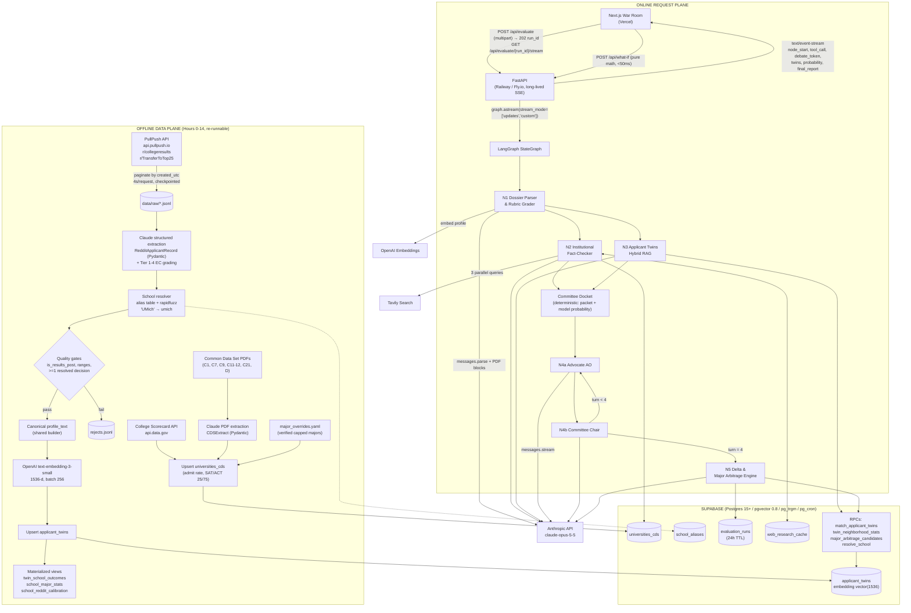
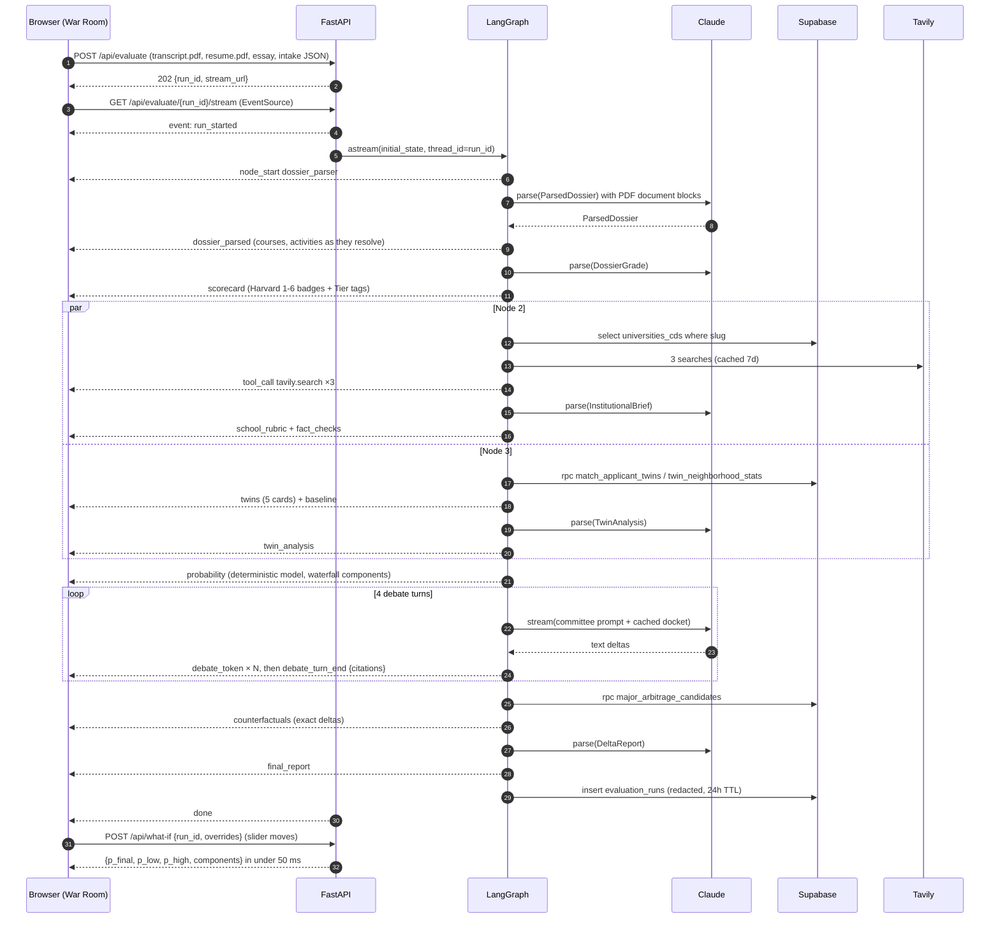
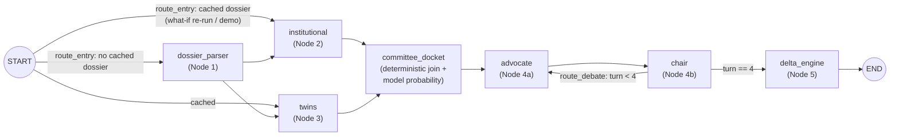

# AdCom — Autonomous Multi-Agent Admissions Committee Simulator

> Master implementation plan for a 36–48 hour hackathon build.
> **Part I:** Sections 1–3 (architecture, data, agents). **Part II:** Sections 4–7 (FastAPI streaming, War Room UI, 36-hour schedule, pitch).

---

## Table of Contents

- [0. Conventions, Assumptions & Repo Layout](#0-conventions-assumptions--repo-layout)
- [1. System Architecture & Tech Stack](#1-system-architecture--tech-stack)
- [2. Data Ingestion Pipeline & Database Schema](#2-data-ingestion-pipeline--database-schema)
- [3. Multi-Agent LangGraph Workflow & System Prompts](#3-multi-agent-langgraph-workflow--system-prompts)
- [4. FastAPI Backend & Streaming Specification](#4-fastapi-backend--streaming-specification)
- [5. Frontend UI/UX & Component Architecture](#5-frontend-uiux--component-architecture)
- [6. Hour-by-Hour Execution Schedule](#6-hour-by-hour-execution-schedule-36-hours-34-devs)
- [7. The 3-Minute Judging Pitch & Demo Script](#7-the-3-minute-judging-pitch--demo-script)

---

## 0. Conventions, Assumptions & Repo Layout

### 0.1 Design principles (these decide every judging Q&A)

1. **Math decides, LLMs judge and explain.** The admit probability comes from a deterministic, inspectable model: school base rate → C7-weighted rubric shifts → Bayesian update on applicant-twin outcomes. LLMs extract, grade, debate and advise, but **no LLM ever writes a probability number**. Every percentage on screen traces back to a formula and a SQL query.
2. **Every claim cites.** Debate messages carry inline citation tokens (`[[cds:c7.essay]]`, `[[twin:3]]`, `[[web:W2]]`). A validator checks them against the docket, and the UI renders them as clickable chips. If a citation can't be resolved, the UI shows it as unverified.
3. **Stream everything.** The first byte reaches the screen in under 2 s. Every node emits progress, tool-call and partial-result events, so the user never sees a bare spinner.
4. **Precompute the expensive parts, cache the rest.** Reddit extraction, embeddings and CDS parsing all happen offline. Prompt caching covers system prompts and the shared debate docket. Tavily results are cached for 7 days. Demo mode can replay a recorded event log if the venue Wi-Fi dies.
5. **Privacy by construction.** We never store the raw PDF. PII is stripped before anything persists. Evaluation runs auto-expire after 24 h. Race/ethnicity is excluded from embeddings, from the probability model and from the context the LLM sees.

### 0.2 Model & provider choices

| Purpose | Provider / model | Notes |
|---|---|---|
| All reasoning nodes (parse, grade, fact-check, twin analysis, debate, delta) | Anthropic `claude-opus-5-5` | Effort is set per node (see §1.5). Thinking is always on for this model and is controlled only by `output_config.effort`. |
| Structured outputs | `client.beta.messages.parse(..., output_format=PydanticModel)` | The result is validated into the Pydantic model and read from `.parsed_output`. |
| Refusal safety net | `fallbacks="default"` + beta `server-side-fallback-2026-07-01` | If a safety classifier declines a request, it is re-run server-side on Anthropic's recommended fallback model. It's enabled in the shared `llm.py` wrapper and is a one-line removal if you don't want it. |
| Offline Reddit/CDS extraction | `ETL_MODEL` env var, default `claude-opus-5-5` | Cost tradeoff in §2.9.11. You decide whether to switch to a cheaper model. |
| Embeddings (1536-d) | OpenAI `text-embedding-3-small` | Anthropic has no embeddings endpoint. The spec's `vector(1536)` matches this model. If you use Voyage instead, change it to `vector(1024)` everywhere. |
| Live web research | Tavily (`AsyncTavilyClient`) | Results are cached in Postgres. If Tavily is down, Node 2 degrades to DB-only. |

### 0.3 Environment variables (`.env`)

```bash
# LLM / embeddings / search
ANTHROPIC_API_KEY=sk-ant-...
OPENAI_API_KEY=sk-...            # embeddings only
TAVILY_API_KEY=tvly-...

# Supabase (backend uses the service-role key; never ship it to the browser)
SUPABASE_URL=https://<project>.supabase.co
SUPABASE_SERVICE_ROLE_KEY=eyJ...

# Public datasets
SCORECARD_API_KEY=...            # free key from api.data.gov

# Tunables
REASONING_MODEL=claude-opus-5-5
ETL_MODEL=claude-opus-5-5
EMBEDDING_MODEL=text-embedding-3-small
DEMO_MODE=false                  # true → replay recorded event logs (Part II, §4)
```

### 0.4 Monorepo layout

```
adcom/
├── apps/
│   └── web/                          # Next.js App Router (Part II, §5)
├── services/
│   └── api/
│       ├── pyproject.toml
│       ├── app/
│       │   ├── main.py               # FastAPI app + SSE routes (Part II, §4)
│       │   ├── config.py             # pydantic-settings
│       │   ├── llm.py                # Anthropic wrapper: parse / stream_text / fallbacks / refusals
│       │   ├── embeddings.py         # OpenAI 1536-d embeddings
│       │   ├── db.py                 # Supabase async client + RPC helpers
│       │   ├── web_research.py       # Tavily + Postgres cache
│       │   ├── profile_text.py       # canonical profile string (shared by ETL + live applicant)
│       │   ├── schemas/
│       │   │   ├── common.py  dossier.py  institution.py  twins.py  debate.py  delta.py  inputs.py
│       │   ├── scoring/
│       │   │   ├── metrics.py        # GPA normalization, rigor, proxy ratings (deterministic)
│       │   │   ├── rubric.py         # C7 → pillar weights, hook effects, major multiplier
│       │   │   ├── probability.py    # logit model + Beta-binomial twin update
│       │   │   └── counterfactuals.py
│       │   └── agents/
│       │       ├── state.py          # AdComState TypedDict
│       │       ├── events.py         # custom stream events
│       │       ├── docket.py         # committee docket builder + citation validator
│       │       ├── graph.py          # StateGraph assembly
│       │       ├── prompts/
│       │       │   ├── rubrics.py  dossier.py  institutional.py  twins.py  committee.py  delta.py
│       │       └── nodes/
│       │           ├── dossier_parser.py  institutional.py  twins.py  debate.py  delta_engine.py
│       ├── etl/
│       │   ├── common.py  pullpush.py  reddit_schema.py  prompts.py  school_resolver.py
│       │   ├── extract_reddit.py  load_twins.py  load_scorecard.py  load_cds.py
│       │   ├── refresh_stats.py  fit_coefficients.py  run_etl.py
│       └── scripts/
│           └── run_graph_cli.py      # run a full evaluation in the terminal
├── supabase/
│   └── migrations/
│       ├── 0001_extensions_types.sql
│       ├── 0002_universities.sql
│       ├── 0003_applicant_twins.sql
│       ├── 0004_stats_views.sql
│       ├── 0005_runtime_tables.sql
│       ├── 0006_rpc.sql
│       └── 0007_rls_cron.sql
└── data/
    ├── schools_seed.csv              # curated unitid → slug, peer group, aliases
    ├── school_aliases.yaml           # Reddit abbreviations ("CMU", "UMich", "Cal")
    ├── cds_sources.yaml              # slug → CDS PDF URL (collected by hand)
    ├── major_overrides.yaml          # verified capped/direct-admit majors
    ├── raw/                          # PullPush JSONL (gitignored)
    ├── processed/                    # extracted twins JSONL (gitignored)
    └── demo_dossiers/                # 3 golden demo applicants
```

### 0.5 Python dependencies (`services/api/pyproject.toml`)

```toml
[project]
name = "adcom-api"
version = "0.1.0"
requires-python = ">=3.12"   # 3.11+ required for LangGraph's async get_stream_writer() context propagation
dependencies = [
  "fastapi",
  "uvicorn[standard]",
  "sse-starlette",
  "python-multipart",
  "langgraph>=1.0",
  "anthropic",               # pin exact version at Hour 0 with `uv lock`
  "openai",
  "supabase",
  "tavily-python",
  "pydantic>=2.7",
  "pydantic-settings",
  "httpx",
  "orjson",
  "rapidfuzz",
  "pypdf",
  "pyyaml",
  "numpy",
  "scipy",
  "statsmodels",             # offline coefficient fitting only
]
```

---

## 1. System Architecture & Tech Stack

### 1.1 End-to-end architecture



### 1.2 One evaluation, start to finish



### 1.3 Tech stack

| Layer | Choice | Why it wins a hackathon |
|---|---|---|
| **Frontend framework** | Next.js 15+ (App Router), TypeScript, React Server Components for the shell and client components for the War Room | One `pnpm create next-app`. Vercel deploys on `git push`. |
| **Styling / components** | Tailwind CSS v4 + shadcn/ui (Card, Badge, Tabs, Slider, Sheet, Tooltip, ScrollArea, Progress) | Polished, accessible defaults in minutes. You own the component code. |
| **Motion** | Framer Motion (`AnimatePresence`, `layout`, spring gauges) | Debate bubbles, twin-card flips and gauge sweeps make the demo memorable. |
| **Charts** | Recharts: `RadarChart` (6 axes), `RadialBarChart` (probability gauge), `BarChart` (waterfall) | Declarative and fast to theme. |
| **Client state** | Zustand store keyed by `run_id`, fed by an SSE reducer | No prop drilling. Event replay just re-feeds the reducer. |
| **SSE client** | Native `EventSource` on `GET /api/evaluate/{run_id}/stream` | `POST /api/evaluate` only *creates* the run (multipart upload → `202 {run_id}`). The stream is a plain GET, so the browser reconnects automatically with `Last-Event-ID` and never re-submits the application (§4.1). |
| **Upload** | `react-dropzone` | Drag-and-drop for PDFs. |
| **Backend** | Python 3.12, FastAPI, `sse-starlette` (`EventSourceResponse`), uvicorn | Async-native and Pydantic end to end. SSE is simpler than WebSockets for one-way streaming. |
| **Agent orchestration** | LangGraph ≥ 1.0 `StateGraph`: parallel fan-out/fan-in, a debate cycle, `get_stream_writer()` custom events, `InMemorySaver` checkpointer, per-node `RetryPolicy` | Real stateful graph semantics (cycles, joins, retries) with first-class streaming. |
| **LLM SDK** | Anthropic Python SDK used directly in nodes (no LangChain chat-model wrapper) | Native `messages.parse` structured outputs, native streaming, prompt caching and fallbacks, with fewer abstraction layers to debug at 3 a.m. |
| **Database** | Supabase Postgres + `pgvector` (HNSW + exact filtered KNN), `pg_trgm` (fuzzy school names), `pg_cron` (TTL purge) | SQL filtering and vector ranking in one RPC call. Free tier is enough. |
| **Web research** | Tavily `AsyncTavilyClient.search(search_depth="advanced")` | One call returns clean snippets with URLs, which are needed for citations. |
| **Hosting** | Vercel (web), Railway or Fly.io (API: long-lived SSE connections, no 10–60 s serverless timeouts), Supabase Cloud | All three deploy in under 10 minutes. |
| **Python tooling** | `uv` for env/lock, `ruff`, `pytest` | Fast installs on hackathon Wi-Fi. |

### 1.4 Why the system is shaped this way

- **Nodes 2 and 3 run in parallel.** Both depend only on Node 1 (dossier + embedding), so a LangGraph fan-out cuts about 10 s off the critical path. A list-source edge `add_edge(["institutional","twins"], "committee_docket")` is a true join: the docket waits for both.
- **The committee docket is a deterministic node.** It does three jobs. It joins the parallel branches. It computes the model probability *before* the debate, so both agents argue about the same number. And it builds one byte-stable context packet that all 4 debate turns share, which makes prompt-cache hits on turns 2–4.
- **The debate is a real graph cycle** (`chair → advocate` while `turn < 4`), not a single prompt pretending to be two people. Each turn sees the full transcript and its own role brief.
- **Node 5 never invents deltas.** It receives a menu of counterfactuals whose deltas were already computed by re-running the probability model with modified inputs (SAT → 75th percentile, add a Tier 2 activity, switch major, apply ED). It ranks and explains them, and the UI binds numbers by `counterfactual_id`.
- **`/api/what-if` bypasses the graph.** Sliders call the same `compute_probability()` with overrides. It needs no LLM, so it responds in under 50 ms and the gauge animates live.

### 1.5 Latency, effort & cost budget (per evaluation)

| Node | LLM calls | Effort | Typical latency | What streams meanwhile |
|---|---|---|---|---|
| N1 Dossier Parser | 1 parse (PDF in) | `medium` | 12–20 s | parse progress, then `dossier_parsed` |
| N1 Rubric Grader | 1 parse | `high` | 8–15 s | `scorecard` badges animate in |
| N2 Institutional | 3 Tavily + 1 parse | `medium` | 6–10 s (parallel with N3) | `tool_call` chips, `school_rubric`, `fact_checks` |
| N3 Twins | 2 RPC + 1 parse | `medium` | 4–8 s (parallel) | `twins` cards fly in **first**, because the RPC returns before the LLM finishes |
| Docket | 0 | — | under 50 ms | `probability` gauge sweeps |
| N4 Debate ×4 | 4 streams | `low` | 6–9 s per turn | `debate_token` typing |
| N5 Delta | 1 RPC + 1 parse | `high` | 10–15 s | `counterfactuals` first, then `final_report` |
| **Total** | **10 LLM calls** | | **~65–90 s cold, ~45 s with cached dossier** | Something visibly happens every ~1.5 s |

**Cost.** Roughly 70–90K input tokens per evaluation (about 40% are cache reads on the debate docket and system prompts) plus 15–25K output/thinking tokens. At Opus 5.5 rates ($4 / $20 per MTok) that is **about $0.60–$1.00 per full evaluation**. What-if calls are free.

### 1.6 Stream event taxonomy (wire format specified in Part II, §4)

| Event | Emitted by | Payload (abridged) |
|---|---|---|
| `run_started` | API | `run_id`, `school_slug` |
| `node_start` / `node_end` / `node_complete` | nodes / nodes / API (from LangGraph `updates`) | `node`, `label`, `elapsed_ms` |
| `progress` | any node | `node`, `message`, `pct?` |
| `tool_call` | N2, N3, N5 | `tool` (`tavily.search`, `rpc.match_applicant_twins`…), `args`, `status`, `result_count` |
| `dossier_parsed` | N1 | redacted `ParsedDossier` |
| `scorecard` | N1 | `DossierGrade` + `ComputedMetrics` |
| `school_rubric` / `fact_checks` | N2 | `SchoolRubric`, `InstitutionalBrief.fact_checks` |
| `twins` / `baseline` / `radar` / `twin_analysis` | N3 | `TwinCard[5]`, `EmpiricalBaseline`, 6-axis `RadarData` (§4.7), `TwinAnalysis` |
| `probability` | Docket | `ProbabilityBreakdown` |
| `debate_turn_start` / `debate_token` / `debate_reset` / `debate_turn_end` | N4 | `turn`, `speaker`, `delta`, `citations[]`, `recommendation?` |
| `counterfactuals` / `final_report` | N5 | `Counterfactual[]`, `DeltaReport` |
| `error` / `done` | any / API | `node`, `message`, `recoverable` |

---

## 2. Data Ingestion Pipeline & Database Schema

### 2.1 Data source inventory

| Source | What we take | Access | Target volume | Lands in |
|---|---|---|---|---|
| **PullPush** `api.pullpush.io/reddit/search/submission/` | r/collegeresults (first-year) and r/TransferToTop25 (transfer) results posts, about 2019 to now | Public JSON, `size≤100`, paginate with `before=<epoch>` | 12–18K raw posts → **10K+ clean twins** | `applicant_twins` |
| **US College Scorecard** `api.data.gov/ed/collegescorecard/v1/schools` | `id` (IPEDS unitid), name, city/state, ownership, admit rate, SAT/ACT 25th/75th | Free API key | ~250 schools with admit rate ≤ 40% | `universities_cds` |
| **Common Data Set PDFs** | C1 (apps/admits/enrolled), **C7 factor weights**, C9 test percentiles, C11–C12 GPA, C21 ED/EA, **Section D transfers** | PDF links collected by hand from each school's Institutional Research page → Claude PDF extraction | 40–60 schools (all demo schools + top targets) | `universities_cds.c7_weights`, etc. |
| **IPEDS** (via Scorecard IDs) | unitid as the canonical school key | Implicit (Scorecard `id` = IPEDS unitid) | — | `universities_cds.unitid` |
| **Major overrides** | Verified capped / direct-admit majors (e.g., CS at UIUC, UW, UT Austin, CMU SCS) with source URLs | Hand-curated YAML (Track A, Hour 10) | 15–25 rows | `universities_cds.major_competitiveness` |
| **SFFA / Harberson rubrics** | Rating anchors | Encoded in prompts (§3.4) | — | prompt constants |

### 2.2 Migration `0001_extensions_types.sql`

```sql
-- Supabase installs extensions into the `extensions` schema; the default search_path includes it.
create extension if not exists vector   with schema extensions;   -- pgvector >= 0.8
create extension if not exists pg_trgm  with schema extensions;   -- fuzzy school-name matching
create extension if not exists pg_cron;                           -- TTL purge of evaluation runs

create type public.c7_level       as enum ('very_important', 'important', 'considered', 'not_considered');
create type public.test_policy    as enum ('required', 'optional', 'blind', 'flexible', 'unknown');
create type public.applicant_type as enum ('first_year', 'transfer');
create type public.school_control as enum ('public', 'private_nonprofit', 'private_forprofit');

-- Canonical C7 factor keys (CDS 2024-25 naming; racial/ethnic status was removed post-SFFA and is intentionally absent).
create or replace function public.c7_factor_keys()
returns text[]
language sql immutable parallel safe
as $$
  select array[
    'rigor', 'class_rank', 'academic_gpa', 'test_scores', 'essay', 'recommendations',
    'interview', 'extracurriculars', 'talent_ability', 'character', 'first_generation',
    'alumni_relation', 'geographic_residence', 'state_residency', 'religious_affiliation',
    'volunteer_work', 'work_experience', 'applicant_interest'
  ]::text[]
$$;

-- CHECK helper: every key is a known C7 factor and every value is a valid level.
create or replace function public.c7_is_valid(w jsonb)
returns boolean
language sql immutable parallel safe
as $$
  select jsonb_typeof(w) = 'object'
     and coalesce(bool_and(
           e.key = any (public.c7_factor_keys())
       and e.value #>> '{}' in ('very_important', 'important', 'considered', 'not_considered')
         ), true)
  from jsonb_each(w) as e
$$;

-- Canonical major buckets shared by ETL, grader and scoring (keep in sync with schemas/common.py::MajorCategory).
create or replace function public.major_category_keys()
returns text[]
language sql immutable parallel safe
as $$
  select array[
    'computer_science', 'computer_engineering', 'electrical_engineering', 'mechanical_aerospace',
    'other_engineering', 'math_stats', 'data_science', 'physics_astro', 'chemistry', 'biology',
    'neuroscience', 'pre_health', 'economics', 'business', 'political_science', 'psychology',
    'social_sciences_other', 'humanities', 'arts_design', 'architecture', 'undecided', 'other'
  ]::text[]
$$;
```

### 2.3 Migration `0002_universities.sql`: `universities_cds`

```sql
create table public.universities_cds (
  -- identity
  slug                  text primary key check (slug ~ '^[a-z0-9_]+$'),   -- 'mit', 'uiuc', 'ut_austin'
  unitid                integer unique,                                     -- IPEDS id (= Scorecard id)
  name                  text not null,
  short_name            text,
  city                  text,
  state                 char(2),
  control               public.school_control,
  peer_group            text not null default 'other'
                        check (peer_group in ('hyps','t20_private','public_ivy','uc','t50_private',
                                              'lac_elite','tech','other')),
  website               text,

  -- selectivity (CDS C1 / C21; Scorecard fallback)
  applicants            integer check (applicants >= 0),
  admits                integer check (admits >= 0),
  enrolled              integer check (enrolled >= 0),
  admit_rate            numeric(5,4) check (admit_rate between 0 and 1),
  ed_applicants         integer,
  ed_admits             integer,
  ed_admit_rate         numeric(5,4) check (ed_admit_rate between 0 and 1),
  ea_admit_rate         numeric(5,4) check (ea_admit_rate between 0 and 1),
  rd_admit_rate         numeric(5,4) check (rd_admit_rate between 0 and 1),
  yield_rate            numeric(5,4) check (yield_rate between 0 and 1),
  in_state_admit_rate   numeric(5,4) check (in_state_admit_rate between 0 and 1),     -- publics, when published
  out_state_admit_rate  numeric(5,4) check (out_state_admit_rate between 0 and 1),

  -- testing (CDS C9; Scorecard fallback)
  test_policy           public.test_policy not null default 'unknown',
  sat_composite_25      smallint check (sat_composite_25 between 400 and 1600),
  sat_composite_50      smallint check (sat_composite_50 between 400 and 1600),
  sat_composite_75      smallint check (sat_composite_75 between 400 and 1600),
  sat_ebrw_25           smallint check (sat_ebrw_25 between 200 and 800),
  sat_ebrw_75           smallint check (sat_ebrw_75 between 200 and 800),
  sat_math_25           smallint check (sat_math_25 between 200 and 800),
  sat_math_75           smallint check (sat_math_75 between 200 and 800),
  act_composite_25      smallint check (act_composite_25 between 1 and 36),
  act_composite_75      smallint check (act_composite_75 between 1 and 36),
  pct_submitting_sat    numeric(5,4),
  pct_submitting_act    numeric(5,4),

  -- high school record (CDS C10-C12)
  avg_hs_gpa            numeric(3,2),
  gpa_distribution      jsonb not null default '[]'::jsonb,   -- [{"bucket":"4.0","pct":0.63}, ...]
  pct_top10_class       numeric(5,4),

  -- CDS C7: {"rigor":"very_important","essay":"important","applicant_interest":"not_considered", ...}
  c7_weights            jsonb not null default '{}'::jsonb
                        constraint c7_weights_valid check (public.c7_is_valid(c7_weights)),

  -- CDS C21/C22: {"ed":true,"ed2":false,"ea":false,"rea":false}
  early_plans           jsonb not null default '{}'::jsonb,

  -- CDS Section D: {"accepts_transfers":true,"applicants":3120,"admits":180,"enrolled":120,"min_college_gpa":null}
  transfer_profile      jsonb not null default '{}'::jsonb,

  -- per-major competitiveness, keyed by major_category:
  -- {"computer_science":{"multiplier":0.38,"direct_admit":true,"college":"Grainger College of Engineering",
  --                      "source":"override","source_url":"https://...","n":212}}
  major_competitiveness jsonb not null default '{}'::jsonb,

  strategic_priorities  text[] not null default '{}',
  institutional_notes   text,
  cds_year              text,                                   -- '2024-2025'
  source_urls           jsonb not null default '{}'::jsonb,     -- {"cds":"...","scorecard":"..."}
  data_quality          jsonb not null default '{}'::jsonb,     -- {"imputed":["sat_composite_25"],"c7_source":"cds"}
  updated_at            timestamptz not null default now()
);

comment on table  public.universities_cds is 'One row per institution: Scorecard + Common Data Set facts, C7 weights, major multipliers.';
comment on column public.universities_cds.c7_weights is 'CDS C7 relative importance of 18 admission factors. Keys from c7_factor_keys().';

create index universities_cds_peer_idx on public.universities_cds (peer_group);
create index universities_cds_admit_idx on public.universities_cds (admit_rate);

-- Reddit names schools in hundreds of ways ("UMich", "Michigan", "UM Ann Arbor"); the resolver maps them here.
create table public.school_aliases (
  alias  text primary key check (alias = lower(alias)),
  slug   text not null references public.universities_cds (slug) on delete cascade
);
create index school_aliases_trgm_idx on public.school_aliases using gin (alias extensions.gin_trgm_ops);
create index school_aliases_slug_idx on public.school_aliases (slug);

create or replace function public.touch_updated_at()
returns trigger language plpgsql as $$
begin
  new.updated_at := now();
  return new;
end $$;

create trigger universities_cds_touch
before update on public.universities_cds
for each row execute function public.touch_updated_at();
```

### 2.4 Migration `0003_applicant_twins.sql`: `applicant_twins`

```sql
create table public.applicant_twins (
  id                     uuid primary key default gen_random_uuid(),

  -- provenance (no Reddit usernames are stored)
  reddit_id              text not null unique,                    -- e.g. 't3_1bx9k2' → stored as '1bx9k2'
  subreddit              text not null check (subreddit in ('collegeresults', 'TransferToTop25')),
  source_url             text not null,                           -- https://www.reddit.com/r/.../comments/<id>/
  post_created_at        timestamptz not null,
  cycle_year             smallint check (cycle_year between 2015 and 2035),   -- matriculation year
  applicant_type         public.applicant_type not null,

  -- academics
  gpa_uw                 numeric(3,2) check (gpa_uw between 0 and 4.00),
  gpa_w                  numeric(4,2) check (gpa_w between 0 and 6.00),
  gpa_w_scale            numeric(3,1),
  college_gpa            numeric(3,2) check (college_gpa between 0 and 4.00),   -- transfers
  class_rank_pct         numeric(5,4) check (class_rank_pct between 0 and 1),   -- 0.02 = top 2%
  sat_score              smallint check (sat_score between 400 and 1600),
  sat_math               smallint check (sat_math between 200 and 800),
  sat_ebrw               smallint check (sat_ebrw between 200 and 800),
  act_score              smallint check (act_score between 1 and 36),
  applied_test_optional  boolean,
  ap_count               smallint check (ap_count between 0 and 30),
  ib_diploma             boolean,
  honors_count           smallint,
  dual_enrollment_count  smallint,
  ap_scores              jsonb not null default '[]'::jsonb,   -- [{"subject":"Calc BC","score":5}]
  rigor_label            text check (rigor_label in ('most_demanding','very_demanding','demanding','average','below_average','unknown')),

  -- major
  intended_major         text,                                  -- raw text: "CS + Math double"
  major_category         text not null default 'undecided'
                         check (major_category = any (public.major_category_keys())),

  -- context (self-reported; race is kept ONLY for aggregate bias audits, never embedded or modeled)
  demographics           jsonb not null default '{}'::jsonb,
  -- {"gender":"F","race_ethnicity_raw":"...","residency_state":"CA","country":"US",
  --  "income_bracket":"80-150k","school_type":"public","first_gen":false}
  hooks                  text[] not null default '{}',
  -- subset of: first_gen, low_income, legacy, recruited_athlete, faculty_staff_child, rural, veteran, questbridge_finalist

  -- extracurriculars (tiers assigned in ETL with the same rubric Node 1 applies to live applicants)
  ec_tier_summary        jsonb not null default '{}'::jsonb,
  -- {"tier1":0,"tier2":2,"tier3":4,"tier4":3,"ec_score":6.25,"tier_derived_ec_rating":1.76}
  activities             jsonb not null default '[]'::jsonb,
  -- [{"description":"USACO Platinum; ...","role":"Founder","tier":2,"tier_rationale":"..."}]
  awards                 jsonb not null default '[]'::jsonb,   -- [{"name":"AIME qualifier","level":"national"}]
  spike_summary          text,
  essay_notes            text,
  lor_notes              text,
  headline               text,                                  -- "3.98 UW · 1560 SAT · 12 AP · CS · T1:0 T2:2"

  -- outcomes: canonical school slugs (FK-like; validated by the resolver, not by FK on arrays)
  accepted_schools       text[] not null default '{}',
  waitlisted_schools     text[] not null default '{}',
  rejected_schools       text[] not null default '{}',
  decisions_detail       jsonb not null default '[]'::jsonb,  -- [{"slug":"mit","outcome":"rejected","round":"EA","as_written":"MIT"}]
  applied_schools        text[] generated always as (accepted_schools || waitlisted_schools || rejected_schools) stored,
  committed_school       text,

  -- retrieval
  profile_text           text not null,                         -- deterministic canonical text (app/profile_text.py)
  embedding              extensions.vector(1536),
  fts                    tsvector generated always as (to_tsvector('english', profile_text)) stored,

  -- extraction metadata
  extraction_confidence  text check (extraction_confidence in ('high','medium','low')),
  extraction_issues      text[] not null default '{}',
  extraction_model       text,
  created_at             timestamptz not null default now(),

  constraint outcome_arrays_disjoint check (
    not (accepted_schools && waitlisted_schools)
    and not (accepted_schools && rejected_schools)
    and not (waitlisted_schools && rejected_schools)
  ),
  constraint has_any_decision check (cardinality(accepted_schools || waitlisted_schools || rejected_schools) > 0)
);

comment on table public.applicant_twins is 'Self-reported Reddit applicant profiles with ground-truth outcomes; the retrieval corpus for Applicant Twins RAG.';

-- ANN index for unfiltered similarity (cohort explorer, cluster views)
create index applicant_twins_embedding_hnsw
  on public.applicant_twins using hnsw (embedding extensions.vector_cosine_ops)
  with (m = 16, ef_construction = 64);

-- Hybrid-search prefilter: "which twins applied to <school>" (array overlap/containment uses GIN)
create index applicant_twins_applied_gin  on public.applicant_twins using gin (applied_schools);
create index applicant_twins_accepted_gin on public.applicant_twins using gin (accepted_schools);
create index applicant_twins_hooks_gin    on public.applicant_twins using gin (hooks);
create index applicant_twins_fts_gin      on public.applicant_twins using gin (fts);
create index applicant_twins_major_idx    on public.applicant_twins (major_category, applicant_type);
create index applicant_twins_stats_idx    on public.applicant_twins (sat_score, gpa_uw);
create index applicant_twins_cycle_idx    on public.applicant_twins (cycle_year);
```

### 2.5 Migration `0004_stats_views.sql`: empirical outcome stats

These views power three things: major multipliers for Node 2, Reddit self-selection calibration for Node 3, and major arbitrage for Node 5.

```sql
-- One row per (twin, school decision)
create materialized view public.twin_school_outcomes as
select t.id as twin_id, t.applicant_type, t.major_category, t.cycle_year, d.slug, d.outcome
from public.applicant_twins t
cross join lateral (
  select unnest(t.accepted_schools)   as slug, 'accepted'::text   as outcome
  union all
  select unnest(t.waitlisted_schools),          'waitlisted'::text
  union all
  select unnest(t.rejected_schools),            'rejected'::text
) d;

create unique index twin_school_outcomes_pk on public.twin_school_outcomes (twin_id, slug);
create index twin_school_outcomes_slug_idx on public.twin_school_outcomes (slug, major_category);

-- Per (school, major) admit rate among Reddit applicants, with a Bayesian-smoothed multiplier
-- relative to that school's overall Reddit admit rate (prior strength = 20 pseudo-applicants).
create materialized view public.school_major_stats as
with school_tot as (
  select slug,
         count(*)::int                                     as n_all,
         avg((outcome = 'accepted')::int)::double precision as rate_all
  from public.twin_school_outcomes
  where applicant_type = 'first_year'
  group by slug
)
select o.slug,
       o.major_category,
       count(*)::int                                            as n,
       count(*) filter (where o.outcome = 'accepted')::int      as n_accepted,
       count(*) filter (where o.outcome = 'waitlisted')::int    as n_waitlisted,
       count(*) filter (where o.outcome = 'rejected')::int      as n_rejected,
       avg((o.outcome = 'accepted')::int)::double precision     as reddit_admit_rate,
       st.rate_all                                              as school_reddit_admit_rate,
       st.n_all                                                 as school_n,
       case when st.rate_all > 0 then
         ((count(*) filter (where o.outcome = 'accepted') + 20.0 * st.rate_all) / (count(*) + 20.0)) / st.rate_all
       else 1.0 end                                             as smoothed_multiplier
from public.twin_school_outcomes o
join school_tot st using (slug)
where o.applicant_type = 'first_year'
group by o.slug, o.major_category, st.rate_all, st.n_all;

create unique index school_major_stats_pk on public.school_major_stats (slug, major_category);

-- Self-selection calibration: how much higher is the Reddit admit rate than the official one?
-- odds_inflation = odds(reddit) / odds(official), clamped to [1, 8]. Node 3 divides twin odds by this.
create view public.school_reddit_calibration
with (security_invoker = true) as
select u.slug,
       u.admit_rate::double precision as official_admit_rate,
       st.n_all                       as reddit_n,
       st.rate_all                    as reddit_admit_rate,
       case
         when u.admit_rate > 0 and u.admit_rate < 1 and st.rate_all > 0 and st.rate_all < 1 then
           least(8.0, greatest(1.0,
             (st.rate_all / (1 - st.rate_all)) / (u.admit_rate::double precision / (1 - u.admit_rate::double precision))))
         else 1.0
       end                            as odds_inflation
from public.universities_cds u
join (
  select slug, count(*)::int as n_all, avg((outcome = 'accepted')::int)::double precision as rate_all
  from public.twin_school_outcomes
  where applicant_type = 'first_year'
  group by slug
) st using (slug);

-- Called by etl/refresh_stats.py after each load.
create or replace function public.refresh_twin_stats()
returns void
language plpgsql
security definer
set search_path = public
as $$
begin
  refresh materialized view concurrently public.twin_school_outcomes;
  refresh materialized view concurrently public.school_major_stats;
end $$;
```

### 2.6 Migration `0005_runtime_tables.sql`: runs & research cache

```sql
create table public.evaluation_runs (
  id                  uuid primary key default gen_random_uuid(),
  session_id          text not null,                       -- anonymous browser session id (no auth needed for the demo)
  created_at          timestamptz not null default now(),
  expires_at          timestamptz not null default now() + interval '24 hours',
  status              text not null default 'running' check (status in ('running','complete','failed')),
  school_slug         text references public.universities_cds (slug),
  intended_major      text,
  major_category      text,
  -- redacted artifacts only: the raw PDF and essay PII never reach this table
  intake              jsonb,     -- RawApplicantInputs minus file bytes
  dossier             jsonb,
  grade               jsonb,
  metrics             jsonb,
  school_rubric       jsonb,
  institutional_brief jsonb,
  twins               jsonb,
  baseline            jsonb,
  twin_analysis       jsonb,
  debate              jsonb,
  probability         jsonb,
  scoring_inputs      jsonb,     -- frozen ScoringInputs so /api/what-if can recompute without the graph
  counterfactuals     jsonb,
  delta_report        jsonb,
  profile_embedding   extensions.vector(1536),
  event_log           jsonb not null default '[]'::jsonb   -- full SSE log → DEMO_MODE replay
);
create index evaluation_runs_session_idx on public.evaluation_runs (session_id, created_at desc);
create index evaluation_runs_expiry_idx  on public.evaluation_runs (expires_at);

create table public.web_research_cache (
  query_hash   text primary key,         -- sha256(slug|query)
  school_slug  text,
  query        text not null,
  results      jsonb not null,           -- Tavily results [{url,title,content,score,published_date}]
  fetched_at   timestamptz not null default now()
);
create index web_research_cache_slug_idx on public.web_research_cache (school_slug, fetched_at desc);
```

### 2.7 Migration `0006_rpc.sql`: hybrid search RPCs

#### 2.7.1 Why filtered *exact* KNN instead of filtered HNSW

If you add a `WHERE target school in applied_schools` filter to an HNSW scan, pgvector **post-filters**: HNSW returns `ef_search` (default 40) nearest rows across all schools, and the filter then throws most of them away. A query for a niche school can come back with 0–2 rows. pgvector 0.8 added iterative scans (`hnsw.iterative_scan`), which help. But our filtered candidate set is small: even MIT has only about 1–3K applicants in the corpus. So we **prefilter with the GIN index on `applied_schools`** inside a `MATERIALIZED` CTE and compute exact cosine distance over those rows. That gives perfect recall in under 10 ms. HNSW is kept for unfiltered queries such as the cohort explorer.

"Hybrid" here means three things combined:
1. **SQL filter**: the target school must be in `accepted_schools ∪ waitlisted_schools ∪ rejected_schools`, plus applicant type, cycle year and optional major.
2. **Semantic similarity**: `1 − cosine_distance` between the applicant's and the twin's profile embeddings.
3. **Structured stat proximity**: Gaussian kernels on GPA (σ = 0.08) and SAT (σ = 40). These stop the ranking from matching a 1350-SAT applicant to a 1580 one just because both wrote about robotics.

`hybrid_score = semantic_weight × semantic + (1 − semantic_weight) × stat_proximity`. The default `semantic_weight` is 0.70. Major arbitrage uses 0.30, so it finds academically similar applicants across majors.

#### 2.7.2 `match_applicant_twins`

```sql
create or replace function public.match_applicant_twins(
  query_embedding  extensions.vector(1536),
  target_schools   text[],                                  -- usually one slug; peer fallback passes several
  match_count      int                    default 5,
  applicant_kind   public.applicant_type  default 'first_year',
  major_filter     text                   default null,     -- exact major_category, or null for all
  query_gpa_uw     numeric                default null,
  query_sat        int                    default null,
  outcome_filter   text                   default 'any',    -- 'any' | 'accepted' | 'waitlisted' | 'rejected'
  min_cycle_year   int                    default 2019,
  semantic_weight  double precision       default 0.70
)
returns table (
  id                   uuid,
  reddit_id            text,
  source_url           text,
  cycle_year           smallint,
  matched_school       text,
  outcome              text,
  gpa_uw               numeric,
  gpa_w                numeric,
  sat_score            smallint,
  act_score            smallint,
  ap_count             smallint,
  intended_major       text,
  major_category       text,
  hooks                text[],
  ec_tier_summary      jsonb,
  activities           jsonb,
  awards               jsonb,
  spike_summary        text,
  headline             text,
  semantic_similarity  double precision,
  stat_proximity       double precision,
  hybrid_score         double precision
)
language sql
stable
parallel safe
set search_path = public, extensions
as $$
  with candidates as materialized (
    -- 1) SQL prefilter via GIN(applied_schools): only twins who applied to a target school
    select t.id, t.reddit_id, t.source_url, t.cycle_year, t.gpa_uw, t.gpa_w, t.sat_score, t.act_score,
           t.ap_count, t.intended_major, t.major_category, t.hooks, t.ec_tier_summary, t.activities,
           t.awards, t.spike_summary, t.headline, t.embedding,
           m.matched_school, m.outcome
    from public.applicant_twins t
    cross join lateral (
      -- outcome at the FIRST target school (in caller's priority order) this twin applied to
      select u.s as matched_school,
             case
               when u.s = any (t.accepted_schools)   then 'accepted'
               when u.s = any (t.waitlisted_schools) then 'waitlisted'
               else 'rejected'
             end as outcome
      from unnest(target_schools) with ordinality as u(s, ord)
      where u.s = any (t.applied_schools)
      order by u.ord
      limit 1
    ) m
    where t.applied_schools && target_schools
      and t.applicant_type = applicant_kind
      and t.embedding is not null
      and (major_filter is null or t.major_category = major_filter)
      and (t.cycle_year is null or t.cycle_year >= min_cycle_year)
  ),
  scored as (
    -- 2) exact cosine similarity + 3) structured stat kernels (missing stat → neutral 0.5)
    select c.*,
           1 - (c.embedding <=> query_embedding) as sem,
           0.5 * coalesce(exp(-power((c.gpa_uw - query_gpa_uw) / 0.08, 2)), 0.5)
         + 0.5 * coalesce(exp(-power((c.sat_score - query_sat) / 40.0, 2)), 0.5) as stat
    from candidates c
    where outcome_filter = 'any' or c.outcome = outcome_filter
  ),
  ranked as (
    select s.*, semantic_weight * s.sem + (1 - semantic_weight) * s.stat as hybrid
    from scored s
  )
  select r.id, r.reddit_id, r.source_url, r.cycle_year, r.matched_school, r.outcome,
         r.gpa_uw, r.gpa_w, r.sat_score, r.act_score, r.ap_count, r.intended_major, r.major_category,
         r.hooks, r.ec_tier_summary, r.activities, r.awards, r.spike_summary, r.headline,
         r.sem, r.stat, r.hybrid
  from ranked r
  order by r.hybrid desc
  limit match_count
$$;
```

#### 2.7.3 `twin_neighborhood_stats`: the empirical baseline over k = 50 neighbors

Five twins make a good story but not a statistic. This function aggregates the top-k neighborhood using similarity weights `w = exp(10·(hybrid − 1))`, so the closest twins count most. It returns `Σw`, `Σw²` and `Σw·admit`. Python computes the effective sample size `n_eff = (Σw)² / Σw²` and the Wilson interval from these.

```sql
create or replace function public.twin_neighborhood_stats(
  query_embedding  extensions.vector(1536),
  target_schools   text[],
  k                int                   default 50,
  applicant_kind   public.applicant_type default 'first_year',
  major_filter     text                  default null,
  query_gpa_uw     numeric               default null,
  query_sat        int                   default null
)
returns table (
  n                    int,
  n_accepted           int,
  n_waitlisted         int,
  n_rejected           int,
  sum_w                double precision,
  sum_w2               double precision,
  sum_w_admit          double precision,
  weighted_admit_rate  double precision,
  mean_similarity      double precision
)
language sql
stable
set search_path = public, extensions
as $$
  with nn as (
    select m.outcome,
           exp(10.0 * (m.hybrid_score - 1.0)) as w,
           m.semantic_similarity
    from public.match_applicant_twins(
           query_embedding => query_embedding,
           target_schools  => target_schools,
           match_count     => k,
           applicant_kind  => applicant_kind,
           major_filter    => major_filter,
           query_gpa_uw    => query_gpa_uw,
           query_sat       => query_sat
         ) m
  )
  select count(*)::int,
         count(*) filter (where nn.outcome = 'accepted')::int,
         count(*) filter (where nn.outcome = 'waitlisted')::int,
         count(*) filter (where nn.outcome = 'rejected')::int,
         coalesce(sum(nn.w), 0),
         coalesce(sum(nn.w * nn.w), 0),
         coalesce(sum(nn.w * (nn.outcome = 'accepted')::int), 0),
         sum(nn.w * (nn.outcome = 'accepted')::int) / nullif(sum(nn.w), 0),
         avg(nn.semantic_similarity)
  from nn
$$;
```

#### 2.7.4 `major_arbitrage_candidates`: same applicant, different major

```sql
create or replace function public.major_arbitrage_candidates(
  query_embedding  extensions.vector(1536),
  target_school    text,
  query_gpa_uw     numeric default null,
  query_sat        int     default null,
  k                int     default 300,
  min_n            int     default 8
)
returns table (
  major_category              text,
  n_neighbors                 int,
  neighbor_admit_rate         double precision,
  school_n                    int,
  school_smoothed_multiplier  double precision
)
language sql
stable
set search_path = public, extensions
as $$
  with nn as (
    -- semantic_weight 0.30 → neighbors chosen mostly by academic stats, so many majors are represented
    select m.major_category, m.outcome
    from public.match_applicant_twins(
           query_embedding => query_embedding,
           target_schools  => array[target_school],
           match_count     => k,
           query_gpa_uw    => query_gpa_uw,
           query_sat       => query_sat,
           semantic_weight => 0.30
         ) m
  )
  select nn.major_category,
         count(*)::int,
         avg((nn.outcome = 'accepted')::int)::double precision,
         coalesce(sms.n, 0)::int,
         coalesce(sms.smoothed_multiplier, 1.0)
  from nn
  left join public.school_major_stats sms
         on sms.slug = target_school and sms.major_category = nn.major_category
  group by nn.major_category, sms.n, sms.smoothed_multiplier
  having count(*) >= min_n
  order by 3 desc
$$;
```

#### 2.7.5 `resolve_school`: fuzzy school lookup for intake autocomplete and ETL triage

```sql
create or replace function public.resolve_school(q text, max_results int default 5)
returns table (slug text, name text, score real)
language sql
stable
set search_path = public, extensions
as $$
  select a.slug, u.name, max(similarity(a.alias, lower(q))) as score
  from public.school_aliases a
  join public.universities_cds u on u.slug = a.slug
  where a.alias % lower(q)
  group by a.slug, u.name
  order by 3 desc
  limit max_results
$$;
```

#### 2.7.6 Calling the RPCs from Python (supabase-py async)

```python
res = await sb.rpc("match_applicant_twins", {
    "query_embedding": embedding,          # list[float] of length 1536; PostgREST casts the JSON array to vector
    "target_schools": ["uiuc"],
    "match_count": 25,
    "query_gpa_uw": 3.94,
    "query_sat": 1520,
}).execute()
rows = res.data
```

### 2.8 Migration `0007_rls_cron.sql`: security & retention

```sql
-- Browser (anon) may read public school facts; everything else is backend-only (service role bypasses RLS).
alter table public.universities_cds   enable row level security;
alter table public.school_aliases     enable row level security;
alter table public.applicant_twins    enable row level security;   -- no policies → anon/authenticated get nothing
alter table public.evaluation_runs    enable row level security;
alter table public.web_research_cache enable row level security;

create policy "anon read universities" on public.universities_cds for select to anon, authenticated using (true);
create policy "anon read aliases"      on public.school_aliases   for select to anon, authenticated using (true);

-- Materialized views can't have RLS: revoke direct API access.
revoke all on public.twin_school_outcomes from anon, authenticated;
revoke all on public.school_major_stats   from anon, authenticated;
revoke all on public.school_reddit_calibration from anon, authenticated;

-- RPCs that touch twins are backend-only.
revoke execute on function public.match_applicant_twins      from anon, authenticated, public;
revoke execute on function public.twin_neighborhood_stats    from anon, authenticated, public;
revoke execute on function public.major_arbitrage_candidates from anon, authenticated, public;
revoke execute on function public.refresh_twin_stats()       from anon, authenticated, public;
grant  execute on function public.resolve_school(text, int)  to anon, authenticated;

-- Privacy: purge evaluation runs after 24h; prune stale research cache weekly.
select cron.schedule('purge-evaluation-runs', '*/30 * * * *',
  $$delete from public.evaluation_runs where expires_at < now()$$);
select cron.schedule('prune-research-cache', '0 4 * * 0',
  $$delete from public.web_research_cache where fetched_at < now() - interval '14 days'$$);
```

### 2.9 Python ETL blueprint

Run order (`python -m etl.run_etl all`):

```
seed-schools → scorecard → cds → scrape → extract → load-twins → refresh-stats → (optional) fit-coefficients
```

Every stage is **idempotent and resumable**. Scraping checkpoints by `created_utc`. Extraction skips post IDs already present in `processed/` or `rejects/`. Loads are upserts.

#### 2.9.1 `etl/common.py`

```python
from __future__ import annotations

import json
import logging
from collections.abc import Iterable, Iterator
from pathlib import Path

from supabase import AsyncClient, acreate_client

from app.config import settings

ROOT = Path(__file__).resolve().parents[3]          # adcom/
DATA_DIR = ROOT / "data"
RAW_DIR = DATA_DIR / "raw"
PROCESSED_DIR = DATA_DIR / "processed"
for d in (RAW_DIR, PROCESSED_DIR):
    d.mkdir(parents=True, exist_ok=True)

logging.basicConfig(level=logging.INFO, format="%(asctime)s %(levelname)s %(name)s: %(message)s")
log = logging.getLogger("etl")


def read_jsonl(path: Path) -> Iterator[dict]:
    if not path.exists():
        return
    with path.open() as f:
        for line in f:
            if line.strip():
                yield json.loads(line)


def append_jsonl(path: Path, rows: Iterable[dict]) -> None:
    with path.open("a") as f:
        for row in rows:
            f.write(json.dumps(row, default=str) + "\n")


async def supabase() -> AsyncClient:
    return await acreate_client(settings.supabase_url, settings.supabase_service_role_key)


async def fetch_all(sb: AsyncClient, table: str, columns: str = "*", page: int = 1000) -> list[dict]:
    """PostgREST caps responses at 1000 rows by default; page through with .range()."""
    out: list[dict] = []
    start = 0
    while True:
        res = await sb.table(table).select(columns).range(start, start + page - 1).execute()
        out.extend(res.data)
        if len(res.data) < page:
            return out
        start += page
```

#### 2.9.2 `etl/pullpush.py`: scrape both subreddits

```python
"""Scrape r/collegeresults and r/TransferToTop25 submissions from PullPush into raw JSONL.

PullPush mirrors Reddit submissions; `size` is capped at 100 and we paginate backwards in time with
`before=<min created_utc of previous page>`. Be a good citizen: one request every 4 s, exponential backoff
on 429/5xx, and a checkpoint file so a crash never re-fetches pages.
"""
from __future__ import annotations

import asyncio
import json
import time
from datetime import datetime, timezone
from pathlib import Path

import httpx

from .common import RAW_DIR, log

PULLPUSH_URL = "https://api.pullpush.io/reddit/search/submission/"
PAGE_SIZE = 100
MIN_INTERVAL_S = 4.0
MIN_SELFTEXT_CHARS = 400
SUBREDDITS = ("collegeresults", "TransferToTop25")
KEEP_FIELDS = ("id", "title", "selftext", "created_utc", "permalink", "link_flair_text", "score", "num_comments")
USER_AGENT = "adcom-hackathon/0.1 (academic research; contact: team@example.com)"


def keep(post: dict) -> bool:
    text = post.get("selftext") or ""
    if text in ("[removed]", "[deleted]") or len(text) < MIN_SELFTEXT_CHARS:
        return False
    if post.get("stickied") or post.get("removed_by_category"):
        return False
    return True


async def get_page(http: httpx.AsyncClient, params: dict) -> list[dict]:
    for attempt in range(7):
        try:
            resp = await http.get(PULLPUSH_URL, params=params)
            if resp.status_code == 429 or resp.status_code >= 500:
                raise httpx.HTTPStatusError(f"retryable {resp.status_code}", request=resp.request, response=resp)
            resp.raise_for_status()
            return resp.json().get("data", [])
        except (httpx.HTTPStatusError, httpx.TransportError, json.JSONDecodeError) as exc:
            wait = min(180, 5 * 2**attempt)
            log.warning("pullpush %s (attempt %d) → sleeping %ss", exc, attempt + 1, wait)
            await asyncio.sleep(wait)
    raise RuntimeError(f"PullPush failed repeatedly for params={params}")


async def scrape(subreddit: str, since: datetime) -> Path:
    out = RAW_DIR / f"{subreddit}.jsonl"
    ckpt = RAW_DIR / f"{subreddit}.checkpoint.json"
    since_epoch = int(since.timestamp())

    seen: set[str] = set()
    if out.exists():
        with out.open() as f:
            seen = {json.loads(line)["id"] for line in f if line.strip()}
    before = json.loads(ckpt.read_text())["before"] if ckpt.exists() else int(time.time())

    async with httpx.AsyncClient(timeout=30, headers={"User-Agent": USER_AGENT}) as http:
        with out.open("a") as f:
            while before > since_epoch:
                params = {
                    "subreddit": subreddit,
                    "size": PAGE_SIZE,
                    "before": before,
                    "after": since_epoch,
                    "sort": "desc",
                    "sort_type": "created_utc",
                }
                posts = await get_page(http, params)
                if not posts:
                    break
                kept = 0
                for p in posts:
                    if p["id"] in seen or not keep(p):
                        continue
                    seen.add(p["id"])
                    row = {k: p.get(k) for k in KEEP_FIELDS} | {"subreddit": subreddit}   # no author field: privacy
                    f.write(json.dumps(row) + "\n")
                    kept += 1
                f.flush()
                before = min(int(float(p["created_utc"])) for p in posts)
                ckpt.write_text(json.dumps({"before": before}))
                log.info("%s: page kept %d/%d, cursor=%s, total=%d",
                         subreddit, kept, len(posts),
                         datetime.fromtimestamp(before, tz=timezone.utc).date(), len(seen))
                await asyncio.sleep(MIN_INTERVAL_S)
    return out


async def scrape_all(since: datetime) -> None:
    # Sequential on purpose: one polite request stream to PullPush.
    for sub in SUBREDDITS:
        await scrape(sub, since)
```

#### 2.9.3 `etl/reddit_schema.py`: the structured-output target

```python
from __future__ import annotations

from typing import Literal

from pydantic import BaseModel, Field

from app.schemas.common import ECTier, Hook, MajorCategory


class ExtractedActivity(BaseModel):
    description: str = Field(description="The poster's own wording, trimmed to at most 300 characters.")
    role: str | None = Field(description="Leadership title if stated, e.g. 'President', 'Founder', 'Captain'.")
    tier_rationale: str = Field(description="One sentence citing scale, distinction, or leadership evidence.")
    tier: ECTier


class ExtractedAward(BaseModel):
    name: str
    level: Literal["school", "regional", "state", "national", "international", "unknown"]


class APScore(BaseModel):
    subject: str
    score: Literal[1, 2, 3, 4, 5]


class Demographics(BaseModel):
    gender: str | None
    race_ethnicity_raw: str | None = Field(description="Verbatim self-report; used only for aggregate bias audits.")
    residency_state: str | None = Field(description="Two-letter US state code if stated.")
    country: str | None
    income_bracket: Literal["<30k", "30-60k", "60-80k", "80-150k", "150-250k", ">250k", "unknown"]
    school_type: Literal["public", "private", "charter", "magnet", "boarding", "religious",
                         "homeschool", "international", "unknown"]
    first_gen: bool | None


class SchoolDecision(BaseModel):
    school_as_written: str = Field(description="Exactly as the poster wrote it, e.g. 'UMich', 'CMU SCS'.")
    outcome: Literal["accepted", "waitlisted", "rejected"]
    round: Literal["ED", "ED2", "EA", "REA", "RD", "rolling", "unknown"]
    major_if_different: str | None


class RedditApplicantRecord(BaseModel):
    is_results_post: bool
    applicant_type: Literal["first_year", "transfer"]
    matriculation_year: int | None = Field(description="'Class of 2029' → 2025. Null if not stated.")

    gpa_uw: float | None = Field(description="Unweighted GPA on a 4.0 scale only.")
    gpa_w: float | None
    gpa_w_scale: float | None
    gpa_raw_text: str | None = Field(description="Raw GPA text when not on a 4.0 UW scale.")
    college_gpa: float | None = Field(description="Transfer applicants' college GPA.")
    class_rank_text: str | None
    class_rank_pct: float | None = Field(description="0.05 = top 5%. Only if computable from what is stated.")

    sat_total: int | None
    sat_math: int | None
    sat_ebrw: int | None
    act_composite: int | None
    applied_test_optional: bool | None
    ap_count: int | None
    honors_count: int | None
    dual_enrollment_count: int | None
    ib_diploma: bool | None
    ap_scores: list[APScore]
    rigor_label: Literal["most_demanding", "very_demanding", "demanding", "average", "below_average", "unknown"]

    intended_major_raw: str | None
    major_category: MajorCategory

    demographics: Demographics
    hooks: list[Hook]
    activities: list[ExtractedActivity]
    awards: list[ExtractedAward]
    spike_summary: str | None = Field(description="One phrase naming the applicant's most distinctive theme.")
    essay_notes: str | None
    lor_notes: str | None

    decisions: list[SchoolDecision]
    extraction_confidence: Literal["high", "medium", "low"]
    extraction_issues: list[str]
```

> **Structured-output schema rules (apply to every LLM output model in this repo).** Make every field required. Express optional values as `X | None` with no default so the model must explicitly emit `null`. Use `Literal[...]` for bounded scales such as ratings, tiers and C7 levels instead of `ge`/`le` constraints. Never use `dict[str, X]` with free-form keys in an LLM output model: arbitrary-key maps don't fit a closed JSON schema, so use `list[{key, value}]` objects instead. Deterministic models (rubric, probability) can use dicts freely.

#### 2.9.4 `etl/prompts.py`: Reddit extractor system prompt

`TIER_RUBRIC` is defined once in `app/agents/prompts/rubrics.py` (§3.4.1). The ETL and Node 1 import the same constant, so Reddit twins and live applicants are tiered on an identical scale.

```python
from app.agents.prompts.rubrics import TIER_RUBRIC

REDDIT_EXTRACTOR_SYSTEM = f"""\
You convert one Reddit post from r/collegeresults or r/TransferToTop25 into a structured applicant record \
for a research dataset that powers an admissions-outcome model. Most posts follow the subreddit template \
(Demographics, Intended Major(s), Academics, Standardized Testing, Extracurriculars/Activities, Awards/Honors, \
Letters of Recommendation, Interviews, Essays, Decisions, Additional Information), but many are partial, \
reformatted, sarcastic, or written as stream-of-consciousness.

Start by deciding `is_results_post`. It is true only when the author reports their own admissions decisions \
for at least one school. Chance-me requests, questions, memes, meta posts, and posts about someone else's \
results are false; for those, fill the remaining fields minimally (nulls, empty lists, major_category \
"undecided") and stop.

Extraction rules
- Extract only what the post states. Use null for anything missing. Never estimate GPA, test scores, ranks, \
  or counts — a downstream statistical model treats every number you emit as observed data.
- GPA: `gpa_uw` is only for an unweighted GPA on a 4.0 scale. A weighted GPA goes in `gpa_w`, with \
  `gpa_w_scale` if stated (e.g., 4.6 on a 5.0 scale). For 100-point, 6.0, IB-point, or foreign scales, copy the \
  text into `gpa_raw_text` and leave `gpa_uw` null. Transfer posts: the college GPA goes in `college_gpa`.
- Tests: SAT total must be 400–1600 and ACT 1–36; otherwise null. If the poster applied test-optional, set \
  `applied_test_optional` true even if they mention a score they didn't send, and still record the score.
- Course counts: count AP, honors, and dual-enrollment courses as stated. When APs are listed by name, count \
  them. Senior-year courses in progress count.
- `rigor_label`: use the poster's own characterization or the counselor-report checkbox if mentioned \
  ("most demanding"); otherwise infer conservatively from AP/IB counts relative to what the poster says the \
  school offers, or use "unknown".
- Decisions: one entry per school, with the school name copied exactly as written — abbreviations like \
  "UMich", "CMU", "Cal" are fine because a resolver normalizes them. Record the final outcome: \
  "waitlisted → accepted" is accepted; "deferred EA → rejected RD" is rejected; "deferred → accepted" is \
  accepted. Omit withdrawn, pending, and unsubmitted applications. Record the round when stated.
- Major: copy the intended major into `intended_major_raw` and map it to the closest `major_category`. \
  "CS + Math" → computer_science (first listed wins). Pre-med tracks → pre_health.
- Activities: one entry per activity in the poster's words, trimmed to 300 characters, then grade it with the \
  tier rubric below. These tiers are compared directly with tiers that another reader assigns to live \
  applicants using the same rubric, so apply it the same way and resist inflation.
- Demographics: copy self-reported values verbatim; never infer gender, race, income, or first-gen status \
  from names, schools, activities, or writing style. Unstated → null or "unknown".
- Hooks: include only hooks the poster states (e.g., "Hooks: first-gen, low-income", "recruited for track"). \
  "Hooks: none" → empty list. Being URM is not a hook in this schema; it stays in the race field only.
- `extraction_confidence`: high if the template was followed and numbers are unambiguous, medium if partially \
  templated, low if you interpreted heavily. Log concrete problems (contradictions, unreadable scales) in \
  `extraction_issues`.

{TIER_RUBRIC}
"""


def render_post(post: dict) -> str:
    return (
        f"Subreddit: r/{post['subreddit']}\n"
        f"Flair: {post.get('link_flair_text') or 'none'}\n"
        f"Title: {post['title']}\n\n"
        f"<post>\n{post['selftext']}\n</post>"
    )
```

#### 2.9.5 `etl/school_resolver.py`: free-text school names → canonical slugs

```python
from __future__ import annotations

import csv
import re
from collections import Counter
from pathlib import Path

from rapidfuzz import fuzz, process
from supabase import AsyncClient

from .common import fetch_all

_PARENS = re.compile(r"\(.*?\)")
_NON_ALNUM = re.compile(r"[^a-z0-9& ]+")
_SPACES = re.compile(r"\s+")
_NOISE_SUFFIXES = (" ed", " ed2", " ea", " rea", " rd", " scs", " coe", " cas", " lsa", " engineering", " honors")

# Too ambiguous to resolve without context; better to drop than to mislabel an outcome.
AMBIGUOUS = {"uw", "miami", "uc", "washington", "columbia college", "wash", "st johns"}


def normalize(name: str) -> str:
    s = _PARENS.sub(" ", name.lower())
    s = _NON_ALNUM.sub(" ", s)
    s = _SPACES.sub(" ", s).strip()
    s = s.removeprefix("the ")
    for suffix in _NOISE_SUFFIXES:          # "cmu scs" → "cmu", "umich lsa" → "umich"
        if s.endswith(suffix) and len(s) > len(suffix) + 1:
            s = s[: -len(suffix)].strip()
    return s


class SchoolResolver:
    def __init__(self, aliases: dict[str, str]):
        self.aliases = aliases
        self.choices = list(aliases)
        self.unresolved: Counter[str] = Counter()

    @classmethod
    async def load(cls, sb: AsyncClient) -> "SchoolResolver":
        rows = await fetch_all(sb, "school_aliases", "alias,slug")
        return cls({r["alias"]: r["slug"] for r in rows})

    def resolve(self, raw: str) -> str | None:
        n = normalize(raw)
        if not n or n in AMBIGUOUS:
            self.unresolved[n] += 1
            return None
        if n in self.aliases:
            return self.aliases[n]
        match = process.extractOne(n, self.choices, scorer=fuzz.WRatio, score_cutoff=92)
        if match:
            return self.aliases[match[0]]
        self.unresolved[n] += 1
        return None

    def dump_unresolved(self, path: Path, top: int = 300) -> None:
        """Triage list: add the frequent ones to data/school_aliases.yaml and re-run load."""
        with path.open("w", newline="") as f:
            w = csv.writer(f)
            w.writerow(["normalized_name", "count"])
            w.writerows(self.unresolved.most_common(top))
```

`data/school_aliases.yaml` (excerpt; extend from `unresolved_schools.csv` during Hours 6–10):

```yaml
mit: [mit, massachusetts institute of technology]
cmu: [cmu, carnegie mellon, carnegie mellon university, carnegie]
uc_berkeley: [berkeley, uc berkeley, ucb, cal, university of california berkeley]
umich: [umich, michigan, university of michigan, um ann arbor, u mich, umich ann arbor]
uiuc: [uiuc, illinois, u of i, university of illinois, university of illinois urbana champaign]
georgia_tech: [georgia tech, gatech, gt, georgia institute of technology]
uw_seattle: [uw seattle, university of washington, udub, uw seattle cse]
ut_austin: [ut austin, university of texas at austin, ut, texas]
washu: [washu, wustl, washington university in st louis, wash u]
upenn: [upenn, penn, university of pennsylvania, wharton]
```

#### 2.9.6 `etl/extract_reddit.py`: LLM extraction → clean rows

```python
from __future__ import annotations

import asyncio
from datetime import datetime, timezone

import anthropic
from pydantic import ValidationError

from app import llm
from app.config import settings
from app.profile_text import ProfileFacts, build_profile_text
from app.scoring.metrics import ec_score, ec_rating_from_tiers

from .common import PROCESSED_DIR, RAW_DIR, append_jsonl, log, read_jsonl, supabase
from .prompts import REDDIT_EXTRACTOR_SYSTEM, render_post
from .reddit_schema import RedditApplicantRecord
from .school_resolver import SchoolResolver

OUT = PROCESSED_DIR / "twins.jsonl"
REJECTS = PROCESSED_DIR / "rejects.jsonl"
CONCURRENCY = 12
OUTCOME_RANK = {"accepted": 3, "waitlisted": 2, "rejected": 1}


async def extract_post(post: dict, sem: asyncio.Semaphore) -> tuple[dict, RedditApplicantRecord | None, str | None]:
    async with sem:
        try:
            rec = await llm.parse(
                RedditApplicantRecord,
                system=REDDIT_EXTRACTOR_SYSTEM,
                messages=[{"role": "user", "content": render_post(post)}],
                effort="low",
                max_tokens=12000,
                model=settings.etl_model,
            )
            return post, rec, None
        except (llm.LLMRefusal, llm.LLMTruncated, ValidationError) as exc:
            return post, None, f"{type(exc).__name__}: {exc}"
        except (anthropic.APIStatusError, anthropic.APIConnectionError) as exc:
            # SDK already retried 429/5xx/connection errors (max_retries=4); record and move on.
            return post, None, f"api_error: {exc}"


def _cycle_year(rec: RedditApplicantRecord, created: datetime) -> int:
    if rec.matriculation_year and 2015 <= rec.matriculation_year <= 2035:
        return rec.matriculation_year
    # Results season is Dec–May; a post from Jan–Aug of year Y is about matriculation year Y.
    return created.year if created.month <= 8 else created.year + 1


def _clean_numbers(rec: RedditApplicantRecord, issues: list[str]) -> dict:
    gpa_uw, gpa_w = rec.gpa_uw, rec.gpa_w
    if gpa_uw is not None and gpa_uw > 4.0:          # weighted GPA mislabeled as unweighted
        issues.append(f"gpa_uw {gpa_uw} > 4.0 moved to gpa_w")
        gpa_w, gpa_uw = gpa_w or gpa_uw, None
    sat = rec.sat_total if rec.sat_total and 400 <= rec.sat_total <= 1600 else None
    act = rec.act_composite if rec.act_composite and 1 <= rec.act_composite <= 36 else None
    rank = rec.class_rank_pct if rec.class_rank_pct is not None and 0 < rec.class_rank_pct <= 1 else None
    return {"gpa_uw": gpa_uw, "gpa_w": gpa_w, "sat_score": sat, "act_score": act, "class_rank_pct": rank}


def to_row(post: dict, rec: RedditApplicantRecord, resolver: SchoolResolver) -> tuple[dict | None, str | None]:
    if not rec.is_results_post:
        return None, "not_results_post"

    # Resolve schools; on duplicates keep the strongest outcome (accepted > waitlisted > rejected).
    best: dict[str, tuple[str, str, str]] = {}
    for d in rec.decisions:
        slug = resolver.resolve(d.school_as_written)
        if slug is None:
            continue
        if slug not in best or OUTCOME_RANK[d.outcome] > OUTCOME_RANK[best[slug][0]]:
            best[slug] = (d.outcome, d.round, d.school_as_written)
    if not best:
        return None, "no_resolved_school"

    issues = list(rec.extraction_issues)
    nums = _clean_numbers(rec, issues)
    if rec.extraction_confidence == "low" and nums["gpa_uw"] is None and nums["sat_score"] is None:
        return None, "low_signal"

    tiers = [a.tier for a in rec.activities]
    created = datetime.fromtimestamp(float(post["created_utc"]), tz=timezone.utc)
    activities = [a.model_dump() for a in rec.activities]
    awards = [a.model_dump() for a in rec.awards]
    ec_summary = {
        "tier1": tiers.count(1), "tier2": tiers.count(2), "tier3": tiers.count(3), "tier4": tiers.count(4),
        "ec_score": round(ec_score(tiers), 2),
        "tier_derived_ec_rating": round(ec_rating_from_tiers(tiers), 2),
    }
    facts = ProfileFacts(
        applicant_type=rec.applicant_type,
        intended_major=rec.intended_major_raw,
        major_category=rec.major_category,
        gpa_uw=nums["gpa_uw"], gpa_w=nums["gpa_w"], college_gpa=rec.college_gpa,
        sat=nums["sat_score"], act=nums["act_score"],
        advanced_courses=(rec.ap_count or 0) + (rec.dual_enrollment_count or 0) or None,
        rigor_label=rec.rigor_label,
        spike=rec.spike_summary,
        activities=[(a.tier, a.description) for a in rec.activities],
        awards=[(a.level, a.name) for a in rec.awards],
        hooks=list(rec.hooks),
        school_type=rec.demographics.school_type,
        residency_state=rec.demographics.residency_state,
        income_bracket=rec.demographics.income_bracket,
        first_gen=rec.demographics.first_gen,
    )
    headline = " · ".join(filter(None, [
        f"{nums['gpa_uw']:.2f} UW" if nums["gpa_uw"] else None,
        f"{nums['sat_score']} SAT" if nums["sat_score"] else (f"{nums['act_score']} ACT" if nums["act_score"] else "TO"),
        f"{rec.ap_count} AP" if rec.ap_count else None,
        rec.major_category.replace("_", " "),
        f"T1:{tiers.count(1)} T2:{tiers.count(2)}",
    ]))

    row = {
        "reddit_id": post["id"],
        "subreddit": post["subreddit"],
        "source_url": f"https://www.reddit.com{post['permalink']}",
        "post_created_at": created.isoformat(),
        "cycle_year": _cycle_year(rec, created),
        "applicant_type": rec.applicant_type,
        **nums,
        "gpa_w_scale": rec.gpa_w_scale,
        "college_gpa": rec.college_gpa,
        "sat_math": rec.sat_math, "sat_ebrw": rec.sat_ebrw,
        "applied_test_optional": rec.applied_test_optional,
        "ap_count": rec.ap_count, "ib_diploma": rec.ib_diploma,
        "honors_count": rec.honors_count, "dual_enrollment_count": rec.dual_enrollment_count,
        "ap_scores": [s.model_dump() for s in rec.ap_scores],
        "rigor_label": rec.rigor_label,
        "intended_major": rec.intended_major_raw,
        "major_category": rec.major_category,
        "demographics": rec.demographics.model_dump(),
        "hooks": list(rec.hooks),
        "ec_tier_summary": ec_summary,
        "activities": activities,
        "awards": awards,
        "spike_summary": rec.spike_summary,
        "essay_notes": rec.essay_notes,
        "lor_notes": rec.lor_notes,
        "headline": headline,
        "accepted_schools":   sorted(s for s, v in best.items() if v[0] == "accepted"),
        "waitlisted_schools": sorted(s for s, v in best.items() if v[0] == "waitlisted"),
        "rejected_schools":   sorted(s for s, v in best.items() if v[0] == "rejected"),
        "decisions_detail": [{"slug": s, "outcome": o, "round": r, "as_written": w} for s, (o, r, w) in best.items()],
        "profile_text": build_profile_text(facts),
        "extraction_confidence": rec.extraction_confidence,
        "extraction_issues": issues,
        "extraction_model": settings.etl_model,
    }
    return row, None


async def run_extraction(limit: int | None = None) -> None:
    sb = await supabase()
    resolver = await SchoolResolver.load(sb)
    done = {r["reddit_id"] for r in read_jsonl(OUT)} | {r["reddit_id"] for r in read_jsonl(REJECTS)}

    posts = [p for sub in ("collegeresults", "TransferToTop25")
             for p in read_jsonl(RAW_DIR / f"{sub}.jsonl") if p["id"] not in done]
    posts = posts[:limit] if limit else posts
    log.info("extracting %d posts (%d already processed)", len(posts), len(done))

    sem = asyncio.Semaphore(CONCURRENCY)
    tasks = [asyncio.create_task(extract_post(p, sem)) for p in posts]
    kept = rejected = 0
    for i, fut in enumerate(asyncio.as_completed(tasks), 1):
        post, rec, err = await fut
        row, reason = (None, err) if rec is None else to_row(post, rec, resolver)
        if row:
            append_jsonl(OUT, [row]); kept += 1
        else:
            append_jsonl(REJECTS, [{"reddit_id": post["id"], "reason": reason}]); rejected += 1
        if i % 100 == 0:
            log.info("progress %d/%d kept=%d rejected=%d", i, len(posts), kept, rejected)
    resolver.dump_unresolved(PROCESSED_DIR / "unresolved_schools.csv")
    log.info("done: kept=%d rejected=%d", kept, rejected)
```

#### 2.9.7 `app/profile_text.py` + `etl/load_twins.py`: embeddings and upsert

The **same builder** turns both a Reddit twin and a live applicant into text, so their embeddings live in one comparable space. Race/ethnicity is deliberately left out of the text.

```python
# app/profile_text.py
from __future__ import annotations

from dataclasses import dataclass, field

MAX_ACTIVITIES = 10
MAX_AWARDS = 6
MAX_DESC = 160


@dataclass(frozen=True)
class ProfileFacts:
    applicant_type: str
    intended_major: str | None
    major_category: str
    gpa_uw: float | None
    gpa_w: float | None
    college_gpa: float | None
    sat: int | None
    act: int | None
    advanced_courses: int | None
    rigor_label: str | None
    spike: str | None
    activities: list[tuple[int, str]] = field(default_factory=list)   # (tier, description)
    awards: list[tuple[str, str]] = field(default_factory=list)       # (level, name)
    hooks: list[str] = field(default_factory=list)
    school_type: str | None = None
    residency_state: str | None = None
    income_bracket: str | None = None
    first_gen: bool | None = None


def _fmt(v, spec: str = "") -> str:
    return "—" if v is None else format(v, spec)


def build_profile_text(f: ProfileFacts) -> str:
    acts = sorted(f.activities, key=lambda a: a[0])[:MAX_ACTIVITIES]          # strongest tiers first
    lines = [
        f"Applicant type: {f.applicant_type.replace('_', '-')}",
        f"Intended major: {f.intended_major or 'undecided'} [{f.major_category}]",
        (f"Academics: UW GPA {_fmt(f.gpa_uw, '.2f')} | W GPA {_fmt(f.gpa_w, '.2f')} | "
         f"{'College GPA ' + _fmt(f.college_gpa, '.2f') + ' | ' if f.college_gpa else ''}"
         f"SAT {_fmt(f.sat)} | ACT {_fmt(f.act)} | advanced courses {_fmt(f.advanced_courses)} | "
         f"rigor {f.rigor_label or 'unknown'}"),
        f"Spike: {f.spike or 'none stated'}",
        "Activities:",
        *[f"- [Tier {t}] {d[:MAX_DESC]}" for t, d in acts],
        "Awards:",
        *[f"- [{lvl}] {name[:MAX_DESC]}" for lvl, name in f.awards[:MAX_AWARDS]],
        (f"Context: {f.school_type or 'unknown'} school; {f.residency_state or 'unknown state'}; "
         f"income {f.income_bracket or 'unknown'}; first-gen {'yes' if f.first_gen else 'no' if f.first_gen is False else 'unknown'}"),
        f"Hooks: {', '.join(sorted(f.hooks)) or 'none'}",
    ]
    return "\n".join(lines)
```

```python
# app/embeddings.py
from openai import AsyncOpenAI

from .config import settings

_client = AsyncOpenAI(api_key=settings.openai_api_key)


async def embed_texts(texts: list[str], batch_size: int = 256) -> list[list[float]]:
    out: list[list[float]] = []
    for i in range(0, len(texts), batch_size):
        resp = await _client.embeddings.create(model=settings.embedding_model, input=texts[i : i + batch_size])
        out.extend(d.embedding for d in sorted(resp.data, key=lambda d: d.index))
    return out


async def embed_one(text: str) -> list[float]:
    return (await embed_texts([text]))[0]
```

```python
# etl/load_twins.py
from __future__ import annotations

from app.embeddings import embed_texts

from .common import PROCESSED_DIR, log, read_jsonl, supabase

UPSERT_BATCH = 500


async def load_twins() -> None:
    sb = await supabase()
    rows = list(read_jsonl(PROCESSED_DIR / "twins.jsonl"))
    rows = list({r["reddit_id"]: r for r in rows}.values())          # last write wins
    log.info("embedding %d profiles", len(rows))
    vectors = await embed_texts([r["profile_text"] for r in rows])
    for r, v in zip(rows, vectors, strict=True):
        r["embedding"] = v                                          # PostgREST casts JSON array → vector(1536)
    for i in range(0, len(rows), UPSERT_BATCH):
        await sb.table("applicant_twins").upsert(rows[i : i + UPSERT_BATCH], on_conflict="reddit_id").execute()
        log.info("upserted %d/%d", min(i + UPSERT_BATCH, len(rows)), len(rows))
```

#### 2.9.8 `etl/load_scorecard.py`: College Scorecard → `universities_cds`

`data/schools_seed.csv` is the curated list of demo and target schools. Verify each `unitid` with a Scorecard name search at Hour 0.

```csv
unitid,slug,short_name,peer_group,aliases
166683,mit,MIT,tech,mit|massachusetts institute of technology
166027,harvard,Harvard,hyps,harvard|harvard university|harvard college
243744,stanford,Stanford,hyps,stanford|stanford university
130794,yale,Yale,hyps,yale|yale university
186131,princeton,Princeton,hyps,princeton|princeton university
211440,cmu,Carnegie Mellon,tech,cmu|carnegie mellon|carnegie mellon university
110635,uc_berkeley,UC Berkeley,uc,berkeley|uc berkeley|ucb|cal
110662,ucla,UCLA,uc,ucla|university of california los angeles
170976,umich,Michigan,public_ivy,umich|michigan|university of michigan
145637,uiuc,UIUC,public_ivy,uiuc|illinois|university of illinois urbana champaign
139755,georgia_tech,Georgia Tech,tech,georgia tech|gatech|gt
228778,ut_austin,UT Austin,public_ivy,ut austin|university of texas at austin
236948,uw_seattle,UW Seattle,public_ivy,uw seattle|university of washington|udub
```

```python
from __future__ import annotations

import csv
import re

import httpx
import yaml

from app.config import settings

from .common import DATA_DIR, log, supabase

SCORECARD_URL = "https://api.data.gov/ed/collegescorecard/v1/schools"
FIELD_MAP = {
    "id": "unitid",
    "school.name": "name",
    "school.city": "city",
    "school.state": "state",
    "school.ownership": "control",
    "school.school_url": "website",
    "latest.admissions.admission_rate.overall": "admit_rate",
    "latest.admissions.sat_scores.25th_percentile.critical_reading": "sat_ebrw_25",
    "latest.admissions.sat_scores.75th_percentile.critical_reading": "sat_ebrw_75",
    "latest.admissions.sat_scores.25th_percentile.math": "sat_math_25",
    "latest.admissions.sat_scores.75th_percentile.math": "sat_math_75",
    "latest.admissions.act_scores.25th_percentile.cumulative": "act_composite_25",
    "latest.admissions.act_scores.75th_percentile.cumulative": "act_composite_75",
    "latest.admissions.test_requirements": "test_requirements",
}
OWNERSHIP = {1: "public", 2: "private_nonprofit", 3: "private_forprofit"}
# IPEDS ADMCON7: 1 required, 2 recommended, 3 neither required nor recommended, 5 considered but not required
TEST_POLICY = {1: "required", 2: "optional", 3: "blind", 5: "optional"}


def slugify(name: str) -> str:
    return re.sub(r"[^a-z0-9]+", "_", name.lower()).strip("_")


async def _fetch(http: httpx.AsyncClient, params: dict) -> list[dict]:
    results, page = [], 0
    while True:
        resp = await http.get(SCORECARD_URL, params=params | {"page": page, "per_page": 100})
        resp.raise_for_status()
        body = resp.json()
        results.extend(body["results"])
        if (page + 1) * 100 >= body["metadata"]["total"]:
            return results
        page += 1


def _to_row(r: dict, seed: dict[int, dict]) -> dict:
    row = {col: r.get(field) for field, col in FIELD_MAP.items()}
    s = seed.get(row["unitid"], {})
    imputed = []
    if row["sat_ebrw_25"] and row["sat_math_25"]:
        row["sat_composite_25"] = row["sat_ebrw_25"] + row["sat_math_25"]     # approximation; CDS C9 overrides
        row["sat_composite_75"] = row["sat_ebrw_75"] + row["sat_math_75"]
        imputed += ["sat_composite_25", "sat_composite_75"]
    row["control"] = OWNERSHIP.get(row["control"])
    row["test_policy"] = TEST_POLICY.get(row.pop("test_requirements"), "unknown")
    row["slug"] = s.get("slug") or slugify(row["name"])
    row["short_name"] = s.get("short_name")
    row["peer_group"] = s.get("peer_group", "other")
    row["source_urls"] = {"scorecard": f"https://collegescorecard.ed.gov/school/?{row['unitid']}"}
    row["data_quality"] = {"imputed": imputed, "base_source": "scorecard"}
    return row


async def load_scorecard() -> None:
    with (DATA_DIR / "schools_seed.csv").open() as f:
        seed = {int(r["unitid"]): r for r in csv.DictReader(f)}
    fields = ",".join(FIELD_MAP)
    async with httpx.AsyncClient(timeout=60) as http:
        base = {"api_key": settings.scorecard_api_key, "fields": fields}
        selective = await _fetch(http, base | {
            "latest.admissions.admission_rate.overall__range": "0..0.40",
            "latest.student.size__range": "1000..",
        })
        seeded = await _fetch(http, base | {"id": ",".join(map(str, seed))})
    by_id = {r["id"]: r for r in selective + seeded}
    rows = [_to_row(r, seed) for r in by_id.values()]

    sb = await supabase()
    # Scorecard runs BEFORE load_cds; CDS values overwrite these columns afterwards.
    await sb.table("universities_cds").upsert(rows, on_conflict="slug").execute()

    aliases: dict[str, str] = {}
    for r in rows:
        aliases[r["name"].lower()] = r["slug"]
        if r["short_name"]:
            aliases[r["short_name"].lower()] = r["slug"]
    for s in seed.values():
        for a in s["aliases"].split("|"):
            aliases[a.strip().lower()] = s["slug"]
    for slug, names in yaml.safe_load((DATA_DIR / "school_aliases.yaml").read_text()).items():
        for a in names:
            aliases[a.lower()] = slug
    valid = {r["slug"] for r in rows}
    await sb.table("school_aliases").upsert(
        [{"alias": a, "slug": s} for a, s in aliases.items() if s in valid], on_conflict="alias"
    ).execute()
    log.info("loaded %d schools, %d aliases", len(rows), len(aliases))
```

#### 2.9.9 `etl/load_cds.py`: Common Data Set PDFs → C7 weights and more

`data/cds_sources.yaml`. Paste the real PDF links from each school's Institutional Research page; never guess URLs.

```yaml
- slug: uiuc
  cds_url: "<paste PDF URL from the school's IR / Common Data Set page>"
- slug: cmu
  cds_url: "<...>"
```

```python
from __future__ import annotations

import base64
import io
import re
from typing import Literal

import httpx
import yaml
from pydantic import BaseModel
from pypdf import PdfReader, PdfWriter

from app import llm
from app.config import settings
from app.schemas.common import C7Level

from .common import DATA_DIR, log, supabase

MARKERS = ("C1", "C7", "C8", "C9", "C11", "C12", "C21", "C22", "D1", "D2", "D9")


class C7Factors(BaseModel):
    rigor: C7Level | None
    class_rank: C7Level | None
    academic_gpa: C7Level | None
    test_scores: C7Level | None
    essay: C7Level | None
    recommendations: C7Level | None
    interview: C7Level | None
    extracurriculars: C7Level | None
    talent_ability: C7Level | None
    character: C7Level | None
    first_generation: C7Level | None
    alumni_relation: C7Level | None
    geographic_residence: C7Level | None
    state_residency: C7Level | None
    religious_affiliation: C7Level | None
    volunteer_work: C7Level | None
    work_experience: C7Level | None
    applicant_interest: C7Level | None


class GPABucket(BaseModel):
    bucket: str
    pct: float


class EarlyPlans(BaseModel):
    ed: bool | None
    ed2: bool | None
    ea: bool | None
    rea: bool | None


class TransferProfile(BaseModel):
    accepts_transfers: bool | None
    applicants: int | None
    admits: int | None
    enrolled: int | None
    min_college_gpa: float | None


class CDSExtract(BaseModel):
    cds_year: str | None
    applicants_total: int | None
    admits_total: int | None
    enrolled_total: int | None
    ed_applicants: int | None
    ed_admits: int | None
    test_policy: Literal["required", "optional", "blind", "unknown"]
    sat_composite_25: int | None
    sat_composite_50: int | None
    sat_composite_75: int | None
    sat_ebrw_25: int | None
    sat_ebrw_75: int | None
    sat_math_25: int | None
    sat_math_75: int | None
    act_composite_25: int | None
    act_composite_75: int | None
    pct_submitting_sat: float | None
    pct_submitting_act: float | None
    gpa_distribution: list[GPABucket]
    avg_hs_gpa: float | None
    pct_top10_class: float | None
    c7: C7Factors
    early_plans: EarlyPlans
    transfer: TransferProfile
    extraction_notes: list[str]


CDS_EXTRACTOR_SYSTEM = """\
You extract fields from pages of a U.S. college's Common Data Set (CDS). The pages may include C1 (applications, \
admissions, enrollment), C7 (relative importance of admission factors), C8 (testing policy), C9 (test score \
percentiles), C11–C12 (high school GPA), C21–C22 (early decision / early action), and Section D (transfer admission).

Rules
- Copy numbers exactly as printed. If a field is blank, "N/A", or not on these pages, return null. Percentages \
  become fractions (63% → 0.63).
- C7 is a grid: each factor row has a mark in one of four columns — Very Important, Important, Considered, \
  Not Considered. Map each row to very_important, important, considered, or not_considered using these keys: \
  Rigor of secondary school record → rigor; Class rank → class_rank; Academic GPA → academic_gpa; \
  Standardized test scores → test_scores; Application Essay → essay; Recommendation(s) → recommendations; \
  Interview → interview; Extracurricular activities → extracurriculars; Talent/ability → talent_ability; \
  Character/personal qualities → character; First generation → first_generation; Alumni/ae relation → \
  alumni_relation; Geographical residence → geographic_residence; State residency → state_residency; \
  Religious affiliation/commitment → religious_affiliation; Volunteer work → volunteer_work; Work experience → \
  work_experience; Level of applicant's interest → applicant_interest. Ignore racial/ethnic status rows on older forms.
- C8 test policy: "required" if tests are required for some or all applicants by default; "optional" if \
  considered when submitted; "blind" if not used in admission decisions; otherwise "unknown".
- C9: newer forms list SAT composite percentiles; older forms list only sections — leave composite null then.
- C11: one bucket per printed GPA band with its label as printed. C12: average high school GPA.
- C21/C22: whether ED, ED2, EA, or restrictive EA is offered; ED applicants and admits if printed.
- Section D: whether transfers are accepted; transfer applicants, admits, enrolled; minimum college GPA if printed.
- Report the CDS year printed on the form, e.g. "2024-2025". Note anything unusual in `extraction_notes`.
"""


def slice_cds_pdf(pdf: bytes) -> bytes:
    """Keep only pages that mention the sections we need (+ the following page for spillover grids)."""
    reader = PdfReader(io.BytesIO(pdf))
    keep: set[int] = set()
    for i, page in enumerate(reader.pages):
        text = page.extract_text() or ""
        if any(re.search(rf"\b{m}\b", text) for m in MARKERS):
            keep.update({i, i + 1})
    keep = {i for i in keep if i < len(reader.pages)}
    if not keep or len(keep) > 40:          # scanned PDF (no text layer) or unhelpful markers → send it all
        return pdf
    writer = PdfWriter()
    for i in sorted(keep):
        writer.add_page(reader.pages[i])
    buf = io.BytesIO()
    writer.write(buf)
    return buf.getvalue()


def _rate(num: int | None, den: int | None) -> float | None:
    return round(num / den, 4) if num is not None and den else None


def to_update(x: CDSExtract, url: str) -> dict:
    rd_apps = (x.applicants_total - x.ed_applicants) if x.applicants_total and x.ed_applicants else None
    rd_admits = (x.admits_total - x.ed_admits) if x.admits_total and x.ed_admits else None
    upd = {
        "cds_year": x.cds_year,
        "applicants": x.applicants_total, "admits": x.admits_total, "enrolled": x.enrolled_total,
        "admit_rate": _rate(x.admits_total, x.applicants_total),
        "ed_applicants": x.ed_applicants, "ed_admits": x.ed_admits,
        "ed_admit_rate": _rate(x.ed_admits, x.ed_applicants),
        "rd_admit_rate": _rate(rd_admits, rd_apps),
        "yield_rate": _rate(x.enrolled_total, x.admits_total),
        "test_policy": x.test_policy,
        "sat_composite_25": x.sat_composite_25, "sat_composite_50": x.sat_composite_50,
        "sat_composite_75": x.sat_composite_75,
        "sat_ebrw_25": x.sat_ebrw_25, "sat_ebrw_75": x.sat_ebrw_75,
        "sat_math_25": x.sat_math_25, "sat_math_75": x.sat_math_75,
        "act_composite_25": x.act_composite_25, "act_composite_75": x.act_composite_75,
        "pct_submitting_sat": x.pct_submitting_sat, "pct_submitting_act": x.pct_submitting_act,
        "gpa_distribution": [b.model_dump() for b in x.gpa_distribution],
        "avg_hs_gpa": x.avg_hs_gpa, "pct_top10_class": x.pct_top10_class,
        "c7_weights": {k: v for k, v in x.c7.model_dump().items() if v is not None},
        "early_plans": x.early_plans.model_dump(),
        "transfer_profile": x.transfer.model_dump(),
    }
    # Only overwrite Scorecard values with non-null CDS values.
    upd = {k: v for k, v in upd.items() if v not in (None, [], {})}
    upd["source_urls"] = {"cds": url}
    upd["data_quality"] = {"base_source": "cds", "notes": x.extraction_notes}
    return upd


async def load_cds() -> None:
    sources = yaml.safe_load((DATA_DIR / "cds_sources.yaml").read_text())
    sb = await supabase()
    async with httpx.AsyncClient(timeout=60, follow_redirects=True) as http:
        for src in sources:
            slug, url = src["slug"], src["cds_url"]
            pdf = (await http.get(url)).raise_for_status().content
            b64 = base64.standard_b64encode(slice_cds_pdf(pdf)).decode()
            extract = await llm.parse(
                CDSExtract,
                system=CDS_EXTRACTOR_SYSTEM,
                messages=[{"role": "user", "content": [
                    {"type": "document", "source": {"type": "base64", "media_type": "application/pdf", "data": b64}},
                    {"type": "text", "text": f"Extract the CDS fields for school slug '{slug}'."},
                ]}],
                effort="medium",
                model=settings.etl_model,
            )
            upd = to_update(extract, url)
            current = (await sb.table("universities_cds").select("source_urls").eq("slug", slug).single().execute()).data
            upd["source_urls"] = (current.get("source_urls") or {}) | upd["source_urls"]
            await sb.table("universities_cds").update(upd).eq("slug", slug).execute()
            log.info("%s: CDS %s, C7 factors=%d", slug, extract.cds_year, len(upd.get("c7_weights", {})))
```

> **Human-in-the-loop check (Hour 12, 20 min):** spot-check C7 for the 5 demo schools against the PDFs. C7 grids are visually simple, but a single misread "Very Important" changes the rubric. Fix any error by hand in Supabase Studio.

#### 2.9.10 `etl/refresh_stats.py`, `etl/run_etl.py`, data-quality SQL

`data/major_overrides.yaml` is only for facts verified from an official source. Leave `multiplier: null` to fall back to the Reddit-smoothed estimate.

```yaml
uiuc:
  computer_science:
    multiplier: null
    direct_admit: true
    college: "Grainger College of Engineering"
    source_url: "<official admissions page>"
  math_stats:
    multiplier: null
    direct_admit: false
    college: "College of Liberal Arts & Sciences"
    source_url: "<official page>"
```

```python
# etl/refresh_stats.py
from __future__ import annotations

from collections import defaultdict

import yaml

from .common import DATA_DIR, fetch_all, log, supabase

MIN_N = 15        # below this, a per-major multiplier is noise


async def refresh_stats() -> None:
    sb = await supabase()
    await sb.rpc("refresh_twin_stats", {}).execute()
    stats = await fetch_all(sb, "school_major_stats")
    overrides = yaml.safe_load((DATA_DIR / "major_overrides.yaml").read_text()) or {}

    by_school: dict[str, dict] = defaultdict(dict)
    for r in stats:
        if r["n"] >= MIN_N:
            by_school[r["slug"]][r["major_category"]] = {
                "multiplier": round(r["smoothed_multiplier"], 3),
                "n": r["n"],
                "reddit_admit_rate": round(r["reddit_admit_rate"], 3),
                "source": "reddit_smoothed",
            }
    for slug, majors in overrides.items():
        for cat, o in majors.items():
            entry = by_school[slug].get(cat, {"n": 0, "source": "default", "multiplier": 1.0})
            entry |= {k: v for k, v in o.items() if v is not None}
            if o.get("multiplier") is not None:
                entry["source"] = "override"
            by_school[slug][cat] = entry

    for slug, mc in by_school.items():
        await sb.table("universities_cds").update({"major_competitiveness": mc}).eq("slug", slug).execute()
    log.info("major_competitiveness updated for %d schools", len(by_school))
```

```python
# etl/run_etl.py
from __future__ import annotations

import argparse
import asyncio
from datetime import datetime, timezone

from .extract_reddit import run_extraction
from .load_cds import load_cds
from .load_scorecard import load_scorecard
from .load_twins import load_twins
from .pullpush import scrape_all
from .refresh_stats import refresh_stats


def main() -> None:
    p = argparse.ArgumentParser(prog="etl")
    p.add_argument("stage", choices=["scorecard", "cds", "scrape", "extract", "load-twins", "refresh-stats", "all"])
    p.add_argument("--since", default="2019-06-01", help="earliest post date for scraping")
    p.add_argument("--limit", type=int, default=None, help="extract at most N posts (smoke tests)")
    a = p.parse_args()
    since = datetime.fromisoformat(a.since).replace(tzinfo=timezone.utc)

    stages = {
        "scorecard": load_scorecard,
        "cds": load_cds,
        "scrape": lambda: scrape_all(since),
        "extract": lambda: run_extraction(a.limit),
        "load-twins": load_twins,
        "refresh-stats": refresh_stats,
    }
    order = list(stages) if a.stage == "all" else [a.stage]
    for name in order:
        asyncio.run(stages[name]())


if __name__ == "__main__":
    main()
```

Data-quality gate. Run this at Hours 8 and 14 and paste the output into the team channel:

```sql
-- corpus size & mix
select applicant_type, count(*), avg(gpa_uw)::numeric(3,2) as gpa, avg(sat_score)::int as sat,
       count(*) filter (where extraction_confidence = 'high') as high_conf
from applicant_twins group by 1;

-- coverage for demo schools (want n >= 80 each, and at least 15 in the demo major)
select slug, count(*) as n, avg((outcome='accepted')::int)::numeric(4,3) as reddit_rate
from twin_school_outcomes where slug in ('uiuc','cmu','umich','georgia_tech','uc_berkeley')
group by 1 order by 2 desc;

-- calibration sanity: odds_inflation should mostly be 1.5–5 (Reddit skews toward admits)
select * from school_reddit_calibration order by reddit_n desc limit 20;

-- tier distribution sanity (expect tier1 ≈ 3–8% of activities)
select tier, count(*) from applicant_twins, jsonb_to_recordset(activities) as a(tier int) group by 1 order by 1;

-- C7 coverage
select count(*) filter (where c7_weights <> '{}') as with_c7, count(*) as total from universities_cds;
```

#### 2.9.11 Throughput & cost (offline, one-time)

| Stage | Volume | Wall clock | Cost |
|---|---|---|---|
| Scrape (PullPush) | ~150–250 pages @ 4 s | 15–25 min | free |
| Extract (12 concurrent) | ~12K posts × ~2.5K in / ~1.2K out tokens (incl. thinking at `effort=low`) | ~2–2.5 h | **Opus 5.5: ~$120 in + ~$290 out ≈ $400.** The same job on Claude Haiku 5.5 ($0.10/$0.50) costs about **$10**, and the Message Batches API halves either price but disables server-side fallbacks. This is your call. Our recommendation is to smoke-test 200 posts on Opus, compare 50 of them against Haiku, and switch `ETL_MODEL` only if tier and decision agreement is ≥ 95%. |
| Embeddings | 10K × ~350 tokens | 2 min | ~$0.07 |
| CDS extraction | 50 PDFs × ~25K tokens | 10 min | ~$6 |

---

## 3. Multi-Agent LangGraph Workflow & System Prompts

### 3.1 The graph



| Node | Kind | Reads (state) | Writes (state) | Retry |
|---|---|---|---|---|
| `dossier_parser` | 2 LLM parses + embed | `inputs` | `dossier`, `grade`, `metrics`, `profile_text`, `profile_embedding` | 2 attempts |
| `institutional` | DB + Tavily + 1 LLM parse | `inputs`, `dossier`, `grade` | `school`, `school_rubric`, `institutional_brief` | 2 attempts |
| `twins` | 2–3 RPCs + 1 LLM parse | `profile_embedding`, `metrics`, `inputs` | `twins`, `baseline`, `twin_analysis` | 2 attempts |
| `committee_docket` | pure Python | everything above | `scoring_inputs`, `probability`, `docket`, `docket_index` | — |
| `advocate` / `chair` | streaming LLM | `docket`, `debate`, `debate_turn` | `debate` (append), `debate_turn` | none: streamed tokens can't be un-sent; a template fallback is used instead |
| `delta_engine` | RPC + 1 LLM parse + DB write | everything | `counterfactuals`, `delta_report` | 2 attempts |

### 3.2 Shared state: `app/agents/state.py`

```python
from __future__ import annotations

import operator
from typing import Annotated, Any, TypedDict

from app.schemas.debate import DebateTurn
from app.schemas.delta import Counterfactual, DeltaReport, ProbabilityBreakdown
from app.schemas.dossier import ComputedMetrics, DossierGrade, ParsedDossier
from app.schemas.inputs import RawApplicantInputs
from app.schemas.institution import InstitutionalBrief, SchoolRubric, WebSnippet
from app.schemas.twins import EmpiricalBaseline, TwinAnalysis, TwinCard
from app.scoring.probability import ScoringInputs


class AdComState(TypedDict, total=False):
    # ---- run identity & inputs (set by the API before graph.astream) ----
    run_id: str
    session_id: str
    inputs: RawApplicantInputs           # intake form + base64 PDFs (bytes never persisted)
    school_slug: str                     # one target school per graph run; the UI runs several in sequence

    # ---- Node 1 ----
    dossier: ParsedDossier
    grade: DossierGrade
    metrics: ComputedMetrics
    profile_text: str
    profile_embedding: list[float]

    # ---- Node 2 ----
    school: dict[str, Any]               # universities_cds row
    school_rubric: SchoolRubric
    institutional_brief: InstitutionalBrief | None   # None when web research degraded
    web_snippets: list[WebSnippet]       # W1..Wn, citable in the debate as [[web:Wn]]

    # ---- Node 3 ----
    twins: list[TwinCard]
    baseline: EmpiricalBaseline
    twin_analysis: TwinAnalysis | None

    # ---- committee docket (deterministic) ----
    scoring_inputs: ScoringInputs
    probability: ProbabilityBreakdown
    docket: str                          # byte-stable JSON packet shared by all debate turns (prompt-cache friendly)
    docket_index: dict[str, list[str]]   # valid citation refs per kind, for the validator

    # ---- Node 4 ----
    debate: Annotated[list[DebateTurn], operator.add]   # reducer: each turn appends
    debate_turn: int

    # ---- Node 5 ----
    counterfactuals: list[Counterfactual]
    delta_report: DeltaReport

    # ---- diagnostics ----
    warnings: Annotated[list[str], operator.add]
```

> **Why one school per run:** debate streaming is the centerpiece of the demo, and four schools debating at once would make the UI unreadable. The dossier is parsed once. Later schools re-enter the graph with `dossier`, `grade`, `metrics` and `profile_embedding` pre-filled, and `route_entry` skips Node 1. In demo mode the target-school tabs therefore start in about 1 s.

### 3.3 Pydantic schemas: `app/schemas/`

#### 3.3.1 `common.py`

```python
from typing import Literal

HarvardRating = Literal[1, 2, 3, 4, 5, 6]          # 1 = strongest (SFFA v. Harvard reader scale)
PlusMinus = Literal["+", "", "-"]
ECTier = Literal[1, 2, 3, 4]                         # 1 = strongest (Harberson-style)
C7Level = Literal["very_important", "important", "considered", "not_considered"]
Outcome = Literal["accepted", "waitlisted", "rejected"]
EarlyRound = Literal["ED", "ED2", "EA", "REA", "RD"]
Hook = Literal["first_gen", "low_income", "legacy", "recruited_athlete", "faculty_staff_child",
               "rural", "veteran", "questbridge_finalist"]
MajorCategory = Literal[
    "computer_science", "computer_engineering", "electrical_engineering", "mechanical_aerospace",
    "other_engineering", "math_stats", "data_science", "physics_astro", "chemistry", "biology",
    "neuroscience", "pre_health", "economics", "business", "political_science", "psychology",
    "social_sciences_other", "humanities", "arts_design", "architecture", "undecided", "other",
]
Pillar = Literal["academic", "extracurricular", "personal", "athletic"]
PILLARS: tuple[Pillar, ...] = ("academic", "extracurricular", "personal", "athletic")

C7_FACTORS = (
    "rigor", "class_rank", "academic_gpa", "test_scores", "essay", "recommendations", "interview",
    "extracurriculars", "talent_ability", "character", "first_generation", "alumni_relation",
    "geographic_residence", "state_residency", "religious_affiliation", "volunteer_work",
    "work_experience", "applicant_interest",
)
```

#### 3.3.2 `inputs.py`: intake (from the API, not the LLM)

```python
from pydantic import BaseModel, Field

from .common import EarlyRound, Hook


class SelfReportedContext(BaseModel):
    residency_state: str | None = Field(None, description="2-letter code")
    country: str | None = "US"
    school_type: str | None = None              # public / private / charter / ...
    first_gen: bool | None = None
    low_income: bool | None = None


class RawApplicantInputs(BaseModel):
    transcript_pdf_b64: str | None = None
    resume_pdf_b64: str | None = None
    resume_text: str | None = None
    activities_text: str | None = None
    essay_text: str | None = None
    recommendation_text: str | None = None      # optional; unlocks Personal rating of 1
    intended_major: str
    target_schools: list[str]                   # slugs, resolved client-side via resolve_school
    early_round: dict[str, EarlyRound] = {}     # {"uiuc": "EA"}
    hooks: list[Hook] = []
    context: SelfReportedContext = SelfReportedContext()
    application_deadline: str | None = None     # ISO date → Node 5 feasibility
```

#### 3.3.3 `dossier.py`: Node 1 outputs

```python
from typing import Literal

from pydantic import BaseModel, Field

from .common import ECTier, HarvardRating, MajorCategory, PlusMinus

SubjectArea = Literal["english", "math", "science", "social_studies", "world_language",
                      "computer_science", "arts", "other"]
CourseLevel = Literal["regular", "honors", "ap", "ib_sl", "ib_hl", "dual_enrollment", "post_ap"]
Letter = Literal["A+", "A", "A-", "B+", "B", "B-", "C+", "C", "C-", "D+", "D", "D-", "F", "P"]
GradeLevel = Literal[9, 10, 11, 12]


# ---------- extraction (LLM call 1: faithful transcription) ----------
class Course(BaseModel):
    title: str
    subject_area: SubjectArea
    level: CourseLevel
    grade_level: GradeLevel | None
    term: str | None = Field(description="e.g. 'S1', 'Full year', 'Fall 2025'")
    grade_as_shown: str | None
    letter_grade: Letter | None = Field(description="Only when the mapping is unambiguous from the transcript legend.")
    in_progress: bool


class APExam(BaseModel):
    subject: str
    score: Literal[1, 2, 3, 4, 5]


class TestScores(BaseModel):
    sat_total: int | None
    sat_math: int | None
    sat_ebrw: int | None
    act_composite: int | None
    ap_exams: list[APExam]
    other: list[str]


class Activity(BaseModel):
    name: str
    role: str | None
    organization: str | None
    description: str
    category: Literal["academic_competition", "research", "arts", "athletics", "community_service",
                      "leadership_government", "work", "entrepreneurship", "stem_project",
                      "family_responsibility", "advocacy", "media_writing", "other"]
    grades: list[GradeLevel]
    hours_per_week: float | None
    weeks_per_year: int | None


class Award(BaseModel):
    name: str
    level: Literal["school", "regional", "state", "national", "international", "unknown"]
    grade: GradeLevel | None


class HighSchool(BaseModel):
    name: str | None
    state: str | None
    country: str | None
    school_type: Literal["public", "private", "charter", "magnet", "boarding", "religious",
                         "homeschool", "international", "unknown"]
    class_rank_text: str | None


class ReportedGPA(BaseModel):
    value: float
    scale: float
    weighted: bool | None


class ParsedDossier(BaseModel):
    high_school: HighSchool
    reported_gpas: list[ReportedGPA]
    courses: list[Course]
    test_scores: TestScores
    activities: list[Activity]
    awards: list[Award]
    essay_text: str | None
    additional_info: str | None
    pii_strings: list[str] = Field(description="Exact identifying strings (names, address, IDs, email, phone) "
                                               "found anywhere; used for redaction, then discarded.")
    extraction_warnings: list[str]


# ---------- deterministic metrics (no LLM) ----------
class ComputedMetrics(BaseModel):
    gpa_uw_4: float | None
    gpa_w_5: float | None
    core_course_count: int
    advanced_course_count: int
    rigor_index: float | None                  # advanced core / core, grades 10–12
    grade_trend: Literal["upward", "flat", "downward", "insufficient_data"]
    sat_equivalent: int | None                 # SAT, or ACT concorded
    proxy_academic_rating: float               # 2.0–6.0 statistical anchor
    tier_derived_ec_rating: float              # 1.0–5.5 statistical anchor (filled after grading)
    ec_score: float


# ---------- grading (LLM call 2: judgment) ----------
class ActivityGrade(BaseModel):
    activity_index: int
    rationale: str
    tier: ECTier
    spike_role: Literal["core", "supporting", "peripheral"]


class PillarRating(BaseModel):
    rationale: str
    evidence: list[str] = Field(description="Dossier paths, e.g. 'activities.2', 'awards.0', 'essay', 'metrics.gpa_uw_4'")
    rating: HarvardRating
    modifier: PlusMinus

    @property
    def numeric(self) -> float:
        """Lower is stronger; '+' pulls toward 1, '-' toward 6."""
        return self.rating + {"+": -0.33, "": 0.0, "-": 0.33}[self.modifier]


class HarvardScorecard(BaseModel):
    academic: PillarRating
    extracurricular: PillarRating
    personal: PillarRating
    athletic: PillarRating


class Spike(BaseModel):
    label: str
    description: str
    strength: Literal["strong", "moderate", "emerging", "none"]


class EssayAssessment(BaseModel):
    themes: list[str]
    voice: Literal["distinctive", "competent", "generic"]
    strengths: list[str]
    weaknesses: list[str]
    red_flags: list[str]
    strongest_line: str | None = Field(description="Quoted verbatim from the essay.")


class DossierGrade(BaseModel):
    major_category: MajorCategory
    rigor_label: Literal["most_demanding", "very_demanding", "demanding", "average", "below_average"]
    activity_grades: list[ActivityGrade]
    spike: Spike
    essay: EssayAssessment | None
    harvard: HarvardScorecard
    reader_comments: str = Field(description="2–4 sentence reader summary comment.")
    grader_warnings: list[str]
```

#### 3.3.4 `institution.py`: Node 2 outputs

```python
from typing import Literal

from pydantic import BaseModel

from .common import C7Level


# ---------- deterministic rubric (no LLM) ----------
class SchoolRubric(BaseModel):
    slug: str
    name: str
    base_admit_rate: float
    ed_admit_rate: float | None
    rd_admit_rate: float | None
    pillar_weights: dict[str, float]              # academic/extracurricular/personal/athletic, sums to 1
    factor_levels: dict[str, C7Level]
    test_weight: float                            # 0–1 from C7 test_scores (0 if test-blind)
    test_policy: str
    sat_25: int | None
    sat_75: int | None
    hook_effects: dict[str, float]                # logit bumps permitted by C7 gating
    residency_effect: float                       # logit; publics with state_residency weight
    major_category: str
    major_multiplier: float
    major_multiplier_source: Literal["override", "reddit_smoothed", "default"]
    major_n: int
    major_college: str | None
    direct_admit: bool | None
    notes: list[str]


class WebSnippet(BaseModel):
    id: str                                       # "W1".."Wn"
    url: str
    title: str
    content: str
    published: str | None


# ---------- LLM output ----------
class FactCheck(BaseModel):
    field: Literal["test_policy", "early_plans", "major_admission_model", "admit_rate", "other"]
    db_value: str | None
    web_value: str | None
    verdict: Literal["confirmed", "updated", "conflict", "unverified"]
    source_ids: list[str]
    note: str


class Priority(BaseModel):
    claim: str
    source_ids: list[str]
    relevance_to_applicant: Literal["strong", "some", "none"]


class InstitutionalBrief(BaseModel):
    fact_checks: list[FactCheck]
    strategic_priorities: list[Priority]
    current_test_policy: Literal["required", "optional", "blind", "unknown"]
    major_admission_model: Literal["direct_admit_capped", "direct_admit_open",
                                   "admit_to_university_then_declare", "unknown"]
    major_notes: str
    fit_signals: list[str]
    misalignment_signals: list[str]
    analyst_summary: str
```

#### 3.3.5 `twins.py`: Node 3 outputs

```python
from typing import Literal

from pydantic import BaseModel

from .common import Outcome


class TwinCard(BaseModel):                         # from the RPC; race withheld
    index: int                                     # 1..5, citation handle [[twin:N]]
    id: str
    source_url: str
    cycle_year: int | None
    matched_school: str
    outcome: Outcome
    gpa_uw: float | None
    sat_score: int | None
    act_score: int | None
    ap_count: int | None
    intended_major: str | None
    major_category: str
    hooks: list[str]
    ec_tier_summary: dict
    top_activities: list[dict]                     # up to 4, strongest tiers first
    awards: list[dict]
    spike_summary: str | None
    headline: str | None
    semantic_similarity: float
    stat_proximity: float
    hybrid_score: float


class EmpiricalBaseline(BaseModel):
    n_neighbors: int
    n_accepted: int
    n_waitlisted: int
    n_rejected: int
    n_effective: float                             # (Σw)² / Σw²
    weighted_admit_rate: float | None              # raw Reddit rate in the neighborhood
    wilson_low: float | None
    wilson_high: float | None
    odds_inflation: float                          # Reddit self-selection factor for this school
    deflated_admit_rate: float | None              # after dividing odds by inflation
    widened_to_peers: bool
    peer_schools: list[str]
    sum_w: float                                   # raw similarity-weight sums → ScoringInputs
    sum_w2: float
    sum_w_admit: float


# ---------- LLM output ----------
class TwinComparison(BaseModel):
    twin_index: int
    key_similarity: str
    key_difference: str
    plausible_deciding_factor: str


class TwinAnalysis(BaseModel):
    comparisons: list[TwinComparison]
    pattern_summary: str
    pattern_strength: Literal["strong", "moderate", "weak"]
    applicant_gaps: list[str]
    applicant_edges: list[str]
```

#### 3.3.6 `debate.py`: Node 4

```python
from typing import Literal

from pydantic import BaseModel

Speaker = Literal["advocate", "chair"]
Recommendation = Literal["ADMIT", "LIKELY ADMIT", "WAITLIST", "LIKELY DENY", "DENY"]


class Citation(BaseModel):
    kind: Literal["dossier", "cds", "twin", "web", "model"]
    ref: str
    valid: bool
    span: tuple[int, int]                          # char offsets in content, for UI chip placement


class DebateTurn(BaseModel):
    turn: int
    speaker: Speaker
    content: str
    citations: list[Citation]
    recommendation: Recommendation | None = None   # chair's closing turn only
    degraded: bool = False                         # True if the template fallback was used
```

#### 3.3.7 `delta.py`: Node 5 + probability

```python
from typing import Literal

from pydantic import BaseModel


# ---------- deterministic ----------
class ProbabilityComponent(BaseModel):
    key: str                                       # "base", "major", "academic", "test", "twins", ...
    label: str
    delta_logit: float
    delta_pp: float                                # percentage-point change at this step of the waterfall
    detail: str


class ProbabilityBreakdown(BaseModel):
    p_final: float
    p_low: float                                   # 10th percentile of posterior
    p_high: float                                  # 90th percentile
    p_model: float                                 # before the twin update
    base_admit_rate: float
    components: list[ProbabilityComponent]
    disposition: Literal["ADMIT", "LIKELY ADMIT", "WAITLIST", "LIKELY DENY", "DENY"]


class Counterfactual(BaseModel):
    id: str                                        # "cf_major_math_stats", "cf_sat_75", ...
    kind: Literal["major_switch", "test_score", "add_activity", "early_round",
                  "demonstrated_interest", "essay"]
    label: str
    p_new: float
    delta_pp: float
    confidence: Literal["data_backed", "model_estimate"]
    evidence: str
    overrides: dict                                # exact ScoringInputs overrides → reproducible in /api/what-if


# ---------- LLM output ----------
class Pivot(BaseModel):
    counterfactual_id: str | None = None           # None only for unquantified pivots
    title: str
    why_it_works: str
    concrete_steps: list[str]
    effort: Literal["hours", "days", "weeks", "months"]
    tradeoffs: str


class EssayEdit(BaseModel):
    issue: str
    current_excerpt: str                           # ≤ 25 words, verbatim
    direction: str
    example_rewrite: str


class DeltaReport(BaseModel):
    headline_verdict: str
    committee_disposition: Literal["ADMIT", "LIKELY ADMIT", "WAITLIST", "LIKELY DENY", "DENY"]
    ranked_pivots: list[Pivot]
    major_arbitrage_note: str | None
    essay_adjustments: list[EssayEdit]
    risks_to_watch: list[str]
    disclaimer: str
```

### 3.4 System prompts: `app/agents/prompts/`

The prompts are written for Claude Opus 5.5. They explain *why* a rule exists rather than shouting in capitals, keep their hard constraints few and specific, and push all numbers through deterministic code. Every system prompt is passed with `cache_control`, so repeated calls are cheap.

#### 3.4.1 `rubrics.py`: shared rubric constants (also imported by the ETL)

```python
HARVARD_RUBRIC = """\
## Harvard-style reader ratings, 1–6 (lower is stronger)
These anchors paraphrase reader guidance disclosed in the SFFA v. Harvard trial record, adapted for a \
single-reader simulation. A rating of 1 is rare in every pillar.

Academic
1 — Summa potential. Top grades in the most demanding curriculum available plus genuine scholarly or creative \
    distinction beyond the classroom: national/international academic recognition (e.g., USAMO/USAPhO/USABO \
    qualifier or higher, Regeneron STS / ISEF finalist) or original research with recognized outcomes.
2 — Magna potential. Near-top grades in a most-demanding curriculum; test scores, if submitted, at or above the \
    most selective colleges' 75th percentile (roughly SAT 1530+ / ACT 35+).
3 — Cum laude potential. Excellent grades in a demanding curriculum; scores within the most selective \
    colleges' middle 50% (roughly SAT 1450–1530 / ACT 33–34).
4 — Solid. Good grades with several B's, or a moderately demanding curriculum; scores below that range.
5 — Modest preparation for highly selective colleges.
6 — Not academically competitive for highly selective admission.

Extracurricular
1 — Unusual, possibly national-level achievement or professional-level talent; likely to be a major \
    contributor in college. Normally requires at least one Tier 1 activity.
2 — Strong contribution: regional/state distinction or significant leadership with demonstrated impact \
    (Tier 2 level).
3 — Solid participation, possibly school-level leadership (Tier 3 level).
4 — Limited participation.
5–6 — Essentially none, or concerning conduct (rare; requires evidence).

Personal (from essays and, when provided, recommendations)
1 — Outstanding: uncommon maturity, insight, generosity, or courage, shown through specific evidence.
2 — Very strong: distinctive voice, clear self-reflection, evident positive effect on others.
3 — Generally positive: thoughtful and likable but not distinctive.
4 — Bland or neutral: the essay could have been written by many applicants.
5 — Somewhat negative: questionable judgment or tone.
6 — Worrisome.

Athletic
1 — Recruited-athlete caliber (requires the recruited_athlete hook or explicit evidence of college recruitment).
2 — Strong varsity contribution with distinction (all-league/all-state, captain of a competitive program).
3 — Some athletic participation.
4 — No athletic participation. (5–6 are unused for athletics.)

Modifiers: "+" when the file sits at the strong edge of its rating, "-" at the weak edge, "" otherwise.
"""

TIER_RUBRIC = """\
## Extracurricular tiers, 1–4 (Sara Harberson-style; lower is stronger)
Tier 1 — Rare and exceptional. National or international distinction, or impact at a scale few high schoolers \
  reach: national/international award winner or finalist; recruited athlete; founder of an organization with \
  substantial, verifiable reach (thousands of beneficiaries, significant funds raised, press coverage); research \
  published in a recognized venue; nationally ranked competitor; professional-level arts accomplishment.
Tier 2 — Distinction at the state or regional level, or a major leadership role with demonstrated impact: \
  state/regional awards and selections (all-state, regional science fair winner), student body president, \
  highly selective summer programs, leadership of a large organization with measurable outcomes, substantial \
  paid work or family responsibility that structures the student's week.
Tier 3 — School-level leadership and accomplishment: club president or officer, varsity captain, section \
  leader, school-level awards, multi-year commitment with a defined role.
Tier 4 — Participation or membership without leadership or distinction; short-term or low-commitment activities.

Calibration: tier inflation is the most common grading error. Most strong applicants have zero Tier 1 \
activities and one or two Tier 2s. When the evidence sits between two tiers, choose the lower one. \
"Founder" or "President" of a club with no evidence of scale or outcomes is Tier 3. Paid work and family \
caregiving are legitimate and often underrated: grade them on hours, responsibility, and duration, not prestige.
"""
```

#### 3.4.2 `dossier.py`: Node 1 prompts (extractor + grader)

```python
from .rubrics import HARVARD_RUBRIC, TIER_RUBRIC

DOSSIER_EXTRACTOR_SYSTEM = """\
You are the intake officer for a simulated university admissions committee. You receive an applicant's raw \
materials — a transcript (PDF or text), a resume or activities list, an optional Common App essay, optional \
recommendation text — and transcribe them into a structured dossier.

Your job is faithful transcription, not evaluation. Separate agents grade the file, and every judgment they \
make inherits your errors, so accuracy beats completeness.

How to extract
- Record only what the documents state. Leave absent fields null or empty. Never estimate GPAs, test scores, \
  ranks, or hours.
- Courses: one entry per course per term as listed. Classify `level` from the course title and any transcript \
  legend (AP, IB HL/SL, Honors, Dual Enrollment or college course codes; post-AP such as Multivariable Calculus \
  or Linear Algebra after Calc BC). If no level is indicated, use "regular". Courses listed as in progress are \
  included with `in_progress` true.
- Grades: copy the grade exactly as printed into `grade_as_shown`. Fill `letter_grade` only when the mapping is \
  unambiguous from the transcript's own legend (e.g., the legend says 93–100 = A and the course shows 97).
- GPA: copy any GPA printed on the transcript with its stated scale and whether it is weighted. Do not compute \
  your own GPA — the system computes normalized GPAs deterministically from the course list.
- Activities: keep the student's own wording in `description`. Split a line into two activities only when it \
  clearly describes separate commitments. Copy hours/week and weeks/year only if stated.
- Awards: set `level` only when stated or unambiguous from the award's name (USAMO qualifier → national; \
  AP Scholar with Distinction → national; Principal's Honor Roll → school); otherwise "unknown".
- Essay: copy the essay text verbatim into `essay_text`.
- Privacy: never put the student's name, address, date of birth, student ID, email, phone number, or family \
  members' names into any field except `pii_strings`. List every such string there exactly as it appears; the \
  system uses the list to redact the essay deterministically and then discards it.
- Never infer race, ethnicity, gender, religion, income, or first-generation status from names, schools, essay \
  topics, or writing style.

Add a short note to `extraction_warnings` for anything illegible, contradictory (e.g., the resume claims a 4.0 \
but the transcript shows B's), or ambiguous.
"""

RUBRIC_GRADER_SYSTEM = f"""\
You are a senior admissions reader on a simulated committee at a highly selective U.S. university. You grade \
one applicant's dossier with the two rubrics below. Your ratings feed a statistical model, a committee debate, \
and advice a real student will act on, so calibration matters more than generosity.

{HARVARD_RUBRIC}
{TIER_RUBRIC}

How to work
1. Grade every activity in the dossier exactly once, referencing it by `activity_index`. Write a one-sentence \
   rationale grounded in the activity's text — scale, role, outcomes, duration — then the tier, then its role \
   relative to the applicant's spike (core, supporting, peripheral).
2. Name the spike: the one theme where this applicant is most distinctive. If nothing stands out, say so with \
   strength "none"; being well-rounded is not a spike.
3. Rate the four pillars. For each, write the rationale first, list evidence as dossier paths \
   ("activities.3", "awards.1", "essay", "metrics.gpa_uw_4"), then give the rating and modifier.
   - The `metrics` block was computed deterministically from the transcript. Use those numbers rather than \
     recomputing GPA or counting courses yourself.
   - Two statistical anchors constrain you: `metrics.proxy_academic_rating` (from GPA, test, and rigor) and an \
     EC anchor computed from your own activity tiers with the formula in `ec_anchor_formula`. Departing from \
     an anchor by more than one point needs explicit evidence in the rationale; the system clamps larger \
     departures and logs a warning.
   - Personal: without recommendation letters, the best possible Personal rating is 2. Say in the rationale \
     that it rests on the essay alone.
   - Athletic: a 1 requires the recruited_athlete hook in the intake.
4. If there is an essay, assess it: themes, voice, concrete strengths and weaknesses, red flags (a résumé in \
   prose, a cliché frame carrying the whole essay, a disclosure that needs careful handling), and the single \
   strongest line quoted exactly.
5. Set `rigor_label` relative to what the transcript suggests the school offers.
6. Write `reader_comments`: 2–4 sentences in the voice of a reader's summary comment, e.g. "Strong STEM kid \
   with a real CS spike; ECs are school-level outside USACO; essay is earnest but generic."

Fairness
- Grade only what is in the dossier. A student's name, gender, race, ethnicity, religion, nationality, \
  disability, or dialect must not influence any rating. The Personal rating in particular must be justified \
  by specific content in the essay or recommendations, not by an impression of likability.
- Context counts: judge rigor against what the school offers when that is stated, and treat substantial work \
  or family responsibilities as real commitments.
- Choose `major_category` from the intended major on the intake form.
"""
```

#### 3.4.3 `institutional.py`: Node 2 prompt

```python
INSTITUTIONAL_SYSTEM = """\
You are the institutional research analyst for a simulated admissions committee. Before the committee \
discusses an applicant, you brief them on the target school: what its Common Data Set says it weighs, what \
has changed recently, and how this applicant lines up with its stated priorities.

You receive:
1. The school's database record (Common Data Set + College Scorecard), including the CDS year.
2. A deterministic rubric derived from the school's C7 factor weights.
3. Numbered web snippets (W1, W2, …) retrieved minutes ago.
4. A short summary of the applicant.

Rules
- Every claim drawn from the web must cite the snippet ids that directly support it. If no snippet supports a \
  claim, leave it out. Do not rely on background knowledge for school facts that change from year to year \
  (test policy, admit rates, major caps, new programs); the database and snippets are your only sources for \
  those. General knowledge is fine for interpretation.
- Fact-check these fields against the snippets: test policy, early plans, how the applicant's intended major \
  admits students (capped direct admit vs. declare-later), and the most recent overall admit rate. For each: \
  confirmed (a snippet agrees with the database), updated (a newer official source differs — prefer the \
  school's own .edu admissions pages and dated announcements over news or forums), conflict (sources disagree \
  and you cannot tell which is newer), or unverified (no relevant snippet).
- Strategic priorities: at most five concrete, sourced priorities (a new college of computing, expanded \
  QuestBridge partnership, reinstated testing requirement). Skip generic slogans like "we value curiosity".
- Fit and misalignment signals: link specific dossier elements to specific priorities or C7 weights, e.g. \
  "applicant_interest is Not Considered, so the campus visit adds nothing" or "school weighs talent_ability as \
  Very Important and the applicant's spike is a Tier 1 talent".
- Keep `analyst_summary` to 3 sentences; committee members read it in under 30 seconds.
"""
```

#### 3.4.4 `twins.py`: Node 3 prompt

```python
TWIN_ANALYST_SYSTEM = """\
You are the data analyst for a simulated admissions committee. You compare one applicant with the five most \
similar historical applicants to the same school, drawn from a database of self-reported outcomes posted to \
Reddit (r/collegeresults, r/TransferToTop25). You also get statistics over the 50 nearest neighbors.

What to produce
- For each twin, referenced by its index 1–5: the most important similarity, the most important difference, \
  and the factor that most plausibly separated outcomes — stated as a hypothesis, not a fact.
- A pattern summary: what admitted neighbors tend to have that rejected neighbors lack (Tier 1–2 activity \
  count, test position, major, rigor). Use the neighborhood statistics. With fewer than about 15 effective \
  neighbors, set `pattern_strength` to weak and say so.
- Gaps (what admitted twins have that this applicant lacks) and edges (what this applicant has that admitted \
  twins lacked). Make each one concrete and cite twin indices as [[twin:N]].

Epistemic rules
- These are self-reported, self-selected posts: posters skew toward high stats and memorable outcomes, and \
  admissions decisions contain real randomness. Phrase separating factors as plausible, never as causal.
- Use only the data provided. Twins' race and ethnicity are withheld from you on purpose; don't speculate \
  about them or any other protected characteristic.
"""
```

#### 3.4.5 `committee.py`: Node 4 prompts (shared system + role turn briefs)

All four turns share one system prompt and one cached docket block, so turns 2–4 read from the prompt cache. The role and turn instructions go in the final, uncached text block.

```python
COMMITTEE_SYSTEM = """\
This is a simulated selection-committee meeting at a highly selective U.S. university, used to help a \
student understand how their application might be read. Two committee members discuss one file:
- the Regional Admissions Officer (the Advocate), who read the file first and is bringing it forward, and
- the Committee Chair (the Skeptic), whose job is to test it against the pool.
Each turn tells you which role you are speaking as.

Ground rules
- Use only the docket. Every factual claim about the applicant, the school, the twins, or the model must be \
  followed immediately by an inline citation in exactly one of these forms:
    [[dossier:<path>]]  e.g. [[dossier:activities.2]], [[dossier:metrics.gpa_uw_4]], [[dossier:essay]]
    [[cds:<key>]]       e.g. [[cds:c7.essay]], [[cds:sat_75]], [[cds:admit_rate]], [[cds:major.computer_science]]
    [[twin:<1-5>]]
    [[web:<id>]]        e.g. [[web:W3]]
    [[model:<key>]]     e.g. [[model:p_final]], [[model:major]], [[model:twins]]
  The interface turns these into clickable evidence chips, and unresolvable citations are shown to the \
  student as unverified — so cite only keys that appear in the docket.
- Never state a number that isn't in the docket.
- The admission probability comes from the statistical model, not from this conversation. You may argue that \
  the model over- or under-weights something, but don't announce a different percentage.
- Sound like experienced admissions officers in a real committee room: specific, brisk, collegial, \
  occasionally wry. Plain prose only — no headings, bullet points, or stage directions. 110–170 words.
- Judge the file on its merits. Don't raise or speculate about race, ethnicity, religion, or other protected \
  characteristics. Socioeconomic context, first-generation status, and school context are fair to discuss \
  when the docket includes them.
"""

TURN_BRIEFS: dict[int, tuple[str, str]] = {
    1: ("advocate", """\
You are the Advocate, opening the case. Name the applicant's spike in one sentence. Then make the three \
strongest arguments for admission, each tied to a priority or a C7 factor this school weighs heavily, with \
citations. If there is context the committee should weigh — first-generation status, an under-resourced \
school, significant work or family responsibility — surface it. End by naming the concern you expect the \
Chair to raise and pre-empting it in one sentence."""),
    2: ("chair", """\
You are the Chair. Stress-test the file so the committee doesn't admit on enthusiasm. Raise the three hardest \
data-backed concerns, choosing from: academic position relative to the school's middle 50% and C7 weights; \
the extracurricular tier gap versus admitted twins; a competitive-major bottleneck (multiplier, capped direct \
admit); essay weaknesses; inconsistencies in the file. Cite each. Acknowledge one genuine strength in a single \
clause so the critique is fair. End with one pointed question the Advocate must answer."""),
    3: ("advocate", """\
You are the Advocate, responding. Answer the Chair's question first, directly. Concede the Chair's strongest \
point — committees trust advocates who concede. Then reframe with the best counter-evidence in the docket: an \
admitted twin who shared the weakness, a factor this school weighs more heavily, or a trajectory signal such as \
an upward grade trend or rigor relative to the school. Close with a one-sentence recommendation."""),
    4: ("chair", """\
You are the Chair, closing the discussion. Summarize where the committee landed in two or three sentences, \
weighing the Advocate's rebuttal honestly — if it answered your concern, say so. Name the single change to \
this file that would most move your vote. Your recommendation should match the model's disposition \
[[model:disposition]] unless you explain in one sentence why the committee reads the file differently. \
Finish with a final line in exactly this format:
RECOMMENDATION: <ADMIT | LIKELY ADMIT | WAITLIST | LIKELY DENY | DENY>"""),
}
MAX_TURNS = len(TURN_BRIEFS)
```

#### 3.4.6 `delta.py`: Node 5 prompt

```python
DELTA_SYSTEM = """\
You are the committee's post-decision counselor. The committee has finished discussing an applicant; now you \
turn the evaluation into the most useful possible plan for the student.

You receive the committee docket, the debate transcript, the statistical model's probability breakdown, and a \
menu of counterfactuals. Each counterfactual has an id and an exact computed change in admission probability, \
produced by re-running the model with one input changed.

Rules
- Numbers: refer to quantified pivots by `counterfactual_id`; the interface displays the computed values next \
  to them. Don't write probabilities or percentage-point deltas in your prose — say "the largest single lever" \
  or "a modest gain" instead. This keeps every number on screen traceable to the model.
- Rank pivots by expected gain times feasibility before the application deadline in the intake. A small gain \
  achievable this week can outrank a large one that needs a year. Include unquantified pivots (counterfactual_id \
  null) only when the debate surfaced a concrete, fixable weakness.
- Major arbitrage: recommend a major switch only if the dossier shows genuine interest in the alternative \
  (coursework, activities, or essay). Name what the student would give up — for example, that internal \
  transfer into a capped major is difficult. Never advise misrepresenting interests; if the student's \
  interest in the original major is clearly core to who they are, say the arbitrage isn't worth it.
- Essay adjustments: two or three, each tied to a weakness raised in the debate. Quote the current excerpt \
  verbatim (25 words or fewer), give a concrete direction, and a short example rewrite (40 words or fewer) in \
  the student's own voice. Don't write the essay for them.
- `risks_to_watch`: things that could make the outcome worse than the model suggests (e.g., a senior-year \
  grade dip, a test-policy change flagged by the fact-checker).
- Tone: direct, warm, unsentimental — a counselor who respects the student enough to be honest.
- `disclaimer`: one sentence noting this is a statistical simulation based on public and self-reported data, \
  not a prediction from any admissions office.
"""
```

### 3.5 Infrastructure modules

#### 3.5.1 `app/config.py`

```python
from pydantic_settings import BaseSettings, SettingsConfigDict


class Settings(BaseSettings):
    model_config = SettingsConfigDict(env_file=".env", extra="ignore")

    anthropic_api_key: str | None = None        # the SDK also reads ANTHROPIC_API_KEY directly
    openai_api_key: str
    tavily_api_key: str | None = None
    supabase_url: str
    supabase_service_role_key: str
    scorecard_api_key: str | None = None

    reasoning_model: str = "claude-opus-5-5"
    etl_model: str = "claude-opus-5-5"
    embedding_model: str = "text-embedding-3-small"
    embedding_dim: int = 1536
    demo_mode: bool = False


settings = Settings()
```

#### 3.5.2 `app/llm.py`: the single doorway to Claude

Every Claude call goes through this module, so models, fallbacks, refusal handling and caching are each configured in one place.

```python
from __future__ import annotations

from collections.abc import Callable
from typing import TypeVar

from anthropic import AsyncAnthropic
from pydantic import BaseModel

from .config import settings

T = TypeVar("T", bound=BaseModel)

# Server-side refusal fallback: if a safety classifier declines, the API re-runs the request on Anthropic's
# recommended fallback model inside the same call. "default" routes by refusal category. Remove these two
# arguments below to opt out.
FALLBACK_BETA = "server-side-fallback-2026-07-01"

client = AsyncAnthropic(api_key=settings.anthropic_api_key, max_retries=4)   # SDK retries 408/409/429/5xx


class LLMRefusal(RuntimeError):
    """The model (and any fallback) declined. Branch on stop_reason, never on content shape."""


class LLMTruncated(RuntimeError):
    """Output hit max_tokens before the structured output was complete."""


def cached_system(text: str) -> list[dict]:
    return [{"type": "text", "text": text, "cache_control": {"type": "ephemeral"}}]


async def parse(
    schema: type[T],
    *,
    system: str,
    messages: list[dict],
    effort: str = "medium",
    max_tokens: int = 16000,
    model: str | None = None,
) -> T:
    """Structured output validated into `schema`. Claude Opus 5.5 always thinks; `effort` sets the depth."""
    resp = await client.beta.messages.parse(
        model=model or settings.reasoning_model,
        max_tokens=max_tokens,
        system=cached_system(system),
        messages=messages,
        output_format=schema,
        output_config={"effort": effort},
        betas=[FALLBACK_BETA],
        fallbacks="default",
    )
    if resp.stop_reason == "refusal":
        category = getattr(resp.stop_details, "category", None) if resp.stop_details else None
        raise LLMRefusal(f"{schema.__name__} refused (category={category})")
    if resp.stop_reason == "max_tokens":
        raise LLMTruncated(f"{schema.__name__} hit max_tokens={max_tokens}")
    return resp.parsed_output


async def stream_text(
    *,
    system: str,
    messages: list[dict],
    on_text: Callable[[str], None],
    on_reset: Callable[[], None] | None = None,
    effort: str = "low",
    max_tokens: int = 4000,
    model: str | None = None,
) -> str:
    """Stream plain text token-by-token. Returns the final text from the model that actually answered."""
    async with client.beta.messages.stream(
        model=model or settings.reasoning_model,
        max_tokens=max_tokens,
        system=cached_system(system),
        messages=messages,
        output_config={"effort": effort},
        betas=[FALLBACK_BETA],
        fallbacks="default",
    ) as stream:
        async for event in stream:
            if event.type == "text":
                on_text(event.text)
            elif event.type == "content_block_start" and event.content_block.type == "fallback":
                # Mid-stream refusal handed off to the fallback model: the partial text before this point
                # is discarded, so the UI must clear the bubble.
                if on_reset:
                    on_reset()
        final = await stream.get_final_message()

    if final.stop_reason == "refusal":
        raise LLMRefusal("debate turn refused")
    texts: list[str] = []
    for block in final.content:
        if block.type == "fallback":
            texts = []                       # keep only text produced after the last hand-off
        elif block.type == "text":
            texts.append(block.text)
    return "".join(texts)
```

#### 3.5.3 `app/agents/events.py`: custom stream events

```python
from __future__ import annotations

import time
from typing import Any

from langgraph.config import get_stream_writer


def emit(event: str, **data: Any) -> None:
    """Push a custom event onto LangGraph's `custom` stream (forwarded to SSE by the API, Part II §4)."""
    try:
        writer = get_stream_writer()
    except RuntimeError:          # called outside a graph run (unit tests, /api/what-if)
        return
    writer({"event": event, "ts": time.time(), **data})


def progress(node: str, message: str, pct: float | None = None) -> None:
    emit("progress", node=node, message=message, pct=pct)


def tool_call(node: str, tool: str, status: str, **data: Any) -> None:
    emit("tool_call", node=node, tool=tool, status=status, **data)
```

#### 3.5.4 `app/db.py`: Supabase helpers

```python
from __future__ import annotations

import hashlib
from datetime import datetime, timedelta, timezone
from typing import Any

from supabase import AsyncClient, acreate_client

from .config import settings

_sb: AsyncClient | None = None


async def sb() -> AsyncClient:
    global _sb
    if _sb is None:
        _sb = await acreate_client(settings.supabase_url, settings.supabase_service_role_key)
    return _sb


async def get_school(slug: str) -> dict[str, Any]:
    res = await (await sb()).table("universities_cds").select("*").eq("slug", slug).maybe_single().execute()
    if res is None or not res.data:
        raise ValueError(f"unknown school slug: {slug}")
    return res.data


async def peer_schools(slug: str, peer_group: str, limit: int = 6) -> list[str]:
    res = await (await sb()).table("universities_cds").select("slug").eq("peer_group", peer_group) \
        .neq("slug", slug).limit(limit).execute()
    return [r["slug"] for r in res.data]


async def match_twins(embedding: list[float], schools: list[str], *, k: int, gpa: float | None,
                      sat: int | None, kind: str = "first_year", outcome: str = "any") -> list[dict]:
    res = await (await sb()).rpc("match_applicant_twins", {
        "query_embedding": embedding, "target_schools": schools, "match_count": k,
        "applicant_kind": kind, "query_gpa_uw": gpa, "query_sat": sat, "outcome_filter": outcome,
    }).execute()
    return res.data or []


async def neighborhood_stats(embedding: list[float], schools: list[str], *, k: int, gpa: float | None,
                             sat: int | None, kind: str = "first_year") -> dict:
    res = await (await sb()).rpc("twin_neighborhood_stats", {
        "query_embedding": embedding, "target_schools": schools, "k": k,
        "applicant_kind": kind, "query_gpa_uw": gpa, "query_sat": sat,
    }).execute()
    return (res.data or [{}])[0]


async def school_calibration(slug: str) -> float:
    res = await (await sb()).table("school_reddit_calibration").select("odds_inflation") \
        .eq("slug", slug).maybe_single().execute()
    return float(res.data["odds_inflation"]) if res is not None and res.data else 1.0


async def major_arbitrage(embedding: list[float], slug: str, *, gpa: float | None, sat: int | None) -> list[dict]:
    res = await (await sb()).rpc("major_arbitrage_candidates", {
        "query_embedding": embedding, "target_school": slug, "query_gpa_uw": gpa, "query_sat": sat,
    }).execute()
    return res.data or []


def _qhash(slug: str, query: str) -> str:
    return hashlib.sha256(f"{slug}|{query}".encode()).hexdigest()


async def research_cache_get(slug: str, query: str, max_age_days: int = 7) -> list[dict] | None:
    cutoff = (datetime.now(timezone.utc) - timedelta(days=max_age_days)).isoformat()
    res = await (await sb()).table("web_research_cache").select("results") \
        .eq("query_hash", _qhash(slug, query)).gte("fetched_at", cutoff).maybe_single().execute()
    return res.data["results"] if res is not None and res.data else None


async def research_cache_put(slug: str, query: str, results: list[dict]) -> None:
    await (await sb()).table("web_research_cache").upsert({
        "query_hash": _qhash(slug, query), "school_slug": slug, "query": query, "results": results,
        "fetched_at": datetime.now(timezone.utc).isoformat(),
    }).execute()


async def save_run(row: dict[str, Any]) -> None:
    await (await sb()).table("evaluation_runs").upsert(row).execute()
```

#### 3.5.5 `app/web_research.py`: Tavily with cache and graceful degradation

```python
from __future__ import annotations

import asyncio

from tavily import AsyncTavilyClient

from . import db
from .agents.events import tool_call
from .config import settings
from .schemas.institution import WebSnippet

_tavily = AsyncTavilyClient(api_key=settings.tavily_api_key) if settings.tavily_api_key else None
TIMEOUT_S = 12


def _queries(school: dict, major_label: str, cycle: int) -> list[str]:
    name = school["name"]
    return [
        f"{name} undergraduate admissions {cycle} test policy SAT ACT requirement",
        f"{name} {major_label} major admission direct admit capped internal transfer",
        f"{name} admissions class of {cycle + 4} profile priorities dean announcement",
    ]


async def _search(slug: str, q: str) -> list[dict]:
    if (hit := await db.research_cache_get(slug, q)) is not None:
        tool_call("institutional", "tavily.search", "cache_hit", query=q, result_count=len(hit))
        return hit
    tool_call("institutional", "tavily.search", "started", query=q)
    resp = await asyncio.wait_for(
        _tavily.search(query=q, search_depth="advanced", max_results=4), timeout=TIMEOUT_S
    )
    results = [
        {"url": r["url"], "title": r.get("title", ""), "content": r.get("content", "")[:1200],
         "published": r.get("published_date")}
        for r in resp.get("results", [])
    ]
    await db.research_cache_put(slug, q, results)
    tool_call("institutional", "tavily.search", "done", query=q, result_count=len(results))
    return results


async def research_school(school: dict, major_label: str, cycle: int) -> list[WebSnippet]:
    if _tavily is None:
        return []
    batches = await asyncio.gather(
        *(_search(school["slug"], q) for q in _queries(school, major_label, cycle)), return_exceptions=True
    )
    seen: set[str] = set()
    snippets: list[WebSnippet] = []
    for batch in batches:
        if isinstance(batch, BaseException):
            tool_call("institutional", "tavily.search", "failed", error=str(batch))
            continue
        for r in batch:
            if r["url"] in seen:
                continue
            seen.add(r["url"])
            snippets.append(WebSnippet(id=f"W{len(snippets) + 1}", **r))
    # Official sources first: .edu admissions pages outrank news and forums.
    snippets.sort(key=lambda s: (".edu" not in s.url, "reddit.com" in s.url))
    return [s.model_copy(update={"id": f"W{i + 1}"}) for i, s in enumerate(snippets[:10])]
```

### 3.6 Deterministic scoring: `app/scoring/` ("math decides")

#### 3.6.1 `metrics.py`: GPA normalization, rigor, anchors, grade guardrails

```python
from __future__ import annotations

import math
from statistics import mean

from app.schemas.dossier import (ActivityGrade, ComputedMetrics, Course, DossierGrade, ParsedDossier,
                                 PillarRating)
from app.schemas.inputs import RawApplicantInputs

LETTER_POINTS = {"A+": 4.0, "A": 4.0, "A-": 3.7, "B+": 3.3, "B": 3.0, "B-": 2.7, "C+": 2.3, "C": 2.0,
                 "C-": 1.7, "D+": 1.3, "D": 1.0, "D-": 0.7, "F": 0.0}
LEVEL_BONUS = {"regular": 0.0, "honors": 0.5, "ib_sl": 0.5, "ap": 1.0, "ib_hl": 1.0,
               "dual_enrollment": 1.0, "post_ap": 1.0}
ADVANCED = {"ap", "ib_sl", "ib_hl", "dual_enrollment", "post_ap"}
CORE = {"english", "math", "science", "social_studies", "world_language", "computer_science"}
ACT_TO_SAT = {36: 1590, 35: 1540, 34: 1500, 33: 1460, 32: 1430, 31: 1400, 30: 1370, 29: 1340,
              28: 1310, 27: 1280, 26: 1240, 25: 1210, 24: 1180, 23: 1140, 22: 1110}
TIER_POINTS = {1: 4.0, 2: 2.0, 3: 0.75, 4: 0.2}


def _graded(courses: list[Course]) -> list[Course]:
    return [c for c in courses
            if c.subject_area in CORE and c.letter_grade in LETTER_POINTS and not c.in_progress]


def normalize_gpa(courses: list[Course]) -> tuple[float | None, float | None]:
    graded = _graded(courses)
    if len(graded) < 6:
        return None, None
    uw = [LETTER_POINTS[c.letter_grade] for c in graded]
    w = [min(5.0, p + (LEVEL_BONUS[c.level] if p >= 2.0 else 0.0)) for c, p in zip(graded, uw)]
    return round(mean(uw), 2), round(mean(w), 2)


def rigor(courses: list[Course]) -> tuple[int, int, float | None]:
    core = [c for c in courses if c.subject_area in CORE]
    upper = [c for c in core if (c.grade_level or 12) >= 10]
    advanced = sum(1 for c in courses if c.level in ADVANCED)
    adv_upper = sum(1 for c in upper if c.level in ADVANCED)
    return len(core), advanced, (round(adv_upper / len(upper), 3) if upper else None)


def grade_trend(courses: list[Course]) -> str:
    early, late = [], []
    for c in _graded(courses):
        if c.grade_level in (9, 10):
            early.append(LETTER_POINTS[c.letter_grade])
        elif c.grade_level in (11, 12):
            late.append(LETTER_POINTS[c.letter_grade])
    if len(early) < 4 or len(late) < 4:
        return "insufficient_data"
    d = mean(late) - mean(early)
    return "upward" if d >= 0.15 else "downward" if d <= -0.15 else "flat"


def sat_equivalent(sat: int | None, act: int | None) -> int | None:
    return sat or (ACT_TO_SAT.get(act) if act else None)


def proxy_academic_rating(gpa_uw: float | None, sat_eq: int | None, advanced: int) -> float:
    """Statistical anchor on the 1–6 scale (2.0 best; a 1 needs evidence of scholarly distinction)."""
    def band(v, cuts):          # cuts: [(threshold, points), ...] descending
        return next((pts for thr, pts in cuts if v >= thr), -1)
    pts = 1 if gpa_uw is None else band(gpa_uw, [(3.95, 3), (3.85, 2), (3.70, 1), (3.50, 0)])
    pts += 1 if sat_eq is None else band(sat_eq, [(1550, 3), (1500, 2), (1450, 1), (1380, 0)])
    pts += band(advanced, [(10, 2), (6, 1), (3, 0)])
    return max(2.0, min(6.0, 5.0 - 0.4 * pts))


def ec_score(tiers: list[int]) -> float:
    return sum(TIER_POINTS[t] for t in tiers)


def ec_rating_from_tiers(tiers: list[int]) -> float:
    """Continuous EC anchor: one Tier 2 ≈ −1.1 rating points; below 1.6 requires a Tier 1."""
    floor = 1.0 if 1 in tiers else 1.6
    return max(floor, min(5.5, 5.2 - 0.55 * ec_score(tiers)))


def compute_metrics(d: ParsedDossier) -> ComputedMetrics:
    uw, w = normalize_gpa(d.courses)
    if uw is None:   # fall back to a printed 4.0-scale unweighted GPA
        uw = next((g.value for g in d.reported_gpas if g.scale == 4.0 and g.weighted is False), None)
    core, advanced, rigor_index = rigor(d.courses)
    sat_eq = sat_equivalent(d.test_scores.sat_total, d.test_scores.act_composite)
    return ComputedMetrics(
        gpa_uw_4=uw, gpa_w_5=w, core_course_count=core, advanced_course_count=advanced,
        rigor_index=rigor_index, grade_trend=grade_trend(d.courses), sat_equivalent=sat_eq,
        proxy_academic_rating=proxy_academic_rating(uw, sat_eq, advanced),
        tier_derived_ec_rating=5.2, ec_score=0.0,      # filled after grading
    )


def _clamp(p: PillarRating, lo: float, hi: float, name: str, warnings: list[str]) -> PillarRating:
    lo_i, hi_i = max(1, math.ceil(lo)), min(6, math.floor(hi))
    if lo_i <= p.rating <= hi_i:
        return p
    new = min(max(p.rating, lo_i), hi_i)
    warnings.append(f"{name} rating {p.rating} clamped to {new} (allowed {lo_i}–{hi_i})")
    return p.model_copy(update={"rating": new, "modifier": ""})


def enforce_grade_invariants(
    d: ParsedDossier, g: DossierGrade, m: ComputedMetrics, inputs: RawApplicantInputs
) -> tuple[DossierGrade, ComputedMetrics, list[str]]:
    warnings = list(g.grader_warnings)

    # 1) every activity graded exactly once
    by_idx = {ag.activity_index: ag for ag in g.activity_grades if 0 <= ag.activity_index < len(d.activities)}
    for i in range(len(d.activities)):
        if i not in by_idx:
            warnings.append(f"activity {i} ungraded → defaulted to Tier 4")
            by_idx[i] = ActivityGrade(activity_index=i, rationale="Not graded; defaulted.",
                                      tier=4, spike_role="peripheral")
    grades = [by_idx[i] for i in sorted(by_idx)]
    tiers = [ag.tier for ag in grades]

    m = m.model_copy(update={"ec_score": ec_score(tiers), "tier_derived_ec_rating": ec_rating_from_tiers(tiers)})
    h = g.harvard

    # 2) academic within ±1 of anchor; a 1 requires national/international academic distinction
    academic = _clamp(h.academic, m.proxy_academic_rating - 1, m.proxy_academic_rating + 1, "academic", warnings)
    distinguished = any(a.level in ("national", "international") for a in d.awards)
    if academic.rating == 1 and not distinguished:
        academic = _clamp(academic, 2, 6, "academic (no national distinction)", warnings)

    # 3) EC within ±1 of tier-derived anchor
    ec = _clamp(h.extracurricular, m.tier_derived_ec_rating - 1, m.tier_derived_ec_rating + 1,
                "extracurricular", warnings)

    # 4) personal best = 2 without recommendations
    personal = h.personal if inputs.recommendation_text else _clamp(h.personal, 2, 6, "personal (essay only)", warnings)

    # 5) athletic: 1 needs the recruited hook; 5–6 unused
    athletic = _clamp(h.athletic, 1 if "recruited_athlete" in inputs.hooks else 2, 4, "athletic", warnings)

    g = g.model_copy(update={
        "activity_grades": grades,
        "harvard": h.model_copy(update={"academic": academic, "extracurricular": ec,
                                        "personal": personal, "athletic": athletic}),
        "grader_warnings": warnings,
    })
    return g, m, warnings
```

#### 3.6.2 `rubric.py`: C7 → school-specific weights (Node 2's deterministic core)

```python
from __future__ import annotations

import math
from statistics import mean

from app.schemas.common import C7_FACTORS
from app.schemas.institution import InstitutionalBrief, SchoolRubric

C7_WEIGHT = {"very_important": 1.0, "important": 0.66, "considered": 0.33, "not_considered": 0.0}
DEFAULT_LEVEL = "considered"
PILLAR_FACTORS = {
    "academic": ("rigor", "class_rank", "academic_gpa", "test_scores"),
    "extracurricular": ("extracurriculars", "talent_ability", "volunteer_work", "work_experience"),
    "personal": ("essay", "recommendations", "character", "interview"),
}
# hook → (gating C7 factor or None, max logit effect at "very_important"). Donations are never modeled.
HOOK_RULES: dict[str, tuple[str | None, float]] = {
    "recruited_athlete": ("talent_ability", 3.0),
    "legacy": ("alumni_relation", 1.4),
    "faculty_staff_child": ("alumni_relation", 1.0),
    "first_gen": ("first_generation", 0.5),
    "rural": ("geographic_residence", 0.3),
    "low_income": (None, 0.3),
    "questbridge_finalist": (None, 0.4),
    "veteran": (None, 0.3),
}
MAJOR_MULT_BOUNDS = (0.25, 2.0)


def _logit(p: float) -> float:
    p = min(max(p, 1e-4), 1 - 1e-4)
    return math.log(p / (1 - p))


def build_school_rubric(school: dict, major_category: str, residency_state: str | None) -> SchoolRubric:
    notes: list[str] = []
    c7 = school.get("c7_weights") or {}
    if not c7:
        notes.append("C7 weights unavailable; every factor defaulted to 'considered'.")
    levels = {f: c7.get(f, DEFAULT_LEVEL) for f in C7_FACTORS}
    w = lambda f: C7_WEIGHT[levels[f]]  # noqa: E731

    raw = {p: mean(w(f) for f in fs) for p, fs in PILLAR_FACTORS.items()}
    raw["athletic"] = 0.5 * w("talent_ability")
    total = sum(raw.values()) or 1.0
    pillar_weights = {p: round(v / total, 4) for p, v in raw.items()}

    test_policy = school.get("test_policy") or "unknown"
    test_weight = 0.0 if test_policy == "blind" else w("test_scores")

    hook_effects = {h: round(eff * (w(f) if f else 1.0), 3) for h, (f, eff) in HOOK_RULES.items()}

    base = float(school.get("admit_rate") or 0.10)
    if not school.get("admit_rate"):
        notes.append("Admit rate missing; defaulted to 10%.")

    residency_effect = 0.0
    if school.get("control") == "public" and school.get("state") and residency_state:
        in_state = residency_state.upper() == school["state"]
        ins, outs = school.get("in_state_admit_rate"), school.get("out_state_admit_rate")
        if ins and outs:
            residency_effect = _logit(float(ins if in_state else outs)) - _logit(base)
        else:
            sw = w("state_residency")
            residency_effect = 0.8 * sw if in_state else -0.4 * sw
        notes.append(f"{'In' if in_state else 'Out-of'}-state applicant at a public university.")

    mc = (school.get("major_competitiveness") or {}).get(major_category) or {}
    mult = float(mc.get("multiplier") or 1.0)
    mult = min(max(mult, MAJOR_MULT_BOUNDS[0]), MAJOR_MULT_BOUNDS[1])

    return SchoolRubric(
        slug=school["slug"], name=school["name"], base_admit_rate=base,
        ed_admit_rate=school.get("ed_admit_rate"), rd_admit_rate=school.get("rd_admit_rate"),
        pillar_weights=pillar_weights, factor_levels=levels, test_weight=test_weight,
        test_policy=test_policy, sat_25=school.get("sat_composite_25"), sat_75=school.get("sat_composite_75"),
        hook_effects=hook_effects, residency_effect=round(residency_effect, 3),
        major_category=major_category, major_multiplier=round(mult, 3),
        major_multiplier_source=mc.get("source", "default") if mc else "default",
        major_n=int(mc.get("n", 0)), major_college=mc.get("college"), direct_admit=mc.get("direct_admit"),
        notes=notes,
    )


def apply_brief_adjustments(r: SchoolRubric, brief: InstitutionalBrief | None) -> SchoolRubric:
    """Fact-checked web findings may correct exactly two things: test policy and the major's admit model."""
    if brief is None:
        return r
    upd: dict = {"notes": list(r.notes)}
    tp = next((fc for fc in brief.fact_checks if fc.field == "test_policy" and fc.verdict == "updated"), None)
    if tp and brief.current_test_policy != "unknown" and brief.current_test_policy != r.test_policy:
        upd["test_policy"] = brief.current_test_policy
        if brief.current_test_policy == "blind":
            upd["test_weight"] = 0.0
        upd["notes"].append(f"Test policy updated from web ({', '.join(tp.source_ids)}).")
    if r.direct_admit is None and brief.major_admission_model == "direct_admit_capped":
        upd["direct_admit"] = True
        upd["notes"].append("Major confirmed as capped direct-admit by fact-checker.")
    return r.model_copy(update=upd)
```

#### 3.6.3 `probability.py`: the probability model

The model is additive in log-odds and sequential, which makes it waterfall-friendly. The twin evidence then updates it as a Beta-binomial:

```
logit p_model = logit(base_admit_rate)
              + ln(major_multiplier)
              + K_PILLAR · Σ_pillars  w_p · (REF_p − rating_p)          # C7-weighted Harvard ratings
              + K_TEST · w_test · z_SAT                                 # position in school's 25–75 band
              + min(HOOK_CAP, Σ hook_effects)                           # C7-gated
              + residency + early_round + demonstrated_interest

prior     ~ Beta(κ·p_model, κ·(1 − p_model))                            κ = 12
evidence  = n_eff similarity-weighted twins, admit rate deflated by Reddit odds inflation
p_final   = posterior mean;  [p_low, p_high] = 10th / 90th posterior percentiles
```

The coefficients are **priors**. `etl/fit_coefficients.py` (§3.9) refits `K_PILLAR`, `K_TEST` and the hook effects on the twin corpus with a statsmodels GLM.

```python
from __future__ import annotations

import math

from pydantic import BaseModel, ConfigDict
from scipy.stats import beta as beta_dist

from app.schemas.common import PILLARS
from app.schemas.delta import ProbabilityBreakdown, ProbabilityComponent

REF = {"academic": 3.0, "extracurricular": 3.5, "personal": 3.5, "athletic": 4.0}   # typical applicant-pool rating
K_PILLAR = 2.0
K_TEST = 0.5
HOOK_CAP = 3.5
KAPPA = 12.0            # prior strength of the rubric model, in pseudo-applicants
N_EFF_CAP = 20.0        # twins can never outvote the model by more than this many pseudo-applicants
P_FLOOR, P_CEIL = 0.005, 0.97
INTEREST_EFFECT = 0.15


class ScoringInputs(BaseModel):
    model_config = ConfigDict(frozen=True)

    base_admit_rate: float
    major_multiplier: float
    pillar_weights: dict[str, float]
    ratings: dict[str, float]                 # pillar → numeric Harvard rating (with ±0.33 modifiers)
    test_weight: float
    test_policy: str
    sat: int | None
    sat_25: int | None
    sat_75: int | None
    hooks: tuple[str, ...]
    hook_effects: dict[str, float]
    residency_effect: float
    early_round: str | None
    ed_admit_rate: float | None
    rd_admit_rate: float | None
    ea_admit_rate: float | None
    applicant_interest_weight: float
    demonstrated_interest: bool = False
    twin_sum_w: float = 0.0
    twin_sum_w2: float = 0.0
    twin_sum_w_admit: float = 0.0
    odds_inflation: float = 1.0

    def with_overrides(self, **kw) -> "ScoringInputs":
        return self.model_copy(update=kw)


def _clamp(v: float, lo: float, hi: float) -> float:
    return min(max(v, lo), hi)


def logit(p: float) -> float:
    p = _clamp(p, 1e-4, 1 - 1e-4)
    return math.log(p / (1 - p))


def sigmoid(x: float) -> float:
    return 1 / (1 + math.exp(-x))


def odds(p: float) -> float:
    return p / (1 - p)


def from_odds(o: float) -> float:
    return o / (1 + o)


def test_position(sat: int | None, sat25: int | None, sat75: int | None) -> float:
    """z-score inside the school's middle 50% (IQR/1.349 ≈ σ), clipped to [−2.5, 1.5]."""
    if sat is None or sat25 is None or sat75 is None or sat75 <= sat25:
        return 0.0
    mid, sigma = (sat25 + sat75) / 2, (sat75 - sat25) / 1.349
    return _clamp((sat - mid) / sigma, -2.5, 1.5)


def early_effect(x: ScoringInputs) -> float:
    if x.early_round in ("ED", "ED2") and x.ed_admit_rate and x.rd_admit_rate:
        # ED pools are stronger than RD pools; credit only half the raw gap, cap at +1.0 logit.
        return min(1.0, 0.5 * (logit(x.ed_admit_rate) - logit(x.rd_admit_rate)))
    if x.early_round in ("EA", "REA") and x.ea_admit_rate and x.rd_admit_rate:
        return min(0.4, 0.3 * (logit(x.ea_admit_rate) - logit(x.rd_admit_rate)))
    return 0.0


def twin_posterior(p_model: float, sum_w: float, sum_w2: float, sum_w_admit: float,
                   odds_inflation: float) -> tuple[float, float, float, str]:
    a0, b0 = KAPPA * p_model, KAPPA * (1 - p_model)
    if sum_w <= 0 or sum_w2 <= 0:
        return p_model, beta_dist.ppf(0.1, a0, b0), beta_dist.ppf(0.9, a0, b0), "No comparable twins; model only."
    n_eff = min(N_EFF_CAP, sum_w**2 / sum_w2)
    r_raw = _clamp(sum_w_admit / sum_w, 0.01, 0.99)
    r = from_odds(odds(r_raw) / max(1.0, odds_inflation))
    a, b = a0 + n_eff * r, b0 + n_eff * (1 - r)
    detail = (f"{n_eff:.1f} effective twins; raw Reddit admit rate {r_raw:.0%} deflated ×{odds_inflation:.1f} "
              f"odds → {r:.0%}")
    return a / (a + b), beta_dist.ppf(0.1, a, b), beta_dist.ppf(0.9, a, b), detail


def disposition(p: float) -> str:
    if p >= 0.70:
        return "ADMIT"
    if p >= 0.45:
        return "LIKELY ADMIT"
    if p >= 0.20:
        return "WAITLIST"
    if p >= 0.08:
        return "LIKELY DENY"
    return "DENY"


def compute_probability(x: ScoringInputs) -> ProbabilityBreakdown:
    base = _clamp(x.base_admit_rate, P_FLOOR, 0.95)
    L = logit(base)
    comps: list[ProbabilityComponent] = []

    def step(key: str, label: str, dl: float, detail: str) -> None:
        nonlocal L
        before = sigmoid(L)
        L += dl
        comps.append(ProbabilityComponent(key=key, label=label, delta_logit=round(dl, 4),
                                          delta_pp=round((sigmoid(L) - before) * 100, 2), detail=detail))

    comps.append(ProbabilityComponent(key="base", label="School admit rate", delta_logit=0.0,
                                      delta_pp=round(base * 100, 2), detail=f"Overall admit rate {base:.1%}"))
    step("major", "Major competitiveness", math.log(_clamp(x.major_multiplier, 0.25, 2.0)),
         f"multiplier ×{x.major_multiplier:.2f}")
    for p in PILLARS:
        w, r = x.pillar_weights.get(p, 0.0), x.ratings[p]
        step(p, f"{p.capitalize()} rating", K_PILLAR * w * (REF[p] - r),
             f"rating {r:.2f} vs pool {REF[p]:.1f}, school weight {w:.2f}")
    z = 0.0 if x.test_policy == "blind" else test_position(x.sat, x.sat_25, x.sat_75)
    step("test", "Test score position", K_TEST * x.test_weight * z,
         f"z={z:+.2f} in school's 25–75 band" if x.sat else "No score submitted")
    hooks_total = min(HOOK_CAP, sum(x.hook_effects.get(h, 0.0) for h in x.hooks))
    step("hooks", "Hooks (C7-gated)", hooks_total, ", ".join(x.hooks) or "none")
    step("residency", "Residency", x.residency_effect, "public-university residency effect")
    step("early", "Application round", early_effect(x), x.early_round or "RD")
    step("interest", "Demonstrated interest",
         INTEREST_EFFECT * x.applicant_interest_weight if x.demonstrated_interest else 0.0,
         "counts only where C7 considers applicant interest")

    p_model = _clamp(sigmoid(L), P_FLOOR, P_CEIL)
    p_final, lo, hi, detail = twin_posterior(p_model, x.twin_sum_w, x.twin_sum_w2, x.twin_sum_w_admit,
                                             x.odds_inflation)
    p_final = _clamp(p_final, P_FLOOR, P_CEIL)
    comps.append(ProbabilityComponent(key="twins", label="Applicant-twin evidence",
                                      delta_logit=round(logit(p_final) - logit(p_model), 4),
                                      delta_pp=round((p_final - p_model) * 100, 2), detail=detail))
    return ProbabilityBreakdown(
        p_final=round(p_final, 4), p_low=round(float(lo), 4), p_high=round(float(hi), 4),
        p_model=round(p_model, 4), base_admit_rate=base, components=comps, disposition=disposition(p_final),
    )
```

#### 3.6.4 `counterfactuals.py`: exact deltas for Node 5 and the what-if sliders

```python
from __future__ import annotations

from app import db
from app.schemas.delta import Counterfactual
from app.schemas.dossier import DossierGrade, ParsedDossier
from app.schemas.institution import SchoolRubric

from .metrics import ec_rating_from_tiers
from .probability import ScoringInputs, compute_probability

ADJACENT_MAJORS: dict[str, tuple[str, ...]] = {
    "computer_science": ("math_stats", "data_science", "electrical_engineering", "physics_astro"),
    "computer_engineering": ("electrical_engineering", "computer_science", "physics_astro"),
    "electrical_engineering": ("physics_astro", "computer_engineering", "math_stats"),
    "mechanical_aerospace": ("physics_astro", "other_engineering"),
    "business": ("economics", "math_stats"),
    "economics": ("math_stats", "political_science"),
    "biology": ("neuroscience", "chemistry"),
    "pre_health": ("biology", "neuroscience", "psychology"),
    "data_science": ("math_stats", "computer_science"),
}
MIN_ARBITRAGE_N = 15
MIN_DELTA_PP = 0.3


async def generate_counterfactuals(
    x: ScoringInputs, *, rubric: SchoolRubric, grade: DossierGrade, dossier: ParsedDossier,
    school: dict, embedding: list[float], gpa: float | None,
) -> list[Counterfactual]:
    p0 = compute_probability(x).p_final
    out: list[Counterfactual] = []

    def add(cid: str, kind: str, label: str, overrides: dict, confidence: str, evidence: str) -> None:
        p = compute_probability(x.with_overrides(**overrides)).p_final
        out.append(Counterfactual(id=cid, kind=kind, label=label, p_new=p, delta_pp=round((p - p0) * 100, 2),
                                  confidence=confidence, evidence=evidence, overrides=overrides))

    # 1) Testing
    if x.test_weight > 0 and x.sat_75 and (x.sat is None or x.sat < x.sat_75):
        add("cf_sat_75", "test_score", f"Raise SAT to the school's 75th percentile ({x.sat_75})",
            {"sat": x.sat_75}, "data_backed", "CDS C9 75th percentile")
    if x.test_policy == "optional" and x.sat and x.sat_25 and x.sat < x.sat_25:
        add("cf_test_optional", "test_score", "Apply test-optional (withhold a below-25th-percentile score)",
            {"sat": None}, "model_estimate", "CDS C8 test-optional policy")

    # 2) Extracurricular tier moves
    tiers = [ag.tier for ag in grade.activity_grades]
    base_anchor = ec_rating_from_tiers(tiers)

    def ec_override(new_tiers: list[int]) -> dict:
        shift = ec_rating_from_tiers(new_tiers) - base_anchor
        return {"ratings": {**x.ratings, "extracurricular": max(1.0, x.ratings["extracurricular"] + shift)}}

    add("cf_add_tier2", "add_activity", "Add one Tier 2 activity (regional/state distinction)",
        ec_override(tiers + [2]), "model_estimate", "EC rating anchor from tier mix")
    t3 = [ag for ag in grade.activity_grades if ag.tier == 3]
    if t3:
        best = dossier.activities[t3[0].activity_index].name
        promoted = tiers.copy()
        promoted[tiers.index(3)] = 2
        add("cf_promote_t3", "add_activity", f"Elevate '{best}' from Tier 3 to Tier 2 with measurable outcomes",
            ec_override(promoted), "model_estimate", "EC rating anchor from tier mix")

    # 3) Major arbitrage (data-backed via twins who applied to this school in other majors)
    adjacent = set(ADJACENT_MAJORS.get(rubric.major_category, ()))
    if adjacent:
        rows = await db.major_arbitrage(embedding, rubric.slug, gpa=gpa, sat=x.sat)
        mc = school.get("major_competitiveness") or {}
        arb: list[Counterfactual] = []
        for r in rows:
            cat = r["major_category"]
            if cat not in adjacent or r["n_neighbors"] < MIN_ARBITRAGE_N:
                continue
            alt_mult = float((mc.get(cat) or {}).get("multiplier") or r["school_smoothed_multiplier"])
            overrides = {"major_multiplier": min(max(alt_mult, 0.25), 2.0),
                         "twin_sum_w_admit": r["neighbor_admit_rate"] * x.twin_sum_w}
            college = (mc.get(cat) or {}).get("college")
            add(f"cf_major_{cat}", "major_switch",
                f"Apply as {cat.replace('_', ' ')}" + (f" ({college})" if college else ""),
                overrides, "data_backed",
                f"{r['n_neighbors']} academically similar applicants to {rubric.name} in {cat}; "
                f"{r['neighbor_admit_rate']:.0%} admitted (Reddit, before calibration)")
            arb.append(out[-1])
        # keep only the two best major switches
        for cf in sorted(arb, key=lambda c: c.delta_pp)[:-2]:
            out.remove(cf)

    # 4) Application round
    plans = school.get("early_plans") or {}
    if x.early_round in (None, "RD"):
        if plans.get("ed") and x.ed_admit_rate and x.rd_admit_rate:
            add("cf_ed", "early_round", "Apply Early Decision (binding)", {"early_round": "ED"},
                "data_backed", "CDS C21 ED vs RD admit rates (half-credited for pool strength)")
        elif (plans.get("ea") or plans.get("rea")) and x.ea_admit_rate and x.rd_admit_rate:
            add("cf_ea", "early_round", "Apply Early Action", {"early_round": "EA"}, "data_backed",
                "EA vs RD admit rates")

    # 5) Demonstrated interest (only where C7 says it counts)
    if x.applicant_interest_weight >= 0.33 and not x.demonstrated_interest:
        add("cf_interest", "demonstrated_interest", "Demonstrate interest (visit, info session, interview)",
            {"demonstrated_interest": True}, "model_estimate", "CDS C7 applicant_interest is considered")

    # 6) Essay (personal rating one step better)
    if x.ratings["personal"] >= 3.5:
        add("cf_essay", "essay", "Rewrite the essay to raise the Personal rating one step",
            {"ratings": {**x.ratings, "personal": x.ratings["personal"] - 1.0}}, "model_estimate",
            "Personal rating sensitivity under this school's essay weight")

    return sorted((c for c in out if c.delta_pp >= MIN_DELTA_PP), key=lambda c: -c.delta_pp)
```

### 3.7 Nodes 1–3

#### 3.7.1 Node 1: `nodes/dossier_parser.py` (Dossier Parser & Rubric Grader)

Node 1 makes two calls on purpose. **Extraction** (faithful transcription at `effort=medium`) is kept separate from **grading** (judgment at `effort=high`). Between the two, deterministic code computes GPA, rigor and grade trend, so the grader is anchored by numbers it didn't make up. After grading, `enforce_grade_invariants` clamps any rating that drifts more than one point from its statistical anchor.

```python
from __future__ import annotations

import re
import time

import orjson

from app import llm
from app.embeddings import embed_one
from app.profile_text import ProfileFacts, build_profile_text
from app.schemas.dossier import ComputedMetrics, DossierGrade, ParsedDossier
from app.schemas.inputs import RawApplicantInputs
from app.scoring.metrics import compute_metrics, enforce_grade_invariants

from ..events import emit, progress
from ..prompts.dossier import DOSSIER_EXTRACTOR_SYSTEM, RUBRIC_GRADER_SYSTEM
from ..state import AdComState

NODE = "dossier_parser"
EMAIL = re.compile(r"[\w.+-]+@[\w-]+\.[\w.]+")
PHONE = re.compile(r"\+?\d[\d\s().-]{8,}\d")
EC_ANCHOR_FORMULA = ("EC anchor = 5.2 − 0.55 × (4·#Tier1 + 2·#Tier2 + 0.75·#Tier3 + 0.2·#Tier4), "
                     "bounded to [1.6, 5.5] without a Tier 1 activity and [1.0, 5.5] with one.")


def _pdf_block(b64: str, title: str) -> dict:
    return {"type": "document", "title": title,
            "source": {"type": "base64", "media_type": "application/pdf", "data": b64}}


def _intake_blocks(inputs: RawApplicantInputs) -> list[dict]:
    blocks: list[dict] = []                              # documents first, then text
    if inputs.transcript_pdf_b64:
        blocks.append(_pdf_block(inputs.transcript_pdf_b64, "Transcript"))
    if inputs.resume_pdf_b64:
        blocks.append(_pdf_block(inputs.resume_pdf_b64, "Resume"))
    parts = [f"<{tag}>\n{val}\n</{tag}>" for tag, val in (
        ("resume_text", inputs.resume_text), ("activities_list", inputs.activities_text),
        ("common_app_essay", inputs.essay_text), ("recommendation_letter", inputs.recommendation_text),
    ) if val]
    parts.append("Transcribe these materials into the dossier.")
    blocks.append({"type": "text", "text": "\n\n".join(parts)})
    return blocks


def redact(d: ParsedDossier) -> ParsedDossier:
    essay = d.essay_text
    if essay:
        for s in sorted(set(d.pii_strings), key=len, reverse=True):
            if len(s) >= 3:
                essay = essay.replace(s, "[redacted]")
        essay = PHONE.sub("[phone]", EMAIL.sub("[email]", essay))
    return d.model_copy(update={"essay_text": essay, "pii_strings": []})


def _grader_payload(d: ParsedDossier, m: ComputedMetrics, inputs: RawApplicantInputs) -> str:
    payload = {
        "intake": {
            "intended_major": inputs.intended_major,
            "hooks": inputs.hooks,
            "has_recommendations": bool(inputs.recommendation_text),
            "context": inputs.context.model_dump(),
        },
        "metrics": m.model_dump(exclude={"tier_derived_ec_rating", "ec_score"}),
        "ec_anchor_formula": EC_ANCHOR_FORMULA,
        "high_school": d.high_school.model_dump(),
        "courses": [c.model_dump() for c in d.courses],
        "test_scores": d.test_scores.model_dump(),
        "activities": [{"index": i, **a.model_dump()} for i, a in enumerate(d.activities)],
        "awards": [{"index": i, **a.model_dump()} for i, a in enumerate(d.awards)],
        "essay": d.essay_text,
        "recommendation": inputs.recommendation_text,
        "extraction_warnings": d.extraction_warnings,
    }
    return "<dossier>\n" + orjson.dumps(payload, option=orjson.OPT_INDENT_2).decode() + "\n</dossier>"


def _facts(d: ParsedDossier, g: DossierGrade, m: ComputedMetrics, inputs: RawApplicantInputs) -> ProfileFacts:
    return ProfileFacts(
        applicant_type="first_year",
        intended_major=inputs.intended_major,
        major_category=g.major_category,
        gpa_uw=m.gpa_uw_4, gpa_w=m.gpa_w_5, college_gpa=None,
        sat=d.test_scores.sat_total, act=d.test_scores.act_composite,
        advanced_courses=m.advanced_course_count,
        rigor_label=g.rigor_label,
        spike=g.spike.label if g.spike.strength != "none" else None,
        activities=[(ag.tier, d.activities[ag.activity_index].description) for ag in g.activity_grades],
        awards=[(a.level, a.name) for a in d.awards],
        hooks=list(inputs.hooks),
        school_type=d.high_school.school_type,
        residency_state=inputs.context.residency_state,
        income_bracket="<60k" if inputs.context.low_income else None,
        first_gen=inputs.context.first_gen,
    )


async def dossier_parser_node(state: AdComState) -> dict:
    t0 = time.perf_counter()
    inputs = state["inputs"]
    emit("node_start", node=NODE, label="Dossier Parser & Rubric Grader")

    progress(NODE, "Reading transcript, resume and essay…", 0.05)
    dossier = await llm.parse(
        ParsedDossier, system=DOSSIER_EXTRACTOR_SYSTEM,
        messages=[{"role": "user", "content": _intake_blocks(inputs)}],
        effort="medium", max_tokens=32000,
    )
    dossier = redact(dossier)
    metrics = compute_metrics(dossier)
    emit("dossier_parsed", dossier=dossier.model_dump(exclude={"essay_text"}), metrics=metrics.model_dump())

    progress(NODE, f"Grading {len(dossier.activities)} activities and four Harvard pillars…", 0.5)
    grade = await llm.parse(
        DossierGrade, system=RUBRIC_GRADER_SYSTEM,
        messages=[{"role": "user", "content": _grader_payload(dossier, metrics, inputs)}],
        effort="high", max_tokens=24000,
    )
    grade, metrics, warnings = enforce_grade_invariants(dossier, grade, metrics, inputs)
    emit("scorecard", grade=grade.model_dump(), metrics=metrics.model_dump(), warnings=warnings)

    progress(NODE, "Embedding profile for twin search…", 0.9)
    profile_text = build_profile_text(_facts(dossier, grade, metrics, inputs))
    embedding = await embed_one(profile_text)

    emit("node_end", node=NODE, elapsed_ms=int((time.perf_counter() - t0) * 1000))
    return {"dossier": dossier, "grade": grade, "metrics": metrics, "profile_text": profile_text,
            "profile_embedding": embedding, "warnings": warnings}
```

#### 3.7.2 Node 2: `nodes/institutional.py` (Institutional Rubric & Fact-Checker)

```python
from __future__ import annotations

import asyncio
import time
from datetime import date

import anthropic
import orjson

from app import db, llm
from app.schemas.institution import InstitutionalBrief, WebSnippet
from app.scoring.rubric import apply_brief_adjustments, build_school_rubric
from app.web_research import research_school

from ..events import emit, tool_call
from ..prompts.institutional import INSTITUTIONAL_SYSTEM
from ..state import AdComState

NODE = "institutional"
SCHOOL_FIELDS = ("slug", "name", "state", "control", "admit_rate", "ed_admit_rate", "rd_admit_rate", "test_policy",
                 "sat_composite_25", "sat_composite_75", "act_composite_25", "act_composite_75", "c7_weights",
                 "early_plans", "major_competitiveness", "strategic_priorities", "cds_year")


def upcoming_matriculation_year(today: date | None = None) -> int:
    today = today or date.today()
    return today.year + 1 if today.month >= 7 else today.year


def _payload(school: dict, rubric, snippets: list[WebSnippet], state: AdComState) -> list[dict]:
    g, d = state["grade"], state["dossier"]
    applicant = {
        "intended_major": state["inputs"].intended_major,
        "major_category": g.major_category,
        "spike": g.spike.model_dump(),
        "ratings": {p: getattr(g.harvard, p).rating for p in ("academic", "extracurricular", "personal", "athletic")},
        "top_activities": [d.activities[ag.activity_index].name for ag in sorted(g.activity_grades, key=lambda a: a.tier)[:4]],
        "essay_themes": g.essay.themes if g.essay else [],
        "early_round": state["inputs"].early_round.get(school["slug"]),
        "hooks": state["inputs"].hooks,
    }
    web = "\n\n".join(f"[{s.id}] {s.title}\nURL: {s.url}\nPublished: {s.published or 'unknown'}\n{s.content}"
                      for s in snippets) or "(no web results available)"
    return [{"type": "text", "text": (
        "<school_record>\n" + orjson.dumps({k: school.get(k) for k in SCHOOL_FIELDS}).decode() + "\n</school_record>\n\n"
        "<derived_rubric>\n" + rubric.model_dump_json() + "\n</derived_rubric>\n\n"
        f"<web_snippets>\n{web}\n</web_snippets>\n\n"
        "<applicant_summary>\n" + orjson.dumps(applicant).decode() + "\n</applicant_summary>\n\n"
        "Write the institutional brief."
    )}]


def _drop_unsourced(brief: InstitutionalBrief, valid_ids: set[str]) -> InstitutionalBrief:
    priorities = [p.model_copy(update={"source_ids": [i for i in p.source_ids if i in valid_ids]})
                  for p in brief.strategic_priorities]
    priorities = [p for p in priorities if p.source_ids]
    checks = []
    for fc in brief.fact_checks:
        ids = [i for i in fc.source_ids if i in valid_ids]
        verdict = fc.verdict if ids or fc.verdict == "unverified" else "unverified"
        checks.append(fc.model_copy(update={"source_ids": ids, "verdict": verdict}))
    return brief.model_copy(update={"strategic_priorities": priorities, "fact_checks": checks})


async def institutional_node(state: AdComState) -> dict:
    t0 = time.perf_counter()
    slug, inputs, grade = state["school_slug"], state["inputs"], state["grade"]
    emit("node_start", node=NODE, label="Institutional Rubric & Fact-Checker")

    tool_call(NODE, "supabase.universities_cds", "started", slug=slug)
    school = await db.get_school(slug)
    tool_call(NODE, "supabase.universities_cds", "done", cds_year=school.get("cds_year"))

    rubric = build_school_rubric(school, grade.major_category, inputs.context.residency_state)
    emit("school_rubric", stage="cds", rubric=rubric.model_dump())

    warnings: list[str] = []
    snippets: list[WebSnippet] = []
    brief: InstitutionalBrief | None = None
    try:
        snippets = await research_school(school, grade.major_category.replace("_", " "), upcoming_matriculation_year())
        brief = await llm.parse(
            InstitutionalBrief, system=INSTITUTIONAL_SYSTEM,
            messages=[{"role": "user", "content": _payload(school, rubric, snippets, state)}],
            effort="medium", max_tokens=12000,
        )
        brief = _drop_unsourced(brief, {s.id for s in snippets})
    except (llm.LLMRefusal, llm.LLMTruncated, anthropic.APIError, asyncio.TimeoutError) as exc:
        warnings.append(f"institutional research degraded: {type(exc).__name__}")
        emit("error", node=NODE, message="Live fact-check unavailable — using Common Data Set only.", recoverable=True)

    rubric = apply_brief_adjustments(rubric, brief)
    emit("fact_checks", brief=brief.model_dump() if brief else None, snippets=[s.model_dump() for s in snippets])
    emit("school_rubric", stage="fact_checked", rubric=rubric.model_dump())
    emit("node_end", node=NODE, elapsed_ms=int((time.perf_counter() - t0) * 1000))
    return {"school": school, "school_rubric": rubric, "institutional_brief": brief,
            "web_snippets": snippets, "warnings": warnings}
```

#### 3.7.3 Node 3: `nodes/twins.py` (Applicant Twins Hybrid RAG)

```python
from __future__ import annotations

import asyncio
import math
import time
from collections import Counter

import anthropic
import orjson

from app import db, llm
from app.schemas.twins import EmpiricalBaseline, TwinAnalysis, TwinCard
from app.scoring.probability import from_odds, odds

from ..events import emit, tool_call
from ..prompts.twins import TWIN_ANALYST_SYSTEM
from ..state import AdComState

NODE = "twins"
CONTRAST_POOL = 25
NEIGHBORHOOD_K = 50
Z80 = 1.2816      # 80% interval, matching the 10th/90th percentile band on the gauge


def select_contrastive(pool: list[dict], k: int = 5) -> list[dict]:
    """Top-k by hybrid score, but guarantee at least one admit and one reject when the pool has them —
    a contrast set teaches far more than five identical outcomes."""
    top = list(pool[:k])
    for needed in ("accepted", "rejected"):
        if any(r["outcome"] == needed for r in top):
            continue
        alt = next((r for r in pool[k:] if r["outcome"] == needed), None)
        if alt is None or not top:
            continue
        counts = Counter(r["outcome"] for r in top)
        victim = max(range(len(top)), key=lambda i: (counts[top[i]["outcome"]], -top[i]["hybrid_score"]))
        top[victim] = alt
    return sorted(top, key=lambda r: -r["hybrid_score"])


def _to_card(index: int, r: dict) -> TwinCard:
    acts = sorted(r.get("activities") or [], key=lambda a: a.get("tier", 4))[:4]
    return TwinCard(
        index=index, id=str(r["id"]), source_url=r["source_url"], cycle_year=r.get("cycle_year"),
        matched_school=r["matched_school"], outcome=r["outcome"], gpa_uw=r.get("gpa_uw"),
        sat_score=r.get("sat_score"), act_score=r.get("act_score"), ap_count=r.get("ap_count"),
        intended_major=r.get("intended_major"), major_category=r["major_category"], hooks=r.get("hooks") or [],
        ec_tier_summary=r.get("ec_tier_summary") or {}, top_activities=acts, awards=(r.get("awards") or [])[:4],
        spike_summary=r.get("spike_summary"), headline=r.get("headline"),
        semantic_similarity=r["semantic_similarity"], stat_proximity=r["stat_proximity"],
        hybrid_score=r["hybrid_score"],
    )


def wilson(p: float, n: float, z: float = Z80) -> tuple[float, float]:
    denom = 1 + z * z / n
    center = (p + z * z / (2 * n)) / denom
    half = z * math.sqrt(p * (1 - p) / n + z * z / (4 * n * n)) / denom
    return max(0.0, center - half), min(1.0, center + half)


def compute_baseline(stats: dict, inflation: float, widened: bool, peers: list[str]) -> EmpiricalBaseline:
    sum_w, sum_w2, sum_wa = (float(stats.get(k) or 0.0) for k in ("sum_w", "sum_w2", "sum_w_admit"))
    n_eff = (sum_w**2 / sum_w2) if sum_w2 > 0 else 0.0
    rate = stats.get("weighted_admit_rate")
    lo, hi = wilson(rate, n_eff) if rate is not None and n_eff >= 1 else (None, None)
    deflated = from_odds(odds(min(max(rate, 0.01), 0.99)) / inflation) if rate is not None else None
    return EmpiricalBaseline(
        n_neighbors=int(stats.get("n") or 0), n_accepted=int(stats.get("n_accepted") or 0),
        n_waitlisted=int(stats.get("n_waitlisted") or 0), n_rejected=int(stats.get("n_rejected") or 0),
        n_effective=round(n_eff, 2), weighted_admit_rate=rate, wilson_low=lo, wilson_high=hi,
        odds_inflation=inflation, deflated_admit_rate=deflated, widened_to_peers=widened, peer_schools=peers,
        sum_w=sum_w, sum_w2=sum_w2, sum_w_admit=sum_wa,
    )


def _analysis_payload(state: AdComState, cards: list[TwinCard], baseline: EmpiricalBaseline) -> str:
    g, m, d = state["grade"], state["metrics"], state["dossier"]
    applicant = {
        "major_category": g.major_category, "gpa_uw": m.gpa_uw_4, "sat_equivalent": m.sat_equivalent,
        "advanced_courses": m.advanced_course_count, "rigor": g.rigor_label, "spike": g.spike.label,
        "activities": [{"tier": ag.tier, "name": d.activities[ag.activity_index].name} for ag in g.activity_grades],
        "awards": [a.name for a in d.awards], "hooks": state["inputs"].hooks,
    }
    twins = [c.model_dump(include={"index", "outcome", "gpa_uw", "sat_score", "ap_count", "major_category",
                                   "hooks", "ec_tier_summary", "top_activities", "awards", "spike_summary",
                                   "cycle_year", "matched_school"}) for c in cards]
    return ("<applicant>\n" + orjson.dumps(applicant).decode() + "\n</applicant>\n\n"
            "<twins>\n" + orjson.dumps(twins).decode() + "\n</twins>\n\n"
            "<neighborhood_stats>\n" + baseline.model_dump_json() + "\n</neighborhood_stats>\n\n"
            f"School: {state['school_slug']}. Write the twin analysis.")


async def twins_node(state: AdComState) -> dict:
    t0 = time.perf_counter()
    emb, m, slug = state["profile_embedding"], state["metrics"], state["school_slug"]
    gpa, sat = m.gpa_uw_4, m.sat_equivalent
    emit("node_start", node=NODE, label="Applicant Twins (Hybrid RAG)")

    tool_call(NODE, "rpc.match_applicant_twins", "started", schools=[slug], k=CONTRAST_POOL)
    pool = await db.match_twins(emb, [slug], k=CONTRAST_POOL, gpa=gpa, sat=sat)
    schools, widened, peers = [slug], False, []
    if len(pool) < 5:                                    # sparse school → widen to its peer group
        school = await db.get_school(slug)
        peers = await db.peer_schools(slug, school["peer_group"])
        schools, widened = [slug, *peers], True
        pool = await db.match_twins(emb, schools, k=CONTRAST_POOL, gpa=gpa, sat=sat)
    tool_call(NODE, "rpc.match_applicant_twins", "done", result_count=len(pool), widened=widened)

    cards = [_to_card(i + 1, r) for i, r in enumerate(select_contrastive(pool, 5))]
    emit("twins", twins=[c.model_dump() for c in cards], widened_to_peers=widened, peer_schools=peers)

    tool_call(NODE, "rpc.twin_neighborhood_stats", "started", k=NEIGHBORHOOD_K)
    stats, inflation = await asyncio.gather(
        db.neighborhood_stats(emb, schools, k=NEIGHBORHOOD_K, gpa=gpa, sat=sat),
        db.school_calibration(slug),
    )
    baseline = compute_baseline(stats, inflation, widened, peers)
    tool_call(NODE, "rpc.twin_neighborhood_stats", "done", n=baseline.n_neighbors)
    emit("baseline", baseline=baseline.model_dump())

    analysis: TwinAnalysis | None = None
    warnings: list[str] = []
    if cards:
        try:
            analysis = await llm.parse(
                TwinAnalysis, system=TWIN_ANALYST_SYSTEM,
                messages=[{"role": "user", "content": _analysis_payload(state, cards, baseline)}],
                effort="medium", max_tokens=10000,
            )
            valid = {c.index for c in cards}
            analysis = analysis.model_copy(update={"comparisons": [c for c in analysis.comparisons if c.twin_index in valid]})
        except (llm.LLMRefusal, llm.LLMTruncated, anthropic.APIError) as exc:
            warnings.append(f"twin analysis degraded: {type(exc).__name__}")
    emit("twin_analysis", analysis=analysis.model_dump() if analysis else None)
    emit("node_end", node=NODE, elapsed_ms=int((time.perf_counter() - t0) * 1000))
    return {"twins": cards, "baseline": baseline, "twin_analysis": analysis, "warnings": warnings}
```

### 3.8 Committee docket, Node 4 (debate) and Node 5 (delta)

#### 3.8.1 `agents/docket.py`: scoring inputs, docket packet, citation validator

```python
from __future__ import annotations

import re

import orjson

from app.schemas.common import PILLARS
from app.schemas.debate import Citation
from app.schemas.delta import ProbabilityBreakdown
from app.scoring.probability import ScoringInputs
from app.scoring.rubric import C7_WEIGHT

from .state import AdComState

CITATION_RE = re.compile(r"\[\[(dossier|cds|twin|web|model):([^\]\s]+)\]\]")
DOSSIER_ROOTS = {"activities", "awards", "metrics", "harvard", "spike", "essay", "essay_assessment",
                 "test_scores", "high_school", "courses", "reader_comments", "context", "hooks"}
ESSAY_CHARS = 4000


def build_scoring_inputs(state: AdComState) -> ScoringInputs:
    r, g, b, m, inputs = (state["school_rubric"], state["grade"], state["baseline"], state["metrics"],
                          state["inputs"])
    hooks = set(inputs.hooks)
    if inputs.context.first_gen:
        hooks.add("first_gen")
    if inputs.context.low_income:
        hooks.add("low_income")
    return ScoringInputs(
        base_admit_rate=r.base_admit_rate,
        major_multiplier=r.major_multiplier,
        pillar_weights=r.pillar_weights,
        ratings={p: getattr(g.harvard, p).numeric for p in PILLARS},
        test_weight=r.test_weight, test_policy=r.test_policy,
        sat=m.sat_equivalent, sat_25=r.sat_25, sat_75=r.sat_75,
        hooks=tuple(sorted(hooks)), hook_effects=r.hook_effects, residency_effect=r.residency_effect,
        early_round=inputs.early_round.get(state["school_slug"]),
        ed_admit_rate=r.ed_admit_rate, rd_admit_rate=r.rd_admit_rate,
        ea_admit_rate=state["school"].get("ea_admit_rate"),
        applicant_interest_weight=C7_WEIGHT[r.factor_levels["applicant_interest"]],
        twin_sum_w=b.sum_w, twin_sum_w2=b.sum_w2, twin_sum_w_admit=b.sum_w_admit, odds_inflation=b.odds_inflation,
    )


def build_docket(state: AdComState, prob: ProbabilityBreakdown) -> tuple[str, dict[str, list[str]]]:
    school, r, g, d, m = state["school"], state["school_rubric"], state["grade"], state["dossier"], state["metrics"]
    brief, snippets = state.get("institutional_brief"), state.get("web_snippets", [])
    twins, b, ta = state["twins"], state["baseline"], state.get("twin_analysis")

    cds = {
        "name": school["name"], "cds_year": school.get("cds_year"), "admit_rate": school.get("admit_rate"),
        "ed_admit_rate": school.get("ed_admit_rate"), "rd_admit_rate": school.get("rd_admit_rate"),
        "sat_25": r.sat_25, "sat_75": r.sat_75, "test_policy": r.test_policy,
        "early_plans": school.get("early_plans"),
        "c7": r.factor_levels,
        "major": {r.major_category: {"multiplier": r.major_multiplier, "source": r.major_multiplier_source,
                                     "n": r.major_n, "college": r.major_college, "direct_admit": r.direct_admit}},
        "pillar_weights": r.pillar_weights, "rubric_notes": r.notes,
    }
    applicant = {
        "intended_major": state["inputs"].intended_major, "major_category": g.major_category,
        "metrics": m.model_dump(),
        "harvard": {p: {"rating": getattr(g.harvard, p).rating, "modifier": getattr(g.harvard, p).modifier,
                        "rationale": getattr(g.harvard, p).rationale} for p in PILLARS},
        "spike": g.spike.model_dump(),
        "activities": [{"index": ag.activity_index, "tier": ag.tier, "spike_role": ag.spike_role,
                        "name": d.activities[ag.activity_index].name,
                        "description": d.activities[ag.activity_index].description} for ag in g.activity_grades],
        "awards": [{"index": i, "name": a.name, "level": a.level} for i, a in enumerate(d.awards)],
        "essay_assessment": g.essay.model_dump() if g.essay else None,
        "essay": (d.essay_text or "")[:ESSAY_CHARS],
        "reader_comments": g.reader_comments,
        "hooks": state["inputs"].hooks,
        "context": state["inputs"].context.model_dump(),
    }
    packet = {
        "school_cds": cds,
        "fact_checks": [fc.model_dump() for fc in brief.fact_checks] if brief else [],
        "priorities": [p.model_dump() for p in brief.strategic_priorities] if brief else [],
        "fit_signals": brief.fit_signals if brief else [],
        "misalignment_signals": brief.misalignment_signals if brief else [],
        "web": [{"id": s.id, "title": s.title, "url": s.url} for s in snippets],
        "applicant": applicant,
        "twins": [t.model_dump(include={"index", "outcome", "gpa_uw", "sat_score", "ap_count", "major_category",
                                        "ec_tier_summary", "top_activities", "spike_summary", "cycle_year",
                                        "hooks"}) for t in twins],
        "twin_baseline": b.model_dump(exclude={"sum_w", "sum_w2", "sum_w_admit"}),
        "twin_analysis": ta.model_dump() if ta else None,
        "model": {"p_final": prob.p_final, "p_low": prob.p_low, "p_high": prob.p_high, "p_model": prob.p_model,
                  "base": prob.base_admit_rate, "disposition": prob.disposition,
                  "components": {c.key: {"delta_pp": c.delta_pp, "detail": c.detail} for c in prob.components}},
    }
    # Sorted keys → byte-identical across all four turns → prompt-cache hits on turns 2–4.
    docket = orjson.dumps(packet, option=orjson.OPT_SORT_KEYS | orjson.OPT_INDENT_2).decode()

    index = {
        "cds": ["name", "cds_year", "admit_rate", "ed_admit_rate", "rd_admit_rate", "sat_25", "sat_75",
                "test_policy", "early_plans", "pillar_weights",
                *(f"c7.{f}" for f in r.factor_levels), f"major.{r.major_category}"],
        "twin": [str(t.index) for t in twins],
        "web": [s.id for s in snippets],
        "model": ["p_final", "p_low", "p_high", "p_model", "base", "disposition",
                  *(c.key for c in prob.components)],
        "dossier_roots": sorted(DOSSIER_ROOTS),
        "dossier.activities": [str(ag.activity_index) for ag in g.activity_grades],
        "dossier.awards": [str(i) for i in range(len(d.awards))],
    }
    return docket, index


def _valid(kind: str, ref: str, idx: dict[str, list[str]]) -> bool:
    if kind == "dossier":
        root, _, rest = ref.partition(".")
        if root in ("activities", "awards"):
            return rest.split(".")[0] in idx[f"dossier.{root}"]
        return root in idx["dossier_roots"]
    return ref in idx.get(kind, [])


def validate_citations(text: str, idx: dict[str, list[str]]) -> list[Citation]:
    return [Citation(kind=mt.group(1), ref=mt.group(2), valid=_valid(mt.group(1), mt.group(2), idx),
                     span=(mt.start(), mt.end()))
            for mt in CITATION_RE.finditer(text)]
```

#### 3.8.2 `nodes/docket_node.py`: the deterministic join

```python
from app.scoring.probability import compute_probability

from ..docket import build_docket, build_scoring_inputs
from ..events import emit
from ..state import AdComState


async def committee_docket_node(state: AdComState) -> dict:
    x = build_scoring_inputs(state)
    prob = compute_probability(x)
    emit("probability", probability=prob.model_dump(), scoring_inputs=x.model_dump())
    docket, index = build_docket(state, prob)
    return {"scoring_inputs": x, "probability": prob, "docket": docket, "docket_index": index, "debate_turn": 0}
```

#### 3.8.3 Node 4: `nodes/debate.py` (Advocate ⇄ Chair, streamed token by token)

```python
from __future__ import annotations

import re

import anthropic

from app import llm
from app.schemas.debate import DebateTurn, Speaker

from ..docket import validate_citations
from ..events import emit
from ..prompts.committee import COMMITTEE_SYSTEM, MAX_TURNS, TURN_BRIEFS
from ..state import AdComState

REC_RE = re.compile(r"RECOMMENDATION:\s*(ADMIT|LIKELY ADMIT|WAITLIST|LIKELY DENY|DENY)\s*$", re.MULTILINE)
ROLE_LABEL = {"advocate": "Regional Admissions Officer (Advocate)", "chair": "Committee Chair"}


def _transcript(turns: list[DebateTurn]) -> str:
    return "\n\n".join(f"[Turn {t.turn} — {ROLE_LABEL[t.speaker]}]\n{t.content}" for t in turns) \
        or "(The discussion has not started.)"


def fallback_turn(turn: int, speaker: Speaker, state: AdComState) -> str:
    """Template turn used only if the API fails mid-demo. Still grounded and cited."""
    g, p, r, b = state["grade"], state["probability"], state["school_rubric"], state["baseline"]
    if speaker == "advocate":
        return (f"I'm bringing this file forward on the strength of {g.spike.label} [[dossier:spike]]. "
                f"Our reader rated it {g.harvard.academic.rating} academically and "
                f"{g.harvard.extracurricular.rating} on activities [[dossier:harvard]], and "
                f"{b.n_accepted} of the closest comparable applicants were admitted [[model:twins]].")
    if turn < MAX_TURNS:
        return (f"My concern is the bottleneck: this major carries a ×{r.major_multiplier:.2f} multiplier "
                f"[[cds:major.{r.major_category}]], and {b.n_rejected} of the closest comparable applicants were "
                f"denied [[model:twins]]. What in this file separates it from them?")
    return (f"The model places this file at {p.disposition.lower()} [[model:disposition]], and the discussion "
            f"didn't give me a reason to depart from it.\nRECOMMENDATION: {p.disposition}")


def make_debate_node(speaker: Speaker):
    async def debate_node(state: AdComState) -> dict:
        turn = state.get("debate_turn", 0) + 1
        expected, brief = TURN_BRIEFS[turn]
        assert expected == speaker, f"turn {turn} belongs to {expected}, not {speaker}"
        emit("debate_turn_start", turn=turn, speaker=speaker)

        messages = [{"role": "user", "content": [
            # identical bytes every turn → cached after turn 1
            {"type": "text", "text": f"<docket>\n{state['docket']}\n</docket>", "cache_control": {"type": "ephemeral"}},
            {"type": "text", "text": f"<transcript>\n{_transcript(state.get('debate', []))}\n</transcript>\n\n{brief}"},
        ]}]

        degraded = False
        try:
            text = await llm.stream_text(
                system=COMMITTEE_SYSTEM, messages=messages,
                on_text=lambda delta: emit("debate_token", turn=turn, speaker=speaker, delta=delta),
                on_reset=lambda: emit("debate_reset", turn=turn, speaker=speaker),
                effort="low", max_tokens=4000,
            )
        except (llm.LLMRefusal, anthropic.APIError):
            text, degraded = fallback_turn(turn, speaker, state), True
            emit("debate_reset", turn=turn, speaker=speaker)
            emit("debate_token", turn=turn, speaker=speaker, delta=text)

        citations = validate_citations(text, state["docket_index"])
        if bad := [f"{c.kind}:{c.ref}" for c in citations if not c.valid]:
            emit("citation_warning", turn=turn, refs=bad)

        recommendation = None
        if speaker == "chair" and turn == MAX_TURNS:
            m = REC_RE.search(text)
            recommendation = m.group(1) if m else state["probability"].disposition

        dt = DebateTurn(turn=turn, speaker=speaker, content=text, citations=citations,
                        recommendation=recommendation, degraded=degraded)
        emit("debate_turn_end", **dt.model_dump())
        return {"debate": [dt], "debate_turn": turn}

    debate_node.__name__ = f"{speaker}_node"
    return debate_node


def route_debate(state: AdComState) -> str:
    return "delta_engine" if state["debate_turn"] >= MAX_TURNS else "advocate"
```

#### 3.8.4 Node 5: `nodes/delta_engine.py` (Actionable Delta & Major Arbitrage)

```python
from __future__ import annotations

import re
import time

import orjson

from app import db, llm
from app.schemas.delta import Counterfactual, DeltaReport
from app.scoring.counterfactuals import generate_counterfactuals

from ..events import emit, tool_call
from ..prompts.delta import DELTA_SYSTEM
from ..state import AdComState

NODE = "delta_engine"
NUMBER_CLAIM = re.compile(r"[+\-]?\d+(\.\d+)?\s?(%|pp\b|percentage points?)", re.IGNORECASE)


def _scrub(text: str) -> str:
    """Belt and braces: strip any percentage the LLM wrote anyway; the UI shows computed numbers."""
    return NUMBER_CLAIM.sub("(see model)", text)


def bind_report(report: DeltaReport, cfs: list[Counterfactual], state: AdComState) -> DeltaReport:
    known = {c.id for c in cfs}
    pivots = [p.model_copy(update={
        "counterfactual_id": p.counterfactual_id if p.counterfactual_id in known else None,
        "why_it_works": _scrub(p.why_it_works),
        "title": _scrub(p.title),
    }) for p in report.ranked_pivots]
    chair = next((t.recommendation for t in reversed(state.get("debate", [])) if t.recommendation), None)
    return report.model_copy(update={
        "ranked_pivots": pivots,
        "committee_disposition": chair or state["probability"].disposition,
        "headline_verdict": _scrub(report.headline_verdict),
        "major_arbitrage_note": _scrub(report.major_arbitrage_note) if report.major_arbitrage_note else None,
    })


async def _persist(state: AdComState, cfs: list[Counterfactual], report: DeltaReport) -> None:
    dump = lambda v: v.model_dump(mode="json") if hasattr(v, "model_dump") else v  # noqa: E731
    await db.save_run({
        "id": state["run_id"], "session_id": state["session_id"], "status": "complete",
        "school_slug": state["school_slug"], "intended_major": state["inputs"].intended_major,
        "major_category": state["grade"].major_category,
        "intake": state["inputs"].model_dump(mode="json", exclude={"transcript_pdf_b64", "resume_pdf_b64",
                                                                  "essay_text", "recommendation_text"}),
        **{k: dump(state.get(k)) for k in ("dossier", "grade", "metrics", "school_rubric", "institutional_brief",
                                           "baseline", "twin_analysis", "probability", "scoring_inputs")},
        "twins": [t.model_dump(mode="json") for t in state["twins"]],
        "debate": [t.model_dump(mode="json") for t in state.get("debate", [])],
        "counterfactuals": [c.model_dump(mode="json") for c in cfs],
        "delta_report": report.model_dump(mode="json"),
        "profile_embedding": state["profile_embedding"],
    })


async def delta_engine_node(state: AdComState) -> dict:
    t0 = time.perf_counter()
    emit("node_start", node=NODE, label="Actionable Delta & Major Arbitrage")
    x = state["scoring_inputs"]

    tool_call(NODE, "rpc.major_arbitrage_candidates", "started", school=state["school_slug"])
    cfs = await generate_counterfactuals(
        x, rubric=state["school_rubric"], grade=state["grade"], dossier=state["dossier"],
        school=state["school"], embedding=state["profile_embedding"], gpa=state["metrics"].gpa_uw_4,
    )
    tool_call(NODE, "rpc.major_arbitrage_candidates", "done", result_count=len(cfs))
    emit("counterfactuals", counterfactuals=[c.model_dump() for c in cfs])

    menu = [c.model_dump(include={"id", "kind", "label", "delta_pp", "confidence", "evidence"}) for c in cfs]
    transcript = "\n\n".join(f"[Turn {t.turn} — {t.speaker}]\n{t.content}" for t in state.get("debate", []))
    report = await llm.parse(
        DeltaReport, system=DELTA_SYSTEM,
        messages=[{"role": "user", "content": [
            {"type": "text", "text": f"<docket>\n{state['docket']}\n</docket>"},
            {"type": "text", "text": (
                f"<transcript>\n{transcript}\n</transcript>\n\n"
                f"<counterfactual_menu>\n{orjson.dumps(menu).decode()}\n</counterfactual_menu>\n\n"
                f"<application_deadline>{state['inputs'].application_deadline or 'unknown'}</application_deadline>\n\n"
                "Write the final report."
            )},
        ]}],
        effort="high", max_tokens=16000,
    )
    report = bind_report(report, cfs, state)
    emit("final_report", report=report.model_dump())

    warnings: list[str] = []
    try:
        await _persist(state, cfs, report)
    except Exception as exc:          # persistence must never break the demo
        warnings.append(f"persist failed: {type(exc).__name__}")
    emit("node_end", node=NODE, elapsed_ms=int((time.perf_counter() - t0) * 1000))
    return {"counterfactuals": cfs, "delta_report": report, "warnings": warnings}
```

### 3.9 Graph assembly, CLI runner, coefficient fitting

#### 3.9.1 `agents/graph.py`

```python
from __future__ import annotations

import anthropic
from langgraph.checkpoint.memory import InMemorySaver
from langgraph.graph import END, START, StateGraph
from langgraph.types import RetryPolicy

from .nodes.debate import make_debate_node, route_debate
from .nodes.delta_engine import delta_engine_node
from .nodes.docket_node import committee_docket_node
from .nodes.dossier_parser import dossier_parser_node
from .nodes.institutional import institutional_node
from .nodes.twins import twins_node
from .state import AdComState

# The SDK already retries 429/5xx/connection errors 4×; this is a second, node-level safety net.
# Not applied to debate nodes: tokens already streamed to the browser can't be un-sent.
LLM_RETRY = RetryPolicy(
    max_attempts=2,
    retry_on=(anthropic.APIConnectionError, anthropic.InternalServerError, anthropic.RateLimitError),
)
DOSSIER_KEYS = ("dossier", "grade", "metrics", "profile_embedding")


def route_entry(state: AdComState) -> str | list[str]:
    """Skip Node 1 when the dossier is already parsed (second target school, what-if re-run, demo cache)."""
    if all(state.get(k) is not None for k in DOSSIER_KEYS):
        return ["institutional", "twins"]
    return "dossier_parser"


def build_graph(checkpointer=None):
    g = StateGraph(AdComState)

    g.add_node("dossier_parser", dossier_parser_node, retry_policy=LLM_RETRY)
    g.add_node("institutional", institutional_node, retry_policy=LLM_RETRY)
    g.add_node("twins", twins_node, retry_policy=LLM_RETRY)
    g.add_node("committee_docket", committee_docket_node)
    g.add_node("advocate", make_debate_node("advocate"))
    g.add_node("chair", make_debate_node("chair"))
    g.add_node("delta_engine", delta_engine_node, retry_policy=LLM_RETRY)

    g.add_conditional_edges(START, route_entry, ["dossier_parser", "institutional", "twins"])
    g.add_edge("dossier_parser", "institutional")                      # fan-out
    g.add_edge("dossier_parser", "twins")
    g.add_edge(["institutional", "twins"], "committee_docket")          # fan-in: waits for BOTH
    g.add_edge("committee_docket", "advocate")
    g.add_edge("advocate", "chair")
    g.add_conditional_edges("chair", route_debate, ["advocate", "delta_engine"])   # the debate cycle
    g.add_edge("delta_engine", END)

    return g.compile(checkpointer=checkpointer or InMemorySaver())


graph = build_graph()
```

How the API consumes it (Part II §4 covers the full SSE wiring):

```python
config = {"configurable": {"thread_id": run_id}}
async for mode, chunk in graph.astream(initial_state, config, stream_mode=["updates", "custom"]):
    if mode == "custom":      # everything emit() wrote: progress, tool_call, debate_token, twins, ...
        yield sse(chunk["event"], chunk)
    else:                     # "updates": {node_name: partial_state} as each node finishes
        for node in chunk:
            yield sse("node_end", {"node": node})
```

> **Retry note:** a node retry re-emits `node_start` and progress events. The frontend reducer must be idempotent per `(node, event)`: it replaces state for that node instead of appending.

#### 3.9.2 `scripts/run_graph_cli.py`: full evaluation in the terminal (Track B's daily driver)

```python
from __future__ import annotations

import argparse
import asyncio
import base64
import json
import uuid
from pathlib import Path

from app.agents.graph import graph
from app.schemas.inputs import RawApplicantInputs


def _read(path: str | None) -> str | None:
    return Path(path).read_text() if path else None


async def main() -> None:
    p = argparse.ArgumentParser()
    p.add_argument("--transcript", help="transcript PDF")
    p.add_argument("--activities", help="activities list .txt")
    p.add_argument("--essay", help="essay .txt")
    p.add_argument("--major", required=True)
    p.add_argument("--school", required=True, help="slug, e.g. uiuc")
    p.add_argument("--round", default=None, choices=["ED", "ED2", "EA", "REA", "RD"])
    a = p.parse_args()

    inputs = RawApplicantInputs(
        transcript_pdf_b64=base64.standard_b64encode(Path(a.transcript).read_bytes()).decode() if a.transcript else None,
        activities_text=_read(a.activities), essay_text=_read(a.essay),
        intended_major=a.major, target_schools=[a.school],
        early_round={a.school: a.round} if a.round else {},
    )
    run_id = str(uuid.uuid4())
    config = {"configurable": {"thread_id": run_id}}
    state = {"run_id": run_id, "session_id": "cli", "inputs": inputs, "school_slug": a.school}

    async for mode, chunk in graph.astream(state, config, stream_mode=["updates", "custom"]):
        if mode == "updates":
            for node in chunk:
                print(f"\n✔ {node}")
            continue
        ev = chunk["event"]
        if ev == "debate_turn_start":
            print(f"\n\n━━ Turn {chunk['turn']} · {chunk['speaker'].upper()} ━━")
        elif ev == "debate_token":
            print(chunk["delta"], end="", flush=True)
        elif ev == "progress":
            print(f"\n· {chunk['node']}: {chunk['message']}")
        elif ev == "tool_call":
            print(f"\n⚙ {chunk['tool']} [{chunk['status']}]")
        elif ev == "probability":
            pb = chunk["probability"]
            print(f"\n◆ P(admit) {pb['p_final']:.1%}  [{pb['p_low']:.1%} – {pb['p_high']:.1%}]  {pb['disposition']}")
        elif ev == "citation_warning":
            print(f"\n⚠ unverified citations: {chunk['refs']}")

    final = (await graph.aget_state(config)).values
    print("\n\n" + json.dumps(final["delta_report"].model_dump(), indent=2))
    for cf in final["counterfactuals"]:
        print(f"  {cf.delta_pp:+6.1f} pp  {cf.label}  ({cf.confidence})")


if __name__ == "__main__":
    asyncio.run(main())
```

```bash
cd services/api
uv run python -m scripts.run_graph_cli --transcript ../../data/demo_dossiers/maya/transcript.pdf \
  --activities ../../data/demo_dossiers/maya/activities.txt --essay ../../data/demo_dossiers/maya/essay.txt \
  --major "Computer Science" --school uiuc
```

#### 3.9.3 `etl/fit_coefficients.py`: replace prior coefficients with fitted ones (Track A, Hour 24, stretch)

This fits the rubric coefficients on the twin corpus. Twins have no essays, so `personal` stays at its prior. The intercept absorbs Reddit's self-selection and is deliberately discarded, because calibration is handled by `odds_inflation`.

```python
from __future__ import annotations

import asyncio
import math

import numpy as np
import statsmodels.api as sm

from app.scoring.metrics import proxy_academic_rating
from app.scoring.probability import REF, logit, test_position
from app.scoring.rubric import build_school_rubric

from .common import fetch_all, log, supabase


async def fit() -> None:
    sb = await supabase()
    schools = {s["slug"]: s for s in await fetch_all(sb, "universities_cds")}
    twins = await fetch_all(sb, "applicant_twins",
                            "gpa_uw,sat_score,act_score,ap_count,major_category,hooks,ec_tier_summary,"
                            "accepted_schools,waitlisted_schools,rejected_schools,applicant_type")
    rows, y, offset = [], [], []
    for t in twins:
        if t["applicant_type"] != "first_year" or t["gpa_uw"] is None:
            continue
        acad = proxy_academic_rating(t["gpa_uw"], t["sat_score"], t["ap_count"] or 0)
        ec = (t["ec_tier_summary"] or {}).get("tier_derived_ec_rating", 4.0)
        for outcome, slugs in (("accepted", t["accepted_schools"]), ("waitlisted", t["waitlisted_schools"]),
                               ("rejected", t["rejected_schools"])):
            for slug in slugs:
                s = schools.get(slug)
                if not s or not s.get("admit_rate") or not s.get("c7_weights"):
                    continue
                r = build_school_rubric(s, t["major_category"], None)
                offset.append(logit(r.base_admit_rate) + math.log(r.major_multiplier))
                rows.append([
                    r.pillar_weights["academic"] * (REF["academic"] - acad),
                    r.pillar_weights["extracurricular"] * (REF["extracurricular"] - ec),
                    r.test_weight * test_position(t["sat_score"], r.sat_25, r.sat_75),
                    r.hook_effects["legacy"] > 0 and "legacy" in t["hooks"],
                    r.hook_effects["first_gen"] > 0 and "first_gen" in t["hooks"],
                ])
                y.append(1.0 if outcome == "accepted" else 0.0)
    X = sm.add_constant(np.asarray(rows, dtype=float))
    res = sm.GLM(np.asarray(y), X, family=sm.families.Binomial(), offset=np.asarray(offset)).fit()
    log.info("n=%d\n%s", len(y), res.summary())
    names = ["const(discard)", "K_PILLAR·academic", "K_PILLAR·extracurricular", "K_TEST", "legacy", "first_gen"]
    for n, v, se in zip(names, res.params, res.bse):
        log.info("%-26s %7.3f ± %.3f", n, v, se)


if __name__ == "__main__":
    asyncio.run(fit())
```

Adopt fitted values only if they are sane (`K_PILLAR` between 1 and 4, `K_TEST` between 0.2 and 1.2, all positive). Otherwise keep the priors and say so honestly if a judge asks.

### 3.10 Verification checklist for Section 3 (before Hour 18 integration)

| Test | How | Pass criterion |
|---|---|---|
| Scoring monotonicity | `pytest tests/test_probability.py`: improve each rating by 1, raise SAT, add ED | `p_final` strictly increases each time; all values in [0.005, 0.97] |
| Waterfall integrity | Sum of `delta_pp` over steps ≈ `p_final × 100` (base included) | Within 0.5 pp |
| Counterfactual reproducibility | Apply `cf.overrides` via `with_overrides` → `compute_probability` | Exactly equals `cf.p_new` (this is the `/api/what-if` contract) |
| Grade guardrails | Fixture where the LLM returns academic = 1 with 3.6 GPA / 1350 SAT | Clamped to within ±1 of the anchor (rating 4), with a warning logged |
| Citation validator | `"…[[twin:7]]…"` with 5 twins; `"[[cds:c7.essay]]"` | First invalid, second valid; spans correct |
| Hybrid search | Run the RPC for the demo dossier at UIUC | 5 rows; ≥1 accepted and ≥1 rejected after `select_contrastive`; under 50 ms in Supabase logs |
| Graph topology | `graph.get_graph().draw_mermaid()` | Matches §3.1; the debate runs exactly 4 turns, alternating speakers |
| Cached-dossier path | Re-invoke with `dossier/grade/metrics/profile_embedding` pre-filled | `dossier_parser` never runs; first event within 1 s |
| Prompt caching | Log `usage.cache_read_input_tokens` on debate turns 2–4 | > 0 on turns 2–4 |
| Degradation | Unset `TAVILY_API_KEY`; force an `APIError` in one debate turn | The run completes; `error` event (recoverable) is sent; the turn is marked `degraded` |
| Offline dev mode | `FAKE_LLM=1` monkeypatches `llm.parse` / `llm.stream_text` to return `data/demo_dossiers/*/fixtures/*.json` | The frontend team can run the whole graph with no API keys (details in Part II §6) |

---

**End of Part I.** Part II follows.
